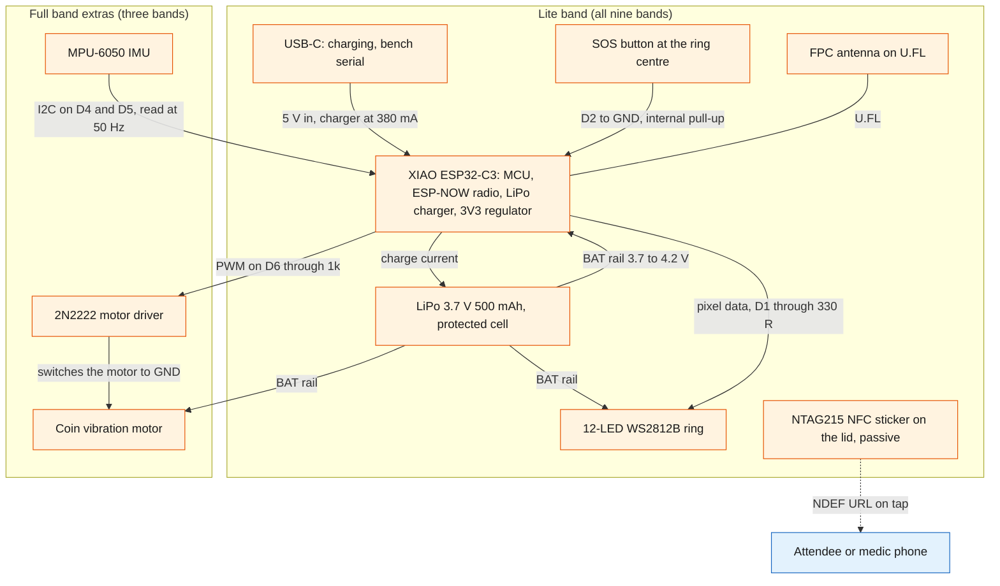
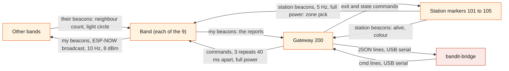
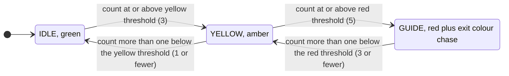
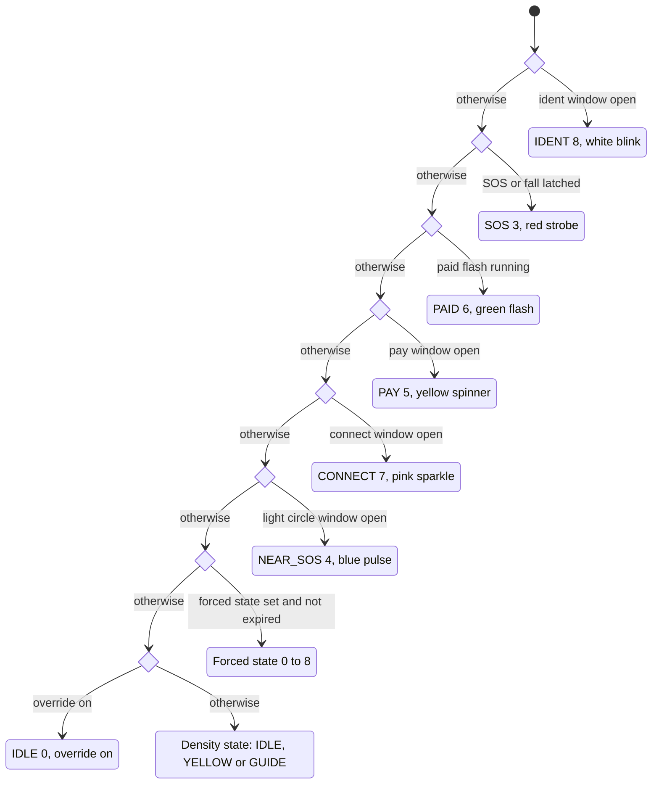

# Hardware

BandIt's physical layer is a small fleet of ESP32-C3 devices: nine wristbands, one USB gateway and two to five station markers. Each band counts the other bands it hears over ESP-NOW radio, turns that count into a colour on a 12-LED ring, and carries an SOS button and an NFC sticker; three "full" bands add an IMU for fall detection and a vibration motor. The gateway turns every radio packet into one line of text for the laptop and broadcasts the laptop's commands back to the bands. This file describes the devices, the radio, the on-band logic and the gateway wire protocol at system level; the hardware handoff remains the design of record for how the devices are built.

## Role in the system

Responsibilities of the physical layer:

- Sense crowd density locally. A band counts the bands it hears strongly and drives IDLE, YELLOW and GUIDE on its own, with no server round trip, so the safety colours keep working if the laptop dies.
- Raise and show emergencies locally: SOS (button hold), fall (full bands) and the blue light circle around a band in SOS.
- Report. Every band beacons its id, flags, neighbour count, zone, battery, light state and a packet counter ten times a second. The gateway relays each beacon it hears to the laptop.
- Know its zone: the station marker heard loudest.
- Obey the server: forced light states, exit colour, one-shot prompts (pay, paid, buzz, clear), live calibration and the override switch, all delivered as gateway commands.
- Carry the attendee's NFC token on the lid, which opens the attendee app and the medic view.
- Station markers anchor zones and glow their exit colour so "follow the colour" means something in the room.

Explicit non-responsibilities:

- No positions. A band knows its zone, never x/y. See [Safety](Safety.md) for how zone-level data becomes density and guidance.
- No pairwise record. A band counts neighbours but does not report who they are (listed as a proposed extension below).
- No decisions about exits, incidents or evacuation. Those are made in the `bandit` module ([SpacetimeDB](SpacetimeDB.md), [Safety](Safety.md)).
- No storage. Calibration pushed by command is lost when a band resets; the bridge re-sends it ([Gateway-Bridge](Gateway-Bridge.md)).
- No network, no encryption, no deep sleep, no over-the-air update in v0.1.
- The gateway does not buffer, retry or interpret. It is a transparent radio-to-serial bridge.
- Cameras are not hardware's concern beyond holding a phone on a stand (see the camera subsection, TBD -- LEO).

## Interfaces

| Interface | Direction | Counterpart | What flows | Transport |
|---|---|---|---|---|
| Band beacon | band to every node in range | other bands, gateway | packet type 1: id, flags, `neigh`, `zone`, `bat`, `state`, `seq` | ESP-NOW broadcast, Wi-Fi channel 1, 10 Hz plus 0 to 30 ms jitter, 8 dBm |
| Station beacon | station to bands and gateway | bands, gateway | packet type 2: station id, colour index in `state` | ESP-NOW broadcast, 5 Hz, full power |
| Gateway command | gateway to bands and stations | bands, stations | packet type 3: target, command, two arguments | ESP-NOW broadcast, each command repeated 3 times 40 ms apart, full power |
| Gateway uplink | gateway to laptop | `bandit-bridge` | one JSON object per heard packet, plus boot, ack and error lines | USB serial, nominal 115200 baud |
| Gateway downlink | laptop to gateway | `bandit-bridge` | text lines `cmd <target> <name> [arg] [arg2]` | USB serial |
| NFC token | band to phone | Attendee app ([Attendee-App](Attendee-App.md)); Medical-ID.md: the medic view | URL `https://<host>/t/BANDIT-0n` | NFC NDEF on an NTAG215 sticker, 1 to 2 cm |
| Button | wearer to band | the band itself | short press (confirm), 3 s hold (SOS) | GPIO with pull-up |
| Bench serial | band to and from laptop | hardware owner only, never the backend | status line once a second with the heard list and RSSIs; bench commands | USB-C serial |
| Overhead camera (TBD -- LEO) | phone to Vision service | [Vision](Vision.md) | video or counts, Leo decides | Leo decides |

## Design

### The fleet

| Unit | Count | Board | Carries | Does |
|---|---|---|---|---|
| Lite band | 6 | Seeed XIAO ESP32-C3 | 12-LED WS2812B ring, 500 mAh LiPo, SOS tactile switch under the ring centre, NTAG215 NFC sticker, printed case, ribbon strap | beacons, counts neighbours, shows colours, SOS, light circle, press to confirm |
| Full band | 3 | XIAO ESP32-C3 | everything above plus a GY-521 MPU-6050 IMU and a 10 mm coin vibration motor with a transistor driver | plus fall detection and buzz patterns; sets flag bit 4 so the server knows which bands can buzz |
| Gateway | 1 | XIAO ESP32-C3 on USB to the laptop, id 200 | nothing else | hears every beacon, prints one JSON line per packet, broadcasts commands at full power |
| Station marker | 2 to 5, ids 101 to 105 | ESP32-C3 SuperMini on USB power | a spare 12-LED ring | beacons its id so bands can pick a zone, glows its exit colour (breathe, chase or off) |

All nine bands run the same firmware; the only per-band differences are the compile-time band id and the full-band flag. A full band whose IMU or motor fails behaves as a lite band; nothing else depends on the extras. Band ids 1 to 9 map to `band.band_id` and NFC tokens `BANDIT-01` to `BANDIT-09` ([SpacetimeDB](SpacetimeDB.md)).

### Band block diagram

What is inside one band and how power and signals flow between the parts.

Points that matter to the rest of the system:

- Power path. One protected 500 mAh cell is wired directly to the XIAO's battery pads, with no connector. The XIAO charges it over USB-C and runs from it otherwise. The ring and the motor run from the battery rail, not from the XIAO's regulator, because the 5 V pin is live only on USB. There is no power switch: a band is on from the moment the battery is connected, and firmware deep sleep (not in v0.1) is the intended off switch.
- The button is a plain tactile switch on a GPIO with the internal pull-up. The firmware debounces it (a press shorter than 30 ms is ignored) and distinguishes a short press from a 3 s hold.
- The NFC sticker is passive and has no electrical connection to the board. It is read by a phone; the band never knows it was tapped. This is why "tap" always needs the button as the consent step ([Payments-Nessie](Payments-Nessie.md), [Attendee-App](Attendee-App.md)).
- The IMU is read over I2C at 50 Hz with the accelerometer at plus or minus 8 g; the motor is driven by PWM at about 70 percent duty so a full 4.2 V cell does not overdrive a 3 V motor.
- An optional resistor divider on A0 gives a battery percentage. It is not fitted by default (`HAS_VBAT_DIV 0`), so most bands report `bat` 255 (unknown) and never set the low-battery flag.

### Radio topology

Who hears whom. Every node is an ESP-NOW broadcaster on Wi-Fi channel 1; nobody joins a network and there are no unicast links, so "who hears whom" is decided only by signal strength.

- Bands transmit at 8 dBm (a quarter of full power) and the gateway and stations at full power. Band power is kept moderate so the RSSI threshold, not raw range, decides nearness, while the gateway must still hear every band across the room. The firmware comments warn against lowering band power further for the same reason.
- Bands listen to everything: other bands (for density and the light circle), stations (for zone) and the gateway (for commands). Stations listen only for commands; they ignore band beacons. The gateway listens to everything and transmits only commands.
- A packet is 14 bytes in a frame type whose payload limit is 250 bytes, so there is ample room for the extensions proposed below. Air time at the demo scale (about 115 packets a second across the fleet) is a few percent of the channel.
- The gateway also prints packets of type 3 it hears from another gateway. In v0.1 every gateway has id 200, so a second gateway would need its own id (see proposed extensions).

### Packet fields

One packed packet type carries band beacons, station beacons and commands. Fields are one byte unless stated.

| Field | Meaning | Band beacon (type 1) | Station beacon (type 2) | Command (type 3) |
|---|---|---|---|---|
| `magic` | constant that marks a BandIt packet; anything else on the channel is dropped | set | set | set |
| `type` | 1 band, 2 station, 3 command | 1 | 2 | 3 |
| `id` | sender: bands 1 to 9, stations 101 to 105, gateway 200 | band id | station id | 200 |
| `flags` | bit 0 SOS, bit 1 fall, bit 2 button pressed in the last second, bit 3 low battery, bit 4 full band | set | 0 | 0 |
| `neigh` | smoothed neighbour count, the density number | set | 0 | 0 |
| `zone` | id of the station heard loudest in the last 3 s, 0 if none | set | 0 | 0 |
| `bat` | battery percent, 255 unknown | set (255 on most bands) | 0 | 0 |
| `state` | light state 0 to 9 (table below) | set | exit colour index 1 to 6 | 0 |
| `seq` (two bytes) | per-sender packet counter, wraps at 65535 | set | set | set (gateway counter) |
| `target` | 0 every band, else a band or station id | unused | unused | set |
| `cmd` | command number 1 to 9 | unused | unused | set |
| `arg`, `arg2` | command arguments | unused | unused | set |

Light states, shared by the firmware, `bandit-protocol` and every dashboard legend:

| State | Name | Ring | Set by |
|---|---|---|---|
| 0 | IDLE | dim green breathing | density logic |
| 1 | YELLOW | solid amber | density logic |
| 2 | GUIDE | red background with a chase in the exit colour | density logic or a forced state |
| 3 | SOS | red strobe at 4 Hz, SOS buzz pattern on full bands | button hold, fall, or forced |
| 4 | NEAR_SOS | blue pulse (light circle) | hearing an SOS or fall beacon nearby |
| 5 | PAY | yellow spinner | `pay` command, 8 s |
| 6 | PAID | solid green flash, 1.5 s | `paid` command |
| 7 | CONNECT | pink sparkle | reserved; nothing sets it in v0.1 |
| 8 | IDENT | white blink at 2.5 Hz | 1.5 s at boot, or forced (used for claiming a band) |
| 9 | OFF | ring off | stations only in v0.1 (see the sentinel note under commands) |

Exit colours, used by GUIDE on bands and as the glow of stations: 1 blue, 2 magenta, 3 cyan, 4 white, 5 orange, 6 violet. A station's colour index defaults to its id minus 100.

### On-band logic

Everything below runs on the band with no server involved. The firmware loop is non-blocking and services the radio, the neighbour table, the button, the IMU, the motor and the ring in turn.

**Density counting and smoothing.** The band keeps a table of up to 32 band ids it has heard, each with the last RSSI and the time last heard. Every 250 ms it counts the entries heard in the last 2 s with RSSI at or above the neighbour threshold (-62 dBm, starting value, calibrate). The raw count feeds an exponential moving average with a 0.7 to 0.3 weight per 250 ms step, which gives a time constant of about one second, and the rounded average is the `neigh` field in every beacon. Smoothing is what stops the ring flickering when one packet is lost or one neighbour's RSSI wobbles across the threshold.

**Hysteresis and the density state.** The smoothed count drives a three-state machine with one count of hysteresis on the way down, so a count hovering at a threshold does not flap between colours.

Both thresholds are live-tunable with the `thresh` command. The checks run in order, so a band that jumps from empty to a crowd passes through YELLOW and reaches GUIDE in the same 250 ms step.

**Zone pick.** The band also keeps a table of up to 8 stations heard. Its zone is the station with the strongest RSSI among those heard in the last 3 s, or 0 if none. The zone is only reported; the band does nothing with it locally. [Safety](Safety.md) turns zone reports into per-zone density.

**Button.** A press released before 3 s is a short press: the band sets the press flag in its beacons for 1 s and gives a short buzz. The server treats a press flag that arrives while a prompt window is open as consent (press to confirm, [Gateway-Bridge](Gateway-Bridge.md)). Holding for 3 s toggles the SOS latch and plays the SOS buzz pattern; the hold fires once per press, so keeping the button down does not toggle again.

**SOS latch.** SOS is a latched boolean, not a timed state. While latched, the band's beacons carry flag bit 0 and its state is 3 regardless of density. The latch releases on another 3 s hold or on a `clear` command from the gateway. A fall sets a second latch (flag bit 1) that behaves like SOS; `clear` releases both.

**Fall detection (full bands).** The IMU is sampled every 20 ms. A total acceleration above 2.8 g marks an impact. If, within 3.5 s of the impact, the magnitude stays within 0.2 g of 1 g for 1.5 s (the person is still), the fall latch is set and the SOS buzz pattern plays. Both numbers are starting values, calibrate; the handoff's note is that a convincing stage fall is a hard arm stop followed by lying still, and that jumping should not trigger it.

**Light circle.** When a band hears another band's beacon with the SOS or fall flag at RSSI at or above the circle threshold (-58 dBm, starting value, calibrate), it opens a 1.5 s NEAR_SOS window that every further such beacon refreshes. Distant bands do not react, so the circle has an edge, and because a NEAR_SOS band does not itself set the SOS flag the circle does not spread from band to band. The circle threshold is stricter than the neighbour threshold on purpose: the circle should be the people within arm's reach, not the whole zone.

**Command handling.** Every command packet whose target is 0 or the band's own id is applied immediately; there is no acknowledgement from the band, which is why the gateway repeats each command three times and why the bridge reconciles against what the band reports ([Gateway-Bridge](Gateway-Bridge.md)).

| Command | What it changes on the band |
|---|---|
| `state` | sets the forced state and its hold time: `arg2` is tenths of a second, 0 means until released. The longest hold is 25.5 s. Forcing 9 (OFF) has no effect in v0.1 because the firmware uses 9 as the "nothing forced" marker. |
| `exit` | sets the exit colour index (1 to 6) used by GUIDE; out-of-range values are ignored |
| `clear` | releases the SOS and fall latches, the forced state and the light-circle window |
| `buzz` | plays pattern 1 short, 2 double or 3 long; lite bands accept it and do nothing |
| `pay` | opens an 8 s PAY window and plays a double buzz |
| `paid` | closes the PAY window and shows PAID for 1.5 s with a short buzz |
| `thresh` | replaces the yellow and red neighbour counts |
| `rssi` | replaces the neighbour and circle RSSI thresholds (sent as positive magnitudes) |
| `override` | 1 stops the density state machine (the band shows IDLE unless forced or in an emergency), 0 restores it |

### Band state precedence

A band can be in several conditions at once (latched SOS, a forced state, a pay window, a dense crowd). The ring shows exactly one state, chosen by a fixed precedence that the firmware evaluates top to bottom every frame. The diagram shows the order in which conditions are checked; the first that holds wins.

Consequences the backend relies on:

- SOS beats everything except IDENT, so a forced evacuation colour never hides a person calling for help. IDENT sits above SOS only because it is a short, deliberate "find this band" blink used at boot and for claiming.
- The light circle beats a forced state. During a medic approach the bands around the person stay blue while the rest of the zone is forced to GUIDE ([Safety](Safety.md)).
- A forced state beats the override flag and the density state, so manual override on the dashboard works whether the density logic is on or off.
- Prompt states (PAY, PAID) beat the light circle and forced states, so a payment or claim prompt is visible even during an evacuation drill. Whether that is wanted is an open question below.
- The state a band reports in `state` is the result of this ladder, not the density state. The bridge therefore compares a directive against the reported state only after discounting the states that legitimately outrank it ([Gateway-Bridge](Gateway-Bridge.md)).

### Gateway wire protocol

The gateway is a transparent bridge. It joins no network, holds no state beyond its own packet counter, and never interprets what it relays. The backend depends on this protocol, so it is specified here and consumed in [Gateway-Bridge](Gateway-Bridge.md).

**Radio to laptop.** One JSON object per heard packet, one per line, at a nominal 115200 baud. The XIAO's serial port is native USB, so the baud figure is nominal and the real throughput is far higher; a true UART at 115200 would be marginal for the fleet's roughly 115 lines a second of about 105 bytes each (rough estimate, not measured).

| Field | Meaning | Notes for the consumer |
|---|---|---|
| `t` | gateway uptime in milliseconds | resets when the gateway reboots; use the laptop clock for real time |
| `type` | 1 band beacon, 2 station beacon, 3 command echo from another gateway | type 3 lines carry only the sender id and `seq`; the command fields are not printed |
| `id` | sender id | band 1 to 9, station 101 to 105, gateway 200 |
| `rssi` | signal strength at the gateway, dBm | distance to the gateway, not density; useful for coverage checks only |
| `flags` | bit 0 SOS, bit 1 fall, bit 2 press in the last second, bit 3 low battery, bit 4 full band | the press bit is the consent signal; bit 3 appears only on bands with the divider |
| `neigh` | the band's smoothed neighbour count | the density number |
| `zone` | station heard loudest, 0 if none | zone-level position |
| `bat` | battery percent | 255 means unknown, which is most bands |
| `state` | light state 0 to 9 | for stations, the colour index 1 to 6 |
| `seq` | per-sender packet counter | gaps estimate loss; a reset means the sender rebooted |

Other lines: a boot line with the gateway's MAC and channel when the gateway starts (the bridge treats it as "gateway rebooted"), an `ack` line after each command with the numeric target, command, `arg` and `arg2` it broadcast, and an `err` line for a malformed or unknown command. The gateway does not buffer: if the laptop is not reading, lines are dropped, not queued.

Liveness rule for every consumer: a band is alive if heard within 2 s and is shown grey (stale) after 5 s.

**Laptop to radio.** One command per line, `cmd <target> <name> [arg] [arg2]`. The gateway broadcasts each command three times 40 ms apart, then prints the `ack` line. Arguments are one byte each.

| Name | Arguments | Valid targets | Effect on a band | Effect on a station |
|---|---|---|---|---|
| `state` | state 0 to 9, optional hold in tenths of a second (1 to 255; 0 or absent means until released) | band, station or 0 | forced state for the hold time; 9 is ignored (sentinel) | mode: 0 breathe, 1 chase, 9 off; any other value breathes; the hold is ignored |
| `exit` | colour 1 to 6 | band, station or 0 | GUIDE chase colour | glow colour |
| `clear` | none | band or 0 | releases SOS and fall latches, forced state and light circle | ignored |
| `buzz` | pattern 1 to 3, default 1 | band or 0 | buzz on full bands | ignored |
| `pay` | none | band | 8 s PAY prompt | ignored |
| `paid` | none | band | PAID for 1.5 s | ignored |
| `thresh` | yellow count, red count | band or 0 | live density thresholds | ignored |
| `rssi` | neighbour magnitude, circle magnitude (positive dBm values) | band or 0 | live RSSI thresholds | ignored |
| `override` | 0 or 1 | band or 0 | density state machine off or on | ignored |

Two hazards fall out of the fact that target 0 means every node, bands and stations alike:

- `exit` to target 0 recolours every station marker as well as every band. Exit colours must be sent per band and per station, never broadcast.
- `state 9` to target 0 turns every station off while doing nothing to bands. OFF for stations is a valid "exit blocked" signal, but only by station id.

`clear` also deserves care: it releases a band's SOS latch, so it must never be used merely to end a forced state on a band that is reporting SOS or fall. [Gateway-Bridge](Gateway-Bridge.md) owns these rules.

### Station marker behaviour

A station is a SuperMini with a ring on USB power, placed at an exit or a zone centre. It beacons its id at 5 Hz at full power with its colour index in `state`, so bands can rank stations by RSSI and pick a zone, and the gateway can show the station as alive. It glows its exit colour in one of three modes: breathe (open exit, the default), chase (come this way) and off (closed exit). It accepts only two commands, `exit` and `state`, addressed to its id or to 0, and ignores everything else. A station never listens to bands and never changes its own colour; if a zone's exit assignment changes, the server changes the colour through a directive for that station ([Safety](Safety.md), [Gateway-Bridge](Gateway-Bridge.md)). Because stations are USB powered they have no battery or liveness concerns beyond the cable; a station that loses power simply disappears from every band's zone pick after 3 s, and bands in that zone report zone 0 or drift to the next-loudest station.

### The NFC token

Each band carries an NTAG215 sticker (504 bytes, NDEF) with an anti-metal backing, placed on the lid over the electronics bay so it reads through the case. It holds one URL record, `https://<host>/t/BANDIT-0n`, where the token matches `band.nfc_token`. A phone reads it at 1 to 2 cm, including through a hand; recent iPhones read in the background with the screen on. The tag is static and can be cloned, which is accepted for v0.1: the token only opens a page, and every action that needs the wearer's consent (claiming the band, paying) requires a button press on the band within a server-timed window. The medic flow and the staff-only access rule live in [Medical-ID](Medical-ID.md); tap to join and claiming live in [Attendee-App](Attendee-App.md). The tags are locked read-only once the host name is final. A production version would use a tag with dynamic authentication (NTAG 424 DNA), listed under proposed extensions.

### Power budget and runtime

Figures from the handoff are design assumptions, not measurements.

| Load | Current | When |
|---|---|---|
| ESP32-C3 with the radio receiving continuously | about 80 to 110 mA | always (no power save in v0.1) |
| 12-LED ring at the firmware's brightness cap (64 of 255), one colour | about 40 mA | always, more for white and strobes |
| Coin motor | about 80 mA | only while buzzing (full bands) |
| IMU | a few mA | always (full bands) |

Call it about 150 mA average: a 500 mAh cell gives roughly 3 hours per charge, charged at 380 mA from empty in about 1.5 to 2 hours. A band on the bench drains at the same rate because there is no sleep. The cell's own protection circuit cuts power at about 2.5 V; the firmware's low-battery flag (bit 3, below 15 percent) exists only on bands fitted with the divider, so the fleet's battery view on the dashboard is "unknown" for most bands and runtime is managed by charging, not telemetry. Stations and the gateway run from USB and have no battery. The 12-LED ring at full white would draw about 0.7 A, which is why brightness is capped in firmware.

### Physical form

The band is a 64 by 42 mm printed "pill", 13.6 mm tall on the wrist, in two printed parts: a black base and a white lid that is thinned over the ring so the LEDs glow through it. The battery lies under the ring in the round head; the SOS switch stands on the battery at the exact centre of the ring and is pressed through a 6.5 mm hole in the lid ("hold the light for three seconds"). The electronics bay in the tail holds the XIAO upside down with its USB-C port in a window in the end wall, the IMU and motor under it on full bands, and the FPC antenna on the inside wall. A 16 mm woven ribbon threads through a channel under the floor, festival style, and closes with a one-way slide lock. The NFC sticker sits on the lid over the tail.

### The "compass" question

Earlier notes described the ring as a compass. No band in v0.1 carries a magnetometer (the MPU-6050 has an accelerometer and a gyroscope only), so a band cannot know which way the wearer is facing and the ring cannot point an arrow in a world direction. The ring can still show a rotating chase, but a chase has no fixed heading. Guidance in v0.1 is therefore colour matching: a band in GUIDE shows its exit colour, and the station marker at that exit glows the same colour, so the instruction is "walk toward the light that matches your wrist". The server decides which colour each zone's bands show ([Safety](Safety.md)). A heading sensor that would make a real arrow possible is listed under proposed extensions.

### Radio and sensing limits

| Limit | Why it exists | Consequence for the design |
|---|---|---|
| RSSI is noisy | multipath, antenna orientation, wrist position; packet-to-packet swings of several dB are normal | the band smooths over about a second and uses one count of hysteresis; the server treats `neigh` as an estimate and maps it through venue calibration ([Safety](Safety.md)) |
| Bodies absorb 2.4 GHz | expect about 10 dB less between two people standing back to back (handoff estimate) | nearness is a threshold on RSSI, not a distance; thresholds are calibrated on wrists at the venue, not on a bench |
| One-byte ids | the packet has one byte for the sender | at most 255 nodes on air; bands occupy 1 to 9 today, stations 101 to 105, gateway 200. Simulated ids from 1000 never go on air. A larger real fleet needs a wider id or a different scheme |
| Table sizes | a band remembers at most 32 bands and 8 stations | with 9 bands and 5 stations this is ample; a larger fleet needs eviction of stale entries |
| No encryption or authentication | ESP-NOW broadcast frames cannot be encrypted, and the packet has no signature | anyone on channel 1 with the packet layout can inject beacons or commands; accepted for a demo, listed under proposed extensions |
| The gateway does not buffer | it has no storage and prints as it hears | the bridge must read continuously; a paused reader loses packets, not time |
| No acknowledgement from bands | commands are fire and forget, repeated three times | the bridge reconciles against the state the band reports rather than trusting delivery |
| Zone, not position | a band knows only its loudest station | everything downstream is zone-level; pairwise proximity needs the neighbour-id extension |
| `rssi` at the gateway measures the gateway link | the field is distance to the gateway, not density | consumers never use it for density; it is a coverage diagnostic |
| Beacon rate times fleet size | 10 Hz per band on one channel | at the demo scale the channel is lightly loaded; hundreds of real bands would need a lower beacon rate |
| Channel 1 is shared with venue Wi-Fi | ESP-NOW frames compete with every access point and phone on the channel | expect some packet loss; the 2 s neighbour window tolerates it, and the bridge estimates loss from `seq` gaps |

### Calibration as a system process

Calibration turns the venue's radio environment into thresholds the bands can use and a mapping the server can use. It is a process over the whole system, not a firmware setting.

What is measured, in the demo spot with bands on wrists:

1. Spread out, about 2 m apart: the typical RSSI between neighbours (this is "far") and the resulting `neigh`, which should be 0 to 1.
2. In the 1.5 m taped square, about 4 people per square metre: the RSSI distribution and the `neigh` counts, which should put bands in YELLOW.
3. In the 1.2 m square, about 6 people per square metre: `neigh` should reach 5 or more on most bands, putting them in GUIDE.

Which live values change it: the `rssi` command sets the neighbour and circle RSSI thresholds and the `thresh` command sets the yellow and red counts. In the system these are rows of `fleet_config`, changed from the ops dashboard with `set_fleet_config` ([Ops-Dashboard](Ops-Dashboard.md)) and delivered by the bridge, which also re-sends them to any band that reboots because a band forgets them on reset ([Gateway-Bridge](Gateway-Bridge.md)). The observed mean `neigh` at each known density is recorded as `calibration_point` rows with `set_calibration`, which is the table the venue tick uses to map `neigh` to people per square metre ([Safety](Safety.md)). The bridge's raw log is the record of each capture. Baking the final thresholds into the firmware so a power cycle does not lose them is the hardware owner's choice and does not change the system's behaviour.

Inter-band RSSI, the number needed to choose the `rssi` thresholds well, is visible in v0.1 only on a band's bench serial status line, because beacons carry a count and not the individual RSSIs. The neighbour-id extension below would make it visible through the gateway.

### Proposed firmware extensions the backend would use

None of these is in v0.1. They are listed so the backend can leave room for them and so the hardware owner can judge their cost. Each is independent.

| Extension | Change on the band | What the backend would do with it |
|---|---|---|
| Neighbour ids with RSSI in each beacon | append the strongest 3 to 5 neighbour ids and their RSSIs to the packet (2 bytes each; the payload limit is 250 bytes) | pairwise encounters for [Social](Social.md), a direct measure of inter-band RSSI for calibration, and a cross-check of each band's `neigh` |
| On-band Bandshake | two bands whose wearers short-press within a second of each other while in contact (very high mutual RSSI) set a connect flag or carry the peer id; state 7 CONNECT already exists for the sparkle | a `connection_request` created from a band event rather than from the app ([Social](Social.md)) |
| Heading sensor | a magnetometer (or a 9-axis IMU in place of the MPU-6050) plus a new command carrying a bearing | a real compass arrow on the ring toward the assigned exit, replacing colour matching; the venue tick would send bearings per zone |
| Battery divider fitted by default | two resistors on A0 and the compile flag | real `bat` values and the low-battery flag on the fleet panel |
| Forcing OFF | a separate "forced" flag instead of using state 9 as the sentinel | the server could switch rings off for charging or storage |
| Longer timed holds | `arg2` in seconds instead of tenths, or a second command | fewer refreshes during a long evacuation (the bridge currently refreshes before 25.5 s) |
| Persisted calibration | store the live thresholds in flash and reload them at boot | the bridge's re-send after reboot becomes a safety net rather than a requirement |
| Distinct gateway ids | a per-gateway id (200, 201, ...) | a second gateway for coverage, with the bridge deduplicating by band id and `seq` |
| Rolling ids or authenticated packets | a per-event key and a short message authentication code, or ids that rotate on a schedule shared with the server | resistance to injected beacons and commands, and to passive tracking |
| Deep sleep | sleep when still for a long time, or on a gateway command | an off switch; multi-day storage without discharging |
| Dynamic NFC tags | NTAG 424 DNA with a per-tap authentication code | the token itself becomes hard to clone; the button remains the consent step |
| Station density | stations also count band beacons and report them | a fixed, body-independent density reading at each exit |
| Per-band IDENT colour | IDENT blinks a requested colour instead of white, set by a new argument on the `state` command or a new command, so each band in view shows a different colour for a few seconds | a camera can map ring colours in a photo to band ids for photo tagging ([Social](Social.md), [Vision](Vision.md), TBD -- LEO); identity still comes from the band, never from a face |

### Overhead camera (TBD -- LEO)

> (TBD -- LEO) Leo decides what the camera observes and how its results enter the system.

The hardware layer's part is small: one phone on a light stand looking straight down on the demo pit, with a second stand available. The vision research proposes a Rust process, `bandit-vision`, on the demo laptop that reads frames from the phone camera and reports into the `bandit` module (for example `report_zone_count`); that process, the images, counting people, detecting a person on the ground or property damage all belong to [Vision](Vision.md). From the hardware side, the only couplings are that the taped demo squares define the camera's region of interest, that the per-band IDENT colour extension above is what would let a camera tell bands apart, and that the handoff names the camera as the fallback density source if neighbour counting proves unstable ([Safety](Safety.md), Plan B).

## Failure modes and fallbacks

| Failure | Effect | Design answer |
|---|---|---|
| A band's battery is flat or reversed | the band is silent; the server sees it stale after 5 s | protected cells, charging before the demo; the band is shown grey and excluded from density; two spare bands |
| Antenna not clipped on, or the fleet is split across channels | a band hears almost nobody and reports `neigh` 0 | every node shares one channel constant; a band that never gains neighbours while others do is visibly wrong on the dashboard |
| RSSI noise at a threshold | colours flap | 1 s smoothing, one count of hysteresis, calibration at the venue, `rssi` and `thresh` live-tunable |
| Bodies shadow the radio | a band in the middle of a crowd hears fewer or weaker neighbours than expected | thresholds calibrated on wrists in the real formations; the server's zone density also uses the count of bands per zone ([Safety](Safety.md)) |
| A command is lost on air | the band keeps its old state | three repeats per command; the bridge re-sends while the reported state disagrees |
| A band reboots | it forgets calibration, exit colour, override and any forced state, and blinks white for 1.5 s | the bridge detects the `seq` reset and re-sends `fleet_config` and the band's directives |
| The gateway reboots or is unplugged | no lines on serial, every band goes stale on the dashboard; bands keep their local behaviour | bands never depend on the gateway for safety colours; the bridge reconnects and resyncs ([Gateway-Bridge](Gateway-Bridge.md)) |
| The laptop stops reading serial | the gateway drops lines | the bridge reads continuously on its own thread and logs everything it reads |
| A station loses power | bands in that zone report zone 0 or the next-loudest station within 3 s | the dashboard shows the station stale; zone density degrades gracefully; the venue tick ignores zone 0 for density |
| SOS triggers by itself | a permanent SOS from one band | a wiring fault (the switch legs on the same side read closed); confirm continuity unpressed before the demo |
| Fall fires on a jump | false fall latch | raise the impact threshold or lengthen the stillness window, both starting values |
| `exit` or `state 9` broadcast to target 0 | every station recoloured or switched off | the bridge never broadcasts these; it addresses bands and stations individually |
| Neighbour counting proves unstable at the venue | density colours cannot be trusted | Plan B in [Safety](Safety.md): the overhead camera (TBD -- LEO) becomes the density source and bands are driven by forced states |

## Dependencies

**Depends on**

- Nothing in software. The devices run with no laptop. Live thresholds come from `fleet_config` through the bridge when it is present.
- The firmware constants file is mirrored by the `bandit-protocol` crate ([Gateway-Bridge](Gateway-Bridge.md)); a change to packet layout, states, flags or commands must land in both.

**Used by**

- [Gateway-Bridge](Gateway-Bridge.md): consumes the wire protocol and the state precedence.
- [Safety](Safety.md): relies on local density, SOS, fall and light-circle behaviour, on zone reports and on forced states and exit colours.
- [Attendee-App](Attendee-App.md) and [Medical-ID](Medical-ID.md): the NFC token and the IDENT prompt.
- [Payments-Nessie](Payments-Nessie.md): the PAY and PAID prompts and the press flag.
- [Simulator](Simulator.md): imitates the band's density, smoothing and state precedence for virtual bands.
- [Social](Social.md): zone-level presence now; the neighbour-id extension later.
- [Ops-Dashboard](Ops-Dashboard.md): the fleet panel, state legend, calibration controls and manual override.

**If you delete this file**

- There is no physical layer. [Gateway-Bridge](Gateway-Bridge.md) has nothing to read and should be deleted too; [Simulator](Simulator.md) becomes the only source of `ingest_band_reports`.
- Remove the Band, Station marker and Gateway rows from the component table in [Architecture](Architecture.md) and the device nodes from its diagrams.
- Remove the NFC tap entry point from [Attendee-App](Attendee-App.md) and [Medical-ID](Medical-ID.md), and the press-to-confirm step from [Payments-Nessie](Payments-Nessie.md).
- In [Safety](Safety.md), remove the band-based density estimate and the light circle; the camera estimate (TBD -- LEO) would stand alone.

## Open questions

- Should PAY and PAID outrank the light circle and forced states, as the firmware's ladder does today, or should emergencies suppress prompts?
- Is forcing OFF on bands wanted for the demo (charging on the bench with rings dark)? If so the sentinel needs the small firmware change listed above.
- How much packet loss does the venue's Wi-Fi on channel 1 cause at the demo spot? This decides whether the 2 s neighbour window is enough and whether a second gateway is needed.
- Do the three full bands always go to the people whose fall is in the demo script, so that fall detection is guaranteed to be on a wrist that will fall?
