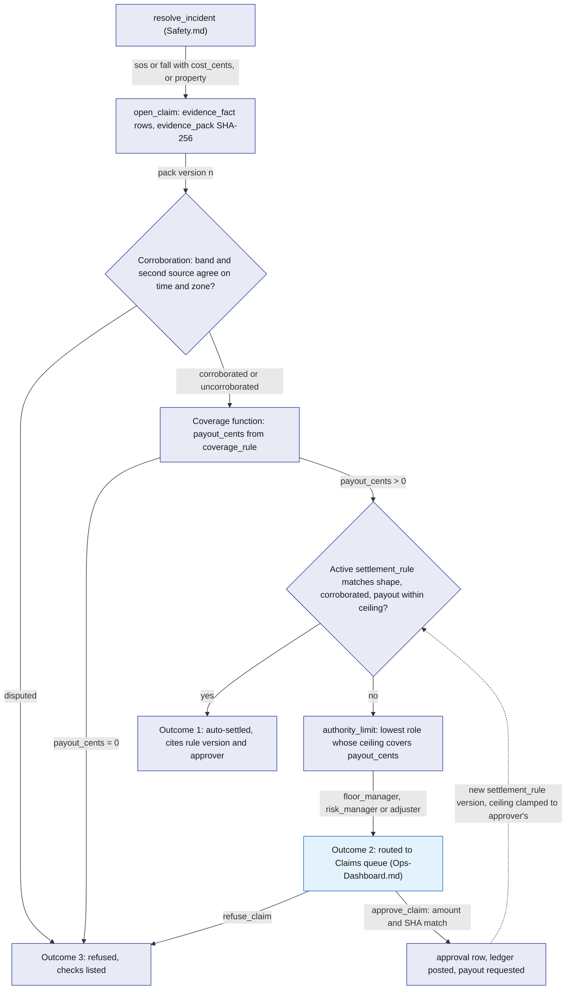
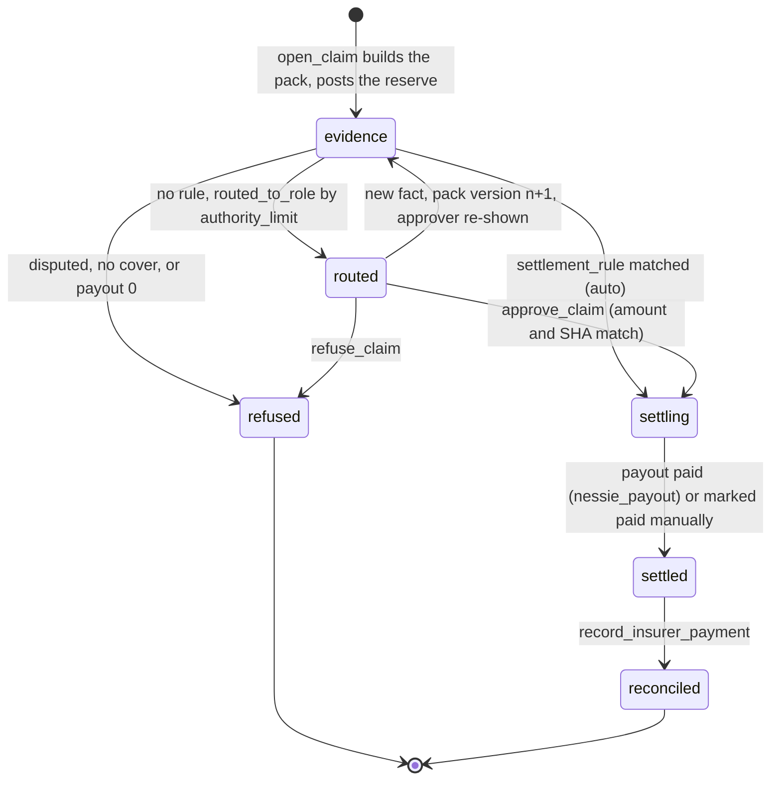
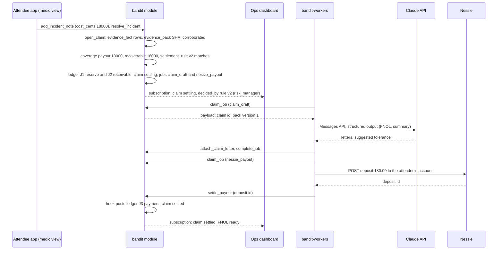
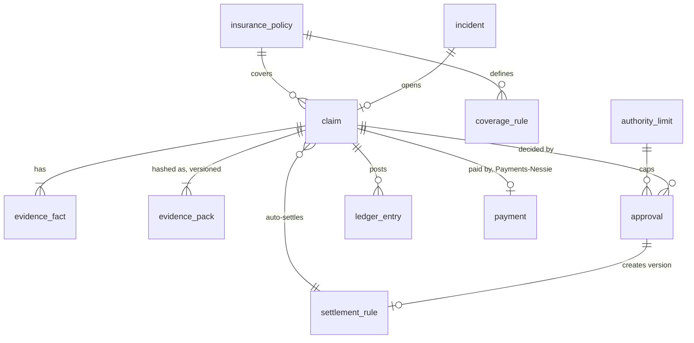

# Hyphenate

Hyphenate is BandIt's incident-to-claim workflow, built for the "autonomous systems for finance" track. It turns a resolved safety incident into a verified evidence pack, decides in code whether the venue's insurance covers it and for how much, and then takes one of three routes: settle it automatically under a rule a human approved earlier, route it to the named person whose authority covers the amount, or refuse it and show what was checked. Money moves on a double-entry ledger (reserve, insurer receivable, claimant payment, reconciliation), and Claude drafts the letters. The model reads and writes words; code decides money, coverage and routing.

## Role in the system

Responsibilities:

- Open a claim from a resolved `sos` or `fall` incident that carries a treatment cost, or from a `property` incident (Vision, TBD -- LEO).
- Build and hash the evidence pack from rows the safety system already wrote; never from new sensing.
- Check corroboration (two independent sources agree on time and zone) in code.
- Compute coverage and amounts in integer cents from `coverage_rule`.
- Decide the outcome: auto-settle, route to a named approver, or refuse.
- Learn: turn each human approval into a versioned `settlement_rule` with a ceiling clamped to the approver's authority.
- Post balanced `ledger_entry` rows for every money movement and keep the claim status honest about them.
- Draft the first notice of loss, the claim summary and recovery letters through `bandit-workers` jobs.
- Pay the claimant through [Payments-Nessie](Payments-Nessie.md) when that component is present.

Non-responsibilities:

- Detecting incidents, freezing snapshots, recording witnesses: [Safety](Safety.md).
- Storing or extracting medical data: [Medical-ID](Medical-ID.md). Hyphenate only reads a card into evidence.
- Camera frames, person-on-ground and property-damage detection, and the per-incident `vision_assessment`: [Vision](Vision.md) (TBD -- LEO, proposed as the Rust process `bandit-vision`). Hyphenate only reads the assessment row into evidence.
- Calling banks: [Payments-Nessie](Payments-Nessie.md). Hyphenate requests a payout and records the result.
- Prompts, model choice, recording and replay: [Anthropic-Agent](Anthropic-Agent.md).
- Screens: the Claims queue panel is in [Ops-Dashboard](Ops-Dashboard.md).

## Interfaces

| Interface | Direction | Who | What flows | Transport |
|---|---|---|---|---|
| Hook in `resolve_incident` | in | `bandit` module (Safety.md) | incident id when a resolved `sos`/`fall` has a note with `cost_cents`, or a resolved `property` incident | same transaction, module-internal call to the `open_claim` logic |
| `open_claim` | in | roles `ops`, `floor_manager`, `risk_manager`, `adjuster` | incident id; opens a claim by hand for an incident the hook skipped | SpacetimeDB reducer |
| `approve_claim` | in | the routed approver role | claim id, amount seen, pack SHA seen, optional rule ceiling, learn flag | reducer |
| `refuse_claim` | in | the routed approver role, `risk_manager`, `adjuster` | claim id, pack SHA seen, reason | reducer |
| `record_insurer_payment` | in | `risk_manager`, `adjuster` | claim id, amount received in cents, insurer reference | reducer |
| `mark_claim_paid_manually` | in | `risk_manager`, `ops` | claim id, payment reference; ledger-only payout | reducer |
| `request_recovery_letter` | in | `risk_manager`, `adjuster` | claim id, counterparty name and contact | reducer; enqueues `recovery_letter` |
| `retire_settlement_rule` | in | `risk_manager`, `owner` | rule id | reducer; new version with ceiling 0 |
| `upsert_insurance_policy`, `upsert_coverage_rule`, `set_authority_limit` | in | `owner`, `risk_manager` (setup) | policy, cover limits and deductibles, role ceilings | reducers, seeded from the venue file |
| `attach_claim_letter` | in | role `worker` | job id, claim id, letter kind, `blob_ref` id, suggested tolerance | reducer; rejects a stale lease |
| Hook in `settle_payout` | in | `bandit` module (Payments-Nessie.md) | payment id with `ref_kind = claim` when the payout is paid or dead | module-internal call |
| Jobs `claim_draft`, `recovery_letter` | out | `bandit-workers` | payload: claim id, evidence pack version; result: letter blobs | `job` table, `claim_job` / `complete_job` |
| `request_payout` | out | `bandit` module (Payments-Nessie.md) | attendee id, amount in cents, `ref_kind = claim`, claim id, memo | module-internal call |
| Claims queue, ledger, rules | out | Ops dashboard (roles above) | `claim`, `evidence_fact`, `evidence_pack`, `approval`, `ledger_entry`, `settlement_rule`, `authority_limit` | SpacetimeDB subscription |
| `vision_assessment`, `camera`, `property_event` rows | in | `bandit-vision` (Vision.md, TBD -- LEO) | per-incident judgment (confirmed, confidence, description, frame blob refs, `model_call` id), the camera's zone, property events | tables read by `open_claim` |
| Letters | out | Ops dashboard | FNOL, summary and recovery letters as blobs | `bandit-api` blob download, caller identified by its `api_session` token (SpacetimeDB.md); letter blobs carry access class `staff` |

## Design

### Which policy pays

One answer for the demo: the venue's general liability policy. It has medical-payments cover (pays reasonable first-aid and treatment costs for a guest hurt on the premises, no fault needed) and property cover for the venue's own equipment, each with a per-claim limit, an aggregate limit for the event and a deductible. The attendee's own health plan and any vendor's insurer are never the payer in BandIt. The attendee's medical card is evidence, not a policy. A vendor only ever receives a recovery letter worded as a question.

### Trigger

A claim opens from an incident, never from a form. Two triggers:

1. A `sos` or `fall` incident is resolved and at least one `incident_note` on it carries `cost_cents` (the medic's logged treatment cost). `resolve_incident` ends with one separable Hyphenate hook that runs the `open_claim` logic in the same transaction, so the claim can never drift from the incident it came from.
2. A `property` incident is resolved with a note carrying the repair or replacement cost. Staff open a property incident from the property-damage button on the Ops dashboard, which calls `open_incident` with kind `property` ([Safety](Safety.md)). With Vision (TBD -- LEO), `bandit-vision` then assesses the scene and writes `report_property_event` with the incident id, the frames and a `vision_assessment`, and those become evidence facts; a detector event that arrives with no incident id opens the `property` incident itself, with `opened_by` `vision`. Without Vision the button still opens the incident, and such a claim has no band source and no assessment, so it can never auto-settle (see corroboration).

One incident opens at most one claim (`claim.incident_id` is unique). A second cost note after the claim opened rebuilds the evidence pack as a new version instead of opening a second claim.

### Evidence pack

The pack is a set of `evidence_fact` rows plus one `evidence_pack` row that hashes them. Code builds it inside `open_claim` from rows that already exist, which is why the safety path never waits on it and why it costs nothing extra at incident time.

Each `evidence_fact` row:

| Field | Meaning |
|---|---|
| `claim_id`, `pack_version` | which claim and which pack build the fact belongs to |
| `source` | one of `band_report`, `incident_snapshot`, `light_circle`, `staff_note`, `vision_assessment` (TBD -- LEO), `medical_card`, `policy` |
| `key`, `value` | what the fact says, as text: for example `fall_flag` = `1`, `zone_id` = `102`, `cost_cents` = `18000` |
| `observed_at` | the time the fact is about (the beacon time, the note time, the frame time) |
| `read_at` | when code or the model read it into the pack |
| `reader` | `code` or `model`; money and routing use only `code` facts |
| `ref` | how to fetch it again: table and row id, or the blob SHA-256 for a PDF or frame |

Sources and what they contribute:

| Source | Rows read | Facts |
|---|---|---|
| `band_report` (as frozen in `incident_snapshot`, since the live row is overwritten) | the subject band's last report at incident open | flags (SOS, fall), `neigh`, `zone`, `state`, report time |
| `incident_snapshot` | the snapshot frozen in `ingest_band_reports` | zone density estimate and risk level, bands present, camera coverage when Vision exists |
| `light_circle` | `incident_band` rows with role witness | witness band ids, their zone and state 4 times |
| `staff_note` | `incident_note` rows | author role, note time, text, `cost_cents` |
| `vision_assessment` (TBD -- LEO) | the `vision_assessment` row for the incident, written by `bandit-vision` through `submit_vision_assessment` a few seconds after the flag | confirmed yes/no, confidence, description and recommended action (reader `model`, since Claude wrote them; `ref` is the `model_call` id); each frame's capture time and the camera's zone from its `camera` row (reader `code`; `ref` is the frame's blob SHA-256) |
| `medical_card` | `medical_card` of the subject attendee | card status, emergency contact present, conditions relevant to the note (reader `model`, via the `claim_draft` job); the read is logged in `medical_access_log` with `via = claim` |
| `policy` | `insurance_policy`, `coverage_rule` | policy number, cover kind, limit, deductible, aggregate remaining at open |

The `evidence_pack` row holds `claim_id`, `version`, `fact_count`, `sha256`, `built_at`, `corroboration` (below) and `checks`, a short text list of every comparison made and its result. The SHA-256 is computed in the module over the facts of that version ordered by id, each serialised as its fields joined in a fixed order, so an auditor can recompute it from the rows. A pack is never edited: a new fact (a late camera frame, a second note) creates version n+1, and every approval records the SHA it was shown, which is what makes the stale check below possible.

### Corroboration rule (code)

Two independent sources must agree on time and zone before a claim can settle without a person. The band is always the first source. The second source depends on what exists:

| Second source | Agree on time | Agree on zone |
|---|---|---|
| `vision_assessment` (TBD -- LEO), when Vision is present | `confirmed` is yes, and the frames' capture times lie within 120 s of the band's fall or SOS time (starting value, calibrate) | the camera's zone (its `camera` row) equals the band's zone |
| Without Vision: staff note plus light-circle witnesses | the first `incident_note` by the assigned medic is written while the incident is open or within 30 min of resolution (starting value) | at least 2 witness bands (starting value) in `incident_band` whose zone at state 4 equals the subject band's zone |

The assessment's `confirmed` flag is a model judgment, so code uses it only as a yes/no gate: yes lets the time and zone checks run, no counts as disagreement. Its confidence is recorded as a fact and shown to people, but no threshold on it ever decides money.

Outcomes, stored in `evidence_pack.corroboration`:

- `corroborated`: both agree. Eligible for auto-settle.
- `uncorroborated`: no second source exists (no assessment, no witnesses, or no medic note). Routed to a person, who decides with their own eyes; never auto-settled.
- `disputed`: a second source exists and disagrees on time or zone, or the assessment says the fall was not confirmed. The claim is refused, and `checks` lists each comparison with both values, so the refusal shows everywhere it looked.

The rule is deliberately dumb: equality on zone id and a window on time. It is the part a judge, an adjuster or an auditor can re-run by hand.

### Coverage and amounts

All amounts are integer cents, USD. A pure function in the module computes them from the matching `coverage_rule` rows; the model never sees a figure before code has fixed it.

| `coverage_rule` field | Meaning | Starting values (venue sets them) |
|---|---|---|
| `policy_id` | which `insurance_policy` | the venue's policy |
| `kind` | `medical_payments` or `property` | both rows seeded |
| `incident_kinds` | which incident kinds it applies to | medical: `sos`, `fall`; property: `property` |
| `per_claim_limit_cents` | most paid for one claim | medical 500000 ($5,000); property 1000000 ($10,000) |
| `aggregate_limit_cents` | most paid under this cover for the event | medical 2500000; property 5000000 |
| `deductible_cents` | the venue's share per claim | medical 0; property 50000 ($500) |
| `active` | rule in force | true |

Computation, in order:

1. `cost_cents` = sum of `cost_cents` over the incident's notes.
2. `payout_cents` = min(`cost_cents`, `per_claim_limit_cents`), then min with the aggregate remaining on `insurance_policy.aggregate_used_cents`. This is what the claimant receives.
3. `recoverable_cents` = max(`payout_cents` - `deductible_cents`, 0). This is what the insurer owes the venue.
4. `venue_cost_cents` = `payout_cents` - `recoverable_cents`.
5. No active rule for the incident kind, or `payout_cents` = 0: the claim is refused with the rule (or its absence) in `checks`.

For a `property` claim the claimant is the venue's repair vendor, so `payout_cents` is what the venue pays the vendor and `recoverable_cents` is what it claims back.

### Three outcomes and the learning loop

The question this diagram answers: which of the three routes does a claim take, and how does a human decision change the next claim's route?

Outcome 1, auto-settle. Fires only when all of these hold: corroboration is `corroborated`; an active `settlement_rule` has the same shape (incident kind, cover kind, and zone when the rule names one); `payout_cents` is at or below the rule's `ceiling_cents`. The claim records `decided_by = rule`, the rule id and version, and the approver who created it, so the dashboard can say "settled under rule v2, approved by the risk manager on Saturday".

Outcome 2, route. Everything else with a positive payout goes to the lowest role in `authority_limit` whose ceiling covers `payout_cents`. The claim stores `routed_to_role`, and the Claims queue filters by the viewer's role. Nothing moves until that person acts.

Outcome 3, refuse. Disputed evidence, no cover, zero payout, or a human refusal. The claim keeps its pack and `checks`, so "why not" is always answerable.

### Authority matrix and learned rules

`authority_limit` rows (one per role; the venue edits them at setup; starting values, set by the venue):

| Role | `ceiling_cents` | Who this is |
|---|---|---|
| `floor_manager` | 50000 ($500) | venue floor manager on shift |
| `risk_manager` | 500000 ($5,000) | the venue's risk manager |
| `adjuster` | none (no ceiling) | the insurer's adjuster |

A `settlement_rule` is only ever created by an approval, never typed in. When `approve_claim` succeeds and the approver did not clear the learn flag, code writes a rule with:

| Field | Value |
|---|---|
| `shape`: `incident_kind`, `cover_kind`, `zone_id` (optional) | copied from the claim; zone left empty unless the approver ticked "this zone only" |
| `requires_corroborated` | always true |
| `ceiling_cents` | min(requested ceiling, approver's `authority_limit.ceiling_cents`); requested defaults to the approved `payout_cents`; the model's suggested tolerance from `claim_draft` may be shown as the default, and code clamps it the same way |
| `approver`, `approver_role`, `approval_id`, `created_at` | the decision that made it |
| `version`, `status` | n+1 for the same shape; the earlier version becomes `superseded` |

The rule inherits the approver's ceiling and nothing more: a floor manager's approval can never create a rule that settles $600. Contradictions never overwrite: a refusal of a shape that has an active rule writes a new version with `ceiling_cents` = 0, and `retire_settlement_rule` does the same, so the shape routes to a person again until someone approves it again. Rule history is therefore the full audit trail of policy.

### Approval, fail closed

The approver sees a grid: cost, limit, deductible, payout, recoverable, venue cost, the pack SHA (first 8 characters) and the checks. `approve_claim` carries the amount and the SHA that were on the screen. The reducer:

1. checks the caller holds the claim's `routed_to_role` or a higher one in the matrix;
2. recomputes `payout_cents` from the current `coverage_rule` rows and compares it with the stored value and with the amount seen;
3. compares the SHA seen with the current `evidence_pack.sha256`;
4. on any mismatch, fails with `stale` and changes nothing; the dashboard reloads and the person looks again;
5. otherwise writes `approval` (claim, approver identity and role, amount, SHA, rules that fired, learn flag, time), posts the ledger, creates the rule version, requests the payout and moves the claim to `settling`.

Fail closed is the whole point: a pack rebuilt by a late camera frame, or a coverage rule edited mid-review, makes the approval on screen void rather than silently approving a different claim.

### Claim lifecycle

The question this diagram answers: which statuses can a claim be in, and what moves it?

`settling` also carries a `payout_failed` flag when the `nessie_payout` job dies after its attempts; the claim stays in `settling` with the flag until `mark_claim_paid_manually` or a new payout request (see Payout).

### Ledger

`ledger_entry` rows are double-entry: each journal (a group of rows sharing `journal_id`) has debits equal to credits, and the posting function rejects a journal that does not balance. Accounts are a fixed set of names in `ledger_entry.account`:

| Account | Kind |
|---|---|
| `claims_expense` | expense |
| `claims_reserve` | liability (what the venue expects to pay claimants) |
| `insurer_receivable` | asset (what the insurer owes the venue) |
| `cash` | asset |

Fields per row: `claim_id`, `journal_id`, `account`, `debit_cents`, `credit_cents`, `memo`, `posted_at`, `posted_by` (reducer name).

Journals in a claim's life:

| Journal | When | Debit | Credit | Amount |
|---|---|---|---|---|
| J1 reserve | `evidence` (claim opened) | `claims_expense` | `claims_reserve` | `payout_cents` |
| J1r reserve reversal | claim refused after J1 | `claims_reserve` | `claims_expense` | `payout_cents` |
| J2 receivable | approval or auto-settle | `insurer_receivable` | `claims_expense` | `recoverable_cents` |
| J3 claimant payment | payout paid | `claims_reserve` | `cash` | `payout_cents` |
| J4 reconciliation | `record_insurer_payment` | `cash` | `insurer_receivable` | amount received; a difference from `recoverable_cents` posts a fifth line to `claims_expense` so the receivable closes |

This is what "money moving" means on the dashboard: four postings, each with a reason, each traceable to a claim and a pack SHA. The ledger panel sums by account and the totals are what a finance reviewer expects to see: an expense, a liability that falls when the claimant is paid, a receivable that falls when the insurer pays.

### Letters

Claude drafts, code checks, a person sends. Two job kinds:

| Job | When enqueued | Input (payload) | Output |
|---|---|---|---|
| `claim_draft` | at auto-settle or approval | claim id, pack version | two blobs: the first notice of loss (FNOL) to the insurer, and a one-paragraph claim summary for the approver's screen; plus an optional suggested rule tolerance in cents |
| `recovery_letter` | `request_recovery_letter` on a `property` claim | claim id, pack version, counterparty name and contact | one blob: a letter to the vendor or contractor |

The worker builds the prompt from the pack facts only (Anthropic-Agent.md owns the prompt, model `claude-opus-5-5`, structured output schema and recording in `model_call`). Two guardrails live in code: every dollar figure in a letter must equal one of the amounts in the payload, otherwise the worker fails the job rather than attaching it; and the recovery letter is worded as a query ("our records show a speaker at Stage B was damaged at 23:40 while your crew was striking the stage; could you tell us what you saw?"), never as an accusation, which the worker enforces by rejecting output that assigns fault. The worker writes each letter to the blob store and calls `register_blob` with the `worker` role and access class `staff` (SpacetimeDB.md; the worker's blob path is in Rust-Backend.md), so only staff can download it through `bandit-api`. `attach_claim_letter` stores the `blob_ref` id on the claim (`fnol_blob_id`, `summary_blob_id`, `recovery_blob_id`) and rejects a stale lease. The FNOL is marked sent by the adjuster or risk manager from the dashboard; BandIt does not email anyone.

If Anthropic-Agent.md is removed, `claim_draft` and `recovery_letter` are replaced by a fixed template filled from the same payload by code. Settlement does not depend on letters.

### Payout

When a claim reaches `settling`, the module calls `request_payout` ([Payments-Nessie](Payments-Nessie.md)) with the attendee, `payout_cents`, `ref_kind = claim` and the claim id. The payout is a deposit to the attendee's Nessie account, done by the `nessie_payout` job. `settle_payout` ends with one separable Hyphenate hook: when a payout with `ref_kind = claim` is paid, post J3 and move the claim to `settled`; when it is dead, set `payout_failed`.

When Payments-Nessie.md is not kept, or a payout has failed, the payout is ledger-only: `mark_claim_paid_manually` posts J3 with the reference typed by the risk manager and moves the claim to `settled`. The ledger and the letters are the same either way; only the cash leg differs.

### Worked flow: the hero case

Illustrative numbers. At 22:14 an attendee wearing band 7 (a full band) falls near Stage B, zone 102. The MPU-6050 sees the impact and stillness; the band's beacon carries the fall flag. Inside `ingest_band_reports` the incident opens as `fall`, and the snapshot freezes zone 102's state and the bands present. Bands 2, 4 and 9 hear the beacon above the circle threshold and pulse blue; they are recorded in `incident_band` as witnesses. If Vision is present (TBD -- LEO), `bandit-vision` sends Claude the frames around 22:14 and writes a `vision_assessment` with confirmed yes a few seconds later. A medic acknowledges, is assigned, treats a wrist sprain, and at 22:26 adds a note "cold pack and wrap, first aid" with `cost_cents` 18000. At 22:31 the medic resolves the incident.

The question this diagram answers: what happens, in which component, between the medic resolving the incident and the claim being settled with letters drafted?

Step by step, in code:

1. Pack: eleven facts. From the snapshot: fall flag 1, zone 102, `neigh` 6, risk `watch`, report time 22:14:05. Light circle: bands 2, 4, 9 in zone 102 at 22:14. Staff note: medic, 22:26, text, 18000. Medical card: present, confirmed, emergency contact present (reader `code`; conditions text is read by the model later for the summary). Policy: medical payments, limit 500000, deductible 0, aggregate remaining 2500000. Vision assessment (TBD -- LEO) when Vision exists: confirmed yes, confidence, the frame SHAs, camera zone 102. SHA-256 computed; `checks` records "note time 22:26 within 30 min of open 22:14: yes; witnesses in zone 102: 3 of 3: yes".
2. Corroboration: `corroborated`.
3. Coverage: cost 18000; payout min(18000, 500000, aggregate) = 18000; recoverable 18000 - 0 = 18000; venue cost 0.
4. Rule: an active `settlement_rule` v2 for shape (`fall`, `medical_payments`, any zone), `requires_corroborated`, ceiling 25000, created on Saturday when the risk manager approved a $120 first-aid claim and accepted the suggested tolerance of $250 (clamped against the risk manager's 500000 ceiling, so 25000 stands). 18000 is within 25000: auto-settle.
5. Ledger: J1 debit `claims_expense` 18000, credit `claims_reserve` 18000. J2 debit `insurer_receivable` 18000, credit `claims_expense` 18000.
6. Jobs: `claim_draft` and, through `request_payout`, `nessie_payout` for 18000.
7. Workers: the FNOL and summary are attached; the deposit lands; `settle_payout` posts J3 debit `claims_reserve` 18000, credit `cash` 18000; the claim is `settled`.
8. Later the adjuster records the insurer's payment: J4 debit `cash` 18000, credit `insurer_receivable` 18000; the claim is `reconciled`.

Same night, 23:40: a speaker at Stage B is broken. The stage manager presses the property-damage button, which opens a `property` incident; with Vision (TBD -- LEO), `bandit-vision` then writes a `property_event` on that incident with Claude's description and the frames. The stage manager's note carries 240000 ($2,400). Coverage: property, payout 240000, recoverable 240000 - 50000 = 190000, venue cost 50000. No rule matches (no approval of that shape yet), and 240000 is above the floor manager's 50000, so the claim is routed to `risk_manager` with the assessment and frames (TBD -- LEO), the zone's bands present at 23:40 and the staff note attached. The risk manager approves; a rule v1 for (`property`, `property`, zone 102 only) with ceiling 240000 is created (clamped to 500000, so it stands), and `request_recovery_letter` to the staging contractor enqueues a letter worded as a query.

### Tables

The question this diagram answers: how do the nine Hyphenate tables relate to each other and to the core incident?

| Table | One row is | Key fields |
|---|---|---|
| `insurance_policy` | the venue's policy for the event | insurer name, policy number, period start and end, FNOL contact, `aggregate_used_cents` per cover kind (updated by code at settlement) |
| `coverage_rule` | one cover under a policy | see Coverage and amounts |
| `claim` | one claim for one incident | `incident_id` (unique), `attendee_id` (empty for property), `policy_id`, `cover_kind`, `status`, `decided_by` (`rule` or `approver`), `routed_to_role`, `settlement_rule_id` and version, `cost_cents`, `payout_cents`, `recoverable_cents`, `venue_cost_cents`, `pack_version`, `payout_payment_id`, `payout_failed`, `fnol_blob_id`, `summary_blob_id`, `recovery_blob_id`, `fnol_sent_at`, `opened_at`, `decided_at`, `settled_at`, `reconciled_at`, `refusal_reason` |
| `evidence_fact` | one fact in a pack | see Evidence pack |
| `evidence_pack` | one hashed build of a claim's facts | `claim_id`, `version`, `fact_count`, `sha256`, `built_at`, `corroboration`, `checks` |
| `settlement_rule` | one version of a learned rule | shape fields, `requires_corroborated`, `ceiling_cents`, `approver`, `approver_role`, `approval_id`, `version`, `status` (`active`, `superseded`), `created_at` |
| `authority_limit` | one role's ceiling | `role`, `ceiling_cents` (empty means no ceiling), `updated_by`, `updated_at` |
| `approval` | one human decision | `claim_id`, `approver`, `approver_role`, `decision` (`approve` or `refuse`), `amount_seen_cents`, `pack_sha_seen`, `rules_fired` (text), `learn`, `requested_ceiling_cents`, `reason`, `decided_at` |
| `ledger_entry` | one line of one journal | see Ledger |

### Reducers

| Reducer | Role | Does |
|---|---|---|
| `open_claim` | `ops`, `floor_manager`, `risk_manager`, `adjuster`; also called by the `resolve_incident` hook | builds the pack, corroboration, coverage, J1, and the outcome |
| `approve_claim` | the routed role or higher | stale checks, `approval`, J2, rule version, `request_payout`, status `settling` |
| `refuse_claim` | the routed role or higher | `approval` with `decision = refuse`, J1r, rule version with ceiling 0 if one was active, status `refused` |
| `record_insurer_payment` | `risk_manager`, `adjuster` | J4, `reconciled` |
| `mark_claim_paid_manually` | `risk_manager`, `ops` | J3 with a typed reference, `settled` |
| `request_recovery_letter` | `risk_manager`, `adjuster` | enqueues `recovery_letter` |
| `attach_claim_letter` | `worker` | stores blob ids and the suggested tolerance; rejects a stale lease |
| `retire_settlement_rule` | `risk_manager`, `owner` | new version with ceiling 0 |
| `upsert_insurance_policy`, `upsert_coverage_rule`, `set_authority_limit` | `owner`, `risk_manager` | setup rows |

### Measuring it

[Simulator](Simulator.md) plants incidents: genuine falls with a medic note and witnesses, and decoys (a fall flag with no note, a note with no band data, witnesses in a different zone). Report precision (auto-settled claims that were genuine divided by all auto-settled), recall (genuine claims that settled or reached an approver divided by all genuine) and dollars wrongly settled (the sum of `payout_cents` auto-settled on decoys). The target for the last number is zero, because the route and refuse paths exist exactly so that auto-settle fires only on corroborated shapes.

## Failure modes and fallbacks

| Failure | Effect | Design answer |
|---|---|---|
| Medic resolves without a cost note | no claim | the hook skips it; ops can add a note later and call `open_claim` by hand |
| Vision absent (TBD -- LEO) | no assessment facts, no `property_event` rows | corroboration falls back to staff note plus light circle; property incidents still open from the staff button and their claims route to a person |
| `vision_assessment` lands after the claim opened (TBD -- LEO) | pack lacks it | the assessment normally arrives seconds after the flag, long before the medic resolves; if not, `open_claim` by hand rebuilds the pack as version n+1 |
| No witnesses (nobody in circle range) | `uncorroborated` | routed to a person; never auto-settled |
| Band and second source disagree | `disputed` | refused with every check listed; a person can still `open_claim` again after adding facts, which builds a new pack version |
| Coverage rule edited during review | amount on screen is wrong | `approve_claim` recomputes and fails `stale` |
| Pack rebuilt during review | SHA on screen is wrong | `approve_claim` fails `stale`; the claim returns to `evidence` and is re-routed |
| Approver below the routed role tries to approve | would exceed authority | reducer rejects on role; the role check is the authority matrix |
| Model suggests a tolerance above the approver's ceiling | rule would overreach | clamped in code to `authority_limit.ceiling_cents` |
| Letter quotes a figure not in the payload | wrong number on paper | worker fails the job; after 3 attempts a template letter is used |
| Claude returns a `refusal` stop reason | no letter | job fails; template letter; settlement unaffected |
| `nessie_payout` dead after 3 attempts | claimant unpaid | `payout_failed` flag; `mark_claim_paid_manually` for a ledger-only payout |
| Payments-Nessie.md not kept | no bank leg | every payout is ledger-only through `mark_claim_paid_manually` |
| Medical-ID.md not kept | no card facts | the `medical_card` source is simply absent from the pack |
| Journal does not balance (bug) | ledger would lie | posting function rejects the whole transaction |
| Aggregate limit exhausted | payout 0 | refused with the policy fact in `checks` |

## Dependencies

**Depends on**

- [SpacetimeDB](SpacetimeDB.md): `job`, `blob_ref`, roles, the hook mechanism inside core reducers.
- [Safety](Safety.md): `incident`, `incident_snapshot`, `incident_band`, `incident_note` with `cost_cents`, `resolve_incident`.
- [Anthropic-Agent](Anthropic-Agent.md) (optional): `claude-client`, `model_call`, prompts for `claim_draft` and `recovery_letter`. Without it, template letters.
- [Payments-Nessie](Payments-Nessie.md) (optional): `request_payout`, `settle_payout`, `nessie_payout`. Without it, ledger-only payouts.
- [Medical-ID](Medical-ID.md) (optional): `medical_card` as an evidence source, `medical_access_log` for the read. Without it, no card facts.
- [Vision](Vision.md) (optional, TBD -- LEO, proposed as `bandit-vision`): `vision_assessment` rows, `camera` zones, frame blobs and `property_event`. Without it, note-plus-witness corroboration and hand-opened property incidents.
- [Ops-Dashboard](Ops-Dashboard.md): the Claims queue, ledger and rules panels.
- [Simulator](Simulator.md): planted incidents for measurement.

**Used by**

- [Ops-Dashboard](Ops-Dashboard.md): the "Claims queue (Hyphenate.md)" panel row.
- [Architecture](Architecture.md): the finance track mapping and the incident-to-claim demo flow.
- [Payments-Nessie](Payments-Nessie.md): Hyphenate is one caller of `request_payout`.

**If you delete this file**

- Drop the nine tables and the reducers above, and the job kinds `claim_draft` and `recovery_letter`.
- Remove the Hyphenate hook bullet from `resolve_incident` in Safety.md and SpacetimeDB.md.
- Remove the "Claims queue (Hyphenate.md)" panel row in Ops-Dashboard.md.
- Remove the `ref_kind = claim` row from the payout callers table and the Hyphenate hook bullet in `settle_payout` in Payments-Nessie.md.
- Remove the `via = claim` row from the access log table in Medical-ID.md.
- Remove the Hyphenate use cases from Anthropic-Agent.md and the planted-incident scenario row from Simulator.md.
- Remove the Hyphenate.md row from the handler registry in Rust-Backend.md, demo flow 7 and the prize row in Architecture.md, the Hyphenate.md rows in Attendee-App.md, the Hyphenate consumer rows in Vision.md, and the Hyphenate row and node in README.md.
- Roles `floor_manager`, `risk_manager` and `adjuster` become unused; SpacetimeDB.md may keep or drop them.

## Open questions

- Should a learned rule be scoped to the event (expire when the venue's policy period ends) or carry over to the next event at the same venue? The design expires with the policy period; the venue may want otherwise.
- Does the demo show the insurer paying (J4) live, or only the first three journals? J4 needs an adjuster at the keyboard.
- The time window for a camera frame (120 s) and for the medic note (30 min) are guesses; the venue rehearsal should set them.
