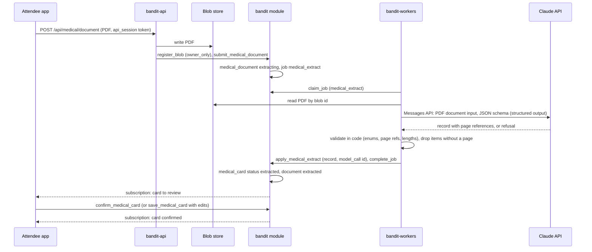
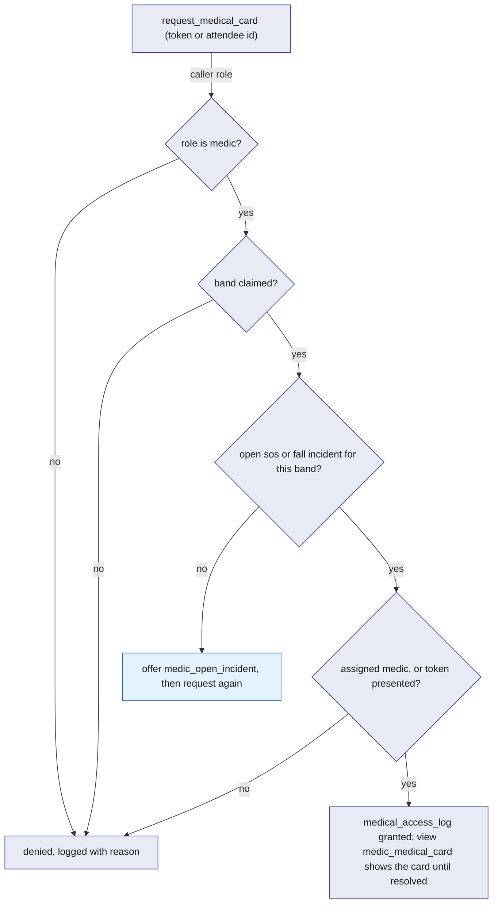
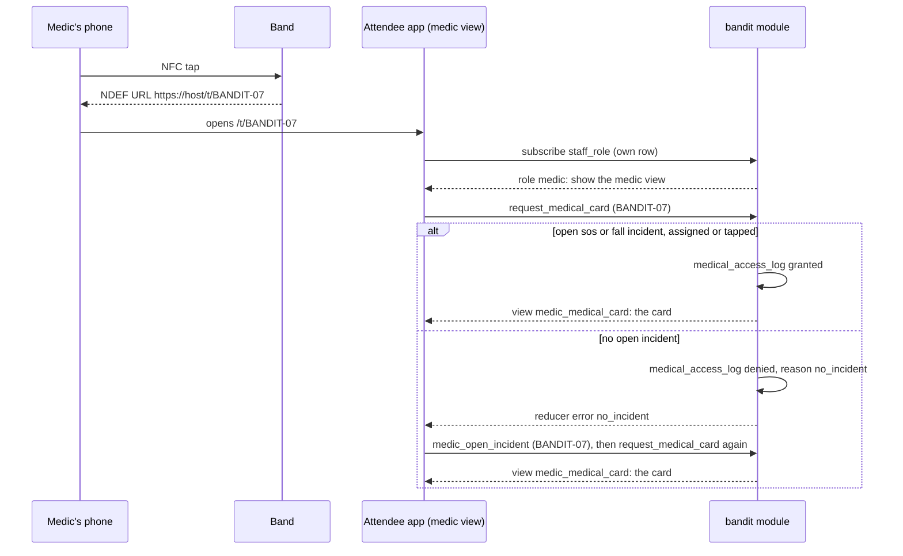

# Medical-ID

Medical-ID is the "Wrist assured" medical card. At sign-up an attendee uploads a medical PDF; a worker sends it to Claude, which returns a structured record with page references; code validates the record and writes a `medical_card`, which the attendee confirms. A medic sees a card only while an `sos` or `fall` incident is open for that band and the medic is assigned to it or has tapped the band, and every medic read is written to `medical_access_log`. The model reads the document; code decides who sees the card.

## Role in the system

Responsibilities:

- Accept the medical PDF through `bandit-api`, store it as an `owner_only` blob, and record a `medical_document`.
- Extract a structured record with the `medical_extract` job, validate it in code, and write `medical_card`.
- Offer a manual-entry form as the fallback and as the only path when [Anthropic-Agent](Anthropic-Agent.md) is not kept.
- Enforce the medic access rule in a reducer and log every medic read.
- Let a medic who tapped a band open an `sos` incident for it, which then grants access.
- Serve the card to the medic view opened by tapping the band.

Non-responsibilities:

- Incident detection, acknowledgement, assignment and resolution: [Safety](Safety.md). This file only reads `incident` rows and, in one reducer, opens one.
- The NFC sticker, its URL and read range: [Hardware](Hardware.md).
- Routes and screens (sign-up, the card review screen, the medic view): [Attendee-App](Attendee-App.md). This file defines what they call and what they may show.
- Prompt wording, the output schema, model and effort, PDF input, recording in `model_call`: [Anthropic-Agent](Anthropic-Agent.md).
- Using the card as claim evidence: [Hyphenate](Hyphenate.md). This file defines the read it is allowed.

## Interfaces

| Interface | Direction | Who | What flows | Transport |
|---|---|---|---|---|
| `POST /api/medical/document` | in | Attendee app, sign-up and profile screens | the PDF (multipart), the caller's `api_session` token | HTTPS to `bandit-api` |
| `register_blob` (core) | out | `bandit-api` (role `api`) | content type, size, SHA-256, owner, access class `owner_only` | SpacetimeDB reducer (SpacetimeDB.md) |
| `submit_medical_document` | in | `bandit-api` (role `api`) | attendee id, `blob_ref` id, page count | reducer; writes `medical_document`, enqueues `medical_extract` |
| Job `medical_extract` | out | `bandit-workers` | payload: document id, blob id; result: validated record | `job` table |
| Claude Messages API | out | `bandit-workers` through `claude-client` | the PDF as document input, a JSON schema; structured record back | HTTPS (Anthropic-Agent.md) |
| `apply_medical_extract` | in | role `worker` | job id, document id, validated record, `model_call` id | reducer; rejects a stale lease |
| `confirm_medical_card` | in | the attendee (own identity) | card id | reducer |
| `save_medical_card` | in | the attendee (own identity) | all card fields, typed or edited | reducer; manual entry or correction |
| `request_medical_card` | in | role `medic` | NFC token or attendee id, optional incident id | reducer; applies the access rule, writes `medical_access_log` |
| `medic_open_incident` | in | role `medic` | NFC token | reducer; opens an `sos` incident assigned to the caller |
| View `my_medical_card` | out | the attendee | own `medical_card` and `medical_document` status | subscription |
| View `medic_medical_card` | out | role `medic` | the card for which a granted, unexpired `medical_access_log` row exists for the caller | subscription |
| `medical_card` read by `open_claim` | out | `bandit` module (Hyphenate.md) | card status, emergency contact present, conditions text, logged with `via = claim` | module-internal |
| Access log | out | Ops dashboard (role `ops`, `owner`) | `medical_access_log` rows | subscription |

## Design

### Upload and storage

The attendee uploads the PDF from the sign-up or profile screen. The app sends it to `bandit-api` with its `api_session` token; `bandit-api` hashes the token, finds the session in its subscription and so knows the attendee's identity ([SpacetimeDB](SpacetimeDB.md), `api_session`). It checks the content type is PDF and the size is at or below 10 MB (starting value), writes the file to the blob store, counts the pages, calls `register_blob` with access class `owner_only`, and calls `submit_medical_document`. That reducer writes a `medical_document` row in status `uploaded`, moves it to `extracting`, and enqueues `medical_extract` with the document and blob ids. An attendee has one current document: a new upload supersedes the old row (`superseded_by`) and the old blob is left for the owner to delete from their profile.

`owner_only` is what keeps the PDF out of every other screen: `bandit-api` serves such a blob only to the owner's own session. Medics, ops and Hyphenate see the extracted card, never the document.

### Extraction

The question this diagram answers: how does a PDF become a confirmed card, and which step is code and which is the model?

The worker claims the job, reads the blob, and sends the PDF as document input with a JSON schema for the response (structured outputs; forced tool choice is not available on this model, so the schema is the contract). Model `claude-opus-5-5`, effort set per [Anthropic-Agent](Anthropic-Agent.md), the call recorded in `model_call`. The schema asks for:

| Field | Shape | Validation in code |
|---|---|---|
| `blood_type` | one of the eight ABO/Rh types or `unknown` | must be in the set; anything else becomes `unknown` |
| `allergies` | list of {name, reaction, page} | at most 20 items; name at most 120 characters; `page` between 1 and the page count; an item without a valid page is dropped |
| `conditions` | list of {name, page} | same |
| `medications` | list of {name, dose, page} | same |
| `emergency_contact` | {name, relation, phone, page} | phone reduced to digits and plus sign, 7 to 15 digits; page required |
| `notes` | free text, list of pages | at most 1000 characters |

Every item carries the page it came from so a medic can trust it and the owner can check it. Code never accepts a field without a page reference, counts what it dropped in `medical_document.dropped_items`, and fails the job if nothing valid remains or the response ended with a `refusal` stop reason. On success `apply_medical_extract` (role `worker`, rejects a stale lease) writes or replaces the attendee's `medical_card` with `status = extracted`, `source = model`, the `document_id` and `model_call_id`, and sets the document to `extracted`. After three failed attempts the document is `failed` and the app shows the manual form.

### Confirmation and manual entry

The app shows the extracted card next to the page references. `confirm_medical_card` sets `status = confirmed`, `confirmed_at`. `save_medical_card` lets the owner edit any field or type a card from nothing; it writes the card with `source = manual` (or `model_edited` when it started from an extraction) and `status = confirmed`, since the owner typed it. The manual form is the whole feature when [Anthropic-Agent](Anthropic-Agent.md) is not kept: upload is hidden, the card is typed, access rules are unchanged.

A card in `extracted` that was never confirmed is still shown to a medic, labelled "not yet confirmed by the wearer", because a card with a caveat beats no card in an emergency.

### Access rule

The rule lives in one reducer, `request_medical_card`, and nowhere else. Its checks, in order:

1. The caller holds role `medic` in `staff_role`.
2. The token or attendee id resolves to a claimed `band` and its owner. An unclaimed band has no card and the reducer stops.
3. There is an `incident` of kind `sos` or `fall` for that band with status `open`, `acknowledged` or `responding`.
4. The caller is that incident's `assigned_medic`, or the caller presented the band's NFC token (a tap). In v0.1 the token is static, so presenting it is taken as a tap; [Hardware](Hardware.md) lists dynamic-URL tags as the extension that would make a tap unforgeable.
5. The reducer writes a `medical_access_log` row: card, attendee, reader identity and role, incident id, `via` (`assignment` or `tap`), `granted` true or false, `reason`, `read_at`.

The view `medic_medical_card` returns the card only where a `granted` log row exists for the caller and the linked incident is still not `resolved`. Since the only way to get a log row is this reducer, "every read writes `medical_access_log`" is literally true, and when the incident resolves the card leaves the medic's screen without any cleanup step. A denied request also leaves a log row, with the reason, so ops can see attempts.

The question this diagram answers: given a medic and a band, when does the card show?

### Opening an incident from a tap

A medic may reach a person before any band flag or dashboard action: the wearer is unwell but did not hold the button, or the band is a lite band with no fall sensor. `medic_open_incident` (role `medic`) takes the token, requires a claimed band with no open `sos` or `fall` incident, and opens an `sos` incident for that band with `status = responding`, `assigned_medic` = the caller and `opened_by = medic`, freezing the snapshot the same way `ingest_band_reports` does ([Safety](Safety.md) owns the snapshot). No escalation timer is scheduled because a medic is already assigned. The next `request_medical_card` passes the rule. The band's own light state is not forced; the medic is already standing there.

### The medic tap flow

The question this diagram answers: what happens from the medic's phone touching the band to the card on screen?

The medic view shows the card fields with their page references, the band id, the incident id and status, and nothing from the PDF itself. When the attendee has no card, it shows "no medical card on file" and the incident still stands.

### Hyphenate reads the card

[Hyphenate](Hyphenate.md)'s `open_claim` reads the subject attendee's `medical_card` when it builds the evidence pack. Code reads only the card's status and whether an emergency contact is present; the conditions text is passed to the `claim_draft` job as model-read material for the claim summary. The read writes a `medical_access_log` row with `via = claim`, the reader being the identity and role of whoever triggered `open_claim` (the medic who resolved the incident, or the ops user), and the claim id in `reason`, so the owner's log shows it like any medic read. This is the one row in the access log table that belongs to another file.

### Tables

| Table | One row is | Fields |
|---|---|---|
| `medical_document` | one uploaded PDF | `id`, `attendee_id`, `blob_id`, `page_count`, `status` (`uploaded`, `extracting`, `extracted`, `failed`), `job_id`, `model_call_id`, `dropped_items`, `superseded_by`, `uploaded_at` |
| `medical_card` | one attendee's current card | `id`, `attendee_id` (unique), `status` (`extracted`, `confirmed`), `source` (`model`, `model_edited`, `manual`), `blood_type`, `allergies`, `conditions`, `medications` (each a list of items with page references, stored as text lists), `emergency_contact_name`, `emergency_contact_relation`, `emergency_contact_phone`, `emergency_contact_page`, `notes`, `document_id`, `model_call_id`, `extracted_at`, `confirmed_at`, `updated_at` |
| `medical_access_log` | one read or denied attempt | `id`, `card_id`, `attendee_id`, `reader_identity`, `reader_role`, `incident_id`, `via` (`assignment`, `tap`, `claim`), `granted`, `reason`, `read_at` |

### Reducers and views

| Name | Kind | Role | Does |
|---|---|---|---|
| `submit_medical_document` | reducer | `api` | document row, `medical_extract` job |
| `apply_medical_extract` | reducer | `worker` | writes the card from a validated record; rejects a stale lease |
| `confirm_medical_card` | reducer | owner | `extracted` to `confirmed` |
| `save_medical_card` | reducer | owner | manual entry or edits; `confirmed` |
| `request_medical_card` | reducer | `medic` | the access rule; writes the log |
| `medic_open_incident` | reducer | `medic` | opens an `sos` incident assigned to the caller |
| `my_medical_card` | view | owner | own card and document status |
| `medic_medical_card` | view | `medic` | cards with a granted log row for the caller and an unresolved incident |

## Failure modes and fallbacks

| Failure | Effect | Design answer |
|---|---|---|
| PDF is scanned images, no text layer | model must read images | Claude reads PDF pages as images; page references still apply |
| Model invents a field | wrong data on a medic's screen | every item needs a page reference or it is dropped; the owner reviews before confirming |
| Model returns a `refusal` stop reason or invalid JSON | no record | job fails; after 3 attempts the document is `failed` and the manual form is shown |
| Anthropic-Agent.md not kept | no extraction | manual form only; access rules unchanged |
| Attendee never confirms | card uncertain | medics see it labelled "not yet confirmed" |
| Medic not assigned and no open incident | denied | the view offers `medic_open_incident` for the tapped band |
| Band unclaimed | no owner | reducer stops; the medic view says so |
| Incident resolves while the medic reads | card disappears | by design: the view is tied to an unresolved incident; the medic can reopen through a new incident if needed |
| Static token reused by a non-medic | nothing shown | role check comes first; without role `medic` the reducer denies and logs |
| Blob store unavailable | upload fails | `bandit-api` returns an error; the app offers retry or the manual form |
| Worker holds the lease past 60 s on a large PDF | reaper requeues | the worker calls `extend_job_lease` while the model call is in flight |
| Two uploads in a row | two documents | the newer supersedes; only the latest is extracted |

## Dependencies

**Depends on**

- [SpacetimeDB](SpacetimeDB.md): `band`, `attendee`, `staff_role`, `incident`, `job`, `blob_ref` with access classes, `register_blob`, `api_session`, `extend_job_lease`, views keyed on the caller.
- [Safety](Safety.md): `incident` kinds and statuses, `assigned_medic`, the snapshot function used by `medic_open_incident`.
- [Rust-Backend](Rust-Backend.md): the `bandit-api` shell that hosts `POST /api/medical/document` and the `bandit-workers` shell.
- [Anthropic-Agent](Anthropic-Agent.md) (optional): `claude-client`, the extraction prompt and schema, `model_call`. Without it, manual entry only.
- [Hardware](Hardware.md): the NFC sticker and its URL.
- [Attendee-App](Attendee-App.md): the upload screen, the card review screen, the medic view route opened from `/t/BANDIT-0n`.

**Used by**

- [Hyphenate](Hyphenate.md): reads `medical_card` as evidence and writes the `via = claim` log row.
- [Ops-Dashboard](Ops-Dashboard.md): the "Medical access log (Medical-ID.md)" panel row, if kept.
- [Architecture](Architecture.md): the medic demo flow.

**If you delete this file**

- Drop `medical_document`, `medical_card`, `medical_access_log`, the two views, the reducers above, the job kind `medical_extract` and the endpoint `POST /api/medical/document`.
- Remove the upload and card screens and the medic view's card panel in Attendee-App.md (the medic view keeps the incident panel).
- Remove the `medical_card` row from the evidence sources table in Hyphenate.md.
- Remove the Medical-ID use case from Anthropic-Agent.md and the "Medical access log (Medical-ID.md)" panel row from Ops-Dashboard.md.
- Remove the Medical-ID.md rows from the endpoint and handler registries in Rust-Backend.md, the Medical-ID.md rows from the registry tables in SpacetimeDB.md and its `medic_open_incident` mention on `incident`, the Medical-ID.md rows and bullets in Safety.md, demo flow 5 and the prize row in Architecture.md, the Medical-ID.md part of the NFC token row and the dependency bullets in Hardware.md, and the Medical-ID row and node in README.md.
- `medic_open_incident` goes with it; if Safety.md wants a medic-opened incident without the card, it defines its own.

## Open questions

- Should a medic assigned to an incident see the card from the dashboard's incident panel without tapping, or always tap? The rule allows both; the screens decide.
- Should `medic_open_incident` force the band into SOS so the light circle forms around the person? The design leaves the band alone; Safety.md may want otherwise.
- Is 10 MB the right upload cap for the synthetic PDFs the team will generate?
