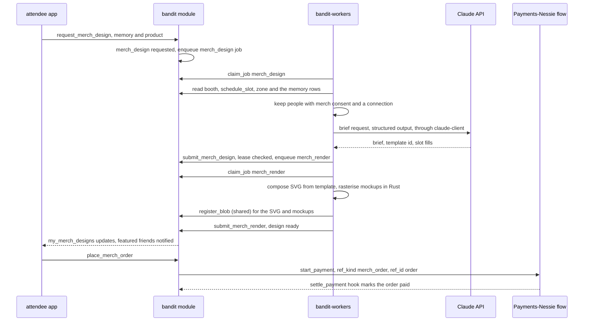
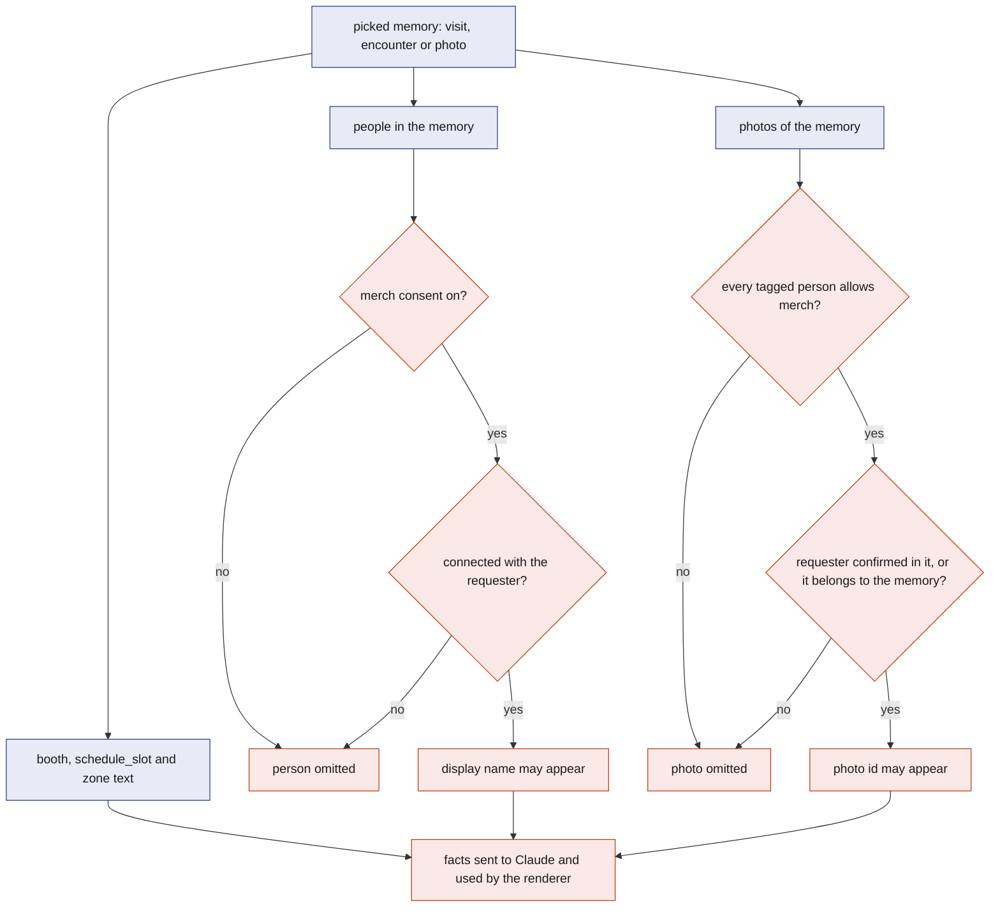
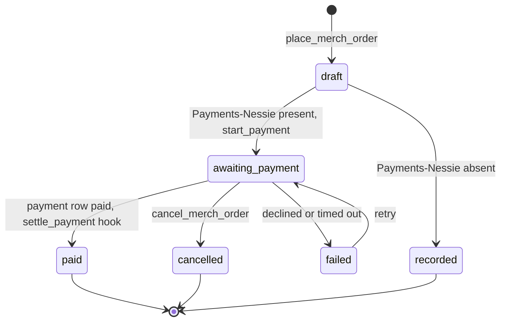

# Merch

Merch turns a memory from the night into something an attendee can hold: a shirt, mug or poster designed from what they actually did, with the people who were there and the photos they confirmed. The attendee picks a memory in their summary; a worker gathers the facts, asks Claude for a design brief, composites the design in Rust from a fixed template library, renders product mockups, and the attendee orders after the event instead of carrying a bag around the venue. Products come from a scraped catalogue, payment goes through Nessie when that component is present, and when AI is unavailable a plain template still ships. The whole feature is optional and sits behind the job queue, far from the safety loop.

## Role in the system

Responsibilities:

- Let an attendee turn a `visit`, `encounter` or `photo` into a `merch_design`, through the jobs `merch_design` (brief) and `merch_render` (SVG and mockups).
- Apply the `merch` consent switch and the connection rule to every person and photo that could appear on a design.
- Hold the product catalogue (`merch_product`, loaded as part of the `import_event` bundle from [BrightData](BrightData.md)) and the orders (`merch_order`).
- Notify people featured in a design and let them order the same item.
- Hand checkout to [Payments-Nessie](Payments-Nessie.md), or record the order without payment when that component is absent.

Non-responsibilities:

- It does not derive memories; [Social](Social.md) does.
- It does not generate images with AI. Claude cannot produce or edit images, and it writes only the brief; all pixels are produced by Rust code from templates and confirmed photos ([Anthropic-Agent](Anthropic-Agent.md)).
- It does not scrape; [BrightData](BrightData.md) does, and it does not move money; [Payments-Nessie](Payments-Nessie.md) does.
- It does not fulfil orders. The demo ends at a confirmed order; printing and shipping are outside the system.

## Interfaces

| Direction | Who | What flows | Transport |
|---|---|---|---|
| In | Attendee app | `request_merch_design` (memory kind and id, product id), `place_merch_order`, `cancel_merch_order`, `leave_merch_design` | SpacetimeDB TypeScript SDK |
| In | `bandit-ingest` (role `ingest`) | `merch_product` rows inside the `import_event` bundle ([BrightData](BrightData.md)); product images arrive as URLs | SDK, before the event |
| In | [Social](Social.md) tables | `visit`, `encounter`, `photo`, `photo_tag`, `connection_request` as memories and consent evidence; `consent.merch` | Module tables, read by the worker |
| In | Core tables | `booth`, `schedule_slot`, `zone`, `attendee` (display names), `blob_ref` | Module tables |
| In | `bandit-workers` (role `worker`) | `submit_merch_design` (job id, lease, brief and slot fills), `submit_merch_render` (job id, lease, SVG and mockup `blob_ref` ids) | SDK |
| In | Claude API (optional) | The design brief, through `claude-client` ([Anthropic-Agent](Anthropic-Agent.md)) | HTTPS from the worker |
| Out | `job` table | Jobs `merch_design` (from `request_merch_design`) and `merch_render` (from `submit_merch_design`) | `enqueue_job` |
| Out | Blob store | the worker writes the SVG, the PNG mockups and, once per product, its cached catalogue image to the blob store and calls `register_blob` (role `worker`, access class `shared`); it then calls `set_merch_product_image` | Blob store write from the worker, then SDK |
| Out | [Payments-Nessie](Payments-Nessie.md) | `start_payment` for the BandIt merch `merchant`, amount in cents, `ref_kind` `merch_order` and `ref_id` the order id; `confirm_mode` `press` at a merch counter during the event, `app` after it | Module call from `place_merch_order` |
| In | [Payments-Nessie](Payments-Nessie.md) | the Merch hook in `settle_payment` runs the `confirm_merch_order` logic for a payment with `ref_kind` `merch_order`; a declined or failed payment is mirrored onto the order by the same hook | Module-internal call |
| Out | Attendee app | Views `merch_catalogue` (public), `my_merch_designs` (own and featured), `my_merch_orders` | Subscription |

## Design

### The flow from memory to order

The question this diagram answers: what happens between an attendee picking a memory and a confirmed order.

1. **Pick.** In the summary the attendee taps a visit ("40 minutes at the robotics booths"), an encounter ("the person you met in Zone B", only once connected) or a confirmed photo, and a product from `merch_catalogue`. `request_merch_design` checks that the caller is a party to the memory (the visit is theirs, they are one side of the encounter, or they have a confirmed tag on the photo), writes a `merch_design` row with status `requested`, and enqueues a `merch_design` job whose payload is the design id.
2. **Gather.** The worker claims the job and reads rows: the zone and its booths (`booth` name, scraped description and tags), the `schedule_slot` rows that overlap the memory's time (the set or talk that was on), the memory's times, and the people and photos that pass the filter below. The booth facts come from the `booth` rows alone: the scraped description and tags are already there, and the memory names the booths exactly, so there is nothing to rank and no search call.
3. **Brief.** The worker sends the facts, the template library (template ids with their slots: title length, subtitle length, number and shape of photo slots, allowed palettes) and the product's print area to Claude as the `merch_design` job in [Anthropic-Agent](Anthropic-Agent.md). Claude returns a brief: concept, title, subtitle, date line, one template id, one palette id, and which photo id or text goes in each slot. It does not write SVG, because markup from a model would need its own sanitiser and could break the renderer; choosing and filling slots is all the creativity the product needs and all that code can validate.
4. **Submit the brief.** `submit_merch_design` checks the lease, stores the brief on the row, sets status `rendering` and enqueues `merch_render` in the same transaction.
5. **Render.** The worker claims `merch_render`, loads the template SVG from its bundled library, fills the slots (text with the template's fonts, photos downscaled and embedded), rasterises it with a pure-Rust SVG renderer, and places the result on the product's mockup images (front of the shirt, wrap of the mug) using the print area from `merch_product`. It writes the SVG and the PNG mockups to the blob store and calls `register_blob` for each with access class `shared` ([Rust-Backend](Rust-Backend.md) gives workers that path). A render with several large photos may run past the lease and calls `extend_job_lease` while it works.
6. **Ready.** `submit_merch_render` checks the lease, stores the `blob_ref` ids, sets status `ready`. The design appears in `my_merch_designs` for the attendee and for every featured person.
7. **Order.** `place_merch_order` writes a `merch_order` and, when [Payments-Nessie](Payments-Nessie.md) is present, calls `start_payment` for the merch `merchant` with the amount in cents, `ref_kind` `merch_order` and `ref_id` the order id. During the event, at a merch counter, the payment uses `confirm_mode` `press`; after the event, when the band is gone, it uses `confirm_mode` `app` and the attendee confirms with `confirm_payment` from their own session. When `settle_payment` moves the payment to `paid`, its Merch hook runs the `confirm_merch_order` logic, which checks the payment row and the amount and sets the order to `paid`. Without Payments-Nessie the order is written as `recorded`.

### Who and what may appear on a design

The question this diagram answers: which facts, people and photos the worker is allowed to send to Claude and put on a design.

- **People.** A person appears by display name only when their `merch` consent is on and a `connection_request` between them and the requester is `accepted`. Without a connection the requester does not even know the name, so there is nothing to print; with a connection but no consent the person is left out and the design says "with a friend" at most. Handles never appear on merch.
- **Photos.** A photo qualifies when the requester has a confirmed tag on it or it was taken during the picked visit or encounter in that zone, and when no `photo_tag` on it, suggested or confirmed, belongs to someone whose `merch` consent is off. A suggested tag counts because the person may well be in the frame and has not yet said.
- **Facts.** Booth and schedule text is public venue data and always allowed. Captions from Vision (TBD -- LEO) are used when present and ignored otherwise.
- **The requester** counts as consenting by asking.

The filter runs in the worker before the prompt is built, on rows, so the model never sees a name it may not print. The same filter runs again in `submit_merch_design`, which rejects a brief that names anyone or any photo outside the allowed set; this is the code check behind the schema check ([Anthropic-Agent](Anthropic-Agent.md)).

### Tables

| `merch_product` field | Meaning |
|---|---|
| `id` | Assigned by SpacetimeDB |
| `source_url`, `vendor` | Where the catalogue entry was scraped from |
| `name`, `kind` | Display name; `tee`, `hoodie`, `mug`, `poster`, `tote` |
| `variants` | Sizes or colours offered, as text |
| `price_cents` | Integer cents, USD |
| `print_area` | Width and height in millimetres and placement on the product, used by the renderer |
| `mockup_template_id` | Which bundled mockup image the renderer places the design on |
| `image_url` | The catalogue image as scraped; stays a URL in the bundle |
| `image_blob_ref` | A cached copy of that image, filled by the worker on first use |
| `active` | Shown in `merch_catalogue` |
| `source_url`, `fetched_at` | Where and when it was scraped, as every scraped row carries |

`merch_product` rows arrive in the `import_event` bundle that `bandit-ingest` loads before the event ([BrightData](BrightData.md)); there is no merch-specific import reducer. Product images stay as URLs in the bundle. The first time the worker renders a design for a product it fetches the image, registers it with `register_blob` (the `worker` role may call it; access class `shared`) and stores the id with `set_merch_product_image`, so the catalogue and the mockups do not depend on the vendor's site during the demo. Without Bright Data, a short catalogue typed by hand goes in as a small `import_event` bundle.

| `merch_design` field | Meaning |
|---|---|
| `id` | Assigned by SpacetimeDB |
| `attendee_id` | Who requested it |
| `memory_kind`, `memory_id` | `visit`, `encounter` or `photo`, and its id |
| `product_id` | The product it was designed for |
| `status` | `requested`, `designing`, `rendering`, `ready`, `fallback`, `failed` |
| `source` | `claude` or `template` (the no-AI path) |
| `title`, `subtitle`, `concept` | From the brief |
| `template_id`, `palette_id` | From the brief, validated against the library |
| `slot_fills` | Which photo id or text goes in each slot |
| `people_ids`, `photo_ids` | Everyone and every photo featured, after the filter |
| `svg_blob_ref`, `mockup_blob_refs` | Rendered output |
| `design_job_id`, `render_job_id`, `model_call_id` | For audit and replay |
| `created_at`, `updated_at` | Timing |

| `merch_order` field | Meaning |
|---|---|
| `id` | Assigned by SpacetimeDB |
| `attendee_id` | Who ordered; may be a featured friend, not only the designer |
| `design_id`, `product_id`, `variant`, `quantity` | What |
| `amount_cents` | `price_cents` times quantity, computed by the reducer |
| `status` | `draft`, `awaiting_payment`, `paid`, `recorded`, `cancelled`, `failed` |
| `payment_id` | The [Payments-Nessie](Payments-Nessie.md) `payment` row, when present |
| `created_at`, `updated_at` | Timing |

### Friends in a design

Every attendee in `people_ids` sees the design in `my_merch_designs` with a notice ("Alex made a design from your night in Zone B"). They can order the same design on any product with `place_merch_order`, which renders nothing new because the SVG already exists and the mockup for another product is produced by a second `merch_render` job on the same SVG. They can also call `leave_merch_design`, which removes them from `people_ids` and enqueues a new `merch_design` job that rebuilds the brief without them; existing orders of the old design are not changed, because a shirt already paid for cannot be edited.

### The no-AI fallback

When Claude is unavailable, refuses, or fails validation twice ([Anthropic-Agent](Anthropic-Agent.md)), the worker submits a brief it builds itself: template `plain`, the attendee's display name, the zone or booth name, and the date, with the first allowed photo if any. `submit_merch_design` accepts it with `source` set to `template` and the design proceeds to `merch_render` like any other, ending in status `fallback` so the app can say "a simple design, AI was unavailable". The attendee can request the design again later.

### Order status

The question this diagram answers: which states an order passes through with and without Payments-Nessie.

During the event, a payment confirms by the wearer pressing the band inside the 8 s PAY prompt ([Payments-Nessie](Payments-Nessie.md)). After the event the band is gone, so `place_merch_order` starts the payment with `confirm_mode` `app` and the attendee confirms it in the app with `confirm_payment`; this file only requires that the `payment` row ends in `paid` or not. A `recorded` order is a real order with no payment attached, which is how the demo runs when the payments component is dropped.

## Failure modes and fallbacks

| Failure | Effect | Design answer |
|---|---|---|
| Claude unavailable, refuses, or fails validation twice | No brief | Worker submits the `plain` template brief; design ends `fallback`, still rendered and orderable |
| Brief names a person or photo outside the allowed set | Consent breach if applied | `submit_merch_design` runs the filter again and rejects; the worker falls back |
| Template or palette id not in the library | Renderer cannot proceed | Schema lists only library ids; code validation rejects anything else before submit |
| Render exceeds the job lease | A second worker could claim the render | `extend_job_lease` from the render loop; `submit_merch_render` rejects a stale lease |
| Rasteriser fails on a photo (corrupt file, huge size) | No mockup | Photos are downscaled and re-encoded before embedding; a failing photo is dropped and the slot left to the template's default art |
| No `merch_product` rows (scrape failed) | Nothing to order | A hand-typed catalogue loaded as a small `import_event` bundle before the event |
| Vendor image URL dead at demo time | Catalogue shows no picture | The worker caches each product image through `register_blob` on first render; until then the app shows the product name and kind |
| Payments-Nessie absent | No payment | Orders are `recorded`; the app says so |
| Payment declined or the PAY prompt times out | Order `failed` | The attendee can retry; the order row keeps its history |
| Featured person withdraws | Design shows someone who left | `leave_merch_design` rebuilds the brief without them; paid orders of the old version stay as they are |
| Social.md deleted | No memories to pick | Merch degrades to picking a zone and an hour from `presence_sample`, with no people and no photos, or is deleted with it |
| Blob store down | Mockups cannot be stored | The render job fails and retries; the design stays `rendering` and the app shows a spinner, never a broken image |

## Dependencies

**Depends on**

- [Social](Social.md): `visit`, `encounter`, `photo`, `photo_tag`, `connection_request`, the `merch` consent switch.
- [SpacetimeDB](SpacetimeDB.md): `booth`, `schedule_slot`, `zone`, `attendee`, `consent`, `blob_ref`, `register_blob`, `job`, `enqueue_job`, `claim_job`, `extend_job_lease`, `complete_job`, `fail_job`.
- [Rust-Backend](Rust-Backend.md): `bandit-workers` (jobs `merch_design`, `merch_render`, the template library and the SVG renderer), the blob store and the worker's `register_blob` path; `bandit-api` serves the stored mockups to the app.
- [Attendee-App](Attendee-App.md): the memory picker, catalogue, design and order screens.
- Optional: [Anthropic-Agent](Anthropic-Agent.md) (degrades to the `plain` template), [BrightData](BrightData.md) (`merch_product` in the `import_event` bundle; degrades to a hand-typed bundle), [Payments-Nessie](Payments-Nessie.md) (degrades to `recorded` orders).

**Used by**

- [Attendee-App](Attendee-App.md): post-event shopping screens.
- [Payments-Nessie](Payments-Nessie.md): the merch `merchant` is one of its merchants, a `payment` with `ref_kind` `merch_order` points here through `ref_id`, and its `settle_payment` carries the Merch hook.

**If you delete this file**

- Remove the job kinds `merch_design` and `merch_render` and the tables `merch_product`, `merch_design`, `merch_order` from [SpacetimeDB](SpacetimeDB.md).
- Remove the `merch_design` row from the catalogue in [Anthropic-Agent](Anthropic-Agent.md), the merch catalogue from the `import_event` bundle in [BrightData](BrightData.md), the `merch_order` and `merch_refund` `ref_kind` values, the Merch hooks and the merch `merchant` from [Payments-Nessie](Payments-Nessie.md), the `merch` consent effect line from [Social](Social.md), and the shopping screens from [Attendee-App](Attendee-App.md).
- Remove the Merch.md rows from the endpoint and handler registries in [Rust-Backend](Rust-Backend.md) and the `resvg` crate note, the "Merch.md" parts of demo flow 6 and the prize row in [Architecture](Architecture.md), and the Merch row and node in [README](README.md).
- The `merch` consent switch itself can stay or go; nothing else reads it.

## Open questions

- Which merch catalogue does `bandit-ingest` scrape: the event's own store, or a print-on-demand catalogue with known print areas?
- Should a featured friend's order of the same design require the designer's consent, or is being featured consent enough?
