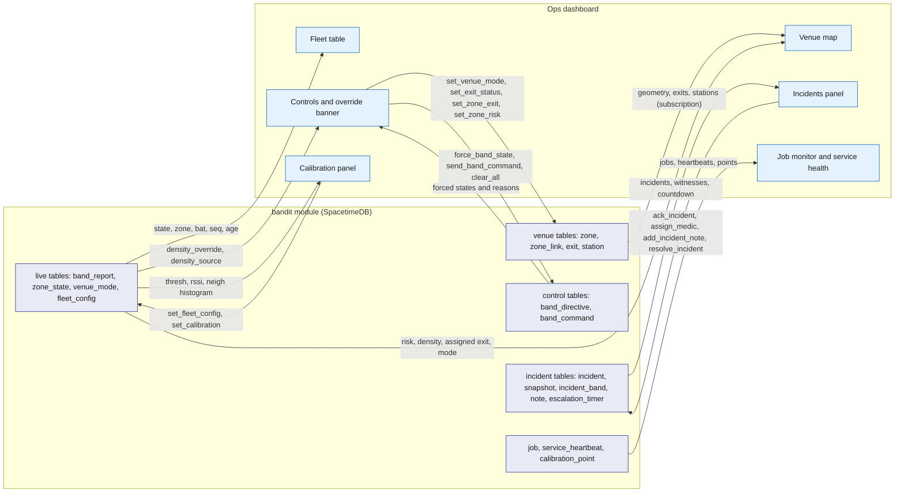
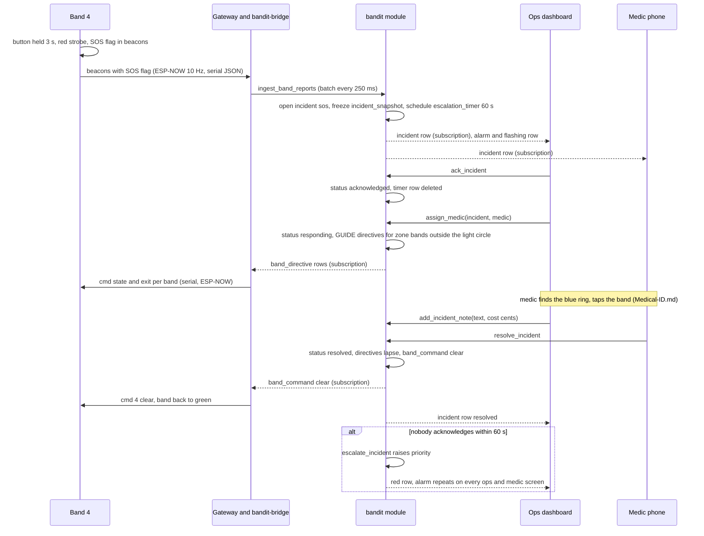
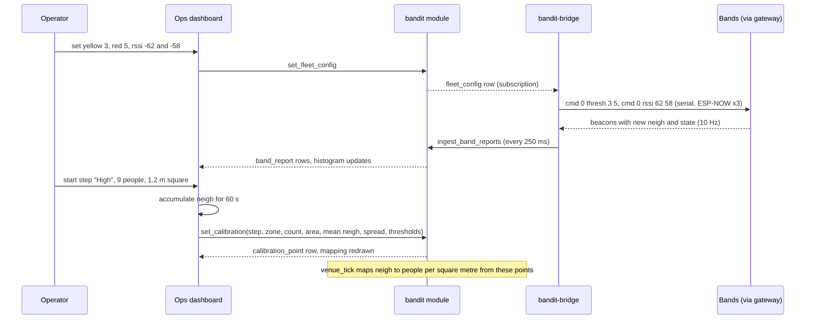

# Ops dashboard

The ops dashboard is the staff web app. On the demo laptop it is the screen the judges watch: the venue map, the fleet, the incidents and the controls. On staff phones it is the same app trimmed by role, so a medic sees incidents first and an approver sees claims. It reads everything by subscription from the `bandit` module through SpacetimeDB's TypeScript client SDK and changes the world only by calling reducers, so it can never disagree with the bands, the bridge or the attendee app. It computes nothing about safety; the module does, and the dashboard shows the result.

## Role in the system

Responsibilities:

- Show the live state of the venue: zones coloured by risk, every band, every incident, the venue mode, service health.
- Give ops the controls: forced states, clear, exit colours, evacuation, blocked exits, manual override, with a banner the whole room can see when override is on.
- Run incidents: acknowledge, assign a medic, add notes with an optional cost, resolve.
- Host the calibration UI: live `thresh` and `rssi` through `fleet_config`, and recording the three calibration steps into `calibration_point`.
- Monitor the work queue (`job`) and the Rust services (`service_heartbeat`).
- Let the owner grant and revoke roles.

Not responsible for:

- Density, risk, exit assignment, escalation or incident creation. `venue_tick`, `ingest_band_reports` and `escalate_incident` do that ([Safety](Safety.md), [SpacetimeDB](SpacetimeDB.md)).
- Talking to the gateway. Every control becomes a `band_directive`, `band_command` or `fleet_config` row and `bandit-bridge` sends it ([Gateway-Bridge](Gateway-Bridge.md)).
- Holding state. A closed laptop loses nothing.
- Calling any external service. It reads `job` rows and `service_heartbeat` instead.
- Medical-ID.md and Payments-Nessie.md: the medical card and the merchant terminal. Those render in the [Attendee app](Attendee-App.md) when a staff phone taps a band.

## Interfaces

| Interface | Direction | Between | What flows | Transport |
|---|---|---|---|---|
| Static bundle | in | `bandit-api` to browser | the app | HTTPS |
| SpacetimeDB connection | both | dashboard and `bandit` module | identity token, subscriptions, reducer calls; the caller's `staff_role` row decides which panels render and which reducers accept it | TypeScript client SDK over WebSocket |
| Subscriptions | in | module to dashboard | venue tables, live tables, control tables, incident tables, `calibration_point`, `job`, `service_heartbeat`, `staff_role`, `band`; see Subscriptions below | SDK subscription |
| Control reducers | out | dashboard to module | `force_band_state`, `send_band_command`, `clear_all`, `set_zone_exit`, `set_zone_risk`, `set_venue_mode`, `set_exit_status`, `set_fleet_config` (calibration values and `density_override`), `set_calibration` | SDK reducer call |
| Incident reducers | out | dashboard to module | `ack_incident`, `assign_medic`, `add_incident_note`, `resolve_incident`, `open_incident` | SDK reducer call |
| Fleet and staff reducers | out | dashboard to module | `register_band` (add, rename), `release_band` (unclaim), `grant_role`, `revoke_role` | SDK reducer call |
| Floor plan | in | `bandit-api` to browser | the venue's floor-plan image, a `blob_ref` with access class `staff` | HTTPS blob endpoint ([Rust-Backend](Rust-Backend.md)) |
| Hyphenate.md | both | dashboard and module | claims queue: `claim`, `evidence_pack`, `approval`, `authority_limit`; `approve_claim` and its siblings for the approver roles | SDK |
| Payments-Nessie.md | in | module to dashboard | payments: `merchant`, `payment` | SDK |
| Medical-ID.md | in | module to dashboard | medical access log: `medical_access_log` (which medic opened which card, when, for which incident) | SDK |
| Vision.md (TBD -- LEO) | both | module and dashboard | camera tiles: `camera`, `camera_count`, `ground_alert`, `vision_assessment`; latest frame `blob_ref`; the property-damage button opens a `property` incident with `open_incident`; the `vision` heartbeat | SDK and HTTPS |
| Elastic.md | in | module to dashboard | the `indexer` heartbeat in service health; nothing else, since zone history is read from `zone_sample` here and never from Elastic | SDK |
| Simulator.md | out | dashboard to module | scenario start, stop and crowd size through the simulator's own control rows; the `simulator` heartbeat | SDK |
| BrightData.md | both | dashboard and module | booth fix-up panel: unplaced or unassigned `booth` rows with their `organization` on each `hall` floor plan; ops fixes them with `upsert_booth`, setting `placement_source` to `manual`; the `ingest` heartbeat | SDK |

## Design

### Layouts by role

One app, one bundle; the caller's `staff_role` rows decide what renders. Reducers check the role again on the server, so hiding a panel is convenience, not security.

| Role | Device | Panels |
|---|---|---|
| `owner` | laptop | everything, plus the staff panel (grant and revoke roles, service identities) |
| `ops` | laptop, phone | venue map, fleet, incidents, controls, calibration, jobs, service health |
| `medic` | phone | incidents (assigned to me first, then open), venue map, fleet read-only. Medical-ID.md: the hint "tap the band for the medical card", which opens the medic view in the attendee app |
| `floor_manager`, `risk_manager`, `adjuster` | phone, laptop | incidents read-only; Hyphenate.md: the claims queue filtered to their authority |
| `photographer` | none here | uploads through Social.md |

Staff onboarding: a staff phone opens the dashboard and shows its identity as a short code on an otherwise empty screen; the owner finds that code in the staff panel and calls `grant_role`. Rust services print their identity on first start and get their service role the same way. The demo seed grants the known roles ahead of time so nobody types codes in front of judges.

### Panels

| Panel | Shows | Reads | Controls (reducer) |
|---|---|---|---|
| Venue map | zones over the floor plan coloured by risk, stations with their exit colour, exits (blocked struck through), the assigned exit per zone, band count, density and its source badge per zone | `venue`, `zone`, `zone_link`, `exit`, `station`, `zone_state`, `venue_mode`, `band_report` | per zone: `set_zone_exit`, `set_zone_risk`, `set_venue_mode` (this zone); per exit: `set_exit_status` |
| Fleet table | one row per band: alive or grey, battery, state, zone, flags, simulated, last seq, owner claimed yes or no | `band`, `band_report`, `band_directive` | per band: `force_band_state`, `send_band_command` (buzz, clear), identify; `register_band` (add, rename), `release_band` (unclaim) |
| Incidents | open and recent incidents with zone, wearer, witnesses, countdown, status, snapshot, notes | `incident`, `incident_snapshot`, `incident_band`, `incident_note`, `escalation_timer`, `staff_role` (medics); the wearer's display name comes with `staff_incidents` | `ack_incident`, `assign_medic`, `add_incident_note`, `resolve_incident`, `open_incident` |
| Controls | fleet-wide actions and the override banner | `band_directive`, `venue_mode`, `fleet_config`, `zone_state` | `force_band_state`, `send_band_command`, `clear_all`, `set_zone_exit`, `set_zone_risk`, `set_venue_mode`, `set_exit_status`, `set_fleet_config` (`density_override`) |
| Calibration | live thresholds, live `neigh` histogram, the three calibration steps and the resulting mapping | `fleet_config`, `band_report`, `calibration_point` | `set_fleet_config`, `set_calibration` |
| Job monitor | queue depth per kind, each job's status, attempts, lease holder and age | `job` | none in the core |
| Service health | one card per Rust service: last heartbeat, version, counters | `service_heartbeat` | none |
| Staff panel (owner) | identities and roles | `staff_role` | `grant_role`, `revoke_role` |
| Hyphenate.md: Claims queue | claims by status and amount, evidence pack, who may approve, approval grid | `claim`, `evidence_pack`, `approval`, `authority_limit` | the approval reducers in Hyphenate.md |
| Payments-Nessie.md: Payments | payments in flight (prompt open, confirmed, timed out), merchants | `payment`, `merchant` | none |
| Medical-ID.md: Medical access log | every card access: medic, band, incident, time, granted or refused | `medical_access_log` | none |
| Vision.md (TBD -- LEO): Camera tiles | latest frame per camera, the detector's head count beside the bands' own count per zone, per-cell counts for the taped square, light circle visible, person-down alerts, and the Claude assessment on each incident | `camera`, `camera_count`, `ground_alert`, `vision_assessment`, `blob_ref` | property-damage button: `open_incident` with kind `property` |
| Simulator.md: Simulator controls | scenario, crowd size, start and stop, replay of a recorded log | the simulator's control rows | the simulator's reducers |
| BrightData.md: Booth fix-up panel | booths that are unplaced on the hall floor plan or unassigned to a zone, with their organisation; ops places or assigns each one before doors open | `hall`, `booth`, `organization`, `station`, `zone` | `upsert_booth` with `placement_source` `manual` |

The flowchart below shows which tables feed which panel and which reducers the panels call. Table groups are drawn as one node each.

### Venue map

The map is the floor-plan image with the zone graph drawn over it. Each `zone` row carries its outline on the plan and its area ([SpacetimeDB](SpacetimeDB.md)); `zone_link` rows are drawn as thin edges with their walking distance. Each zone is filled by its `zone_state` risk: `normal` green, `watch` yellow, `high` red, the same thresholds the bands use for yellow and red, so what judges see on the wrists and on the screen agrees. Inside the zone: the band count, the density in people per square metre, the `density_source` badge (`band`, `camera`, `manual` or `none`, so everyone can see what drove the colour), and a swatch of the exit colour assigned to the zone with an arrow along the graph to that exit. Station markers are dots in their colour; exits are door icons, struck through when blocked. When `venue_mode` is `evacuate`, the map's frame turns red and the assigned exits are highlighted. Clicking a zone opens its controls: pin an exit or return it to automatic (`set_zone_exit`), force its risk level or release it (`set_zone_risk`), evacuate this zone. Clicking an exit toggles blocked.

Vision.md (TBD -- LEO): when present, the zone shows two density numbers, the band estimate and the detector's camera estimate, with the higher one driving the colour ([Safety](Safety.md)).

For the demo there are 2 to 5 real zones, so the map is simple; the same drawing scales to a venue by adding rows, not code.

### Fleet table

| Column | Source | Rule |
|---|---|---|
| Band id | `band` | real bands 1 to 9, simulated from 1000 |
| Alive | `band_report` age | green dot when heard in the last 2 s, grey row after 5 s |
| State | `band_report.state` | chip in the ring's colour with the state name; a forced state shows a pin icon from `band_directive` |
| Zone | `band_report.zone` | station id mapped to the zone name; blank when 0 |
| Battery | `band_report.bat` | percent; "n/a" when 255 |
| Flags | `band_report.flags` | SOS, fall, press, low battery, full band |
| Neighbours | `band_report.neigh` | the band's own smoothed count |
| Last seq | `band_report.seq` | a reset to a low number means a reboot |
| Simulated | `band.simulated` | real bands are listed first; a filter hides simulated bands by default because up to 500 of them would bury the nine that matter |
| Claimed | `band.owner` empty or not | no names here; identity appears only on an incident |

Row actions: force a state with a hold time (`force_band_state`), identify (`force_band_state` with state 8 for 8 s, which blinks the band white so a staff member can find it on a wrist), buzz a full band or clear this band (`send_band_command` with `buzz` and a pattern 1 to 3, or `clear`), and unclaim the band (`release_band`, used when an attendee lost their browser identity, see [Attendee app](Attendee-App.md)). `register_band` adds or renames a band and sets its `nfc_token` and full or lite flag.

### Incidents panel

New incidents arrive by subscription within the bridge's 250 ms batch of the band's beacon, because `ingest_band_reports` opens them in the same transaction as the report. The panel plays a sound and flashes the row until someone acknowledges. Rows are ordered by priority, then age.

Each row shows: kind (`sos`, `fall`, `crowd_risk`, `evacuation`, `property`), zone, the band id and, only here, the wearer's display name, which `staff_incidents` carries while the incident is open (identity appears only here), the light-circle witnesses from `incident_band` (bands that reported state 4 while the incident was open), status, and a countdown to the `escalation_timer` row's scheduled time. When the timer fires, `escalate_incident` raises the priority, the row turns red and the alarm repeats on every ops and medic screen. Opening a row shows the frozen `incident_snapshot` (zone state, bands present, light circle; Vision.md: camera coverage) and the notes.

Actions and the reducer each calls:

| Action | Reducer | Effect |
|---|---|---|
| Acknowledge | `ack_incident` | status `acknowledged`; the escalation timer row is deleted, so a handled incident never escalates |
| Assign medic | `assign_medic` | status `responding`; the picker lists `staff_role` rows with role `medic` and, when the medic wears a band, that band's zone, so ops can pick the nearest; the module then issues the medic-approach directives ([Safety](Safety.md)) |
| Add note | `add_incident_note` | free text with an optional cost in cents (first aid supplies, damage); Hyphenate.md reads the cost |
| Resolve | `resolve_incident` | status `resolved`; directives for the incident lapse and the band is cleared |
| Open incident | `open_incident` | ops opens an incident by hand on a zone (kind `crowd_risk`, `evacuation` or `property`) when they see something the sensors did not; Vision.md uses it as the property-damage button |

Vision.md (TBD -- LEO): an incident row also shows `camera_corroborated` (a person-down alert landed in the zone within 3 s of the flag), `vision_status` (`pending`, `confirmed`, `not_confirmed`) and, when it arrives, the `vision_assessment`: confidence, description, recommended action and the frames.

The sequence below follows one SOS from the wrist to resolved, as the operator sees it.

### Controls and the override banner

Every control writes a row; `bandit-bridge` turns the row into gateway text and keeps re-sending sticky directives until the bands agree ([Gateway-Bridge](Gateway-Bridge.md)). Destructive controls (evacuate, clear all, override) ask for a second tap.

| Control | Reducer | What the module writes | What the bridge sends |
|---|---|---|---|
| Force a state on all bands or one, with an optional hold in tenths of a second | `force_band_state(target, state, hold)` | `band_directive` with reason `manual` (or `plan_b`) for target 0 or a band id | `cmd <target> state <n> [tenths]`, re-sent before the 25.5 s per-command limit while the directive stands |
| Buzz or clear one band | `send_band_command(target, buzz or clear, arg)` | a one-shot `band_command`; the bridge sends it once and calls `ack_band_command` | `cmd <id> buzz <pattern>` or `cmd <id> clear` |
| Clear all (the demo's reset button) | `clear_all` | deletes every `band_directive`, clears `zone.evacuating` and the forced exit and risk columns, sets `venue_mode` back to `normal`, writes one `clear` command for target 0 | `cmd 0 clear` |
| Exit colour per zone | `set_zone_exit(zone, exit or none)` | `zone.forced_exit_id`; `venue_tick` honours it; none returns the zone to automatic | `cmd <band> exit <n>` for the zone's bands and `cmd <station> exit <n>` for its station |
| Force a zone's risk level | `set_zone_risk(zone, level or none)` | `zone.forced_risk`; the tick writes that level with `density_source` `manual` so the map and the lights agree with what staff see | exit and state commands that follow from the level |
| Evacuation mode | `set_venue_mode(mode, zones)` | `venue_mode` evacuate for the venue, or `zone.evacuating` on the listed zones; the tick writes forced GUIDE directives with each zone's exit colour and an `evacuation` incident | `cmd <band> state 2` and `exit <n>` for every band in scope |
| Block an exit | `set_exit_status(exit, blocked)` | `exit` blocked; the tick reassigns the zones that used it | exit colour commands for the affected zones |
| Override on or off (Plan B) | `set_fleet_config` with `density_override` true or false | bands stop their density state machine and stay green unless forced; density then comes from the camera when Vision.md (TBD -- LEO) is present ([Safety](Safety.md)) | `cmd 0 override 1` or `0` |

The banner. Whenever any `band_directive` carries reason `manual` or `plan_b`, any zone's `density_source` is `manual`, or `fleet_config.density_override` is true, a full-width banner reads "MANUAL OVERRIDE since hh:mm by <staff>. Tell the judges." It is visible on every ops and medic screen and cannot be dismissed while the condition stands, because the team's rule is to say so when override is used in front of judges. A forced state on a single band also shows a pin on that fleet row. The handoff maps the override button to forcing state 2 and clearing; this design keeps that (force GUIDE on all, then clear all) and adds `density_override` so bands do not fight the operator with their own density colours.

### Calibration panel

Calibration sets two things: `fleet_config`, which the bands use live, and `calibration_point` rows, which `venue_tick` uses to map a band's `neigh` to people per square metre ([Safety](Safety.md)).

Live thresholds: four controls bound to `fleet_config`: yellow neighbour count, red neighbour count, neighbour RSSI threshold, light-circle RSSI threshold (starting values 3, 5, -62 dBm, -58 dBm, calibrate). Apply calls `set_fleet_config`; the bridge sends `cmd 0 thresh y r` and `cmd 0 rssi a b` and re-sends them to any band whose `seq` resets, so a rebooted band gets the values back without a reflash. Beside the controls a live histogram of `neigh` across live real bands, built on the client from `band_report` updates, shows the effect of a change at once.

Recording the three steps. Each step is a button that counts a 60 s window and then writes one `calibration_point` with `set_calibration`: the step label, the zone, the head count (typed), the taped area (1.5 m or 1.2 m square, or the spread-out area typed), the computed people per square metre, the window's mean and spread of `neigh`, and the thresholds in force. Steps, from the hardware test plan:

| Step | Setup | Expected density | Expected `neigh` |
|---|---|---|---|
| Spread | bands on wrists, people 2 m apart | well under 1 per square metre | 0 to 1 |
| Watch | everyone inside the 1.5 m taped square | about 4 per square metre with 9 people | the yellow count |
| High | everyone inside the 1.2 m taped square | about 6 per square metre with 9 people | 5 or more for most bands |

The panel then shows the mapping the tick will use and flags a step whose `neigh` overlaps its neighbour's, so the operator widens the thresholds before the rehearsal. The bridge's raw `.jsonl` log holds every packet from the window for later study ([Gateway-Bridge](Gateway-Bridge.md)).

The sequence below shows one calibration change and one recorded step.

### Job monitor

A read-only table of `job` rows: id, kind, status (`queued`, `leased`, `done`, `failed`, `dead`), attempts of 3, lease holder, lease expiry, age, and the payload and result references. Counters per kind at the top. A job leased past its expiry is marked "awaiting reaper" because `job_reaper` returns it to the queue within 10 s; a `dead` job is highlighted so the owning feature's panel can offer its own retry. Nothing here touches the safety path, which never waits on a job.

### Service health

Every Rust service calls `heartbeat` every 5 s, writing one `service_heartbeat` row per service keyed by its `service` name ([SpacetimeDB](SpacetimeDB.md)). The panel shows one card per row: version, uptime from `started_at`, age of `last_at`, and the counters that apply (`lines_per_second` and `loss_percent` for the bridge, `backlog` for workers, and the free-text `note`, for example the serial port name). A card turns amber when `last_at` is older than 10 s and red after 15 s (starting values, the red threshold matching SpacetimeDB.md). The strip also shows the dashboard's own connection state and which deployment it is talking to (Maincloud or the laptop). A red bridge card during the demo is the cue to reach for manual override.

Cards in the core: `bridge`, `workers`, `api`. Optional cards, each one line to remove:

- Elastic.md: the `indexer` card (`backlog` is rows pending).
- BrightData.md: the `ingest` card, present only while a load runs.
- Simulator.md: the `simulator` card.
- Vision.md (TBD -- LEO): the `vision` card (`backlog` is frames waiting for the detector).

### Subscriptions

| Table | Why | Laptop | Staff phone |
|---|---|---|---|
| `venue`, `zone`, `zone_link`, `exit`, `station`, `booth` | map geometry and labels | yes | yes |
| `zone_state`, `venue_mode` | risk colours, assigned exits, evacuation | yes | yes |
| `band`, `band_report` | fleet table and map counts; phones subscribe to real bands only | all | real bands |
| `band_directive`, `band_command` | override banner, pins, pending one-shots | yes | banner only |
| `fleet_config`, `calibration_point` | calibration panel; `density_override` for the banner | yes | `fleet_config` only |
| `incident`, `incident_snapshot`, `incident_band`, `incident_note`, `escalation_timer` | incidents panel and countdown | yes | yes |
| `display_name` carried on `staff_incidents` | the wearer's name on an open incident | yes | medics |
| `staff_role` | own role, medic picker, staff panel | yes | own rows |
| `job` | job monitor | yes | no |
| `service_heartbeat` | service health | yes | yes |
| Hyphenate.md: `claim`, `evidence_pack`, `approval`, `authority_limit` | claims queue | yes | approvers |
| Payments-Nessie.md: `payment`, `merchant` | payments | yes | no |
| Medical-ID.md: `medical_access_log` | medical access log | yes | no |
| Vision.md (TBD -- LEO): `camera`, `camera_count`, `ground_alert`, `vision_assessment` | camera tiles | yes | no |
| BrightData.md: `hall`, `organization` | booth-map fix-up view | yes | no |

With 500 simulated bands, `band_report` changes up to four times a second per band. The laptop subscribes to all of them for the map counts but paints the fleet table and map at most a few times a second; phones never subscribe to simulated bands.

## Failure modes and fallbacks

| Failure | Effect | Design answer |
|---|---|---|
| Bridge or gateway down | every real band goes grey within 5 s; the `bridge` heartbeat stops | service health card goes red; the operator forces zone levels with `set_zone_risk` so the map still tells the story (forced band states need the radio back); the team tells the judges |
| Radio works but density is unstable | zones flicker | calibration panel: widen thresholds live; if still unstable, Plan B: `density_override` on through `set_fleet_config`, density from the camera when Vision.md (TBD -- LEO) is present, band colours driven by `force_band_state` from the zone's risk ([Safety](Safety.md)); SOS, light circle and pay keep working on the bands |
| SpacetimeDB connection lost | panels freeze | the SDK reconnects and replays subscriptions; controls are disabled while disconnected; rows show their age |
| Operator forgets override is on | bands stay green during the density demo | the banner cannot be dismissed while the directive stands |
| Wrong role on a phone | panels missing, reducers rejected | the empty screen shows the identity code for the owner to grant a role |
| Two operators act at once | conflicting directives | the last reducer wins, and both screens show the same result because both read the same rows |
| Escalation timer fires during a handled incident | false alarm | impossible by design: `ack_incident` deletes the timer row in the same transaction |
| Fleet table floods with simulated bands | the nine real bands are hard to find | simulated bands hidden by default, real bands pinned to the top |
| Floor plan missing | no map image | zones draw as labelled boxes on a blank plan; colours and counts still work |

## Dependencies

**Depends on**

- [SpacetimeDB](SpacetimeDB.md): every table listed under Subscriptions; the ops reducers (`force_band_state`, `send_band_command`, `clear_all`, `set_zone_exit`, `set_zone_risk`, `set_venue_mode`, `set_exit_status`, `set_fleet_config`, `set_calibration`, `open_incident`), the incident, setup and job reducers, `register_band` and `release_band`; `service_heartbeat` and `heartbeat`; `grant_role` and `revoke_role`.
- [Safety](Safety.md): the meaning of risk levels, exit assignment, escalation, medic approach, evacuation, manual override and Plan B.
- [Gateway-Bridge](Gateway-Bridge.md): directive reconciliation and command delivery that make the controls take effect; the raw log for calibration.
- [Hardware](Hardware.md): band states, flags, exit colours, the 25.5 s forced-state limit, the alive and stale rule.
- [Rust-Backend](Rust-Backend.md): `bandit-api` serves the bundle and the floor-plan blob.

**Used by**

- [Attendee app](Attendee-App.md): unclaiming a band through `release_band` for identity recovery; `grant_role` for staff phones.
- [Medical-ID](Medical-ID.md): the medic's incident list; the card itself opens from the attendee app.
- [Hyphenate](Hyphenate.md), [Payments-Nessie](Payments-Nessie.md), [Medical-ID](Medical-ID.md), [Vision](Vision.md), [Elastic](Elastic.md), [Simulator](Simulator.md), [BrightData](BrightData.md): host their optional panels and service cards.
- [Architecture](Architecture.md): the demo choreography's manual override and SOS flows.

**If you delete this file**

- Ops loses every control; forced states, evacuation and calibration would need another client calling the same reducers, and the manual-override fallback disappears from the demo.
- Remove the Ops dashboard row from the component table in Architecture.md and the ops subscriptions from SpacetimeDB.md's "subscriptions per client".
- Remove the "ops dashboard" bullets in Hyphenate.md (claims queue), Payments-Nessie.md (payments), Medical-ID.md (medical access log), Vision.md (camera tiles, property button), Elastic.md (indexer card), Simulator.md (controls) and BrightData.md (booth fix-up panel).

## Open questions

- Should `set_zone_exit` pins survive a switch to evacuation mode, or should evacuation reset every zone to automatic assignment?
- Does a medic's `resolve_incident` need an ops confirmation, or is one tap enough for the demo?
- Which zone outline format does `zone` store for the map: a polygon in plan pixels, or a rectangle, which is enough for the taped squares?
