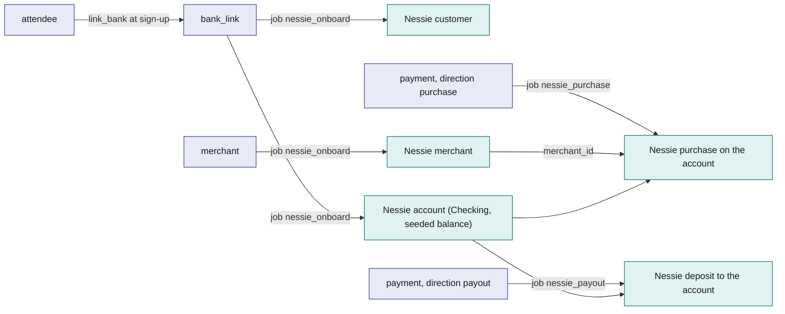
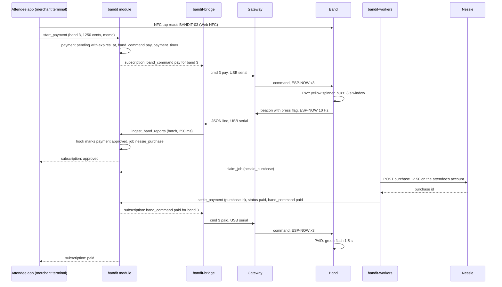
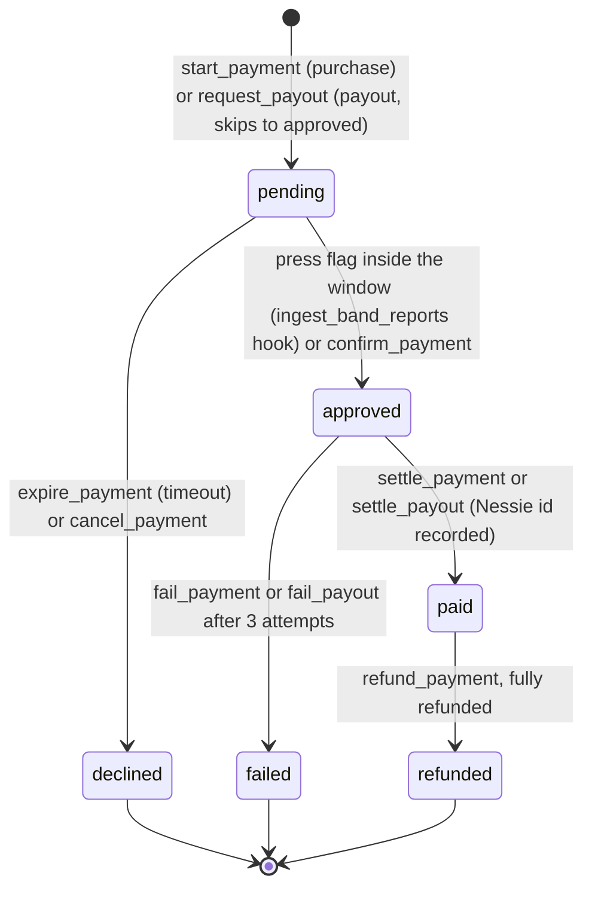

# Payments-Nessie

Payments-Nessie is tap to pay with the band, settled on Capital One's Nessie sandbox bank API. A merchant reads the band's NFC token, types an amount, and the server puts the band in the PAY state: the ring spins yellow for 8 s and the wearer presses the button to approve. A beacon with the press flag inside the window approves the payment, a worker records the purchase in Nessie, and the band flashes green. The press on the wearer's own wrist is the answer to "can't anyone clone the tag?": a copied tag can start a prompt, but only the wearer can accept it. The same rows and jobs pay money out (claims, refunds) and carry merch checkout.

## Role in the system

Responsibilities:

- Give every attendee a Nessie customer and a demo account at sign-up (`nessie_onboard`), and every merchant a Nessie merchant record.
- Own the `payment` lifecycle: pending, approved, paid, declined, failed, refunded.
- Attribute a button press to exactly one open prompt per band, through one separable hook in `ingest_band_reports`.
- Issue the one-shot `pay` and `paid` band commands through `band_command`.
- Call Nessie only from `bandit-workers` (jobs `nessie_purchase`, `nessie_payout`) through the `nessie-client` crate.
- Expose `request_payout` so [Hyphenate](Hyphenate.md) and [Merch](Merch.md) can pay attendees without knowing Nessie.

Non-responsibilities:

- What the band does in PAY and PAID states, the press flag, the 8 s window: [Hardware](Hardware.md).
- Delivering commands to the radio and acknowledging them: [Gateway-Bridge](Gateway-Bridge.md).
- The merchant terminal screen itself (layout, NFC and QR reading code): [Attendee-App](Attendee-App.md). This file defines what the screen calls and shows.
- The merch catalogue, designs and orders: [Merch](Merch.md). Claims and the ledger: [Hyphenate](Hyphenate.md).
- Job leasing, retries and the reaper: [SpacetimeDB](SpacetimeDB.md).

## Interfaces

| Interface | Direction | Who | What flows | Transport |
|---|---|---|---|---|
| `register_merchant` | in | role `ops` | merchant name, category, the staff identity that will run its terminal | SpacetimeDB reducer; enqueues `nessie_onboard` (subject merchant) |
| `link_bank` | in | the attendee (own identity), called by the sign-up flow (Attendee-App.md) | nothing but the caller | reducer; creates `bank_link` pending, enqueues `nessie_onboard` (subject attendee) |
| `start_payment` | in | role `merchant` | band id or NFC token, amount in cents, memo, optional `ref_kind` and `ref_id` | reducer; creates `payment`, `band_command` `pay`, `payment_timer` |
| `cancel_payment` | in | the merchant who started it, `ops` | payment id | reducer; only while `pending` |
| `confirm_payment` | in | the paying attendee (own identity) | payment id | reducer; app-confirm mode only (see Merch checkout) |
| `refund_payment` | in | the merchant who took it, `ops` | payment id, amount in cents, reason | reducer; creates a payout with `ref_kind = refund` |
| `request_payout` | in | module-internal (Hyphenate.md, Merch.md hooks), role `ops` by hand | attendee id, amount in cents, `ref_kind`, `ref_id`, memo | reducer or internal call; creates `payment` direction payout, enqueues `nessie_payout` |
| Hook in `ingest_band_reports` | in | `bandit` module (SpacetimeDB.md) | a report with the press flag from a band with an open prompt | same transaction |
| `expire_payment` | in | scheduled, one `payment_timer` row per pending payment | payment id | scheduled reducer |
| `complete_bank_link`, `settle_payment`, `fail_payment`, `settle_payout`, `fail_payout` | in | role `worker` | job id plus Nessie ids or a failure reason | reducers; each rejects a stale lease |
| Jobs `nessie_onboard`, `nessie_purchase`, `nessie_payout` | out | `bandit-workers` | payloads named below | `job` table, `claim_job` / `complete_job` / `fail_job` |
| Nessie REST API | out | `bandit-workers` through `nessie-client` | customers, accounts, merchants, purchases, deposits | HTTPS to `api.nessieisreal.com`, api key as the `key` query parameter |
| `band_command` rows `pay`, `paid` | out | `bandit-bridge` (Gateway-Bridge.md) | one-shot commands for one band | subscription, then `cmd <band> pay` and `cmd <band> paid` over USB serial |
| Terminal and wallet views | out | Attendee app (merchant terminal route; the attendee's own wallet) | `payment` rows for this merchant; the attendee's own `bank_link` and `payment` rows | subscription |
| Payout callers | out | Hyphenate.md (`ref_kind = claim`), Merch.md (`ref_kind = merch_refund`) | result of a payout, through one separable hook each in `settle_payout` and `fail_payout` | module-internal |

## Design

### Nessie and how BandIt maps to it

Nessie is Capital One's hackathon banking sandbox. A developer signs in with GitHub, gets an api key from the profile page, and sends it as the `key` query parameter on every request to `api.nessieisreal.com`. Creation calls return the new object's id. Enterprise endpoints are read-only; everything BandIt needs is under the per-customer endpoints. Amounts in Nessie are dollars as decimal numbers, so `nessie-client` converts integer cents to a two-decimal dollars string at the boundary and back, and never does arithmetic in floating point. Field names below were checked against the current documentation except where marked; the shape is a sandbox and should be re-checked against the interactive docs before the event.

| Nessie entity | Fields BandIt sets or reads | BandIt row | Created by |
|---|---|---|---|
| Customer | `first_name`, `last_name`, `address` (placeholder venue address) | `bank_link.nessie_customer_id` | `nessie_onboard`, subject attendee |
| Account (belongs to a customer) | `type` (`Checking`), `nickname` ("BandIt wallet"), `balance`, `rewards`, `account_number` | `bank_link.nessie_account_id`; the seeded demo balance is recorded as `bank_link.seeded_cents` | `nessie_onboard`, subject attendee |
| Merchant | `name`, `category`, `address`, `geocode` | `merchant.nessie_merchant_id` | `nessie_onboard`, subject merchant |
| Purchase (on an account) | `merchant_id`, `medium` (`balance`), `purchase_date`, `amount`, `status`, `description` | `payment` with `direction = purchase`; the purchase id lands in `payment.nessie_ref` | `nessie_purchase` |
| Deposit (on an account) | `medium` (`balance`), `transaction_date`, `amount`, `status`, `description` | `payment` with `direction = payout`; the deposit id lands in `payment.nessie_ref` | `nessie_payout` |
| Transfer (account to account) | `medium`, `payee_id`, `amount`, `transaction_date`, `status`, `description` (not re-verified; generic) | not used in v0.1 | none |

A Nessie merchant is a directory record, not an account, so a purchase debits the attendee's account and nothing is credited on the Nessie side. The merchant's takings are the sum of its paid `payment` rows in BandIt. If the venue wants a visible receiving account, a venue customer and account can be created once and each purchase mirrored as a transfer; that is the one place a transfer would be used, and it is off by default because it doubles every call.

The question this diagram answers: which BandIt row stands for which Nessie object, and which job creates it?

### Onboarding at sign-up

Sign-up ([Attendee-App](Attendee-App.md)) calls `link_bank` after the profile is saved. The reducer writes a `bank_link` row in status `pending` for the caller and enqueues `nessie_onboard` with the attendee id. The worker creates the customer from the profile's display name (split into first and last name; a single word becomes the first name and "BandIt" the last), creates a `Checking` account named "BandIt wallet" with an initial balance of 20000 cents ($200, starting value for the demo), and calls `complete_bank_link` with both ids. The row becomes `linked`. A failed job after three attempts leaves it `failed`, and the wallet screen shows "wallet not ready" with a retry that enqueues the job again. A real deployment would link an existing account instead of creating one; the demo creates one because every judge needs a funded wallet in seconds.

Merchants onboard the same way: `register_merchant` by ops writes a `merchant` row with `nessie_merchant_id` empty and enqueues `nessie_onboard` with the merchant id. The terminal refuses to start a payment until the merchant row has its Nessie id.

### The merchant terminal

The terminal is a route in the attendee app for a signed-in identity with role `merchant` (the screen is owned by [Attendee-App](Attendee-App.md)). It identifies the band three ways, in this order of preference:

1. NFC tap on Android Chrome through Web NFC: the phone reads the NDEF URL `https://<host>/t/BANDIT-0n` from the band's sticker and the terminal takes the token from the path.
2. QR fallback: a QR sticker on the band carrying the same URL, scanned with the phone camera. iPhones cannot read NFC from a web page, so this is the iPhone path.
3. Typing the band number.

The terminal resolves the token to a `band` row and its owner, shows the band id and the owner's display name so the merchant can see they have the right person, takes the amount in whole cents and a memo, and calls `start_payment`. It then subscribes to the resulting `payment` row and shows pending (with a countdown), paid, declined or failed. Nothing else about the payment happens on the phone.

### The payment flow

The question this diagram answers: what happens, in which component, from the tap on the band to the green flash?

Step by step:

1. `start_payment` checks the caller has role `merchant` and an onboarded `merchant` row, the band is claimed, the owner has a `linked` `bank_link`, and the band has no open prompt (next section). It writes `payment` with `status = pending`, `started_at` now, `expires_at` = `started_at` + 8 s + 1.5 s grace (starting value, calibrate: the grace covers command delivery and the bridge's 250 ms batch), a one-shot `band_command` `pay` for the band, and a `payment_timer` row due at `expires_at`.
2. The bridge sends `cmd <band> pay` once and calls `ack_band_command`. The band spins yellow for 8 s and buzzes (full bands). If the wearer does nothing, the band returns to its density colour on its own; the server sends nothing on timeout, as the gateway protocol asks.
3. The wearer presses. The band's beacons carry the press flag (bit 2) for 1 s. The bridge batches the changed report into `ingest_band_reports`.
4. Hook in `ingest_band_reports` (one separable bullet in SpacetimeDB.md and Safety.md): a report whose flags carry the press bit, from a band with exactly one open prompt, is handed to that prompt. For a `pending` payment whose `expires_at` is in the future, the hook sets `status = approved`, `approved_at`, and enqueues `nessie_purchase` with the payment id. Later reports in the same second still carry the flag but find no pending payment, so a press counts once.
5. The worker claims `nessie_purchase`, posts the purchase on the attendee's account with `merchant_id`, `medium` `balance`, the amount as dollars, and `description` "BandIt payment <payment id>", then calls `settle_payment` with the purchase id. The reducer rejects a stale lease, sets `status = paid`, `paid_at`, `nessie_ref`, and writes a one-shot `band_command` `paid`.
6. The band flashes green for 1.5 s with a short buzz. The terminal shows paid.

Idempotency: Nessie has no idempotency key, so before posting, the worker lists the account's recent purchases and looks for its description string; if the purchase already exists (a worker died between the POST and `settle_payment`), it reuses that id instead of charging twice.

### One open prompt per band

The press flag is one bit. It can only mean one thing at a time, so the server allows at most one open prompt per band, across every feature that uses the press: a `pending` payment here, and an open claim prompt from `claim_band_start` ([Attendee-App](Attendee-App.md), band in IDENT). `start_payment` refuses with `prompt_busy` while either exists, and `claim_band_start` refuses while a payment is pending (one separable bullet in Attendee-App.md). A second merchant tapping the same band during a prompt is told to wait. This is also why the window is short.

### Timeout

`payment_timer` is a scheduled table owned by this file: one row per pending payment, due at `expires_at`. Its reducer `expire_payment` reads the payment: if still `pending`, it sets `status = declined`, `decline_reason = timeout`, and deletes the timer; if already `approved` or `paid`, it only deletes the timer. A press that reaches the module after `expires_at` finds no pending payment and is ignored, which is the intended fail-safe: better to decline a slow press than to charge after the ring went dark. The band's own 8 s timer and this one are independent; the grace keeps the server's window the longer of the two.

### Payment status

The question this diagram answers: which statuses can a payment have and what moves it between them?

`failed` is final for that row: the terminal offers "try again", which is a new payment with a new prompt. Partial refunds leave the original `paid` with `refunded_cents` increased; it becomes `refunded` when the sum reaches the amount.

### Payouts

A payout is money to an attendee: a claim settlement from [Hyphenate](Hyphenate.md), a refund from a merchant, or a merch refund from [Merch](Merch.md). `request_payout` writes a `payment` with `direction = payout`, the attendee, the amount, `ref_kind` (`claim`, `refund`, `merch_refund`, `manual`) and `ref_id`, already in `status = approved` because receiving money needs no press, and enqueues `nessie_payout`. The worker posts a deposit on the attendee's account with `description` "BandIt payout <payment id>" (same idempotency search as purchases) and calls `settle_payout`; after three failed attempts it calls `fail_payout`. Both reducers end with one separable hook per caller: Hyphenate.md posts its cash journal and moves the claim on; Merch.md updates its order. A payout to an attendee with no `linked` `bank_link` fails immediately with `no_wallet`, so callers can fall back (Hyphenate uses a ledger-only payout).

`refund_payment` is a payout with `ref_kind = refund` and `ref_id` = the original purchase. The reducer requires the original to be `paid`, caps the amount at the original minus earlier refunds, and is allowed to the merchant who took the payment or to ops. Nessie has no refund object, so the refund is a deposit back to the attendee and the original purchase stays as it was.

### Merch checkout

[Merch](Merch.md) reuses the flow without new tables. At the event, a merch counter is a `merchant`, and Merch.md's `place_merch_order` calls `start_payment` with `ref_kind = merch_order` and the order id (`confirm_mode = press` at the counter); the Merch hook in `settle_payment` marks the order paid. After the event the bands are returned, so there is no band to press. For that case `start_payment` accepts `confirm_mode = app` (default `press`): no band command is sent, no `payment_timer` is created, and the attendee confirms from their own app session with `confirm_payment`, which the reducer accepts only from the paying attendee's identity. Everything after `approved` is identical. The press mode is the demo; the app mode is what makes post-event orders honest.

### The `nessie-client` crate

A small Rust crate used only by `bandit-workers`: a base URL and key from configuration ([Rust-Backend](Rust-Backend.md)), typed request and response structs for the six entities above, cents-to-dollars conversion at the boundary, a timeout per call, and error types that separate "Nessie said no" (do not retry: declined, bad request) from "could not reach Nessie" (retry under the job's attempts). It records nothing itself; the `payment` row and the `job` row are the record.

### Tables

| Table | One row is | Fields |
|---|---|---|
| `merchant` | a merchant that can take payments | `id`, `name`, `category`, `terminal_identity` (the staff identity with role `merchant` allowed to run it), `nessie_merchant_id`, `onboard_job_id`, `active`, `created_at` |
| `bank_link` | an attendee's Nessie customer and account | `attendee_id` (unique), `status` (`pending`, `linked`, `failed`), `nessie_customer_id`, `nessie_account_id`, `seeded_cents`, `onboard_job_id`, `linked_at` |
| `payment` | one purchase or one payout | `id`, `direction` (`purchase`, `payout`), `band_id` (purchase, press mode), `attendee_id`, `merchant_id` (purchase), `amount_cents`, `memo`, `status`, `confirm_mode` (`press`, `app`), `ref_kind`, `ref_id`, `started_at`, `expires_at`, `approved_at`, `paid_at`, `decline_reason`, `failure_reason`, `nessie_ref`, `job_id`, `command_id`, `refunded_cents` |
| `payment_timer` | the scheduled expiry of one pending payment | `scheduled_id`, `scheduled_at`, `payment_id` |

### Reducers

| Reducer | Role | Does |
|---|---|---|
| `register_merchant` | `ops` | merchant row, `nessie_onboard` job |
| `link_bank` | the attendee | `bank_link` pending, `nessie_onboard` job |
| `complete_bank_link` | `worker` | records Nessie ids, `linked`; rejects a stale lease |
| `start_payment` | `merchant` | checks, `payment` pending, `band_command` `pay`, `payment_timer` (press mode); or pending with no command (app mode) |
| `confirm_payment` | the paying attendee | app mode: pending to approved, `nessie_purchase` job |
| `cancel_payment` | the merchant who started it, `ops` | pending to declined, reason `cancelled` |
| `expire_payment` | scheduled | pending to declined, reason `timeout` |
| `settle_payment` | `worker` | approved to paid, `nessie_ref`, `band_command` `paid`; Merch hook; rejects a stale lease |
| `fail_payment` | `worker` | approved to failed with reason |
| `request_payout` | module-internal, `ops` | payout row approved, `nessie_payout` job |
| `settle_payout`, `fail_payout` | `worker` | payout paid or failed; Hyphenate and Merch hooks |
| `refund_payment` | the merchant who took it, `ops` | payout with `ref_kind = refund`, caps the amount |

## Failure modes and fallbacks

| Failure | Effect | Design answer |
|---|---|---|
| Gateway or bridge down when `pay` is issued | band never spins | timer declines at `expires_at`; terminal shows "band did not respond"; merchant retries when the fleet is back |
| Command lost on the radio despite 3 repeats | same as above | same; the bridge's `ack_band_command` only says it sent, not that the band heard |
| Press arrives after the window | ignored | declined by the timer; the merchant starts again |
| Two prompts on one band | press would be ambiguous | `start_payment` and `claim_band_start` refuse while the other is open |
| Attendee has no wallet | cannot pay | `start_payment` refuses with `no_wallet`; wallet screen offers to retry onboarding |
| Nessie unreachable | approved but not recorded | job retries under its lease and attempts; then `fail_payment`; terminal offers a new payment |
| Nessie rejects the purchase (for example balance too low, if the sandbox enforces it) | approved but not recorded | `fail_payment` with Nessie's message; no retry |
| Worker dies between POST and `settle_payment` | risk of double charge on retry | worker searches recent purchases for its description before posting |
| Slow duplicate worker | could overwrite a newer result | `settle_payment` rejects a stale lease |
| Cloned NFC tag | attacker starts a prompt on the victim's band | only the wearer can press; an unexpected PAY is ignored and times out |
| Web NFC unsupported (iPhone, desktop) | cannot tap | QR sticker or typed band number |
| `band` unclaimed | no owner, no wallet | `start_payment` refuses; the terminal says "band not claimed" |
| Payout to an attendee without a wallet | cannot deposit | `fail_payout` with `no_wallet` at request time; callers fall back (Hyphenate: ledger-only) |
| Merch.md not kept | no merch callers | `ref_kind = merch_order` and `merch_refund` simply never appear |

## Dependencies

**Depends on**

- [Hardware](Hardware.md): PAY and PAID states, the press flag and its 1 s duration, the 8 s window, `pay` and `paid` command words.
- [Gateway-Bridge](Gateway-Bridge.md): delivery of `band_command` rows and `ack_band_command`.
- [SpacetimeDB](SpacetimeDB.md): `band`, `attendee`, `staff_role`, `band_command`, `job`, the `ingest_band_reports` hook, scheduled tables.
- [Attendee-App](Attendee-App.md): the merchant terminal route, the wallet view, `link_bank` at sign-up, `claim_band_start` sharing the press.
- [Rust-Backend](Rust-Backend.md): `bandit-workers` shell and the Nessie key in configuration.
- Nessie (external): sandbox availability and the api key.

**Used by**

- [Hyphenate](Hyphenate.md): `request_payout` for claim settlements. Without this file, Hyphenate pays ledger-only.
- [Merch](Merch.md): `start_payment` with `ref_kind = merch_order`, `request_payout` for refunds. Without this file, Merch orders are recorded without payment.
- [Ops-Dashboard](Ops-Dashboard.md): the "Payments (Payments-Nessie.md)" panel row, if kept.
- [Architecture](Architecture.md): the tap-to-pay demo flow.

**If you delete this file**

- Drop `merchant`, `bank_link`, `payment`, `payment_timer`, the reducers above, the job kinds `nessie_onboard`, `nessie_purchase`, `nessie_payout`, and the `nessie-client` crate.
- Remove the Payments-Nessie hook bullet from `ingest_band_reports` in SpacetimeDB.md and Safety.md.
- Remove the merchant terminal route, the wallet view and the `link_bank` call in Attendee-App.md, and the "payment pending" clause in `claim_band_start`.
- Remove the `request_payout` bullets in Hyphenate.md (payout becomes ledger-only) and Merch.md.
- Remove the "Payments-Nessie.md" rows in Ops-Dashboard.md (interfaces, panel and subscriptions) and the Nessie key from Rust-Backend.md's secrets list.
- Remove the Payments-Nessie.md row from the handler registry and the `nessie-client` row from the crate table in Rust-Backend.md, with the `NessieC` node in its workspace diagram.
- Remove the Payments-Nessie.md registry rows and the payment branch of the `ingest_band_reports` diagram in SpacetimeDB.md, the payment branch of the press-to-confirm diagram in Gateway-Bridge.md, the Nessie node, demo flow 2, the prize row and the "Nessie is down" failure row in Architecture.md, and the Payments-Nessie row and node in README.md.
- Band states PAY and PAID stay in the firmware; nothing drives them.

## Open questions

- Does the current sandbox reject a purchase above the account balance, or allow a negative balance? The failure row above assumes the former; verify on the interactive docs.
- Should the merchant terminal show the owner's display name before the prompt, or only the band id? The design shows both so the merchant can check the person.
- Is a venue receiving account wanted for the demo (a transfer per purchase), or is the attendee's debit enough to show money moving?
