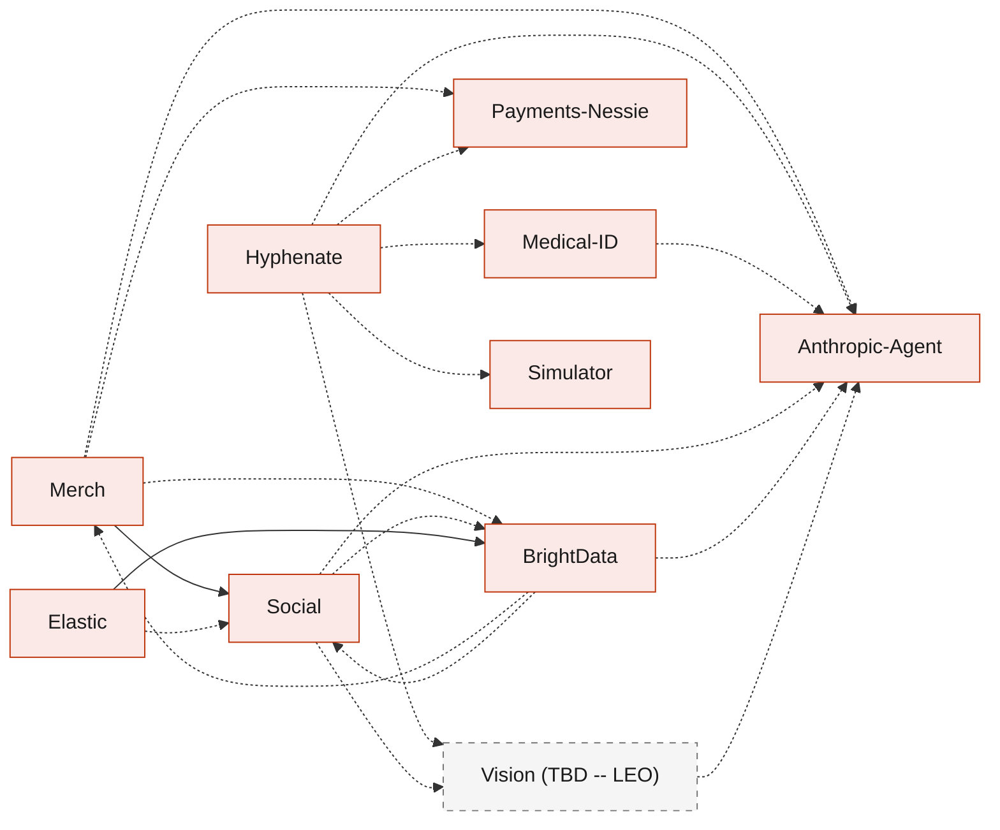

# BandIt system design

BandIt is the only band you need at a public event: a wristband that senses crowd density, raises SOS and fall alerts, lights a circle around someone who needs help, and later turns the night into a summary, connections, merch and settled insurance claims. This folder is the system design, one Markdown file per component, so any part can be removed on its own. Start with [Architecture](Architecture.md) for the big picture.

## Reading order

1. [Architecture](Architecture.md): the whole system on one page, deployment, demo flows, failure matrix.
2. [Hardware](Hardware.md): bands, gateway, station markers, the radio and the gateway wire protocol.
3. [SpacetimeDB](SpacetimeDB.md): the single source of truth, its tables and reducers.
4. [Safety](Safety.md): density, exit guidance, SOS, fall, light circle, incidents, evacuation.
5. [Gateway-Bridge](Gateway-Bridge.md) and [Rust-Backend](Rust-Backend.md): how the devices and services connect.
6. The apps, then whichever optional features you care about.

## Components

Core components are what the safety demo needs. Optional components are features that can be deleted.

| File | Component | Kind | What it covers | Needs |
|---|---|---|---|---|
| [Architecture.md](Architecture.md) | Whole system | core | context, containers, data ownership, deployment, demo flows, failure matrix, prize tracks | all |
| [Rust-Backend.md](Rust-Backend.md) | Cargo workspace and services | core | crates, processes, service identity, config and secrets, `bandit-api` and `bandit-workers` shells | SpacetimeDB |
| [Hardware.md](Hardware.md) | Bands, gateway, station markers | core | fleet, radio, packet, on-band logic, gateway wire protocol, NFC, power, limits, proposed firmware extensions | none |
| [Gateway-Bridge.md](Gateway-Bridge.md) | `bandit-bridge`, `bandit-protocol` | core | serial to SpacetimeDB, batching, directive reconciliation, command delivery, raw logs | Hardware, SpacetimeDB |
| [SpacetimeDB.md](SpacetimeDB.md) | `bandit` module | core | tables, reducers, scheduled reducers, roles and views, subscriptions, deployment | none |
| [Safety.md](Safety.md) | Safety behaviours | core | density and risk, exit guidance, SOS, fall, light circle, incidents, escalation, medic approach, evacuation, manual override | SpacetimeDB, Hardware, Gateway-Bridge |
| [Ops-Dashboard.md](Ops-Dashboard.md) | Staff web app | core | map, fleet, incidents, controls, calibration, service health | SpacetimeDB, Safety |
| [Attendee-App.md](Attendee-App.md) | Attendee web app | core | tap to join, claim by press, profile, consent, live view, routes for medic and merchant screens | SpacetimeDB |
| [Simulator.md](Simulator.md) | `bandit-sim` | optional | a simulated crowd through the same reducers, scenarios, log replay | SpacetimeDB, Hardware |
| [Vision.md](Vision.md) | Vision service (TBD -- LEO) | optional | interface contract for camera counts, person-down alerts, incident assessments, photo features | SpacetimeDB; uses Anthropic-Agent when present |
| [Medical-ID.md](Medical-ID.md) | Medical card | optional | medical PDF to a structured card, medic access rule, NFC medic flow | Attendee-App; uses Anthropic-Agent when present (else manual entry) |
| [Payments-Nessie.md](Payments-Nessie.md) | Tap to pay | optional | press-to-confirm payments, Nessie accounts, merchant terminal, payouts | Attendee-App, Gateway-Bridge |
| [Hyphenate.md](Hyphenate.md) | Incident to claim | optional | evidence packs, coverage in code, authority matrix, learned rules, ledger, letters | Safety; uses Medical-ID, Payments-Nessie, Anthropic-Agent, Vision, Simulator when present |
| [Social.md](Social.md) | Memories and connections | optional | visits, encounters, Bandshake, connection requests, social handles entered at onboarding (with the step for BrightData's profile claim), photo tagging, post-event summary, share links | SpacetimeDB; uses BrightData, Vision, Anthropic-Agent when present |
| [Merch.md](Merch.md) | Personalised merch | optional | merch from memories, design and render jobs, orders | Social; uses Anthropic-Agent, BrightData, Payments-Nessie when present |
| [Elastic.md](Elastic.md) | Organizer and search | optional | the organizer workflow over raw scraped records (fixed ES\|QL joins, the agent `bandit-organizer` for fuzzy linking and the cross-source merge, capped gap fill through Bright Data); `bandit-indexer`, the search indices and the three meaning-ranked search routes; Kibana views of each import run and the Import run, Search and Event story dashboards | BrightData; uses Social when present |
| [BrightData.md](BrightData.md) | `bandit-ingest` | optional | fetching and page extraction through Bright Data for the event, organisations, booth floor plans, schedule and merch catalogue; snapshots; the Rust map stage; unclaimed profiles and their claim; one-bundle import | SpacetimeDB; uses Anthropic-Agent, Merch, Social when present |
| [Anthropic-Agent.md](Anthropic-Agent.md) | Claude use | optional | `claude-client`, every Claude use case, structured outputs, recording and replay, guardrails | Rust-Backend |

How the optional features lean on each other. Every optional feature also builds on the core files; those arrows are left out to keep the picture readable. Solid arrows are hard needs; dashed arrows mean "uses it when it is there, degrades without it". Simulator has no dependencies of its own; Hyphenate uses it for measurement when it is there.

## How to delete a part

1. Delete the file.
2. Remove its row from the Components table above and its node from the diagram.
3. Search the other files for the file name (for example `Merch.md`). Core files mention an optional part only in a table row or bullet that starts with that file name; delete those rows. Each file's "If you delete this file" section lists exactly where they are.
4. Check the docs that depended on it (solid arrows above). A dashed arrow means the other doc already says how it degrades without it.

Deleting a core file is not intended; the safety demo needs all of them.

## Conventions

- **Rust backend.** The SpacetimeDB module and every service are Rust ([Rust-Backend](Rust-Backend.md)). Only the two browser apps are TypeScript, using SpacetimeDB's TypeScript client SDK.
- **Diagrams are Mermaid.** GitHub renders them inline, they diff as text, and every diagram here was rendered and checked before it was committed. Colours mean the same thing in every file:

| Colour | Meaning |
|---|---|
| Orange | devices and firmware (bands, gateway, station markers) |
| Red | Rust processes and crates |
| Indigo | the SpacetimeDB module |
| Blue | browser apps and people |
| Teal | external services (Elastic, Claude, Nessie, Bright Data) |
| Grey, dashed | vision, still (TBD -- LEO) |

- **(TBD -- LEO)** marks anything about cameras or computer vision. Leo owns that part; those sections define only the interface the rest of the system needs.
- **Starting values.** Thresholds and timings that are not fixed by the firmware are labelled as starting values to calibrate at the venue.
- **Names.** Tables, reducers, roles and job kinds use exact `snake_case` names, defined once in the doc that owns them ([SpacetimeDB](SpacetimeDB.md) for core tables and reducers).
- **Out of scope for these docs:** effort estimates, build instructions, false-alarm cancelling, privacy policy, synthetic-data concerns and clock synchronisation.
