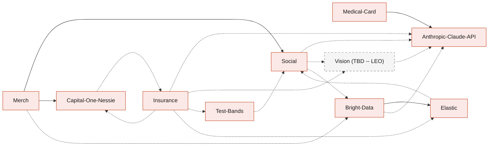

# BandIt system design

BandIt is the only band you need at a public event. The band senses crowd density, raises an SOS or a fall, and lights up the bands around someone who needs help. Meanwhile an exit marker at every exit glows that exit's colour.

Later, the same band turns the night into a recap, a people graph, merch and settled insurance claims. When an organizer (`ops`) ends the event, every attendee's tap page (/t/code) becomes their recap.

This folder is the system design. Each component has its own file, so any optional part can be removed on its own.

Judges: start with [Sponsor-Tracks](1-overview/Sponsor-Tracks.md), which quotes each track and points to the part that answers it. Then read [Architecture](1-overview/Architecture.md) for how the parts interact, [Insurance](6-features/Insurance.md) for the insurance Decision Engine and [Elastic](7-integrations/Elastic.md) for The Evidence Engine.

## Terms

One word for one thing in every doc. Code names stay as the code spells them, in backticks.

| Term | Means | Not |
| --- | --- | --- |
| attendee | a person at the event who wears a band | wearer, guest, user, visitor |
| organizer | the event staff who run the event in the organizer portal, with the `ops` role | host, ops, admin |
| medic | staff who treat people at the event, with the `medic` role | paramedic, responder |
| photographer | staff who take the event photos | |
| band | the BandIt wristband | bracelet, wearable, device |
| station marker | the device on a stand that beacons its station id, so each band picks its zone. Used for the hardware, the radio and zones | station, marker, beacon, anchor |
| exit marker | a station marker in its job at the door: it glows that exit's colour and leads bands to the nearest exit | exit beacon, exit station |
| station id | a station marker's id, above 100; a band's zone is the station id it hears loudest | |
| zone | the area around one station marker | area, region, room |
| gateway | the USB radio on the venue laptop that hears every band and station marker | receiver, hub |
| `band1t-bridge` | the program that passes gateway lines to the module and commands back | bridge service |
| the module | the `band1t` SpacetimeDB module on SpacetimeDB Maincloud | backend, server, database (alone) |
| organizer portal (/organizer) | the organizer's web app | Ops dashboard, host portal, dashboard |
| tap page (/t/code) | the page a band's NFC sticker opens | attendee app, band page, landing page |
| recap | the tap page after the event ends | summary page |
| light circle | the bands near a person in trouble, pulsing blue | witness ring, halo |
| witness | a band in the light circle when an incident opens, kept as an `incident_band` row | |
| incident | an SOS, a fall or damage the module records | alert, event (alone) |
| security cameras | the venue's cameras, each covering one zone | security room camera, venue camera |
| security view | the camera software on the venue laptop | vision service, camera app |
| camera sighting | the security view's record of a flash on an incident | verdict, assessment |
| medical card | the attendee's own health information | medical ID, medical profile |
| hospital report | the hospital's report and itemised bill for a claim | medical record, clinic report |
| claim | an insurance claim the attendee files after an incident | case, request |
| evidence pack | a claim's numbered facts, checks and fingerprint | evidence bundle |
| The Evidence Engine | Elastic's part: past claims, recap ranking, event setup and the raw data | evidence agent, search |
| the insurance Decision Engine | the Anthropic Claude API plus the Rust code that decides insurance claims | claims agent, Decision Engine (alone) |
| wallet | the attendee's Capital One Nessie account in BandIt | account (alone) |
| findable switch | the one consent switch at sign-up | privacy toggle, consent switch |

## Folder map

The folders follow the usual order of a system design: what the system must do, the data, the services, the devices, the apps, the features and the outside services.

| Folder | Files | What it answers |
|---|---|---|
| 1-overview | [Sponsor-Tracks](1-overview/Sponsor-Tracks.md), [Requirements](1-overview/Requirements.md), [Architecture](1-overview/Architecture.md), [Flows](1-overview/Flows.md), [Decisions](1-overview/Decisions.md) | what each sponsor track asks and where BandIt answers it, what BandIt must do, how the parts interact, the event step by step, and the choices that cut across files |
| 2-data | [SpacetimeDB](2-data/SpacetimeDB.md) | the single source of truth: tables, reducers, views, subscriptions |
| 3-services | [Rust-Backend](3-services/Rust-Backend.md), [Gateway-Bridge](3-services/Gateway-Bridge.md), [Test-Bands](3-services/Test-Bands.md) | the Rust processes and where they run |
| 4-devices | [Hardware](4-devices/Hardware.md), [Vision](4-devices/Vision.md) | the bands, the gateway, the station markers and the security cameras (TBD -- LEO) |
| 5-apps | [Organizer-Portal](5-apps/Organizer-Portal.md), [Tap-Page](5-apps/Tap-Page.md) | the two browser apps: the organizer portal and the tap page |
| 6-features | [Safety](6-features/Safety.md), [Social](6-features/Social.md), [Medical-Card](6-features/Medical-Card.md), [Merch](6-features/Merch.md), [Insurance](6-features/Insurance.md) | what BandIt does for people |
| 7-integrations | [Elastic](7-integrations/Elastic.md), [Bright-Data](7-integrations/Bright-Data.md), [Capital-One-Nessie](7-integrations/Capital-One-Nessie.md), [Anthropic-Claude-API](7-integrations/Anthropic-Claude-API.md) | the sponsor and outside services |

## Reading order

1. [Sponsor-Tracks](1-overview/Sponsor-Tracks.md): each track's own words, the three engines, and where to see each part running.
2. [Requirements](1-overview/Requirements.md): goals, functional and non-functional requirements, scale, constraints.
3. [Architecture](1-overview/Architecture.md): how the parts interact, who decides what, what each database does best, deployment.
4. [Flows](1-overview/Flows.md): the event from setup to the close, step by step.
5. [SpacetimeDB](2-data/SpacetimeDB.md) and [Safety](6-features/Safety.md): the live world and the safety behaviours built on it.
6. [Hardware](4-devices/Hardware.md), [Gateway-Bridge](3-services/Gateway-Bridge.md) and [Rust-Backend](3-services/Rust-Backend.md): how the devices and services connect.
7. The apps, then the features and integrations you care about. For the tracks: [Insurance](6-features/Insurance.md) (the insurance Decision Engine) and [Elastic](7-integrations/Elastic.md) (The Evidence Engine).
8. [Decisions](1-overview/Decisions.md) is the log of cross-cutting choices. Each file also ends with its own Decisions table.

## Components

Core components are what the safety features need. Optional components are features that can be deleted.

| File | Component | Kind | What it covers | Needs |
|---|---|---|---|---|
| [Sponsor-Tracks.md](1-overview/Sponsor-Tracks.md) | Sponsor tracks | core | each track's exact words, mapped to the part of BandIt that answers it; the three engines; where judges see each part | none |
| [Requirements.md](1-overview/Requirements.md) | Requirements | core | goals, functional requirements F1 to F17, quality targets, scale, constraints, out of scope | none |
| [Architecture.md](1-overview/Architecture.md) | Whole system | core | how the parts interact, who decides what, context, containers, the live loop, data ownership, what each database does best, deployment | all |
| [Flows.md](1-overview/Flows.md) | The event flow | core | setup before doors open, the nine steps of the event, the index of sequence diagrams | all |
| [Decisions.md](1-overview/Decisions.md) | Decision log | core | build, deployment, identity and sponsor decisions | none |
| [SpacetimeDB.md](2-data/SpacetimeDB.md) | `band1t` module | core | tables, reducers, scheduled reducers, roles and views, subscriptions, deployment | none |
| [Rust-Backend.md](3-services/Rust-Backend.md) | Cargo workspace and services | core | crates, processes and where they run, service identity, config and secrets, `bandit-api` and `bandit-workers` | SpacetimeDB |
| [Gateway-Bridge.md](3-services/Gateway-Bridge.md) | `band1t-bridge` | core | serial to SpacetimeDB through the ingest reducers, command delivery one at a time with the gateway's ack, the gateway line protocol | Hardware, SpacetimeDB |
| [Hardware.md](4-devices/Hardware.md) | Bands, gateway, station markers | core | the fleet, radio, packet, on-band logic, state precedence, gateway wire protocol, NFC, power, limits | none |
| [Safety.md](6-features/Safety.md) | Safety behaviours | core | density on the bands and each zone's level, the exit markers, SOS, fall, light circle, incidents from open to resolve, a medic taking an incident, low visibility, calibration, the override and forced states, and exit routing and the medic approach (TBD -- LEO) | SpacetimeDB, Hardware, Gateway-Bridge |
| [Organizer-Portal.md](5-apps/Organizer-Portal.md) | Organizer portal | core | the Live tab ("Alerts", venue map, zone table, low visibility), the incident desk, the attendee list and the "Event ended" button for `ops`, the big-screen graph | SpacetimeDB, Safety |
| [Tap-Page.md](5-apps/Tap-Page.md) | Tap page | core | sign-in and tap to join, band codes, claim by press, band setup and the thank-you screen, the recap after the event | SpacetimeDB |
| [Test-Bands.md](3-services/Test-Bands.md) | The in-module crowd and the test bands, driven by `bandit-claims` | optional | a crowd of 1,000 crowd bands from 100 with generated attendees inside the module, test bands 90 to 99 through `report_test_band`, scenarios | SpacetimeDB, Hardware; uses Social when present |
| [Vision.md](4-devices/Vision.md) | Security cameras and the security view (TBD -- LEO) | optional | the security view that finds a calling band's flash on a security camera, the 3D venue model, the radio and photo recorders; camera sightings and property events for incidents; planned head counts, person-down alerts and photo features | SpacetimeDB; uses Anthropic-Claude-API and Elastic when present |
| [Medical-Card.md](6-features/Medical-Card.md) | Medical card | optional | the medical history and health insurance PDFs to one card, the medic access rule, the card on a medic's tap and in the incident desk | Tap-Page, Organizer-Portal, Anthropic-Claude-API |
| [Social.md](6-features/Social.md) | Memories and the people graph | optional | visits, encounters, the people graph, the big screen's 3D event graph with the event photos, the Photos tab, Meta handles typed at onboarding, photo tagging and tap to share, the recap's social part, share links | SpacetimeDB; uses Bright-Data, Test-Bands, Vision, Anthropic-Claude-API when present |
| [Merch.md](6-features/Merch.md) | Personalised merch | optional | a few hand-made templates (t-shirt, mug, poster), the attendee's own photo in each template's photo area, suggestions by booth time, one-tap orders from the recap, paid from the wallet | Social, Capital-One-Nessie; uses Bright-Data when present |
| [Capital-One-Nessie.md](7-integrations/Capital-One-Nessie.md) | Wallet and payouts | optional | a $200 Capital One Nessie sandbox wallet per attendee with an exact balance kept in the module, one-tap merch checkout after the event, claim payouts | Tap-Page; uses Insurance when present |
| [Insurance.md](6-features/Insurance.md) | Incident to claim | optional | the scripted claims run, evidence packs, bill review, coverage in code, the organizer's decisions, learned rules, ledger, the accuracy scorecard | Safety; uses Capital-One-Nessie, Anthropic-Claude-API, Elastic, Vision, Test-Bands when present |
| [Elastic.md](7-integrations/Elastic.md) | `bandit-organize` and recap order | optional | recap suggestions ranked by interest match through `bandit-indexer`; the scraped event data organized by the `bandit-organize` workflow in Elastic Workflows before import; Vision.md: the raw radio data and photo records stored for Elastic Kibana | uses Bright-Data and Social when present |
| [Bright-Data.md](7-integrations/Bright-Data.md) | `bandit-ingest` | optional | the event's organisations, booths, floor plan and schedule through the Bright Data Web MCP, the profile claim, the one-bundle import; the 3D venue model exported through the Bright Data Browser API; any event's venue set up from its name on the organizer portal | Elastic; uses Anthropic-Claude-API and Social when present |
| [Anthropic-Claude-API.md](7-integrations/Anthropic-Claude-API.md) | Anthropic Claude API use | optional | `claude-client`, every Anthropic Claude API use case, structured outputs, recording and replay, guardrails | Rust-Backend |

How the optional features lean on each other. Every optional feature also builds on the core files; those arrows are left out to keep the picture readable.

Solid arrows are hard needs. Dashed arrows mean "uses it when it is there, and works without it".

## How to delete a part

1. Delete the file.
2. Remove its row from the Components table above and its node from the diagram.
3. Follow the "If you delete this file" list in its Dependencies section. Core files mention an optional part only in a table row or line that starts with that file name (for example "Merch.md:"), so search for the file name and delete those rows.
4. Check the files with a solid arrow into it. A dashed arrow means the other file already says how it works without it.

Deleting a core file is not intended; the safety features need all of them.

## Conventions

- **Every file has the same sections:** Role in the system, Interfaces, Design, Failure modes and fallbacks, Dependencies, and a closing Decisions table. Every choice is decided.
- **Rust backend.** The SpacetimeDB module and every service are Rust ([Rust-Backend](3-services/Rust-Backend.md)). Only the two browser apps are TypeScript, using SpacetimeDB's TypeScript client SDK.
- **Happy paths first.** The design follows a few clear paths. An edge case stays only when it protects a person, judges see it at the event, or it wins a sponsor track, such as the insurance cases in [Insurance](6-features/Insurance.md).
- **Diagrams are Mermaid.** GitHub renders them inline and they diff as text. Every diagram here was rendered and checked before it was committed. Colours mean the same thing in every file:

| Colour | Meaning |
|---|---|
| Orange | devices and firmware (bands, gateway, station markers) |
| Red | Rust processes and crates |
| Indigo | the SpacetimeDB module |
| Blue | browser apps and people |
| Teal | outside services (Elastic, the Anthropic Claude API, Capital One Nessie, Bright Data, SpacetimeDB SpacetimeAuth) |
| Grey, dashed | the security view, still (TBD -- LEO) |

- **Excalidraw diagrams.** The whole system is also drawn in [bandit-system-design.excalidraw](../diagrams/bandit-system-design.excalidraw), on branch `vik-excalidraw-diagrams`. Open it at excalidraw.com or with the Excalidraw extension for VS Code; the generator that draws it is in `diagrams/generator`. The Mermaid diagrams in these files are the reference.
- **(TBD -- LEO)** marks Leo's parts: the security cameras and the security view, the zone pick on the band, exit routing and the medic approach. The sections give Leo's starting design, built on the names the code already has.
- **Starting values.** Thresholds and timings that the firmware does not fix are labelled as starting values, to calibrate at the venue.
- **Names.** Tables, reducers, roles and job kinds use exact `snake_case` names, defined once in the file that owns them ([SpacetimeDB](2-data/SpacetimeDB.md) for the core).
- **Out of scope** is listed in [Requirements](1-overview/Requirements.md).
