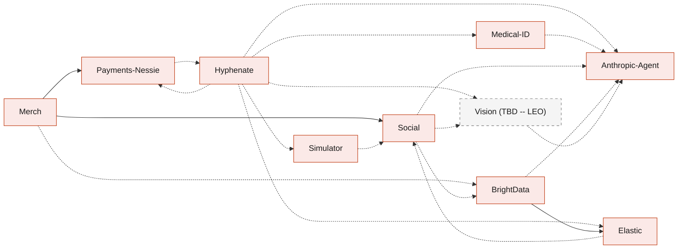

# BandIt system design

BandIt is the only band you need at a public event. A wristband senses crowd density, raises SOS and fall alerts, and lights and buzzes the bands around someone who needs help. Later, the same band turns the night into a recap, a people graph, merch and settled insurance claims: when a staff member with `ops` ends the event, every attendee's page becomes their recap. This folder is the system design. Each component has its own file, so any optional part can be removed on its own. Start with [Requirements](1-overview/Requirements.md), then [Architecture](1-overview/Architecture.md).

## Folder map

The folders follow the usual order of a system design: what the system must do, the data, the services, the devices, the apps, the features and the outside services.

| Folder | Files | What it answers |
|---|---|---|
| 1-overview | [Requirements](1-overview/Requirements.md), [Architecture](1-overview/Architecture.md), [Flows](1-overview/Flows.md), [Decisions](1-overview/Decisions.md) | what BandIt must do, how the parts fit, the demo step by step, and the choices that cut across files |
| 2-data | [SpacetimeDB](2-data/SpacetimeDB.md) | the single source of truth: tables, reducers, views, subscriptions |
| 3-services | [Rust-Backend](3-services/Rust-Backend.md), [Gateway-Bridge](3-services/Gateway-Bridge.md), [Simulator](3-services/Simulator.md) | the Rust processes and where they run |
| 4-devices | [Hardware](4-devices/Hardware.md), [Vision](4-devices/Vision.md) | the bands, gateway, station markers and the camera (TBD -- LEO) |
| 5-apps | [Ops-Dashboard](5-apps/Ops-Dashboard.md), [Attendee-App](5-apps/Attendee-App.md) | the two browser apps |
| 6-features | [Safety](6-features/Safety.md), [Social](6-features/Social.md), [Medical-ID](6-features/Medical-ID.md), [Merch](6-features/Merch.md) | what BandIt does for people |
| 7-integrations | [Elastic](7-integrations/Elastic.md), [BrightData](7-integrations/BrightData.md), [Payments-Nessie](7-integrations/Payments-Nessie.md), [Hyphenate](7-integrations/Hyphenate.md), [Anthropic-Agent](7-integrations/Anthropic-Agent.md) | the sponsor and outside services |

## Reading order

1. [Requirements](1-overview/Requirements.md): goals, functional and non-functional requirements, scale, constraints.
2. [Architecture](1-overview/Architecture.md): the whole system on one page, what each database does best, deployment.
3. [Flows](1-overview/Flows.md): the demo from setup to the close, step by step.
4. [SpacetimeDB](2-data/SpacetimeDB.md) and [Safety](6-features/Safety.md): the live world and the safety behaviours built on it.
5. [Hardware](4-devices/Hardware.md), [Gateway-Bridge](3-services/Gateway-Bridge.md) and [Rust-Backend](3-services/Rust-Backend.md): how the devices and services connect.
6. The apps, then the features and integrations you care about.
7. [Decisions](1-overview/Decisions.md) is the log of cross-cutting choices. Each file also ends with its own Decisions table.

## Components

Core components are what the safety demo needs. Optional components are features that can be deleted.

| File | Component | Kind | What it covers | Needs |
|---|---|---|---|---|
| [Requirements.md](1-overview/Requirements.md) | Requirements | core | goals, functional requirements F1 to F17, quality targets, scale, constraints, out of scope | none |
| [Architecture.md](1-overview/Architecture.md) | Whole system | core | context, containers, the live loop, data ownership, what each database does best, deployment, prize tracks | all |
| [Flows.md](1-overview/Flows.md) | Demo flows | core | setup before the demo, the nine demo steps, the index of sequence diagrams | all |
| [Decisions.md](1-overview/Decisions.md) | Decision log | core | build, deployment, identity and sponsor decisions | none |
| [SpacetimeDB.md](2-data/SpacetimeDB.md) | `band1t` module | core | tables, reducers, scheduled reducers, roles and views, subscriptions, deployment | none |
| [Rust-Backend.md](3-services/Rust-Backend.md) | Cargo workspace and services | core | crates, processes and where they run, service identity, config and secrets, `bandit-api` and `bandit-workers` | SpacetimeDB |
| [Gateway-Bridge.md](3-services/Gateway-Bridge.md) | `bandit-bridge`, `bandit-protocol` | core | serial to SpacetimeDB, batching, directive reconciliation, command delivery, press to confirm, raw logs | Hardware, SpacetimeDB |
| [Hardware.md](4-devices/Hardware.md) | Bands, gateway, station markers | core | the fleet, radio, packet, on-band logic, state precedence, gateway wire protocol, NFC, power, limits | none |
| [Safety.md](6-features/Safety.md) | Safety behaviours | core | density and risk, exit colours and vibration, SOS, fall, light circle, incidents, medic approach, evacuation, override | SpacetimeDB, Hardware, Gateway-Bridge |
| [Ops-Dashboard.md](5-apps/Ops-Dashboard.md) | Staff web app | core | venue map, fleet, incidents, controls, calibration, service health, the host portal for `ops`, the big-screen graph | SpacetimeDB, Safety |
| [Attendee-App.md](5-apps/Attendee-App.md) | Attendee web app | core | sign-in and tap to join, claim by press, profile and consent, live view, medic view, the recap page | SpacetimeDB |
| [Simulator.md](3-services/Simulator.md) | The in-module crowd and the demo bands, driven by `bandit-claims` | optional | a simulated crowd with simulated owners inside the module, demo bands 90 to 99 through `report_sim_band`, scenarios, log replay | SpacetimeDB, Hardware; uses Social when present |
| [Vision.md](4-devices/Vision.md) | Vision service (TBD -- LEO) | optional | camera counts, person-down alerts, incident assessments, photo features | SpacetimeDB; uses Anthropic-Agent when present |
| [Medical-ID.md](6-features/Medical-ID.md) | Medical card | optional | medical PDF to a structured card, the medic access rule, the medic tap flow | Attendee-App; uses Anthropic-Agent when present |
| [Social.md](6-features/Social.md) | Memories and the people graph | optional | visits, encounters, the people graph, Meta handles typed at onboarding, photo tagging and tap to share, the recap's social part, share links | SpacetimeDB; uses BrightData, Simulator, Vision, Anthropic-Agent when present |
| [Merch.md](6-features/Merch.md) | Personalised merch | optional | a few hand-made templates (t-shirt, mug, poster), the attendee's own photo in each template's photo area, suggestions by booth time, one-tap orders from the recap page, paid from the wallet | Social, Payments-Nessie; uses BrightData when present |
| [Payments-Nessie.md](7-integrations/Payments-Nessie.md) | Wallet and payouts | optional | a $200 Nessie sandbox wallet per attendee with an exact balance kept in the module, one-tap merch checkout after the event, claim payouts | Attendee-App; uses Hyphenate when present |
| [Hyphenate.md](7-integrations/Hyphenate.md) | Incident to claim | optional | the live-learning claims demo, evidence packs, bill review, coverage in code, authority matrix, learned rules, ledger, the accuracy scorecard | Safety; uses Medical-ID, Payments-Nessie, Anthropic-Agent, Elastic, Vision, Simulator when present |
| [Elastic.md](7-integrations/Elastic.md) | Organizer and recap order | optional | the `bandit-organize` Workflow over scraped records, `bandit-indexer`, the recap's suggestions ordered by meaning, Kibana dashboards | uses BrightData and Social when present |
| [BrightData.md](7-integrations/BrightData.md) | `bandit-ingest` | optional | the event's organisations, booths, floor plan and schedule through the Bright Data Web MCP, the profile claim, the one-bundle import | Elastic; uses Anthropic-Agent and Social when present |
| [Anthropic-Agent.md](7-integrations/Anthropic-Agent.md) | Claude use | optional | `claude-client`, every Claude use case, structured outputs, recording and replay, guardrails | Rust-Backend |

How the optional features lean on each other. Every optional feature also builds on the core files; those arrows are left out to keep the picture readable. Solid arrows are hard needs. Dashed arrows mean "uses it when it is there, and works without it".

## How to delete a part

1. Delete the file.
2. Remove its row from the Components table above and its node from the diagram.
3. Follow the "If you delete this file" list in its Dependencies section. Core files mention an optional part only in a table row or line that starts with that file name (for example "Merch.md:"), so search for the file name and delete those rows.
4. Check the files with a solid arrow into it. A dashed arrow means the other file already says how it works without it.

Deleting a core file is not intended; the safety demo needs all of them.

## Conventions

- **Every file has the same sections:** Role in the system, Interfaces, Design, Failure modes and fallbacks, Dependencies, and a closing Decisions table. Every choice is decided.
- **Rust backend.** The SpacetimeDB module and every service are Rust ([Rust-Backend](3-services/Rust-Backend.md)). Only the two browser apps are TypeScript, using SpacetimeDB's TypeScript client SDK.
- **Happy paths first.** The design follows a few clear paths. An edge case stays only when it protects a person, a judge will see it, or it wins a sponsor track, such as the insurance cases in [Hyphenate](7-integrations/Hyphenate.md).
- **Diagrams are Mermaid.** GitHub renders them inline and they diff as text. Every diagram here was rendered and checked before it was committed. Colours mean the same thing in every file:

| Colour | Meaning |
|---|---|
| Orange | devices and firmware (bands, gateway, station markers) |
| Red | Rust processes and crates |
| Indigo | the SpacetimeDB module |
| Blue | browser apps and people |
| Teal | outside services (Elastic, Claude, Nessie, Bright Data, SpacetimeAuth) |
| Grey, dashed | vision, still (TBD -- LEO) |

- **Excalidraw diagrams.** The whole system is also drawn in [bandit-system-design.excalidraw](../diagrams/bandit-system-design.excalidraw), on branch `vik-excalidraw-diagrams`. Open it at excalidraw.com or with the Excalidraw extension for VS Code. The generator that draws it is in `diagrams/generator`. The Mermaid diagrams in these files are the reference.
- **(TBD -- LEO)** marks anything about cameras or computer vision. Leo owns that part. The sections give Leo's starting defaults and the interface the rest of the system needs.
- **Starting values.** Thresholds and timings that the firmware does not fix are labelled as starting values, to calibrate at the venue.
- **Names.** Tables, reducers, roles and job kinds use exact `snake_case` names, defined once in the file that owns them ([SpacetimeDB](2-data/SpacetimeDB.md) for the core).
- **Out of scope** is listed in [Requirements](1-overview/Requirements.md).
