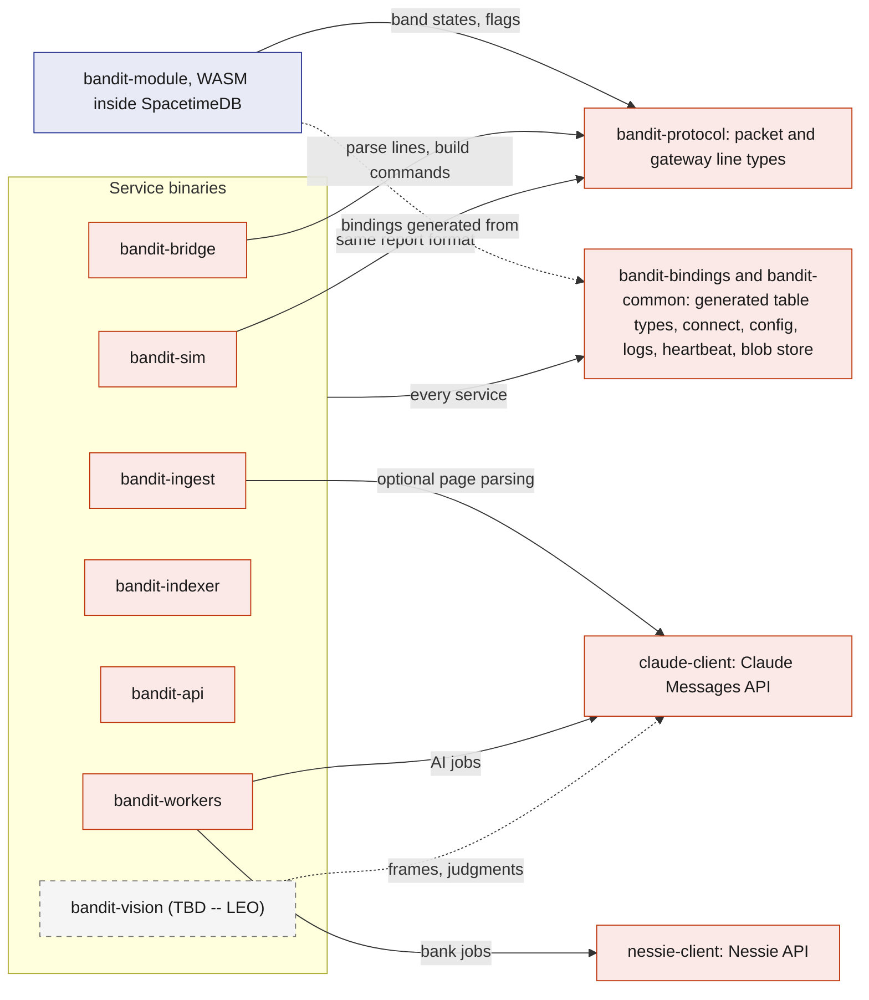
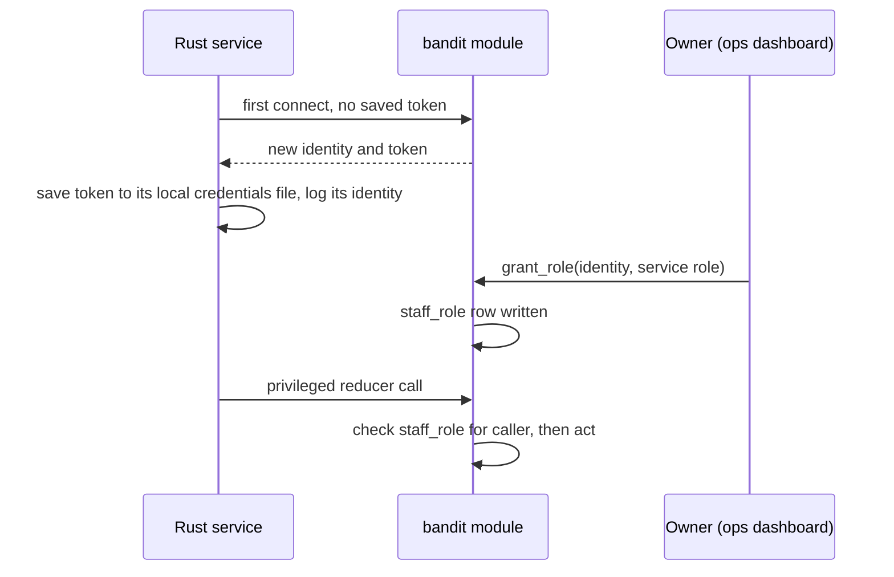
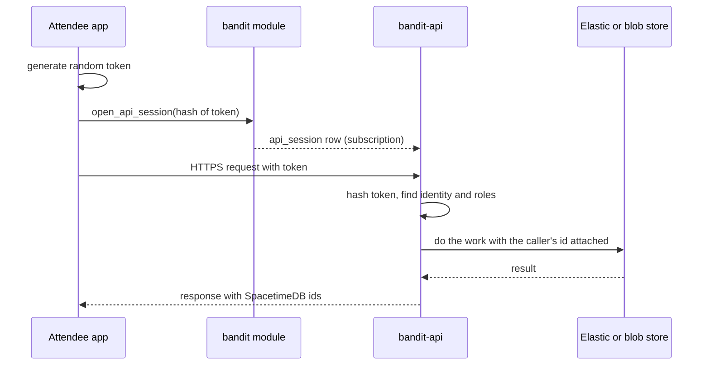
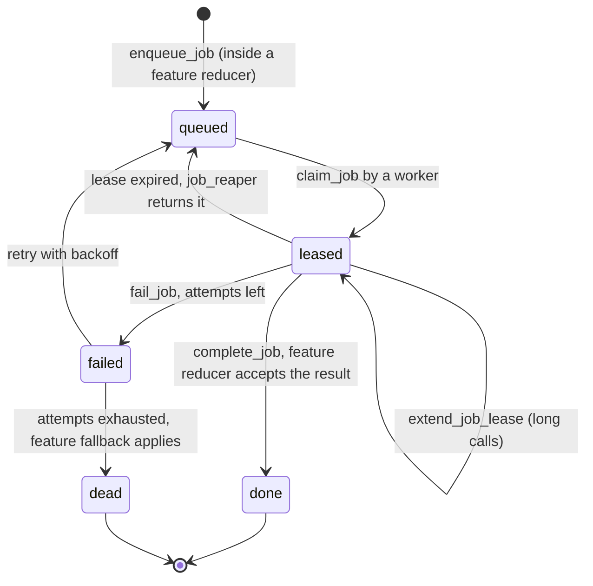

# Rust backend

Every piece of BandIt's backend is Rust: the SpacetimeDB module, the device bridge, the simulator, the scraper, the search indexer, the HTTP edge and the job workers. They live in one Cargo workspace so they share one set of protocol types and one set of generated SpacetimeDB bindings, which keeps a field rename from silently breaking another process. This file describes the workspace, the processes, how each one identifies itself to the database, and the two service shells (`bandit-api` and `bandit-workers`) that feature docs plug into.

## Role in the system

Responsibilities:

- the Cargo workspace layout and what each crate is for;
- the catalogue of running processes, their SpacetimeDB roles and their secrets;
- service identity, configuration and secrets handling;
- the `bandit-api` shell: authentication, blob storage, and the endpoint registry that feature docs add rows to;
- the `bandit-workers` shell: the job loop, leases, concurrency, and the handler registry that feature docs add rows to;
- logging, health reporting and run profiles.

Not here: what the module's tables and reducers are ([SpacetimeDB](SpacetimeDB.md)), how the bridge talks to the gateway ([Gateway-Bridge](Gateway-Bridge.md)), what any feature's endpoint or job does (the feature's own doc), and how Claude is called ([Anthropic-Agent](Anthropic-Agent.md)).

## Interfaces

Every process, what it is allowed to do in the database, and what it talks to outside.

| Process | Crate | SpacetimeDB role | Talks to | Secrets it holds |
|---|---|---|---|---|
| `bandit` module | `bandit-module` | runs inside SpacetimeDB | nothing outside the database | none |
| `bandit-bridge` | `bandit-bridge` | `bridge` | gateway over USB serial | its SpacetimeDB token |
| Simulator.md: `bandit-sim` | `bandit-sim` | `simulator` | nothing outside | its SpacetimeDB token |
| `bandit-ingest` | `bandit-ingest` | `ingest` | the `bandit` module (seed mode); BrightData.md: Bright Data, OpenStreetMap, Claude API (`floorplan_check`; `scrape_extract` only without Elastic.md); Elastic.md: Elastic Serverless (raw indices, the organizer workflow) | SpacetimeDB token; BrightData.md: Bright Data key, Anthropic key, mail sender credentials; Elastic.md: Elastic ingest key |
| Elastic.md: `bandit-indexer` | `bandit-indexer` | `indexer` | Elastic Serverless | SpacetimeDB token, Elastic key |
| `bandit-api` | `bandit-api` | `api` | browsers over HTTPS, the blob store; Elastic.md: Elastic Serverless | SpacetimeDB token, blob store credentials; Elastic.md: Elastic key; Social.md: OAuth client secrets |
| `bandit-workers` | `bandit-workers` | `worker` | the blob store; Anthropic-Agent.md: Claude API; Payments-Nessie.md: Nessie | SpacetimeDB token, blob store credentials; Anthropic-Agent.md: Anthropic key; Payments-Nessie.md: Nessie key |
| Vision.md (TBD -- LEO): `bandit-vision` | `bandit-vision` | `vision` | cameras; Anthropic-Agent.md: Claude API through `claude-client` | SpacetimeDB token, Anthropic key |

## Design

### Why Rust everywhere, and what runs where

The module must be Rust or another WASM language to run inside SpacetimeDB; choosing Rust for the services too means the radio packet types, the job payloads and the generated table bindings are one set of Rust types used on both sides of every connection. The module itself cannot reach the gateway, the cameras or external APIs, and putting API keys in the module environment would expose them, so every side effect outside the database happens in a separate Rust process that connects as an ordinary SpacetimeDB client.

### Workspace layout

Which crate depends on which. Every service binary also uses `bandit-bindings` and `bandit-common`; the arrows show only the dependencies that differ between binaries.

| Crate | Kind | Purpose | Owner doc |
|---|---|---|---|
| `bandit-protocol` | library | mirrors the firmware's shared header: packet fields, flag bits, band states, command names, exit colour indices, and the gateway's JSON line and command line formats | [Gateway-Bridge](Gateway-Bridge.md) |
| `bandit-module` | WASM library | the SpacetimeDB module `bandit` | [SpacetimeDB](SpacetimeDB.md) |
| `bandit-bindings` | library | client bindings generated from the module, plus one helper that connects with a saved token and reports the service's identity | this file |
| `bandit-common` | library | config loading, structured logging, the 5 s heartbeat, the blob store abstraction (local folder or S3-compatible bucket) | this file |
| `claude-client` | library | the only way any process calls Claude; also records every call | [Anthropic-Agent](Anthropic-Agent.md) |
| `nessie-client` | library | typed calls to Nessie | [Payments-Nessie](Payments-Nessie.md) |
| `bandit-bridge`, `bandit-sim`, `bandit-ingest`, `bandit-indexer`, `bandit-api`, `bandit-workers` | binaries | the processes in the Interfaces table | their docs |
| Vision.md (TBD -- LEO): `bandit-vision` | binary | the proposed vision service; it calls Claude through `claude-client` like the workers do | [Vision](Vision.md) |

The two browser apps use TypeScript bindings generated from the same module, so the web and Rust sides cannot drift apart either.

Candidate third-party crates, chosen because they are mature and async-friendly: `spacetimedb` (module) and `spacetimedb-sdk` (clients), `tokio`, `serde` and `serde_json`, `tokio-serial` (bridge), `axum` (API), `reqwest` (all HTTPS clients), `sha2` (evidence and blob hashes), `tracing` (logs), `resvg` (Merch.md rendering), `image` (Vision.md frame resizing, TBD -- LEO).

### Service identity and roles

Every process is a SpacetimeDB client with its own identity, so every reducer can check who is calling.

- The module's init reducer seeds the database owner as `owner`. Only `owner` can call `grant_role` and `revoke_role`.
- Each service keeps its token in a local credentials file, never in the repo. Restarting a service keeps its identity, so its role survives restarts.
- Service roles are narrow: the bridge can report bands and acknowledge commands but cannot touch claims; workers can submit job results but cannot force band states.

### Configuration and secrets

- Each process reads one config file plus environment variables for secrets. The config picks the database (Maincloud or the laptop standalone fallback, see [Architecture](Architecture.md)), the database name `bandit`, and process-specific settings such as the serial port or the job kinds a worker handles.
- Secrets (the SpacetimeDB tokens, the blob store credentials, and each feature's own keys: Anthropic-Agent.md: Anthropic key; Elastic.md: Elastic key; BrightData.md: Bright Data key and mail sender credentials; Payments-Nessie.md: Nessie key; Social.md: OAuth client secrets) live only in the environment of the processes listed in the Interfaces table. They are never written to SpacetimeDB rows, never sent to browsers and never committed.
- Switching from Maincloud to the laptop fallback is a config change plus a restart of each process; no code changes.

### `bandit-api`: the HTTP edge

`bandit-api` exists for the few things browsers cannot do directly against SpacetimeDB: calls that need a secret (Elastic), large files (photos, PDFs, merch images), and public pages (share links).

How it knows who is calling: the browser generates a random session token, registers its hash with the `open_api_session` reducer (bound to the caller's SpacetimeDB identity, with an expiry), then sends the token with each HTTPS request. `bandit-api` subscribes to `api_session` with its `api` role, hashes the presented token and looks up the identity. This needs no JWT verification and no second login, and revoking a session is a row delete.

Blob storage: an upload is streamed to the blob store (a local folder in the demo, an S3-compatible bucket if hosted), hashed with SHA-256, and registered with `register_blob` (callable by the `api` and `worker` roles, since workers also produce files such as letters and renders), which writes a `blob_ref` row with content type, size, hash, owner and an access class (`owner_only`, `staff`, `shared`). Downloads check the caller against that access class. Large files never go into SpacetimeDB rows, because big rows slow commits and subscriptions.

Endpoint registry. Core endpoints are below; each optional feature adds its own rows and owns their behaviour.

| Endpoint | Purpose | Owner |
|---|---|---|
| health | liveness for the dashboard and scripts | this file |
| blob upload | stream a file in, hash it, call `register_blob` | this file |
| blob download | serve a file if the caller passes its access class | this file |
| Elastic.md: `GET /search/booths`, `GET /search/memories`, `GET /search/photos` | meaning-ranked search proxies holding the Elastic key; each builds the caller's filter from `api_session` and the `api_presence_windows` view before Elastic ranks | [Elastic](Elastic.md) |
| BrightData.md: `POST /claim/person`, `GET /claim/confirm/{token}` | start and confirm a claim on an unclaimed exhibitor, speaker, sponsor or artist profile | [BrightData](BrightData.md) |
| Medical-ID.md: `POST /api/medical/document` | upload the medical PDF as `owner_only`, call `submit_medical_document`, which enqueues `medical_extract` | [Medical-ID](Medical-ID.md) |
| Social.md: OAuth sign-in callbacks (`link_social_handle`), photographer photo upload, share-link page | verified handles in; photos in; public page for a share token | [Social](Social.md) |
| Merch.md: design image download | mockups for the attendee and friends in the design | [Merch](Merch.md) |

### `bandit-workers`: the job runner

All slow or external work is a `job` row ([SpacetimeDB](SpacetimeDB.md)). `bandit-workers` is one process that runs a handler per job kind, so adding a feature means adding a handler, not a new service.

How one job moves through a worker:

- **Claiming.** The worker subscribes to queued jobs of the kinds it handles and calls `claim_job`. The reducer gives the job to exactly one caller, so two workers never run the same job.
- **Leases.** A lease lasts 60 s (starting value). Handlers with long model outputs call `extend_job_lease`. If a worker dies, `job_reaper` puts the job back in the queue after the lease runs out.
- **Results.** The handler submits its result through the feature's reducer, which checks that the caller still holds the lease. A slow duplicate whose lease was handed on is rejected, so it cannot overwrite a newer result.
- **External side effects.** Handlers that change something outside (for example a bank purchase or a payout) first record the external request id on the job, and check for it before calling again, so a retry after a crash does not pay twice.
- **Concurrency.** Each kind has its own concurrency limit, so a burst of post-event stories cannot starve a payment. Nothing in the safety path ever waits on a job.
- **Dead jobs.** After 3 attempts (starting value) the job is `dead` and the feature's no-AI or manual fallback applies; the ops dashboard's job monitor shows it.

Handler registry. Each optional feature owns its rows.

| Job kind | Handler does | Owner |
|---|---|---|
| Medical-ID.md: `medical_extract` | PDF to a validated medical card through Claude | [Medical-ID](Medical-ID.md) |
| Payments-Nessie.md: `nessie_onboard`, `nessie_purchase`, `nessie_payout` | create bank customer and account; settle a purchase; pay out a claim or refund | [Payments-Nessie](Payments-Nessie.md) |
| Hyphenate.md: `claim_draft`, `recovery_letter` | first notice of loss and claim summary; recovery query letter | [Hyphenate](Hyphenate.md) |
| Merch.md: `merch_design`, `merch_render` | design brief through Claude (template and slot choices); composite the SVG and render mockups in Rust | [Merch](Merch.md) |
| Social.md: `summary_story` | the attendee's story of the night through Claude, often as a batch | [Social](Social.md) |
| Vision.md (TBD -- LEO): `photo_features` | not a `bandit-workers` handler; `bandit-vision` claims it with the `vision` role | [Vision](Vision.md) |

### Health and logs

- Every process calls `heartbeat` every 5 s with its name, version and a few counters (the bridge adds gateway lines per second and per-band loss; workers add queue depth per kind). The ops dashboard turns `service_heartbeat` rows into a service health strip and greys a service out after 15 s of silence.
- Every process writes structured logs with `tracing`, to the console and to a local file, tagged with the SpacetimeDB row ids it touched, so a log line can be matched to an incident or a job.

### Run profiles

| Profile | Database | Bands | AI (Anthropic-Agent.md) | Use |
|---|---|---|---|---|
| Live demo | Maincloud | real bands through the bridge, plus a simulated crowd (Simulator.md) | live Claude calls, recorded | the judged demo |
| Offline fallback | laptop standalone | real bands, optional sim | replay of recorded Claude responses | no venue internet |
| Rehearsal | either | sim only, or the bridge replaying a recorded `.jsonl` log | live or replay | practising the choreography without wearers |

## Failure modes and fallbacks

| Failure | Effect | Design answer |
|---|---|---|
| A service loses its credentials file | It gets a new identity with no role; its reducer calls are refused | The owner grants the role to the new identity from the dashboard; the refusal is logged loudly. |
| `bandit-workers` crashes mid-job | Jobs stay leased | `job_reaper` returns them after the lease; external calls check the recorded request id before retrying. |
| `bandit-api` is down | No uploads, search or share pages | Live safety, payments and the summary views keep working directly against SpacetimeDB. |
| A secret is missing for one feature | That feature's handlers fail | Only those job kinds go `dead`; other features run; the job monitor shows which kind is failing. |
| Bindings out of date after a schema change | A service fails to start or misreads rows | Regenerate the Rust and TypeScript bindings from the module on every publish; schema rules in [SpacetimeDB](SpacetimeDB.md) favour adding tables over reshaping them. |
| Database switched to the laptop fallback | Services still point at Maincloud | Config change and restart; every process reads the same config key for the database. |

## Dependencies

**Depends on:** [SpacetimeDB](SpacetimeDB.md) (tables, reducers, roles, the job queue), [Architecture](Architecture.md) (deployment).

**Used by:** every Rust component doc ([Gateway-Bridge](Gateway-Bridge.md), [Simulator](Simulator.md), [BrightData](BrightData.md), [Elastic](Elastic.md), [Anthropic-Agent](Anthropic-Agent.md), [Payments-Nessie](Payments-Nessie.md), [Medical-ID](Medical-ID.md), [Hyphenate](Hyphenate.md), [Social](Social.md), [Merch](Merch.md), [Vision](Vision.md)).

**If you delete this file:** not intended; it is core. When you delete an optional feature, remove its rows from the endpoint registry and the handler registry above, its crate if it has one (`claude-client` with Anthropic-Agent.md, `nessie-client` with Payments-Nessie.md), and its process row in the Interfaces table.

## Open questions

- Do `bandit-api`, `bandit-workers` and `bandit-indexer` stay on the demo laptop, or move to a small cloud VM so they keep running when the laptop sleeps?
- Local folder or an S3-compatible bucket for blobs during the demo?
