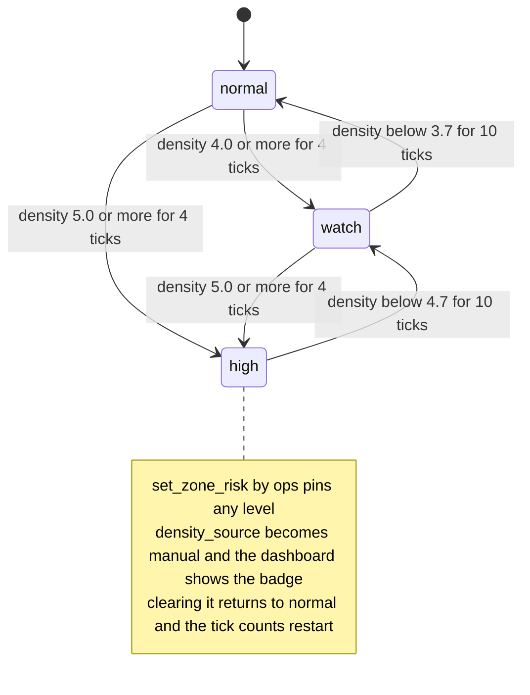
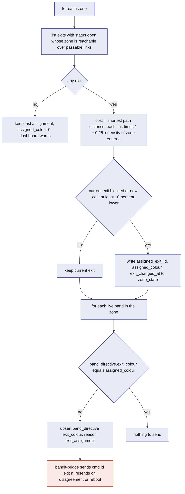
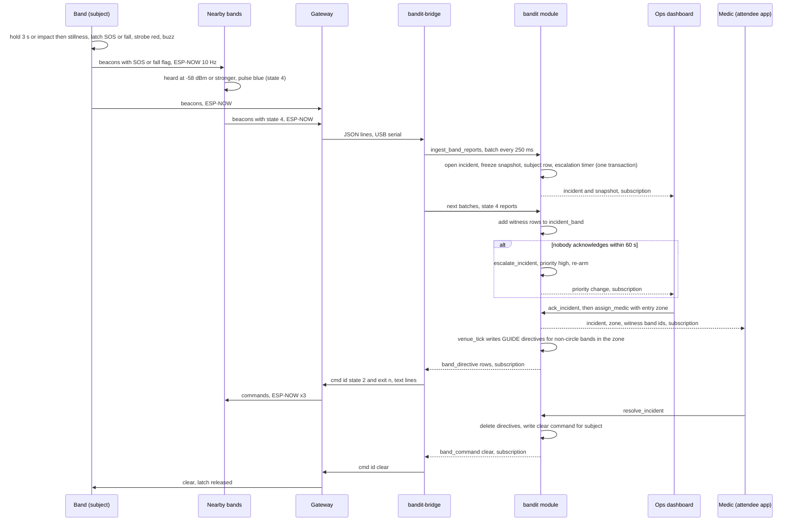
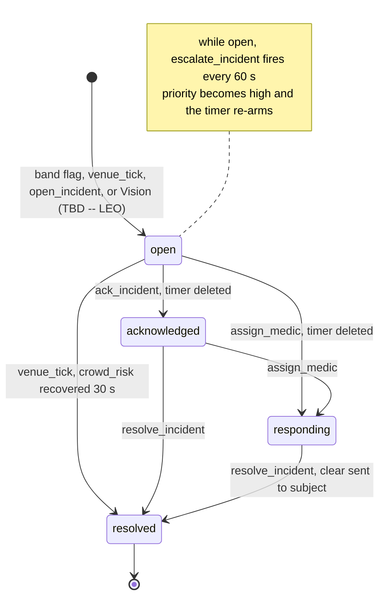

# Safety

Safety is the set of behaviours that keep a crowd from crushing anyone and get help to a person who falls or calls for it: zone density and risk, exit guidance by colour, SOS and fall handling with the light circle, incident lifecycle and escalation, medic approach, evacuation, and the manual overrides the team can fall back on. It exists because crowd crushes are preceded by measurable density for minutes before anyone is hurt, and because a person on the ground needs the people around them to notice and move before any responder arrives. The design puts the first reaction on the band itself, with no server in the loop, and uses the `bandit` module only to decide what the bands cannot know alone: which exit, which zone is dangerous, who is coming to help.

## Role in the system

Responsibilities:

- Define how `venue_tick` turns band reports (and a camera count when Vision exists, TBD -- LEO) into a density and a risk level per zone, with hysteresis.
- Define how each zone is assigned an exit and how that becomes an exit colour on bands and stations.
- Define when incidents of each kind open, acknowledge, respond and resolve, what is frozen in the snapshot, who counts as a witness, and when escalation fires.
- Define the medic approach, evacuation mode, blocked exits, manual override and Plan B.
- State what keeps working when the laptop, bridge or database is down.

Non-responsibilities:

- The band's own state machine, thresholds and radio are specified in [Hardware](Hardware.md). This file relies on them and says which ones matter.
- How directives become gateway commands and how often they are refreshed is [Gateway-Bridge](Gateway-Bridge.md).
- Table and reducer definitions are [SpacetimeDB](SpacetimeDB.md); this file names them and specifies the policy inside them.
- The staff screens that show all of this are [Ops-Dashboard](Ops-Dashboard.md); the medic's phone view is a route in [Attendee-App](Attendee-App.md).
- Medical-ID.md: the medical card.
- Hyphenate.md: claims and evidence.
- Anything the camera does internally is Vision (TBD -- LEO). This file states only what it consumes from `camera_count` and `vision_assessment`.

## Interfaces

| Direction | Counterpart | What flows | Tables or reducers | Transport |
|---|---|---|---|---|
| In | `bandit-bridge`, `bandit-sim` via `ingest_band_reports` | per band: `neigh`, `zone`, `state`, SOS, fall and press flags, every 250 ms | `band_report` | reducer, inside the module |
| In | Venue setup | zones with areas, zone graph with distances, exits with colours and status, stations | `zone`, `zone_link`, `exit`, `station` | seed load |
| In | Ops (calibration UI) | measured points mapping `neigh` to people per square metre | `calibration_point` via `set_calibration` | TypeScript SDK |
| In | Ops | mode, blocked exits, forced exit, forced risk, forced states, reset | `set_venue_mode`, `set_exit_status`, `set_zone_exit`, `set_zone_risk`, `force_band_state`, `send_band_command`, `clear_all`, `set_fleet_config` | TypeScript SDK |
| In | Ops, medics | incident handling | `ack_incident`, `assign_medic`, `add_incident_note`, `resolve_incident`, `open_incident` | TypeScript SDK |
| In | Medical-ID.md: medic | an `sos` incident opened by a medic already on the spot, from the band's NFC token | `medic_open_incident` ([Medical-ID](Medical-ID.md)) | TypeScript SDK |
| In | Vision service (TBD -- LEO) | people count per zone from a local detector, about 1 to 2 Hz per zone; a person-down alert from pose estimation within about a second; a Claude assessment of frames around an event, a few seconds later | `camera_count` via `report_zone_count`; `ground_alert` via `report_ground_alert`; `vision_assessment` via `submit_vision_assessment` ([Vision](Vision.md)) | reducer |
| Out | Everyone | density, source, risk, assigned exit per zone, twice a second | `zone_state` | subscription |
| Out | `bandit-bridge` | exit colour per band, forced GUIDE for evacuation and medic approach, `clear` on resolve | `band_directive`, `band_command` | subscription, then gateway commands |
| Out | Staff | incidents, snapshots, witnesses, notes, escalation | `incident`, `incident_snapshot`, `incident_band`, `incident_note` | subscription through staff views |
| Out | History | one zone row per minute, read by the dashboard and never copied elsewhere | `zone_sample` | `memory_tick` |

## Design

### Three layers, three speeds

Safety runs at three places with very different latencies, and the design is careful about which decision lives where.

| Layer | Decides | Latency | Keeps working without |
|---|---|---|---|
| Band (firmware) | its own density colour (IDLE, YELLOW, GUIDE), SOS strobe and buzz, fall detection, joining the light circle | under one beacon interval, about 100 ms | everything else: the laptop, the gateway, the database |
| `bandit` module (`venue_tick`, `ingest_band_reports`) | density and risk per zone, exit colour per zone, incidents, witnesses, escalation, evacuation and medic-approach directives | one bridge batch plus one tick, about 0.75 s to the dashboard; one more bridge pass plus three radio repeats back to the bands, about 1 s | the dashboard and every phone |
| Staff (dashboard, medic phone) | acknowledge, assign, block an exit, evacuate, override | human | nothing the bands do depends on them |

The band's own precedence order matters for everything below. From the firmware: IDENT, then SOS or fall, then PAID, PAY, CONNECT, then the light circle (NEAR_SOS), then any forced state, then the override flag, then the density state. So a forced GUIDE from the server never hides an SOS or a light circle, and the server can rely on that without checking.

### Density and risk per zone

`venue_tick` runs every 500 ms and computes, for each zone, the following.

**Band-based estimate.** Live bands are those whose `band_report.heard_at` is within 2 s. For the zone's live bands the tick takes `band_count` and `neigh_mean`, the mean of their smoothed neighbour counts. It derives two numbers and keeps the higher as `density_band`:

- `density_neigh`: `neigh_mean` mapped to people per square metre through the calibration table, by linear interpolation between the two nearest `calibration_point` rows (clamped at the ends). Why: `neigh` is a count of bands within a radio radius, and only a measurement in the real room, on real wrists, can turn that into a density, so the mapping is data, not a formula.
- `density_count`: `band_count` divided by `zone.area_m2`. Why: this is a floor; it can never exceed the truth because not everyone wears a band, and it protects against a calibration table that is wrong in the low range.

**Camera estimate (TBD -- LEO).** When Vision exists, a local detector (person detection with pose estimation, running on every frame on the demo laptop) writes a `camera_count` row per zone through `report_zone_count` at about 1 to 2 Hz. When the zone's row is fresh (within 3 s, starting value), `density_camera` is its people count divided by the area the camera covers. At that rate the estimate is fresh on every tick, so it is fused rather than merely displayed. Vision owns how the count is produced; this file only reads the row.

**Choosing.** `density` is the higher of the fresh estimates and `density_source` records which one won (`band` or `camera`). Why the higher: a false alarm costs a few seconds of yellow light; a missed one costs the demo's whole point. When ops has set `zone.forced_risk`, the tick writes that level with `density_source` `manual` and skips the estimate.

**Thresholds.** `normal` below 4.0 people per square metre, `watch` from 4.0 to below 5.0, `high` at 5.0 and above. These are the published crowd-safety limits for a moving crowd (4) and a standing crowd (5) and match the dashboard's yellow and red. They are fixed by the design; the calibration table is what gets tuned.

**Hysteresis.** Raw density flaps at a threshold, so the level changes only when the raw level has pointed the same way for several consecutive ticks, and it needs a margin to come down. The tick keeps `candidate_risk` and `candidate_ticks` in `zone_state`. Starting values, calibrate:

- going up: the candidate must hold for 4 ticks (2 s);
- going down: the candidate must hold for 10 ticks (5 s) and the density must be at least 0.3 below the threshold it crossed (so `high` releases below 4.7, `watch` releases below 3.7). Levels step down one at a time, so a zone leaving `high` passes through `watch` before `normal`.

Why asymmetric: becoming dangerous should show quickly; the relief should be certain before the lights change back, or the crowd sees flicker and stops trusting the colour.

This diagram answers: how a zone's risk level moves, and what stops it flickering.

**Band colour versus zone colour.** Bands decide their own colour from their own neighbour count with one count of hysteresis, so during the demo the rings go red a second or two before the zone goes `high` on the dashboard. That is expected and is the right order: the people in the crowd learn first, staff confirm second. Both are recorded: `zone_state` and `zone_sample` carry both estimates and the source.

### The calibration table and the demo squares

The calibration table is recorded in the demo spot with all bands on wrists. Each row is one measurement: a label, the mean `neigh` observed across bands over a 60 s log, and the density known from the taped area. The three measurements the demo needs:

| Label | How it is staged | People per square metre (known) | Expected `neigh` (measured on the day) | Band colour | Zone risk |
|---|---|---|---|---|---|
| spread | 9 wearers 2 m apart | about 0.3 (assumption for a 30 m² area) | 0 to 1 | green | `normal` |
| 1.5 m square | 9 wearers inside a 1.5 m taped square (2.25 m²) | about 4 | around the yellow threshold, 3 | yellow | `watch` |
| 1.2 m square | 9 wearers inside a 1.2 m taped square (1.44 m²) | about 6 | at or above the red threshold, 5 | red with exit colour | `high` |

The `neigh` column is filled in from the logs at the venue, not guessed. The fleet thresholds (`yellow_at` 3, `red_at` 5, `neigh_rssi_min` -62 dBm) are then set with `set_fleet_config` so that the squares fire the right band colours, and the calibration points make the zone's `density_band` land in the right risk band at the same moment. If the mapping from `neigh` to density is noisy at the top, the 1.2 m square's point is what matters: it must map to 5.0 or more.

The pit zone's `area_m2` is set to the area people can actually stand in around the station marker (an assumption at setup, pace it out), not to the taped square; the taped square is what the camera measures (TBD -- LEO), and the band count divided by the pit zone area is only the floor described above.

### Exit assignment

Zones form a graph: `zone_link` rows carry a walking distance between neighbouring zones. Exits open from `exit` zones, each exit with a colour index 1 to 6. Every tick assigns each zone one exit.

Cost of an exit for a zone is the shortest path over the graph from the zone to the exit's zone, where each link's distance is multiplied by a crowding factor for the zone it enters: 1 plus `penalty_per_density` times that zone's current `density`, with `penalty_per_density` 0.25 per person per square metre (starting value, calibrate). Links marked not passable and exits with status `blocked` are skipped. Why a multiplicative penalty on the zone entered: it makes a path through a dense zone longer, so adjacent zones spread across exits instead of all choosing the nearest, which is the behaviour the crowd-safety literature asks for.

Stability: a zone switches exit only if its current exit is blocked or unreachable, or the best exit's cost is at least 10 percent lower than the current one's (starting value). Why: a crowd that sees its colour change every few seconds stops following it.

Writing: the tick stores `assigned_exit_id`, `assigned_colour` and `exit_changed_at` in `zone_state`. Then for every live band it compares the band's `band_directive.exit_colour` with its current zone's `assigned_colour` and upserts the row when they differ (reason `exit_assignment`). This covers both a zone changing its exit and a band walking into another zone. The bridge turns the row into `exit` commands and resends when the band's reported state disagrees or it reboots ([Gateway-Bridge](Gateway-Bridge.md)). In `normal` risk the colour is invisible (the band is green); it is already loaded when the band goes to GUIDE. Station markers glow their own exit colour, set once from `station.colour_index`; a station at a blocked exit is switched off with a directive addressed to that station (mode 9, off), never to target 0, because a broadcast `state 9` would switch off every station while doing nothing to bands; the room then has no light pointing at a closed door.

No exit reachable: the zone keeps its last assignment, `assigned_colour` is set to 0, and the dashboard shows the zone with a "no exit" warning. Bands in that zone keep whatever colour they last received rather than going dark.

This diagram answers: what one tick does to assign a zone's exit and get the colour onto the bands.

### Crowd-risk incidents

A zone that stays `high` for 10 consecutive ticks (5 s, starting value) with no open `crowd_risk` incident gets one, opened by `venue_tick` with a snapshot and an escalation timer like any other incident. Why wait after the level is already `high`: the risk level already has hysteresis; the extra wait separates "the dashboard went red" from "staff must act", so a crowd that compresses for a moment and relaxes does not page every medic.

The incident closes itself when the zone has been `normal` for 60 consecutive ticks (30 s, starting value): `venue_tick` sets `resolved` with resolution `recovered`. If a medic has been assigned, the tick does not auto-close; a person resolves it. Ops can also open a `crowd_risk` incident by hand with `open_incident` when they see something the bands do not.

### SOS and fall

**On the band, first.** Holding the button 3 s latches SOS: the ring strobes red, a full band buzzes the SOS pattern, and every beacon carries the SOS flag. A full band that detects an impact above 2.8 g followed by 1.5 s of stillness latches a fall the same way with the fall flag. Every band that hears those beacons at -58 dBm or stronger pulses blue for 1.5 s, refreshed by each beacon: the light circle. This is the whole first response and it needs nothing but the bands ([Hardware](Hardware.md)).

**In the module, within one batch.** The next `ingest_band_reports` batch (250 ms) carries the flag. In the same transaction the reducer:

1. opens an `incident` of kind `sos` or `fall` (fall wins if both flags are set), status `open`, `opened_by` `band`, `zone_id` from the band's current zone (0 if unzoned), `subject` the band's owner if claimed;
2. freezes an `incident_snapshot`: the zone's density, source and risk, the bands present in the zone, the bands currently showing state 4, the venue mode, the zone's assigned exit and its status, the fleet config version, and (TBD -- LEO) the cameras covering the zone;
3. adds the band as the `subject` row in `incident_band`;
4. inserts an `escalation_timer` row for 60 s later (starting value).

Later batches refresh `incident.last_signal_at` while the flag stays set, and record every band that reports state 4 as a `witness` in `incident_band`, matched to the open incident in its zone, then a linked zone, then the newest open one. The witness list is the light circle as the server saw it, with first and last times, and it is the list the medic reads to find the person.

**Escalation.** If nobody acknowledges within 60 s, `escalate_incident` sets `priority` `high`, writes an `escalation` note, and arms itself again 60 s later. Every ops and medic screen is subscribed to the incident, so the priority change is the alert; the dashboard sounds on it ([Ops-Dashboard](Ops-Dashboard.md)). `ack_incident`, `assign_medic` and `resolve_incident` all delete the timer, so a handled incident never escalates.

**Vision.md (TBD -- LEO), corroboration within a second.** When the Vision service exists, its local pose detector raises a `ground_alert` through `report_ground_alert` when it sees a person lying down. An alert that lands in the zone of an open `sos` or `fall` incident within 3 s (starting value) of the flag sets `incident.camera_corroborated`, which the dashboard shows as a second source. An alert with no matching band flag that lasts 5 s (Vision's starting value) opens its own `fall` incident with `opened_by` `vision`, no `band_id` and no subject: the person may be wearing no band or a lite band. It gets the same snapshot, timer, escalation and medic approach, but there is no light circle, so the medic is guided by the camera's zone alone, and `resolve_incident` sends no `clear` because there is no band to clear.

**Vision.md (TBD -- LEO), judgment a few seconds later.** The Vision service also watches new `sos` and `fall` incidents, sends Claude a few frames from around the flag time with the detector's boxes and the band data, and writes a `vision_assessment` through `submit_vision_assessment`, which sets `incident.vision_status` to `confirmed` or `not_confirmed`. This raises or lowers confidence on the dashboard and goes into the evidence. Neither the alert nor the assessment gates the band-local reaction, the incident opening, the light circle or escalation; those have already happened.

**Resolving.** `resolve_incident` sets `resolved`, deletes directives tied to the incident, and, when the incident has a subject band, writes a `clear` command for it so the SOS latch releases without the wearer holding the button again. For 10 s after resolution (starting value) a still-set flag from that band does not reopen an incident, which gives the command time to arrive; after that a flag is a new incident. Hyphenate.md: `resolve_incident` ends with a claims hook that runs the `open_claim` logic when an `sos` or `fall` incident carries a note with `cost_cents`, or when a `property` incident resolves; the snapshot and witness rows are its evidence.

**Property incidents.** A `property` incident has no band. Staff open one from the dashboard's property-damage button, which calls `open_incident` with kind `property`, the zone and `opened_by` `ops`; it gets the same snapshot and escalation timer as any other incident. Vision.md (TBD -- LEO): `bandit-vision` then assesses the scene and writes `report_property_event` with the incident id, the event's frame blob refs and a `vision_assessment`; a detector event that arrives with no incident id opens a `property` incident itself, with `opened_by` `vision` and the zone the camera covers. From then on a property incident follows the lifecycle below like any other incident.

This diagram answers: what happens, in order, from a fall to a medic standing next to the person.

This diagram answers: which statuses an incident passes through and what moves it.

### Medic dispatch and approach

There are no positions, so the medic flow is zone-level. `assign_medic` records `assigned_medic` and a `medic_entry_zone_id`: the zone the medic enters the incident zone from, given by ops, or the medic's own band's zone if they wear one, or the exit zone of the incident zone's assigned exit. The medic's phone shows the incident zone, the station colour that marks it, the subject band id and the witness band ids; the blue ring in the room is what they walk toward.

On every tick while the incident is `responding`, `venue_tick` opens space around the person:

- it finds the incident zone's neighbours over `zone_link`, drops the neighbour that is the next hop on the shortest path from the entry zone (the way the medic is coming), and picks the least dense remaining neighbour;
- every live band in the incident zone that is not the subject and is not in the light circle gets a `band_directive` with `forced_state` GUIDE and `exit_colour` set to that neighbour's assigned exit colour, reason `medic_approach`, `incident_id` set, no expiry (the bridge refreshes it);
- the subject stays in SOS and the circle stays blue, because the band's own precedence puts both above a forced state, so the medic can still see the person.

Medical-ID.md: a medic who reaches a person before any flag can call `medic_open_incident` with the band's NFC token; it opens an `sos` incident already `responding` with the caller as `assigned_medic`, with the same snapshot and no escalation timer, and the approach directives above apply from the next tick.

Why the exit colour of a neighbouring zone rather than the incident zone's own: the incident zone's exit may be the way the medic is coming, and the point is to move people sideways, not out through the responder. If the zone has no neighbours, the directive uses the zone's own assigned exit. When the incident resolves, `resolve_incident` deletes these directives; the bridge lets the forced states expire (it never sends `clear` for a directive change) and only the subject band gets an explicit `clear` command.

### Evacuation mode and blocked exits

Ops calls `set_venue_mode` with `evacuate` for the whole venue or for chosen zones (which sets `zone.evacuating` instead). On its next pass `venue_tick`:

- opens one `evacuation` incident (with snapshot and timer) if none is open, so the event is recorded and escalates like any other;
- writes a `band_directive` with `forced_state` GUIDE, the band's zone's `assigned_colour` and reason `evacuation`, no expiry, for every live band in scope, and keeps the colour in step with reassignments on later ticks;
- sets stations at blocked exits to `state 9` (off) and stations at open exits to `state 1` (chase), so the open doors are the moving lights.

`set_exit_status` marks an exit `blocked` or `open` at any time, in or out of evacuation; the assignment skips blocked exits on the next tick and the stability margin is ignored when the current exit is the one that was blocked, so the colour changes at once. Leaving evacuation with `set_venue_mode` `normal` deletes the evacuation directives; the bridge lets the forced GUIDE expire and the bands return to density colours within a second, with no `clear` sent. `clear_all` also sends an explicit `clear` to everyone, which releases SOS latches too, so it is the reset button, not the way out of a drill.

Without a compass the band cannot point; the guidance is "follow your colour to the light of the same colour", which is why stations chase in evacuation and why every zone's colour must be one of the six the stations can show.

### Manual override and Plan B

Two overrides exist, and the team tells the judges when either is used.

**Forcing from the dashboard.** `force_band_state` writes a `band_directive` for one band or for everyone (target 0) with a state and an optional hold; `send_band_command` sends a `buzz` or `clear`; `clear_all` resets everything in one call. `set_zone_risk` forces a zone's level so the map and the lights agree with what staff see. The dashboard shows a visible "override" badge whenever any directive has reason `manual` or `plan_b` or any zone has `density_source` `manual`, so nobody forgets to say so.

**Plan B: camera as the density source (TBD -- LEO).** If neighbour counting is not stable in the room, ops sets `fleet_config.density_override` true, which the bridge sends as `override 1`: bands stop driving their own density colour and stay green unless forced. Density then comes from `camera_count` alone (the overhead camera's local detector counting heads in the taped square, 1 to 2 Hz), `venue_tick` picks it because it is the only fresh estimate, risk and exit assignment work unchanged, and ops drives the band colours with `force_band_state` from the zone's risk (GUIDE for `high`, YELLOW for `watch`). SOS, fall and the light circle are unaffected because the band never gives those up. If there is no camera either, ops forces states by hand from what they see.

### What keeps working when something is down

| Down | Still works | Lost | Design answer |
|---|---|---|---|
| Laptop (bridge and gateway) | density colours, SOS strobe and buzz, fall detection, light circle, last exit colour and last calibration on each band | zone risk on the dashboard, exit reassignment, incidents, medic directives, evacuation changes | the bands are the safety system; the server adds coordination. Bands keep the last `exit` and `thresh` values until they reboot |
| Bridge only (gateway plugged, process dead) | the same as above | the same; the gateway drops packets because nobody reads | `service_heartbeat` goes red after 15 s; restart the bridge; the simulator may replay a log meanwhile |
| SpacetimeDB unreachable (Maincloud) | everything on the bands; the bridge keeps logging raw lines to its `.jsonl` | every server decision and every screen | switch to the laptop standalone deployment ([SpacetimeDB](SpacetimeDB.md)); the raw log can be replayed into it |
| One station | bands near it report zone 0 (unzoned) | that zone's density and exit colour; its bands keep the last colour they got | unzoned bands are counted in a dashboard "unzoned" bucket; an SOS from an unzoned band still opens an incident with the light-circle witnesses |
| Camera (TBD -- LEO) | everything band-based | the camera estimate, person-down corroboration and the Claude assessment | `density_source` falls back to `band`; nothing waits on the camera |
| `venue_tick` stalled | bands as above; incidents from `ingest_band_reports` still open | zone risk, assignment, crowd-risk incidents, directives | `venue_mode.tick_at` stops advancing and the dashboard says so after 2 s |

### Demo choreography, mapped

| Moment | What the people do | Band (local) | Module | Dashboard |
|---|---|---|---|---|
| Spread out | 9 wearers 2 m apart in the pit zone | green | `density_band` below 4, `normal`, exit colour preloaded | pit zone green |
| 1.5 m square | all 9 step inside the yellow tape | `neigh` reaches 3, yellow | after 4 ticks `watch`, `density` about 4 | pit zone yellow, both estimates shown |
| 1.2 m square | all 9 inside the red tape, the judge in the middle | `neigh` reaches 5, red with the exit colour chase | after 4 ticks `high`; after 10 more ticks a `crowd_risk` incident with snapshot and timer | pit zone red, incident card appears, station of the assigned exit named |
| Step out | everyone walks toward the station glowing their colour | yellow then green as `neigh` drops with one count of hysteresis | `watch` after 10 ticks below 4.7, `normal` after 10 more below 3.7; incident `recovered` after 30 s of `normal`, or ops resolves it | zone back to green, incident resolved |
| SOS | one wearer holds the button 3 s | red strobe; the bands around pulse blue | `sos` incident, snapshot with the circle, timer | incident card, zone, subject id, witness ids, 60 s countdown |
| Medic | a teammate playing medic acknowledges, assigns themself, walks in | non-circle bands in the zone go GUIDE toward a side exit; the circle stays blue | `responding`, medic-approach directives | medic view shows the zone and the circle. Medical-ID.md: the medical card |
| Resolve | medic resolves | `clear` arrives, strobe stops, blue fades in 1.5 s | `resolved`, directives deleted | card closes |

If the manual override or Plan B is used at any step, the dashboard badge is visible and the presenter says so.

## Failure modes and fallbacks

| Failure | Effect | Design answer |
|---|---|---|
| Calibration table wrong (room absorbs more signal than the rehearsal) | zone risk under- or over-reads | `density_count` floor catches gross under-reads; ops `set_zone_risk` fixes the level live; the calibration UI re-records points from a fresh 60 s log |
| Band colours and zone level disagree | judges see red rings on a yellow map | expected for a second or two by design; both estimates are shown with the source badge; if persistent, retune `yellow_at`, `red_at` with `set_fleet_config` |
| Exit colour flaps between two exits | crowd loses trust | 10 percent switch margin plus the density hysteresis upstream; ops can pin with `set_zone_exit` |
| SOS reopens right after resolve | duplicate incident | 10 s grace after resolution while the `clear` command propagates |
| False light-circle witnesses from a far band | wrong witness list | the circle threshold is -58 dBm, tighter than the neighbour threshold; `circle_rssi_min` is tunable live |
| Fall fires on a jump | false `fall` incident | thresholds are tunable in firmware ([Hardware](Hardware.md)); the incident is resolved by ops with a note; with Vision (TBD -- LEO) no ground alert corroborates it and the assessment marks it `not_confirmed` |
| Medic approach guides people toward the medic | crowd moves into the responder | the next-hop neighbour toward the entry zone is excluded; ops can give a different entry zone with `assign_medic` |
| Evacuation with every exit blocked in a zone | no colour to show | `assigned_colour` 0, dashboard "no exit" warning, bands keep the last colour; ops unblocks or opens a link |
| Tick cannot finish in 500 ms with 500 simulated bands | ticks slip | the tick does one pass over `band_report` and a Dijkstra over at most a handful of zones; if it slips, the simulator's band count is reduced, never the real bands |

## Dependencies

**Depends on**

- [Hardware](Hardware.md): band states and precedence, flags, thresholds, the light-circle rule, station colours and modes.
- [SpacetimeDB](SpacetimeDB.md): every table and reducer named here, including `zone.forced_exit_id`, `zone.forced_risk`, `zone.evacuating`, `incident.assigned_medic`, `incident.medic_entry_zone_id`, `incident.opened_by`, `incident.priority`, `incident.camera_corroborated` and `incident.vision_status` (TBD -- LEO), `zone_state.candidate_risk` and `candidate_ticks`.
- [Gateway-Bridge](Gateway-Bridge.md): directive reconciliation and refresh before the 25.5 s band-side limit, command delivery.

**Used by**

- [Ops-Dashboard](Ops-Dashboard.md) (map colours, incident cards, override badge, calibration UI), [Attendee-App](Attendee-App.md) (medic view, evacuation banner, busy map), [Simulator](Simulator.md) (scenarios that drive these behaviours), [Hyphenate](Hyphenate.md) (snapshot and witnesses as evidence), [Vision](Vision.md) (TBD -- LEO, the two rows it feeds), [Architecture](Architecture.md) (end-to-end demo flows).

**If you delete this file**

- The safety demo has no specification: `venue_tick`, the incident steps in `ingest_band_reports` and `escalate_incident` in [SpacetimeDB](SpacetimeDB.md) would have no policy to implement. This file is core and is not deletable. Deleting Vision removes the camera estimate paragraph, the two corroboration and judgment paragraphs, the Vision rows in the interfaces and "what keeps working" tables, and the camera half of Plan B; the band-based path is complete without it.

## Open questions

- Whether the pit zone's `area_m2` should be the whole stage area or the standing area around the station; it changes only the `density_count` floor, but the number should be decided when the room is paced out.
- Whether the medic's entry zone should default to the medic's band zone (if medics wear bands in the demo) or always be chosen by ops.
- The crowding penalty and switch margin have never been tried in a real room; the simulator should run the two-exit scenario before the first rehearsal.
