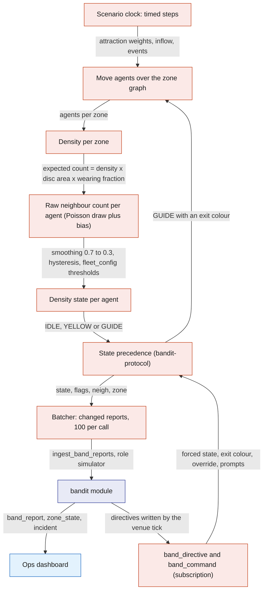
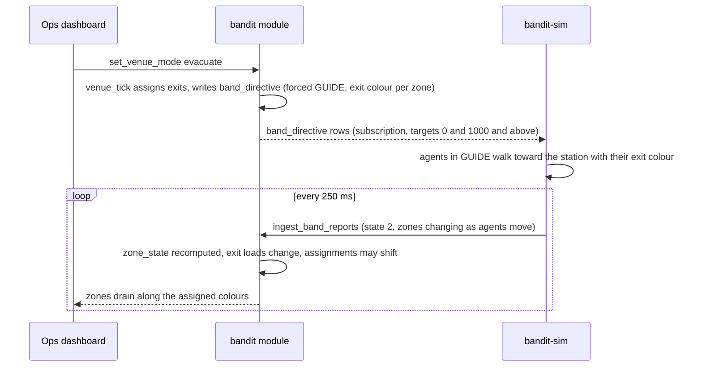

# Simulator

`bandit-sim` is an optional Rust process on the demo laptop that drives virtual bands through the same `ingest_band_reports` reducer the bridge uses, under the `simulator` role. Nine real bands cannot show how a venue of hundreds behaves, so the simulator adds a crowd that moves over the zone graph, reports neighbour counts the way a band's firmware would, and obeys the server's directives, while the real bands move inside it on the same dashboard. It also replays a recorded bridge log through the same path. It never touches the radio.

## Role in the system

Responsibilities:

- Create and run virtual bands with ids from 1000, registered with `band.simulated` set.
- Run a crowd model over `zone`, `zone_link`, `exit` and `station` that yields per-band `neigh`, `zone` and `state` values consistent with what the firmware produces at a given density.
- Obey `band_directive` and `band_command` rows for its own ids and for target 0, and acknowledge the one-shots addressed to its ids.
- Run scripted scenarios: crush build-up, SOS, fall, evacuation, medic approach.
- Replay a bridge `.jsonl` log at recorded or accelerated speed.
- Report its health through `heartbeat` every 5 s.

Explicit non-responsibilities:

- It never opens the serial port and never sends radio commands; real bands are [Gateway-Bridge](Gateway-Bridge.md)'s alone.
- It never writes `band_directive` or any ops table; it is a device, not an operator.
- It never reports ids 1 to 9 (a replay offsets them, see below).
- It does not validate the radio: it models what a band would report at a density, which cannot tell you whether the venue's RSSI thresholds are right. That is calibration ([Hardware](Hardware.md)).
- It holds no truth; stopping it simply makes its bands go stale.

## Interfaces

| Interface | Direction | Counterpart | What flows | Transport |
|---|---|---|---|---|
| `register_band` | out, at start | `bandit` module | one row per virtual band: id from 1000, `simulated` true, full-band flag on a configurable share | SpacetimeDB Rust client SDK, caller role `simulator` |
| `ingest_band_reports` | out, every 250 ms | `bandit` module | batches of changed reports with the same fields the bridge sends ([Gateway-Bridge](Gateway-Bridge.md)); `heard_age_ms` 0, `gateway_rssi` and `loss_pct` absent or scripted | SDK |
| `ack_band_command` | out | `bandit` module | command id and outcome for one-shots addressed to ids 1000 and above | SDK |
| `heartbeat` | out, every 5 s | `bandit` module | service `simulator`, version, counters: virtual bands, reports per second, active scenario and its clock, replay position | SDK |
| `zone`, `zone_link`, `exit`, `station` | in, subscription | `bandit` module | the venue graph: areas, walking distances, exits and the station colour at each | SDK |
| `fleet_config` | in, subscription | `bandit` module | the same thresholds real bands use, so virtual colours match real ones | SDK |
| `band_directive`, `band_command` | in, subscription | `bandit` module | targets 0 and 1000 and above | SDK |
| Scenario file | in | the operator | a list of timed steps (below) | local text file chosen at start |
| Replay log | in | a bridge run | the bridge's raw `.jsonl` | local file |

The module's `register_band` must accept the `simulator` role for ids 1000 and above, and `ack_band_command` must be idempotent, because a target-0 one-shot is acknowledged by the bridge and applied (without acknowledgement) by the simulator; if no bridge is running the simulator acknowledges target-0 commands after a 1 s grace period (starting value). Both are small requirements on [SpacetimeDB](SpacetimeDB.md).

## Design

### A virtual band is the firmware in Rust

Each virtual band keeps the variables a real band keeps: a raw neighbour count, its smoothed value, the density state with hysteresis, the zone, the exit colour, a forced state with its hold, the override flag, the SOS and fall latches, the prompt and press windows. The smoothing (0.7 to 0.3 per 250 ms step), the hysteresis and the state precedence come from `bandit-protocol`, the same code the bridge uses to judge real bands, so a virtual band in a given situation reports the same `state` a real one would. Reports leave through the same change-or-heartbeat rule as the bridge (send when a field changed or once a second), in batches of at most 100 reports per reducer call (starting value) so that a 500-band crowd is four or five calls per 250 ms rather than one huge transaction.

### The crowd model

One agent per virtual band. The model is deliberately simple; it has to make the dashboard's density, guidance and incident logic visible, not predict a real crowd.

- Zones and movement. Agents sit in a zone and walk between zones along `zone_link` edges at a speed that falls with the density of the zone they are in (free walking speed about 1.3 m per second, falling toward zero above five people per square metre; model assumption). Each agent has a dwell time in its current zone and an attraction weight per zone that the scenario sets, so a scenario can pull people toward a stage zone or spread them evenly.
- Density per zone is the number of agents in the zone divided by `zone.area`. Real bands are not counted here; the module mixes real and simulated bands when it computes zone density ([Safety](Safety.md)).
- From density to a neighbour count. A real band counts the bands it hears above the RSSI threshold, which corresponds to a sensing radius r around the wearer. The expected count is density times the disc area times the fraction of people wearing a band: r of 1.2 m (starting value, replace with the venue calibration) and a wearing fraction of 1.0 in the demo so that the virtual crowd is fully instrumented, configurable to model a real venue where few people wear one. Each 250 ms step draws the raw count from a Poisson distribution around that expectation, adds a slowly varying per-agent bias to imitate antenna and body differences, caps it at 31 (a band's table holds 32 entries), then applies the firmware's smoothing and hysteresis with the thresholds in `fleet_config`. The result is a `neigh` series that wobbles the way real ones do and crosses the colour thresholds at the densities calibration says it should.
- Zone report. An agent reports the station id of its zone, or 0 if the zone has no station. Near a zone boundary it reports the neighbouring zone's station with a small probability (5 percent, starting value), which imitates the RSSI confusion real bands show at boundaries.

What happens in one simulator tick.

### Virtual bands obey the server

Directives for target 0 or an id at 1000 and above are applied as a band would apply the matching commands: a forced state with its hold, an exit colour, the override flag. Because the simulator reads the directive itself rather than a radio command, it follows the directive's own end time and does not need the bridge's 25.5 s refresh. The behavioural part is what makes guidance visible: an agent whose shown state is GUIDE (from density or forced) walks toward the exit whose station glows its exit colour, found through `station` and `exit`, along the shortest `zone_link` path, and on arrival stays at the exit zone with a low neighbour count. Agents in IDLE or YELLOW keep their own plans. This is how an evacuation drains zones along the assigned colours and how a medic approach opens space around an incident ([Safety](Safety.md)).

One-shots: `pay` opens an 8 s PAY window and the virtual wearer presses after 2 s (configurable; "never" demonstrates a decline); `paid` shows PAID for 1.5 s; `buzz` does nothing visible; `clear` releases the latches. Each one addressed to a virtual id is acknowledged with `ack_band_command` once applied.

How a directive moves the simulated crowd.

### Scenarios

A scenario is a small text file of timed steps: at a given second, set a zone's inflow or attraction, latch SOS or fall on a chosen virtual band, change the wearing fraction, or wait for a condition in the database (for example `venue_mode` becoming `evacuate`, or an incident being assigned a medic) before continuing. The simulator makes no ops calls itself; where a scenario needs an operator action the step waits for it, which keeps the demo honest.

| Scenario | What the script does | What the system should show |
|---|---|---|
| Crush build-up | ramps inflow into one zone from about one to six people per square metre over 90 s, holds for 60 s, then releases | the zone turns watch then high in `zone_state`; virtual bands go YELLOW then GUIDE; a `crowd_risk` incident opens; exit assignment moves bands away from the hot zone |
| SOS | one virtual band latches SOS; agents within the light-circle radius (0.9 m, starting value) report NEAR_SOS while it lasts | an `sos` incident with its snapshot; the circle members appear in `incident_band`; escalation fires if nobody acknowledges within 60 s |
| Fall on a full band | a virtual band with the full-band flag sets the fall flag after a short "impact" | a `fall` incident, otherwise identical to SOS |
| Evacuation | waits for ops to set `venue_mode` to `evacuate` (optionally with one exit marked blocked), then lets the agents follow their directives | zones drain along the assigned colours; the blocked exit draws nobody; exit loads balance |
| Medic approach | runs the SOS scenario, then waits for `assign_medic`; agents outside the circle follow the GUIDE directive out of the zone, the circle stays | space opens around the person while the blue ring remains |
| Hyphenate.md: Planted incidents | plants genuine falls (a full-band fall flag, witnesses in the same zone, then a wait for a medic cost note) and decoys (a fall flag with no note, a note with no band data, witnesses in a different zone) | only genuine, corroborated claims settle automatically; decoys route to a person or are refused, which is what Hyphenate.md measures |

Scenarios can be stacked: a crush with an SOS inside it is the full demo story.

### Replay mode

Replay reads a bridge `.jsonl` log and feeds its reports through the same batcher at their recorded receive times, at normal or accelerated speed. Ids 1 to 9 are offset by 1000 (band 1 becomes 1001) and marked simulated, so a replay never collides with live bands; command lines, `ack`, `err` and boot lines in the log are shown in the simulator's own output but never re-issued. `neigh` values in a replay reflect the thresholds that were in force when it was recorded, which the bridge tags on each logged line. Uses: rehearsing the dashboard without hardware, re-running the venue tick on a recorded crush after a rule change, and a backup if the radio misbehaves in front of the judges.

### Real and simulated bands on the same dashboard

Both kinds arrive through `ingest_band_reports` and live in `band_report` keyed by band id, so nothing downstream has two code paths. `band.simulated` is the only distinction: the ops dashboard draws simulated bands lighter and shows per-zone counts as real plus simulated ([Ops-Dashboard](Ops-Dashboard.md)); incidents raised by simulated bands are labelled through that flag; the venue tick treats both identically when it computes density and guidance ([Safety](Safety.md)). One honest limit: there is no radio between the two populations, so a real band standing in a simulated crowd stays green unless real people surround it, and a simulated band never counts a real one. The demo choreography puts the real people in the taped square and the simulated crowd in the surrounding zones, so each population shows the behaviour it can.

## Failure modes and fallbacks

| Failure | Effect | Design answer |
|---|---|---|
| Simulator crashes | its bands go stale after 5 s and vanish from density after that | restart; it re-registers nothing (rows exist) and resumes the scenario from the start; the dashboard shows the missing heartbeat |
| A batch is rejected as too large or too slow | reports pile up | batches are capped at 100 reports and the next tick replaces an unsent batch with fresh state; nothing accumulates |
| SpacetimeDB connection lost | no reports | pause the scenario clock, keep the latest state, resume and send the whole crowd in the first batches after reconnect |
| Scenario and reality collide (a scripted SOS while a real SOS is open) | two incidents, one labelled simulated | scenarios wait for operator steps where it matters; ops can stop the scenario from the terminal |
| Replay recorded under different thresholds | virtual colours do not match the current `fleet_config` | replays are labelled with their recorded thresholds; use them for dashboards and rules, not for calibration |
| Venue graph missing a station colour | agents cannot find their exit | agents fall back to the nearest exit by walking distance and the heartbeat reports the gap |

## Dependencies

**Depends on**

- [SpacetimeDB](SpacetimeDB.md): `ingest_band_reports`, `ack_band_command`, `register_band`, `heartbeat`, the venue tables, `fleet_config`, `band_directive`, `band_command`, and the `simulator` role.
- [Gateway-Bridge](Gateway-Bridge.md): the `bandit-protocol` crate and the raw log format for replay.
- [Hardware](Hardware.md): the behaviour being imitated (smoothing, hysteresis, precedence, windows).
- [Safety](Safety.md): what the directives mean, so agents react the way the venue tick expects.

**Used by**

- [Ops-Dashboard](Ops-Dashboard.md): the simulated legend and the real-plus-simulated counts.
- [Architecture](Architecture.md): the demo flow that shows a crowd of hundreds.
- [Safety](Safety.md): scenario runs as the test bed for density, guidance, escalation and medic approach.

**If you delete this file**

- Remove the simulator rows and legend from [Ops-Dashboard](Ops-Dashboard.md) and the `bandit-sim` row from the component tables in [Architecture](Architecture.md), [Rust-Backend](Rust-Backend.md) and the README.
- In [SpacetimeDB](SpacetimeDB.md), the `simulator` role, the simulated id range on `register_band` and the `band.simulated` flag become unused and can be dropped; `ingest_band_reports` keeps only the `bridge` role.
- Replay disappears; the bridge's raw log remains a post-mortem and calibration record only ([Gateway-Bridge](Gateway-Bridge.md)).
- Remove the "Simulator.md" rows from the interfaces and subscriptions tables in [SpacetimeDB](SpacetimeDB.md), the Simulator.md bullet in [Attendee-App](Attendee-App.md), the Simulator.md sentence under the demo flows in [Architecture](Architecture.md), and the planted-incident paragraph and dependency bullet in [Hyphenate](Hyphenate.md).
- The demo shows nine bands and no crowd; density for the surrounding zones would come only from Vision (TBD -- LEO), if present.

## Open questions

- How many reports per `ingest_band_reports` call does the module handle comfortably on SpacetimeDB 2.x? This sets the batch cap and whether 500 virtual bands need more than one connection.
- Should a replay be allowed to keep real ids 1 to 9 when no bridge is connected, so a backup run looks exactly like the live one? That would need the module to accept the `simulator` role on real ids while no `bridge` heartbeat is fresh.
- Should scenarios be started from the ops dashboard rather than from the process's arguments? That needs one small control row and is a later convenience.
