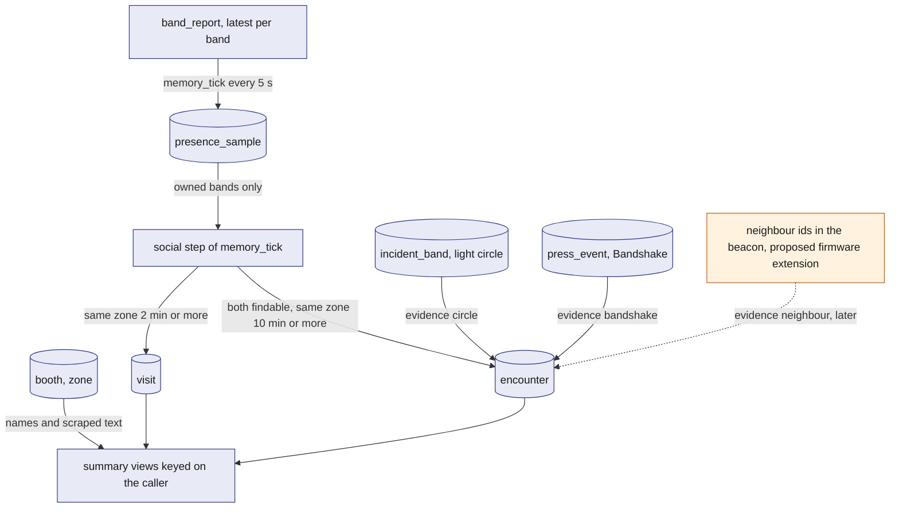
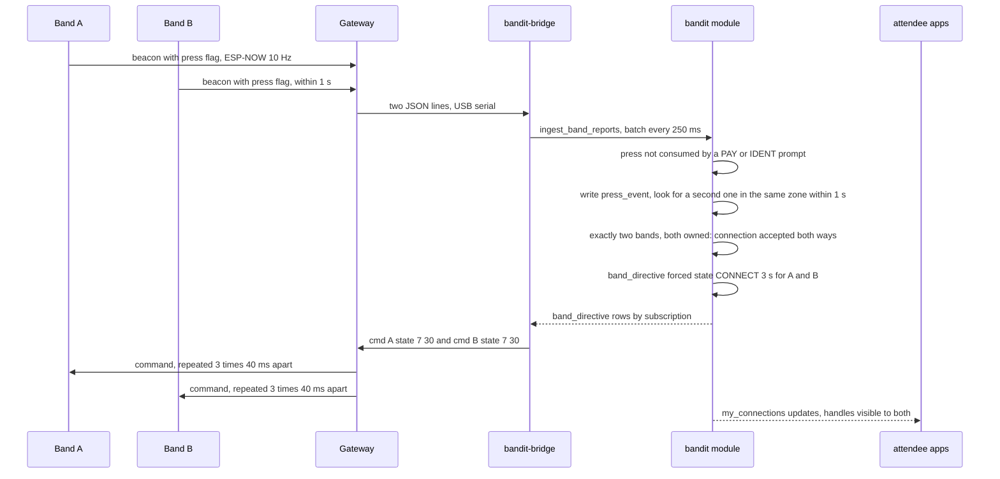
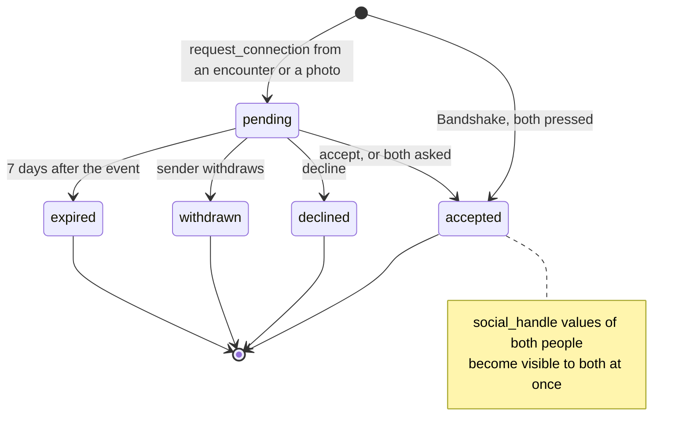
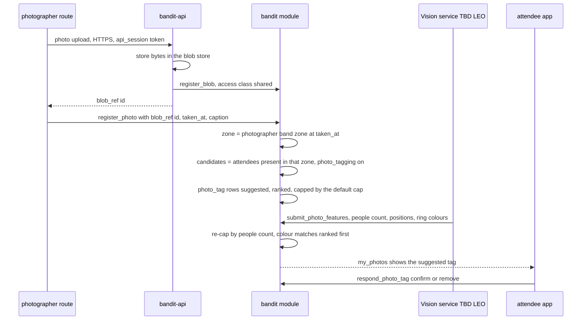

# Social

The social layer turns zone-level presence into memories: where an attendee spent time, who they were with, which photos they are in, the profile they claimed and the accounts they linked, and a post-event summary they can share. It is built only from what the bands already report (band, zone, time, press flag), so it needs no new hardware and no positions. People stay anonymous to each other until both sides agree; social handles appear to both at once, never to one first. Everything here is optional: delete it and the safety demo is untouched.

## Role in the system

Responsibilities:

- Derive `visit` and `encounter` rows from `presence_sample` in the social step of `memory_tick`.
- Detect a server-side Bandshake from two press flags in the same zone, with no firmware change.
- Own the social part of onboarding: every attendee's own handles into `social_handle`, by LinkedIn, TikTok or X sign-in or by typing a handle.
- BrightData.md: place the claim of an unclaimed `person` profile (exhibitors, speakers, sponsors and artists) in the same onboarding flow. The `person` and `claim_contact` rows, the claim reducers and the claim routes belong to [BrightData](BrightData.md).
- Hold `connection_request` and `social_handle`, and enforce the mutual-acceptance rule.
- Register photographer photos, propose `photo_tag` candidates from presence and consent, and let attendees confirm or remove tags.
- Provide the post-event summary as views keyed on the caller, the optional `summary_story` Claude job, and `share_link` tokens.
- Use the consent switches `findable`, `photo_tagging` (and `merch`, used by [Merch](Merch.md)) set through `set_consent`.

Non-responsibilities:

- It does not write `presence_sample`, `band_report` or any band state; it only reads them ([SpacetimeDB](SpacetimeDB.md), [Safety](Safety.md)).
- It does not analyse images. Face or people counts, positions in the frame and ring colours come from Vision (TBD -- LEO) through `submit_photo_features` ([Vision](Vision.md)).
- It does not scrape people. `person` profiles come from event pages only, through [BrightData](BrightData.md), which also owns the claim; this file only places the claim step in onboarding.
- It does not rank by meaning. The timeline, the people met and the tagged photos are exact views here; "the photo of me with the robot" is a ranked question the attendee app sends to Elastic's search routes over a one-way copy of this file's rows ([Elastic](Elastic.md)). Nobody chats with an agent.
- It does not make merch; it supplies the memories that [Merch](Merch.md) starts from.

## Interfaces

| Direction | Who | What flows | Transport |
|---|---|---|---|
| In | `memory_tick` (core, every 5 s) | Calls the social step after writing `presence_sample`; the step reads `presence_sample`, `band`, `attendee`, `consent`, `booth`, `incident_band` | In-module call (one line to remove) |
| In | `ingest_band_reports` (core) | Calls the Bandshake step for each report whose press flag was not consumed by a PAY or IDENT prompt | In-module call (one line to remove) |
| In | Hardware.md | Press flag (bit 2, on for 1 s after a short press), `zone` per band, states PAY (5), IDENT (8), CONNECT (7) | Gateway JSON lines through `bandit-bridge` |
| In | Attendee app | `request_connection`, `respond_connection`, `withdraw_connection`, `set_social_handle`, `remove_social_handle`, `respond_photo_tag`, `create_share_link`, `revoke_share_link`, `request_summary_story` | SpacetimeDB TypeScript SDK |
| In | BrightData.md: `person` table | `person` rows (unclaimed profiles: name, role, organisation, source; claimed identity once claimed), read so a claimed profile can serve as the attendee's display name | Module table |
| In | BrightData.md: the claim flow | The app calls `POST /claim/person`; `bandit-api` calls `request_person_claim`, sends the magic link, and on `GET /claim/confirm/{token}` calls `confirm_person_claim`. All of it is defined in [BrightData](BrightData.md); this file only places the step in onboarding | HTTPS to `bandit-api`, then SDK |
| In | `bandit-api` (role `api`) | `link_social_handle` after an OAuth callback (LinkedIn, TikTok, X) for the attendee named by the `api_session` | SDK |
| In | Photographer route of the attendee app (role `photographer`) | Photo bytes to `bandit-api`, then `register_photo` with the `blob_ref` id, capture time and caption; `hide_photo` | HTTPS upload, then SDK |
| In | `bandit-api` (role `api`) | `register_blob` for the uploaded photo (access class `shared`) | SDK |
| In | Vision service (TBD -- LEO) | `submit_photo_features` with people count, positions and ring colours seen for a photo | SDK (role `vision`) |
| In | Ops dashboard (role `ops`) | `request_summary_stories` after the event | SDK |
| In | `bandit-workers` (role `worker`) | `submit_summary_story` with job id, lease token and story sections | SDK |
| Out | `band_directive` (core) | Forced state CONNECT for 3 s on both bands after a Bandshake | Module write, bridge sends `state 7` |
| Out | Attendee app | Views keyed on the caller: `my_visits`, `my_encounters`, `my_connections`, `my_photos`, `my_story`, `my_share_links` | Subscription |
| Out | `bandit-api` | `share_link` rows and the rows a link selects, for the public share page | Subscription (role `api`) |
| Out | Email and OAuth providers, through `bandit-api` | The magic link to the `claim_contact` address through the configured mail sender ([Rust-Backend](Rust-Backend.md)); OAuth redirects to LinkedIn, TikTok and X | HTTPS from `bandit-api` |
| Out | `bandit-indexer` ([Elastic](Elastic.md)) | `visit`, `encounter` (only when both people are `findable`), `photo` and confirmed `photo_tag`, into `bandit-memories` and `bandit-photos`; never `social_handle` | Subscription (role `indexer`) |
| Out | `job` table | Job `summary_story` with the attendee id and `delivery` (`interactive` or `batch`) | `enqueue_job` from `request_summary_story` and `request_summary_stories` |
| Out | [Merch](Merch.md) | `visit`, `encounter`, `photo`, `photo_tag` and `connection_request` rows as memories and consent evidence | Module tables |

## Design

### From presence to visits and encounters

Presence is the only input: every 5 s `memory_tick` writes one `presence_sample` (band, zone, time) per live band. The social step runs right after, inside the same scheduled reducer, and considers only bands that have an owner, so the simulated crowd and unclaimed bands cost nothing here and create no memories.

The question this diagram answers: what each memory row is derived from, and which evidence is available today versus later.

**Visits.** A visit is one attendee staying in one zone. The step keeps a per-band counter of consecutive samples in the current zone. A visit opens when the counter reaches 2 minutes (24 samples; starting value, calibrate) and closes when the band has been out of that zone for 2 minutes (starting value, calibrate), so a short walk past the exit does not split it. The zone is the resolution: when a zone holds exactly one `booth`, the visit also records that booth; when it holds several, the summary lists the booths in that area and the visit stays at zone level, because nothing in the packet says which stand the person faced. Why a 2 minute threshold: zone changes come from "loudest station in the last 3 s", which flaps at boundaries, and 2 minutes of persistence filters that without hiding a real stop.

| `visit` field | Meaning |
|---|---|
| `id` | Assigned by SpacetimeDB |
| `attendee_id`, `band_id` | Whose visit, through which band |
| `zone_id`, `booth_id` | Where; `booth_id` empty unless the zone has one booth |
| `started_at`, `ended_at` | Open visits have no end yet |
| `samples` | Number of presence samples counted, for the minutes shown in the summary |
| `status` | `open`, `closed` |

**Encounters.** An encounter is two attendees in the same zone long enough to have plausibly met. Both must have `findable` on; the step builds the pair set only from findable, owned bands, so cost grows with real attendees, not with the simulated crowd. A pair opens an encounter after 10 minutes of co-presence (120 samples; starting value, calibrate); gaps up to 2 minutes merge into the same encounter. `minutes` grows while they stay together. Zone-level co-presence is weak evidence on its own (a zone can hold many people), so the row records which evidence it has:

| `encounter.evidence` | Meaning | Available |
|---|---|---|
| `zone` | Same zone for the threshold time | now |
| `circle` | Both bands were in the same light circle during one incident (`incident_band` rows for the same incident), which proves radio proximity at or above -58 dBm | now |
| `bandshake` | A mutual press, see below | now |
| `neighbour` | Both bands heard each other as neighbours (RSSI at or above -62 dBm) for the threshold time | after the proposed firmware extension |

The light-circle and Bandshake upgrades are applied when the step sees the matching `incident_band` or `press_event` rows for a pair that already has, or later gets, a zone encounter. When Hardware.md's proposed extension puts neighbour ids in the beacon and the bridge carries them into the report, the step keeps a pairwise counter only for mutual neighbours and opens a `neighbour` encounter after 5 minutes (starting value, calibrate), shorter because the evidence is stronger. The zone rule stays as the fallback for bands without the extension.

| `encounter` field | Meaning |
|---|---|
| `id` | Assigned by SpacetimeDB |
| `attendee_a`, `attendee_b` | The pair, lower id first |
| `zone_id` | Where it started |
| `started_at`, `ended_at` | Open encounters have no end yet |
| `minutes` | Co-presence minutes so far |
| `evidence` | `zone`, `circle`, `bandshake`, `neighbour` (the strongest seen) |
| `status` | `open`, `closed` |

What an encounter shows before a connection: "someone you spent 40 minutes with in Zone B around 21:10". No name, no handle. That is enough to recognise the moment and ask.

### Server-side Bandshake

The firmware has no connect feature in v0.1, but it already sends the press flag for 1 s after a short press and shows state 7 CONNECT when told to. So the module can do the handshake: two people touch bands and press together, and the server sees two presses from two bands in the same zone within 1 s.

The question this diagram answers: how two button presses become a mutual connection with no firmware change.

Rules of the Bandshake step, which runs inside `ingest_band_reports` after the claim and payment steps have had their chance to consume the press:

- A press is consumed by the first open prompt. If the band is in PAY (5) or IDENT (8), or [Payments-Nessie](Payments-Nessie.md) or band claiming has a prompt window open for it, the press belongs to that flow and never reaches this step.
- An unconsumed press on an owned band writes a `press_event` (band id, zone, time) when the press flag goes from off to on. Rows older than 2 s are deleted by the same step, so the table holds at most a few rows.
- A Bandshake is exactly two `press_event` rows from different bands in the same zone within 1 s. Three or more presses in that window are ambiguous and produce nothing; the people simply press again. A press from a band whose owner has `findable` off still works, because pressing is consent for this one connection.
- On a match the step writes a `connection_request` with source `bandshake` and status `accepted` (both pressed, so both accepted), writes a `band_directive` forced state 7 for 3 s (starting value, calibrate) for both bands so both rings sparkle pink, and upgrades any open encounter between the pair to evidence `bandshake`.
- An unowned band in the pair gives no connection and no light; the press is dropped.

Why a server-side handshake and not a firmware one: the bridge already carries every press to the module within 250 ms, and the match rule is one table scan, so the feature costs no flash and no radio protocol change.

### Profiles, claims and linked accounts

**Where social information comes from.** Every attendee enters their own socials during onboarding in the attendee app, right after tap to join ([Attendee-App](Attendee-App.md)): LinkedIn, TikTok or X sign-in, or a typed handle for Instagram or any other platform. Those land in `social_handle`. Nobody's social profile is scraped; the only scraped people data is the unclaimed `person` profile described next, and it comes from the event's own pages.

**Unclaimed profiles.** Before the event, `bandit-ingest` builds one `person` row per exhibitor contact, speaker, sponsor and artist from the event's pages: name, role, organisation and source page ([BrightData](BrightData.md)). A `person` row is unclaimed until someone proves it is theirs, and claiming never changes what other attendees see: presence stays anonymous and encounters still show "someone" until a connection is accepted. Claiming only lets the person use their profile as their display name and attach their handles to it.

**The claim (BrightData.md).** Claiming is a step in the same onboarding flow. The person taps their band, which opens the attendee app and completes the band claim by press ([Attendee-App](Attendee-App.md)). When the app asks for a display name it also offers the unclaimed `person` rows that match the typed name or organisation, and the person picks theirs; attendees without a profile skip the step. From the pick onward the flow belongs to [BrightData](BrightData.md): the app calls `POST /claim/person`, `bandit-api` calls `request_person_claim` with a token hash and sends the magic link to the `claim_contact` address, and opening the link hits `GET /claim/confirm/{token}`, which calls `confirm_person_claim` to set the claimed identity on the `person` row. Token expiry, the first-claim-wins rule and the help-desk fallback are defined there. Once confirmed, the app offers the profile's name as the display name and continues with the socials step below.

**Linked accounts.** The onboarding flow then asks for the person's socials, with or without a claimed profile. Each one is a `social_handle` row. Where a provider's sign-in returns the value, `bandit-api` runs the OAuth redirect, receives the callback and calls `link_social_handle` for the attendee named by the `api_session`, marking the row `oauth`; where it does not, the person types the value in the app with `set_social_handle` and the row is marked `typed`. Provider by provider:

| Platform | How the value is obtained | `verified` |
|---|---|---|
| LinkedIn | Sign-in with OpenID Connect confirms the account's name and email, but returns no profile URL, so the person pastes the URL | `typed` for the URL (the sign-in is recorded on the row as `oauth_checked`) |
| TikTok | Sign-in returns the username and the profile link | `oauth` |
| X | Sign-in returns the username | `oauth` |
| Instagram | No usable sign-in for this; the handle is typed | `typed` |
| Other | Typed | `typed` |

`bandit-api` holds the OAuth client secrets ([Rust-Backend](Rust-Backend.md)); the module and the browser never see them. A `verified` value of `typed` is shown to the counterpart as "unverified" when revealed, so a pasted LinkedIn URL is not mistaken for a checked one.

**Mutual opt-in.** No handle is ever revealed on a profile, a booth page, a share page or in search. A handle whose `share_mode` is `on_connect` becomes visible to exactly one other person at a time: the counterpart of a `connection_request` that is `accepted`, which means both sides agreed (one asked and the other accepted, both asked, or both pressed in a Bandshake). A handle whose `share_mode` is `hidden` is never shown and exists only for the owner's own record.

### Connection requests and handles

An attendee asks to connect from a memory, never from a name: `request_connection` takes an `encounter` id or a `photo` id, and the module resolves the other person from that row. This keeps attendees from enumerating people. The recipient sees the requester's display name and the shared context ("the person you spent 40 minutes with in Zone B wants to connect"). Social handles stay hidden until the request is accepted, and then both sides see each other's handles in the same transaction; there is no state where one person has the other's handle and not the reverse.

The question this diagram answers: which states a connection request passes through and when handles become visible.

| `connection_request` field | Meaning |
|---|---|
| `id` | Assigned by SpacetimeDB |
| `from_attendee`, `to_attendee` | Who asked, who was asked (both set by the module from the memory) |
| `encounter_id`, `photo_id` | The memory the request came from; empty for a Bandshake |
| `source` | `encounter`, `photo`, `bandshake` |
| `status` | `pending`, `accepted`, `declined`, `withdrawn`, `expired` |
| `created_at`, `responded_at` | Timing |

| `social_handle` field | Meaning |
|---|---|
| `id` | Assigned by SpacetimeDB |
| `attendee_id` | Owner |
| `platform` | `linkedin`, `tiktok`, `x`, `instagram`, `other` |
| `value` | The handle or profile URL |
| `verified` | `oauth` (value returned by the provider's sign-in) or `typed` (entered by the owner) |
| `oauth_checked` | True when a sign-in with that provider succeeded even though the value was typed (LinkedIn) |
| `share_mode` | `on_connect` (revealed to an accepted connection) or `hidden` |
| `linked_at` | When it was set |

Reducers: `request_connection` (caller must be a party to the memory and the other person must be `findable`, except for a photo where both are confirmed), `respond_connection` (only the recipient), `withdraw_connection` (only the sender), `set_social_handle` and `remove_social_handle` (only the owner), `link_social_handle` (role `api`, after an OAuth callback). A decline is final for that pair and the requester is told only that there was no match, which is the kinder reading. The view `my_connections` joins the counterpart's `social_handle` rows only where a request between the pair is `accepted` and `share_mode` is `on_connect`; the join condition is the whole rule.

### Photos and tagging

The photographer's route in the attendee app uploads a photo to `bandit-api`, which stores the bytes and calls `register_blob` with access class `shared`, then the route calls `register_photo` with the `blob_ref` id, the capture time and an optional caption. The photographer wears a band, so the module knows which zone they stood in at that moment, and that zone is where the photo was taken.

The question this diagram answers: how a photo becomes suggested tags that attendees confirm, and where Vision joins in.

Candidate rule: an attendee is a candidate when they have `photo_tagging` on and a `presence_sample` in the photographer's zone within 30 s of `taken_at` (starting value, calibrate). Candidates are ranked by how many samples around that time fall in the zone (someone who was there for the whole minute ranks above someone passing through). The list is capped by the number of people in the photo when Vision has reported it, else by a default cap of 6 (starting value, calibrate). Each candidate gets a `photo_tag` with status `suggested`, visible only to that candidate, who confirms or removes it. Only confirmed tags appear to anyone else, go to Elastic, or count for merch.

Vision interface (TBD -- LEO): `submit_photo_features` carries the photo id, how many people are in it, where they stand, which ring colours show, and an optional caption. Vision may run this after the event in bulk ([Anthropic-Agent](Anthropic-Agent.md)). The module uses the count to re-cap and the colours to re-rank: with Hardware.md's proposed firmware extension where IDENT shows a per-band colour on request, the module can put the bands in the photographer's zone into IDENT with distinct colours when a shot is announced, and a ring colour seen in the photo then maps to one band id. Tags with that evidence are marked `colour` and ranked first; identity still never comes from a face. How Vision gets the frame and what it computes is Leo's.

| `photo` field | Meaning |
|---|---|
| `id` | Assigned by SpacetimeDB |
| `photographer_attendee_id` | Who uploaded (role `photographer`) |
| `blob_ref_id` | The bytes, access class `shared` |
| `taken_at` | Capture time from the file, else upload time |
| `zone_id` | The photographer's band zone at `taken_at` |
| `caption` | From the photographer, or from Vision (TBD -- LEO) |
| `people_count` | From Vision (TBD -- LEO), empty until then |
| `status` | `uploaded`, `tagged`, `hidden` |

| `photo_tag` field | Meaning |
|---|---|
| `id` | Assigned by SpacetimeDB |
| `photo_id`, `attendee_id` | Which photo, who |
| `evidence` | `zone` (presence only), `colour` (ring colour matched, TBD -- LEO) |
| `rank` | Position in the candidate list |
| `status` | `suggested`, `confirmed`, `removed` |
| `updated_at` | Last change |

Sharing a photo: from the summary an attendee adds a confirmed photo to a `share_link`. The share page lists the other confirmed people by display name only, and their handles only where the viewer is connected to them, so "tag everyone" on a social network works for friends and stays blank for strangers.

### The post-event summary

The summary is not one table; it is a set of views keyed on the caller's identity, so every attendee sees only their own rows and the module, not the app, enforces that:

| View | Rows |
|---|---|
| `my_visits` | The caller's `visit` rows joined with `zone` and `booth` names and the scraped booth text ([BrightData](BrightData.md)), with minutes, plus the top zones by minutes |
| `my_encounters` | The caller's `encounter` rows; the counterpart appears as display name when a connection is `accepted`, otherwise as "someone" with the zone, time and minutes |
| `my_connections` | Accepted connections with the counterpart's shared handles; pending requests in both directions |
| `my_photos` | Photos where the caller has a `suggested` or `confirmed` tag, with the other confirmed people as above |
| `my_story` | The caller's `summary_story` row when one exists |
| `my_share_links` | The caller's links and what each exposes |

The timeline is `my_visits` in time order with the gaps filled from `presence_sample` at zone level, computed in the app. A ranked question about the night ("which robotics booths did I visit?") goes from the app's search box to Elastic's search routes over the one-way copy ([Elastic](Elastic.md)); the summary itself never depends on Elastic.

**The story (optional Claude job).** `request_summary_story` enqueues a `summary_story` job for the caller; `request_summary_stories` (role `ops`) enqueues one per attendee with batch delivery after the event. The worker builds the prompt from the same views' rows after consent filtering (connected counterparts by display name, everyone else as "someone", no handles), calls Claude as described in [Anthropic-Agent](Anthropic-Agent.md), and submits through `submit_summary_story` with the job id and lease token. The `summary_story` row holds the attendee id, the job id, the sections as text, the `model_call` id and a status (`pending`, `ready`, `fallback`). When Claude is unavailable the worker submits a templated recap built from the same rows ("You spent 40 minutes at the robotics booths and met 3 people"), so the summary is never empty.

### Share links

A `share_link` is a token the attendee mints for one selection of their summary. `create_share_link` takes the selection (timeline yes or no, top zones, visits, people, story, a list of confirmed photo ids) and stores only a hash of a random token; the app shows the token once in the URL. `bandit-api` serves the page: it finds the link by token hash in its subscription, reads only the selected rows, and renders a static page. People appear by display name only and never with handles; photos only if confirmed and selected. `revoke_share_link` ends the page at once. Links expire 30 days after the event (starting value, calibrate).

| `share_link` field | Meaning |
|---|---|
| `id` | Assigned by SpacetimeDB |
| `attendee_id` | Owner |
| `token_hash` | SHA-256 of the token in the URL; the token itself is never stored |
| `includes_timeline`, `includes_zones`, `includes_visits`, `includes_people`, `includes_story` | The selection |
| `photo_ids` | Confirmed photos selected |
| `created_at`, `expires_at`, `revoked` | Lifetime |

### Consent switches used

| Switch (`consent`, set by `set_consent`) | Effect here |
|---|---|
| `findable` | Off: no encounters are created for this person and nobody can send them a request from an encounter; Bandshake still works because the press is consent |
| `photo_tagging` | Off: never a tag candidate; still can be a photographer |
| `merch` | Used by [Merch](Merch.md); listed here because the same switch screen sets it |

Changing a switch acts from then on; existing rows are not rewritten, except that turning `findable` off closes the person's open encounters.

## Failure modes and fallbacks

| Failure | Effect | Design answer |
|---|---|---|
| Band unclaimed or owner left | No attendee behind the presence | The social step skips bands without an owner; no visits, no encounters, no tags |
| Zone flaps between two stations at a boundary | Visits would split and encounters chatter | 2 minute open and close thresholds; a zone counts only after 2 consecutive samples agree (starting values, calibrate) |
| Bridge or gateway down | Presence gaps | Open visits and encounters close after 2 minutes away; they reopen as new rows when presence returns |
| Two presses more than 1 s apart | No Bandshake | Nothing happens; the people press again. Window is a starting value, calibrate against real presses |
| Three presses in the window | Ambiguous pair | No connection, no light; press again when fewer people are pressing |
| Press while a PAY or IDENT prompt is open | The press belongs to that flow | Consumption order in `ingest_band_reports`: claim, payment, then Bandshake |
| Many people in one zone | Zone-level encounters between strangers | Encounters show nothing personal until both accept; light-circle and Bandshake evidence rank higher; the firmware extension brings pairwise proximity |
| Vision absent (TBD -- LEO) | No people count, no colour matches | Default cap of 6 candidates by presence rank; attendees still confirm or remove |
| Photographer's band missing or stale | Photo zone unknown | `register_photo` accepts an explicit zone from the photographer route; without one the photo is stored with no candidates |
| Attendee has no handles | Connection accepted, nothing to show | `my_connections` shows the display name and "no handles shared"; either side can add a handle later and it appears to the other |
| BrightData.md: claim mail not sent, link expired or replayed, or the wrong person claims a profile | Profile claim fails or lands on the wrong identity | Defined in [BrightData](BrightData.md): the link is shown on the ops console in demo mode, `confirm_person_claim` rejects a used or expired token, the first confirmed claim wins and ops clears a wrong claim by hand. Nothing in this file keys on the claim |
| OAuth provider down or app not approved by the provider | No verified link | The person types the value; the row is `typed` and shown as unverified |
| LinkedIn returns no profile URL | Cannot verify the URL | Pasted URL stored as `typed` with `oauth_checked` set; shown as unverified |
| Claude unavailable | No story | Templated recap submitted by the worker; the rest of the summary is unaffected |
| Share link leaked | Public page visible to anyone with the token | Only the attendee's selection, display names only, no handles; `revoke_share_link` ends it |

## Dependencies

**Depends on**

- [SpacetimeDB](SpacetimeDB.md): `presence_sample`, `band_report`, `band`, `attendee`, `consent`, `booth`, `zone`, `incident_band`, `band_directive`, `blob_ref`, `register_blob`, `job`, `enqueue_job`, `api_session`; the social step hook in `memory_tick` and the Bandshake step hook in `ingest_band_reports`.
- [Hardware](Hardware.md): press flag, zone, states CONNECT, PAY, IDENT; the proposed extensions (neighbour ids in the beacon, IDENT per-band colour).
- [Gateway-Bridge](Gateway-Bridge.md): reports every 250 ms, `band_directive` reconciliation.
- [Attendee-App](Attendee-App.md): the summary, consent and connection screens, the photographer route.
- [Rust-Backend](Rust-Backend.md): `bandit-api` for photo upload, share pages, the magic-link mail sender and the OAuth client secrets.
- [BrightData](BrightData.md): `person` rows, the claim reducers `request_person_claim` and `confirm_person_claim` and the two claim routes (degrades to no claimable profiles; attendees still type a display name and enter their socials).
- Optional: [Anthropic-Agent](Anthropic-Agent.md) for `summary_story` (degrades to the templated recap), [Vision](Vision.md) (TBD -- LEO) for photo features (degrades to the default cap), [Payments-Nessie](Payments-Nessie.md) only as a press consumer. This file does not depend on [Elastic](Elastic.md); Elastic copies its rows for the attendee app's search box.

**Used by**

- [Merch](Merch.md): memories, confirmed tags and connections.
- [Elastic](Elastic.md): `bandit-memories` and `bandit-photos` are copies of this file's rows.
- [Attendee-App](Attendee-App.md): the post-event entry points.

**If you delete this file**

- Remove the social step bullet from `memory_tick` and the Bandshake step row from `ingest_band_reports` in [SpacetimeDB](SpacetimeDB.md), the Social.md rows in its registry tables, the `bandshake` directive reason, the `summary_story` job kind, and the tables `visit`, `encounter`, `press_event`, `connection_request`, `social_handle`, `photo`, `photo_tag`, `share_link`, `summary_story`.
- Remove the Social.md rows from the endpoint and handler registries in [Rust-Backend](Rust-Backend.md) (OAuth sign-in callbacks, photo upload, share page, `summary_story`), the socials onboarding step and the Social.md rows from [Attendee-App](Attendee-App.md), the `photographer` role row from [Ops-Dashboard](Ops-Dashboard.md), demo flow 6 and the memories row in the data ownership table of [Architecture](Architecture.md), the Social.md consumers of the proposed extensions in [Hardware](Hardware.md), and the Social.md row from the README components table.
- The profile claim stays with [BrightData](BrightData.md); a claimed `person` row then has no handles attached.
- Remove the `summary_story` row from the catalogue in [Anthropic-Agent](Anthropic-Agent.md), the `bandit-memories` and `bandit-photos` indices and the memory and photo search routes from [Elastic](Elastic.md), the `submit_photo_features` consumer from [Vision](Vision.md), the photographer route and summary screens from [Attendee-App](Attendee-App.md), and the share page from `bandit-api`.
- [Merch](Merch.md) must then start from a zone and an hour of presence instead of a memory, or be deleted too.
- `presence_sample` stays: it is core and feeds incidents.

## Open questions

- Should the photographer route live in the attendee app (as the medic and merchant routes do) or in the ops dashboard?
- When a zone holds several booths, is a hand-placed "booth faces station" hint worth adding so a visit can name one booth?
- Does the Bandshake need the two bands to report the same `zone`, or is "both heard by the gateway within 1 s" enough when stations are few?
- Which mail sender does `bandit-api` use for magic links, and will the OAuth apps for LinkedIn, TikTok and X be approved in time, or do all handles start as `typed`?
