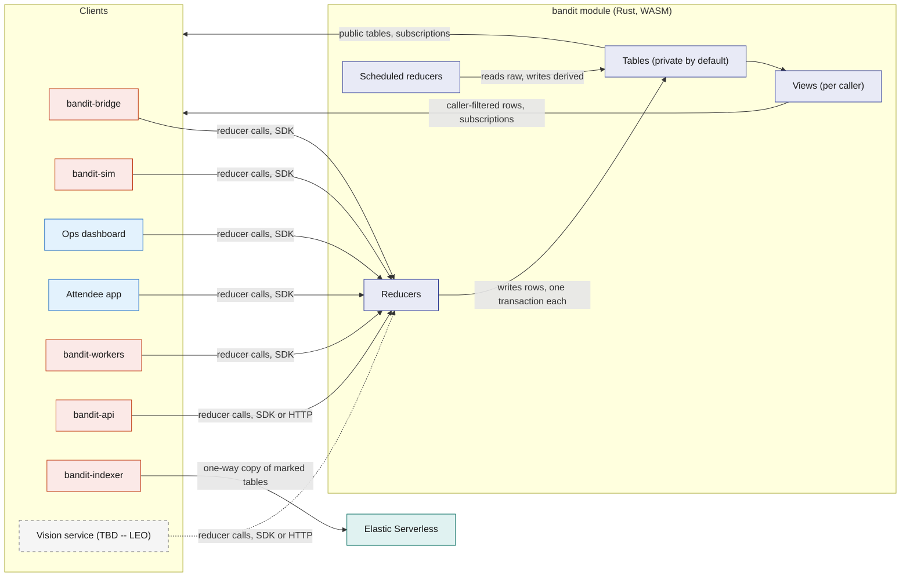
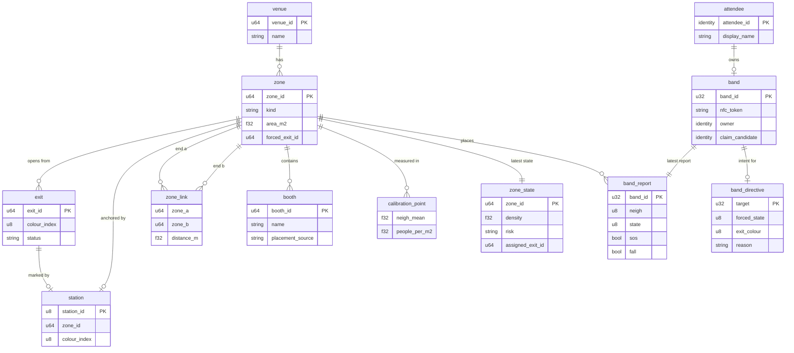
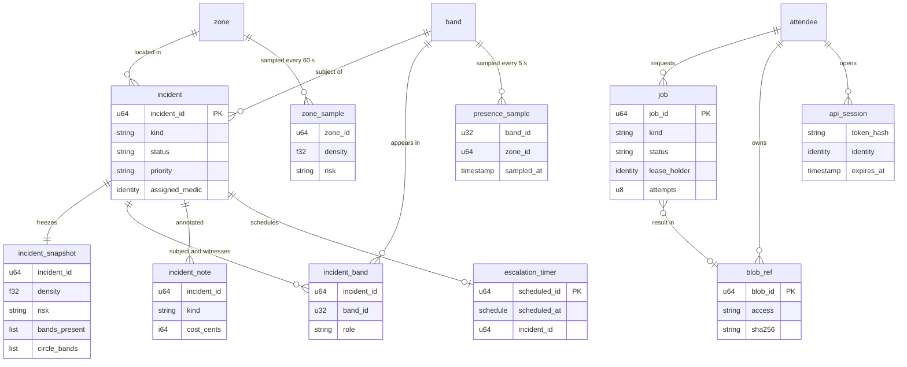
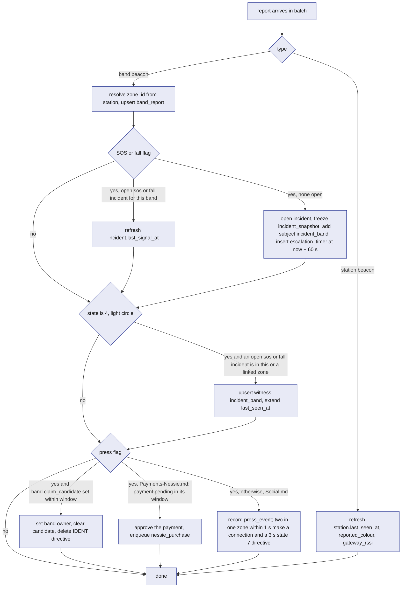

# SpacetimeDB: the `bandit` module

The `bandit` module is one SpacetimeDB database, written in Rust and compiled to WASM, that holds every piece of BandIt's live state and performs every state-changing action through reducers. Bands, the bridge, the simulator, staff and attendee web apps, the workers and the indexer all read it by subscription and change it only by calling reducers, so there is exactly one version of the truth for the venue at any moment. It exists because crowd safety cannot tolerate two systems disagreeing about which zone is dangerous or whether an incident is open. Everything else in BandIt is either a sensor feeding it, a screen reading it, or a worker doing slow work it has queued.

## Role in the system

Responsibilities:

- Hold the venue layout, identities, live band and zone state, control intent for the bands, incidents, sampled history and the work queue, in the core tables below.
- Turn raw band reports into derived safety state (`zone_state`, exit assignments, incidents) inside scheduled reducers, on a fixed cadence, in transactions.
- Enforce access: who may call which reducer and who may see which rows, by role and by caller identity, inside the database rather than in any app.
- Give every client the same live view through subscriptions to public tables and per-caller views.
- Queue slow or external work as `job` rows and accept results only from the worker that still holds the lease.

Non-responsibilities:

- It does not talk to radios, serial ports, cameras or any external service. Those are Rust processes ([Gateway-Bridge](Gateway-Bridge.md), [Rust-Backend](Rust-Backend.md)) that call reducers and subscribe; the feature doc that owns an external service says which process talks to it.
- It does not decide a band's density colour, SOS strobe or light circle. The band does that locally ([Hardware](Hardware.md)); the module decides exit colours, forced states, one-shot prompts and calibration values ([Safety](Safety.md)).
- It does not store photos, PDFs or rendered merch. Blobs live in `bandit-api`'s blob store; the module keeps a `blob_ref` row.
- It does not run any external HTTP call. SpacetimeDB 2.x procedures can make outbound HTTP calls, but they block private and loopback addresses and keep secrets in plain module environment, so every external call stays in the Rust workers. A text-only procedure (for example, formatting an incident summary) may appear as an optional showcase, never on the live path.
- The safety reasoning (thresholds, hysteresis, exit cost, escalation policy) is specified in [Safety](Safety.md). This file defines the tables and reducers that carry it.

## Interfaces

Every interface is a reducer call in or a subscription out, over the SpacetimeDB WebSocket protocol through the Rust or TypeScript client SDK. The HTTP endpoint `POST /v1/database/bandit/call/<reducer>` (JSON argument array, bearer token) is the alternative for one-off calls from scripts and from services that have no SDK connection; it reaches the same reducers with the same role checks.

| Direction | Counterpart | What flows | Reducers or tables | Transport |
|---|---|---|---|---|
| In | `bandit-bridge` | latest report per real band and station, every 250 ms; acks of one-shot commands (`sent` or `expired`); service heartbeat | `ingest_band_reports`, `ack_band_command`, `heartbeat` | Rust SDK |
| Out | `bandit-bridge` | desired band states, exit colours, one-shot commands, live calibration | `band_directive`, `band_command`, `fleet_config` (via `staff_directives`, `staff_commands` views) | subscription |
| In | Simulator.md: `bandit-sim` | reports for simulated bands (ids from 1000), replay of recorded logs when the bridge is down | `ingest_band_reports`, `heartbeat` | Rust SDK |
| Out | Simulator.md: `bandit-sim` | venue graph, zone state, directives for simulated targets, venue mode | `zone`, `zone_link`, `station`, `zone_state`, `venue_mode`, `fleet_config`, `staff_directives`, `staff_commands` | subscription |
| In | `bandit-ingest` | venue layout, booths, schedule, bands, calibration (seed and Bright Data load) | `upsert_venue`, `upsert_zone`, `upsert_zone_link`, `upsert_exit`, `upsert_station`, `upsert_booth`, `upsert_schedule_slot`, `register_band`, `set_calibration`; BrightData.md: `import_event` (one whole event bundle per transaction) | Rust SDK or HTTP |
| In | Ops dashboard | modes, exits, forced states, calibration, incident handling, role grants | Ops and Incident reducers below | TypeScript SDK |
| Out | Ops dashboard | everything staff may see | public tables plus `staff_*` and `my_role` views | subscription |
| In | Attendee app | claim, profile, consent, API session token | `claim_band_start`, `update_profile`, `set_consent`, `open_api_session` | TypeScript SDK |
| Out | Attendee app | own band, own reports, own presence, own incidents, venue map, busy zones, evacuation banner with the exit name and colour | `my_*` views, `zone`, `exit`, `booth`, `schedule_slot`, `zone_state`, `venue_mode` | subscription |
| In | `bandit-workers` | lease and finish jobs, heartbeat | `claim_job`, `extend_job_lease`, `complete_job`, `fail_job`, `heartbeat` | Rust SDK |
| Out | `bandit-workers` | queued and leased jobs by kind | `worker_jobs` view | subscription |
| In | `bandit-api` | blob registration, heartbeat; feature reducers named in feature docs | `register_blob`, `heartbeat` | Rust SDK |
| Out | `bandit-api` | API session tokens to authenticate its callers; blob refs | `api_sessions`, `staff_blobs` views | subscription |
| Out | Elastic.md: `bandit-indexer` | tables marked "copied" below, plus feature tables listed in [Elastic](Elastic.md) | `booth`, `zone`, `zone_sample` and feature tables | subscription (one way, nothing flows back) |
| In | Vision.md (TBD -- LEO): `bandit-vision` | zone counts from a local detector at about 1 to 2 Hz per zone, person-down alerts, property events, Claude incident assessments a few seconds after an event | `report_zone_count`, `report_ground_alert`, `report_property_event`, `submit_vision_assessment` ([Vision](Vision.md)) | Rust SDK or HTTP |
| Internal | scheduler | ticks and timers | `venue_tick`, `memory_tick`, `escalate_incident`, `job_reaper` | schedule tables |

## Design

### Why one module is the single source of truth

Three facts drive the choice. First, the safety loop has several writers (bridge, simulator, ops, scheduled ticks) and many readers (dashboard, medic phones, bridge, attendee apps); if any two of them held their own copy of "which zone is high" or "is this incident open", the demo would show different colours on different screens at the worst moment. Second, SpacetimeDB reducers are transactions: `ingest_band_reports` can open an incident, freeze its snapshot, record the subject band and schedule the escalation timer so that either all of it is visible to every subscriber or none of it is. Third, subscriptions push changes to every client the instant a transaction commits, so there is no polling layer between a band's SOS flag and the medic's phone. External services never hold truth: a search index receives a one-way copy, workers return model and bank results through reducers, and imported venue data enters through setup reducers like everything else.

### Module architecture

This diagram answers: who calls the module, what runs inside it, and how data gets back out.

### Design principles

| Principle | What it means here | Why |
|---|---|---|
| Raw in, derived out | The bridge, and any service that stands in for a device or adds a camera, writes only raw tables such as `band_report`. Only `venue_tick` writes `zone_state` and the safety rows of `band_directive`; only `memory_tick` writes `presence_sample` and `zone_sample`. | Two writers never fight over a derived row, and every screen computes nothing: it shows what the tick decided. |
| Overwrite live rows, sample history | `band_report`, `zone_state`, `venue_mode`, `fleet_config` are one row per band, zone or venue, overwritten in place. History exists only in `presence_sample` (5 s) and `zone_sample` (60 s). | Tables stay bounded by fleet size however long the event runs, and subscriptions carry changes, not logs. |
| Private by default, access through views | Every table is private unless listed as public below. Clients reach private rows only through views that read the caller's identity, so "a medic sees an incident only while it is open" is enforced by the database. | An app bug cannot leak a row the view would not return. |
| Search gets a copy, never the original | Only tables marked "copied" go to Elastic, one way, through `bandit-indexer`. Identity, incident and medical tables never leave the module. | Elastic can be rebuilt from the module at any time; the reverse is never needed. |
| Add tables rather than reshape them | A new feature adds its own tables and reducers (the registry below). Core table columns are frozen after the first publish; a needed column is appended with a default. | SpacetimeDB publishes additive changes without clearing data; column changes do not. |
| Nothing in the safety path waits | No reducer calls out, no reducer waits on a job, no procedure sits between a band flag and an incident row. | A band's SOS reaches the dashboard in one bridge batch plus one transaction. |
| Every privileged reducer checks the caller | The first statement of each non-attendee reducer looks up `staff_role` by the caller's identity and rejects the call if the role is not allowed. | The module, not the app, is the security boundary. |

### Core tables

Conventions: "auto id" is a SpacetimeDB auto-increment primary key and is the id used everywhere else, including Elastic document ids. "identity" is a SpacetimeDB `Identity`. Timestamps are SpacetimeDB timestamps set from the reducer context's clock. "Visibility" says who can read: "public" means any connected client; otherwise the named views. "Copied" says whether `bandit-indexer` copies the table to Elastic.

#### Venue group (loaded at setup)

`venue`: one row per event. Written by `upsert_venue` (role `ingest` or `ops`). Public. Not copied.

| Field | Type | Meaning |
|---|---|---|
| `venue_id` | auto id | the venue; the demo has one |
| `name` | text | display name |
| `starts_at`, `ends_at` | timestamp | event window, used by post-event features to know when "the event" ended |
| `pit_zone_id` | zone id, optional | the demo pit zone, so the dashboard can open on it |
| `origin_lat`, `origin_lon`, `plan_rotation_deg` | numbers | where the floor plan's origin sits on the earth and how the plan is rotated, so plan metres can be drawn on a map; the seed leaves them empty. BrightData.md: its `import_event` fills them |
| `notes` | text | free text for ops |

`zone`: an area of the venue, anchored by at most one station. Written by `upsert_zone` (role `ingest`, `ops`); `set_zone_exit`, `set_zone_risk` and `set_venue_mode` write the three override columns. Public. Not copied; Elastic.md: its booth documents carry the zone name as a plain field, copied from the booth row, never a zone document.

| Field | Type | Meaning |
|---|---|---|
| `zone_id` | auto id | the zone |
| `venue_id` | venue id | owner venue |
| `name` | text | for example "Main stage left" |
| `kind` | enum `floor`, `stage`, `corridor`, `exit`, `outside` | `exit` zones are where exits open; `outside` is the safe side of an exit |
| `area_m2` | number | floor area usable by people; set by ops at setup (assumption, measure at the venue) |
| `capacity` | number | people at which ops considers the zone full (planning only, not used by risk) |
| `station_id` | station id, optional | the station whose beacon defines "in this zone"; simulated-only zones have none |
| `plan_x_m`, `plan_y_m` | numbers | the zone centre on the floor plan, metres from the venue origin; for drawing the map only, never a band position |
| `evacuating` | bool | set by `set_venue_mode` when evacuation is scoped to zones |
| `forced_exit_id` | exit id, optional | ops override of exit assignment (`set_zone_exit`); empty means automatic |
| `forced_risk` | enum, optional | ops override of the risk level (`set_zone_risk`); empty means automatic |

`zone_link`: an undirected walking connection between two zones. Written by `upsert_zone_link`. Public. Not copied.

| Field | Type | Meaning |
|---|---|---|
| `link_id` | auto id | the link |
| `zone_a`, `zone_b` | zone id | the two ends |
| `distance_m` | number | walking distance between zone centres (assumption at setup, pace it out) |
| `passable` | bool | ops can close a corridor without deleting the row |

`exit`: a door out of an exit zone, with a colour. Written by `upsert_exit`; `set_exit_status` writes `status`. Public. Not copied.

| Field | Type | Meaning |
|---|---|---|
| `exit_id` | auto id | the exit |
| `zone_id` | zone id | the zone the exit opens from |
| `name` | text | for example "North doors" |
| `colour_index` | 1 to 6 | 1 blue, 2 magenta, 3 cyan, 4 white, 5 orange, 6 violet; the colour bands show in GUIDE and the station glows |
| `station_id` | station id, optional | the station marker standing at this exit |
| `status` | enum `open`, `blocked` | blocked exits are skipped by assignment |
| `status_changed_at`, `status_changed_by` | timestamp, identity | audit |

`station`: a station marker, keyed by its radio id. Written by `upsert_station`; `ingest_band_reports` refreshes the three live columns from station beacons. Public. Not copied.

| Field | Type | Meaning |
|---|---|---|
| `station_id` | 101 to 105, primary key | the radio id |
| `zone_id` | zone id | the zone this station anchors |
| `exit_id` | exit id, optional | the exit it marks, if it stands at one |
| `colour_index` | 1 to 6 | desired colour; defaults to `station_id` minus 100 |
| `label` | text | where it physically stands |
| `plan_x_m`, `plan_y_m` | numbers | where it stands on the floor plan, metres from the venue origin |
| `last_seen_at` | timestamp | last station beacon the gateway heard |
| `reported_colour` | 0 to 6 | colour index the station last reported in its beacon |
| `gateway_rssi` | dBm | signal at the gateway, a health indicator only |

`booth`: a stand or stage with scraped or hand-entered content. Written by `upsert_booth` (role `ingest`, `ops`; the hand-fix reducer) and by BrightData.md's `import_event`. Public. Copied to `bandit-booths`.

| Field | Type | Meaning |
|---|---|---|
| `booth_id` | auto id | the booth |
| `zone_id` | zone id | where it is, assigned by nearest station |
| `booth_number` | text | the number printed on the event's plan |
| `name`, `description`, `tags`, `url` | text, text, list of text, text | content, from the seed or from ops edits. BrightData.md: its `import_event` fills the description and tags |
| `plan_x_m`, `plan_y_m` | numbers | position on the floor plan, metres from the venue origin |
| `placement_source` | enum `plan`, `manual`, `none` | where the position came from; a `manual` value survives a re-import |
| `source_url`, `fetched_at` | text, timestamp | provenance of scraped content; empty for a hand-entered booth |
| `updated_at` | timestamp | for the indexer's incremental copy |
| BrightData.md: `organization_id`, `hall_id` | ids, optional | the exhibitor organisation and the hall sheet the booth belongs to |

`schedule_slot`: a timed item at a booth or zone. Written by `upsert_schedule_slot`. Public. Not copied unless a search feature asks for it (Elastic.md decides whether it joins `bandit-booths`).

| Field | Type | Meaning |
|---|---|---|
| `slot_id` | auto id | the slot |
| `zone_id` | zone id | where |
| `booth_id` | booth id, optional | which booth, if any |
| `title`, `performer`, `description` | text | content |
| `starts_at`, `ends_at` | timestamp | when |

`calibration_point`: one measured point mapping the bands' neighbour count to people per square metre. Written by `set_calibration` (role `ops`). Public. Not copied.

| Field | Type | Meaning |
|---|---|---|
| `point_id` | auto id | the point |
| `venue_id` | venue id | where measured |
| `label` | text | for example "spread 2 m", "1.5 m square", "1.2 m square" |
| `neigh_mean` | number | mean `neigh` observed across bands during the measurement |
| `people_per_m2` | number | the known density of the measurement (people divided by taped area) |
| `band_count` | number | how many bands took part |
| `recorded_at`, `recorded_by` | timestamp, identity | audit |

#### Identity group

`attendee`: one person, keyed by the identity of their attendee app connection. Written by `claim_band_start` (creates a blank row), `update_profile`. Private; read through `my_attendee`. Not copied. Feature docs add their own tables for socials, medical and payment data; this row holds only the basics.

| Field | Type | Meaning |
|---|---|---|
| `attendee_id` | identity, primary key | the person |
| `display_name` | text | shown to staff only inside an open incident, through `staff_incidents`, and nowhere else in the core. Social.md: also shown to connected attendees on mutual opt-in |
| `created_at`, `updated_at` | timestamp | audit |

`consent`: one switch per attendee per feature. Written by `set_consent`. Private; read through `my_consent`; feature reducers read it directly. Not copied.

| Field | Type | Meaning |
|---|---|---|
| `consent_id` | auto id | the row; the reducer keeps one row per `(attendee_id, kind)` |
| `attendee_id` | identity | whose |
| `kind` | text: `findable`, `photo_tagging`, `merch` | the switch; [Attendee-App](Attendee-App.md) shows the three, and the feature doc that uses a switch defines what it unlocks (Social.md: `findable` and `photo_tagging`; Merch.md: `merch`). Text rather than an enum so a feature can add a switch without a column change. Other docs write `consent.findable` as shorthand for "the caller's `findable` row has `granted` true" |
| `granted` | bool | the switch |
| `updated_at` | timestamp | audit |

`band`: one physical or simulated band. Written by `register_band` (role `ingest`, `ops`), `claim_band_start` and `ingest_band_reports` (claim completion). Private; read through `my_band` (owner) and `staff_bands` (staff, owner identity hidden). Not copied.

| Field | Type | Meaning |
|---|---|---|
| `band_id` | 1 to 9, or 1000 and up, primary key | the radio id; simulated bands start at 1000 |
| `nfc_token` | text, unique | `BANDIT-01` to `BANDIT-09`; empty for simulated bands |
| `is_full` | bool | carries the IMU and motor |
| `simulated` | bool | driven by `bandit-sim` |
| `label` | text | written on the case |
| `owner` | identity, optional | the attendee who claimed it |
| `claimed_at` | timestamp, optional | when the press completed the claim |
| `claim_candidate` | identity, optional | who started a claim that is waiting for the press |
| `claim_pending_until` | timestamp, optional | end of the 8 s prompt window |

`staff_role`: one role grant to one identity. Written by `grant_role`, `revoke_role` (role `owner`); `init` seeds the publisher as `owner`. Private; read through `my_role` (own rows) and `staff_roles` (owner and ops). Not copied.

| Field | Type | Meaning |
|---|---|---|
| `role_id` | auto id | the grant |
| `identity` | identity | who |
| `role` | enum of the roles below | what |
| `label` | text | person's name or service name, for the dashboard |
| `granted_by`, `granted_at` | identity, timestamp | audit |

#### Live group (overwritten in place)

`band_report`: the latest report per band, built from one record of the bridge's batch. Written only by `ingest_band_reports` (role `bridge`, `simulator`). Private; read through `my_band_report`, `staff_band_reports` (real bands) and `staff_sim_reports` (simulated bands). Not copied.

| Field | Type | Meaning |
|---|---|---|
| `band_id` | band id, primary key | which band |
| `source` | enum `bridge`, `simulator` | who reported |
| `heard_at` | timestamp | when the gateway last heard the band: the module's clock at the batch minus the record's `heard_age_ms`; liveness is judged from this (alive within 2 s, stale after 5 s) |
| `gateway_id` | number | which gateway heard it (200 in v0.1) |
| `gateway_rssi` | dBm | signal at the gateway: distance to the gateway, not density |
| `loss_pct` | number | the bridge's packet-loss estimate for this band over the last 5 s, a radio-health figure |
| `flags` | 0 to 255 | the flag byte, OR-accumulated by the bridge since its previous batch so a 1 s press flag or a brief fall flag is never missed |
| `sos`, `fall`, `press`, `low_battery`, `full_band` | bool | the flag bits decoded so views and subscriptions can filter on them |
| `neigh` | number | the band's own smoothed neighbour count: the density number |
| `station_id` | 0 or 101 to 105 | the record's `zone`: station heard loudest, 0 if none |
| `zone_id` | zone id or 0 | resolved from `station.zone_id`; 0 means unzoned |
| `bat` | 0 to 100 or 255 | battery percent, 255 unknown |
| `state` | 0 to 9 | the band state it is showing |
| `seq` | number | the band's packet counter; the bridge detects reboots from it |

`zone_state`: the latest derived state per zone. Written only by `venue_tick`. Public. Not copied (its history is `zone_sample`).

| Field | Type | Meaning |
|---|---|---|
| `zone_id` | zone id, primary key | which zone |
| `band_count` | number | live bands whose `zone_id` is this zone |
| `neigh_mean` | number | mean `neigh` of those bands |
| `density_band` | people per m² | band-based estimate ([Safety](Safety.md)) |
| `density_camera` | people per m², optional | camera estimate when fresh (TBD -- LEO) |
| `density` | people per m² | the chosen estimate: the higher fresh one |
| `density_source` | enum `band`, `camera`, `manual`, `none` | which estimate won, or that ops forced the level; the dashboard shows this badge |
| `risk` | enum `normal`, `watch`, `high` | current level after hysteresis |
| `risk_since` | timestamp | when the current level began |
| `candidate_risk`, `candidate_ticks` | enum, number | the level the raw density points at and how many consecutive ticks it has held |
| `assigned_exit_id` | exit id, optional | the exit this zone's bands are guided to |
| `assigned_colour` | 0 to 6 | its colour, 0 when no exit is reachable |
| `exit_changed_at` | timestamp | when the assignment last changed |
| `sos_count`, `circle_count` | number | live bands in the zone with an SOS or fall flag, and bands showing state 4 |
| `updated_at` | timestamp | tick time |

`venue_mode`: one row per venue. Written by `set_venue_mode` (role `ops`, `owner`); `venue_tick` refreshes `tick_at`. Public. Not copied.

| Field | Type | Meaning |
|---|---|---|
| `venue_id` | venue id, primary key | which venue |
| `mode` | enum `normal`, `evacuate` | venue-wide mode; zone-scoped evacuation uses `zone.evacuating` with `mode` left `normal` |
| `tick_at` | timestamp | heartbeat of `venue_tick`; clients use it as the server clock to judge stale rows and a dead tick |
| `set_by`, `set_at`, `note` | identity, timestamp, text | audit and the reason ops typed |

`fleet_config`: one row of live band calibration. Written by `set_fleet_config` (role `ops`, `owner`); `init` seeds defaults from `bandit-protocol`. Public. Not copied.

| Field | Type | Meaning |
|---|---|---|
| `config_id` | always 1, primary key | singleton |
| `yellow_at`, `red_at` | neighbour counts | `thresh` arguments; starting values 3 and 5, calibrate |
| `neigh_rssi_min`, `circle_rssi_min` | dBm | `rssi` arguments; starting values -62 and -58, calibrate |
| `density_override` | bool | `override 1` to every band: the density state machine is off and bands stay green unless forced (Plan B) |
| `version` | number | incremented on every change so the bridge resends only when it moves |
| `updated_by`, `updated_at` | identity, timestamp | audit |

#### Control group

`band_directive`: sticky desired state per target. Written by `venue_tick` (exit colours, evacuation, medic approach), `claim_band_start` (IDENT), `force_band_state` and `clear_all` (manual), and Social.md's Bandshake step (CONNECT for 3 s). Private; read through `staff_directives` (ops, owner, bridge, simulator). Not copied. One row per target: a band id means that band, a station id means the station marker itself (for which only `exit_colour` and a forced mode, 0 breathe, 1 chase, 9 off, are meaningful), and 0 means all bands. A band row overrides the target 0 row field by field. `exit_colour` is never written on target 0, because an `exit` broadcast recolours every station marker; `venue_tick` writes exit colours per band from each band's zone. The bridge reconciles rows into `state`, `exit` and `override` commands ([Gateway-Bridge](Gateway-Bridge.md)). Deleting a row or removing a forced state never sends `clear`: the bridge lets the forced state expire. Only a `band_command` of kind `clear` sends `clear`, and `clear` also releases SOS, fall and the light circle.

| Field | Type | Meaning |
|---|---|---|
| `target` | 0, band id or station id, primary key | 0 means every band |
| `forced_state` | 0 to 8 for a band; 0, 1 or 9 for a station; optional | state the band must hold, or the station's mode; empty means none. 9 is a no-op on bands (the firmware's "nothing forced" marker), so ring-off is never a band directive |
| `forced_until` | timestamp, optional | end of the hold; empty means until cleared. The bridge refreshes before each 25.5 s band-side limit |
| `exit_colour` | 1 to 6, optional | colour to show in GUIDE |
| `override` | bool | stop the band's density state machine for this target |
| `reason` | text: `exit_assignment`, `evacuation`, `medic_approach`, `claim_ident`, `manual`, `plan_b`; features add their own (Social.md: `bandshake`) | why; the dashboard shows it. Text rather than an enum so a feature can add a reason without a column change |
| `incident_id` | incident id, optional | the incident that caused it, for `medic_approach` |
| `version` | number | incremented on every write |
| `updated_at`, `updated_by` | timestamp, text | tick name or caller identity |

`band_command`: a one-shot event the bridge sends once. Written by `send_band_command` (role `ops`), `clear_all`, `resolve_incident`, and feature reducers (Payments-Nessie.md: `pay` and `paid`). Deleted by `ack_band_command`. Private; read through `staff_commands`. Not copied.

| Field | Type | Meaning |
|---|---|---|
| `command_id` | auto id | the command |
| `target` | 0 or band id | who |
| `name` | enum `pay`, `paid`, `buzz`, `clear` | the gateway command word |
| `arg` | number | buzz pattern 1 to 3; unused otherwise |
| `created_at`, `created_by` | timestamp, text | audit |
| `source_table`, `source_id` | text, number | the row that caused it (for example a payment), so a feature can trace delivery |

#### Incident group

`incident`: one safety event. Written by `ingest_band_reports` (sos, fall), `venue_tick` (crowd_risk, evacuation), `open_incident` (ops), `ack_incident`, `assign_medic`, `resolve_incident`, `escalate_incident`, Medical-ID.md's `medic_open_incident`, and the Vision reducers `report_property_event`, `report_ground_alert` and `submit_vision_assessment` (TBD -- LEO). Private; read through `staff_incidents` (staff) and `my_incident` (the subject's owner). Not copied.

| Field | Type | Meaning |
|---|---|---|
| `incident_id` | auto id | the incident |
| `kind` | enum `sos`, `fall`, `crowd_risk`, `evacuation`, `property` | what |
| `status` | enum `open`, `acknowledged`, `responding`, `resolved` | lifecycle ([Safety](Safety.md)) |
| `priority` | enum `normal`, `high` | raised by `escalate_incident` |
| `zone_id` | zone id or 0 | where; 0 when the band was unzoned |
| `band_id` | band id, optional | the subject band for `sos` and `fall`; empty for `crowd_risk`, `evacuation`, `property`, and for a `fall` opened by Vision (TBD -- LEO) from a ground alert with no band flag |
| `subject` | identity, optional | the band's owner at open time |
| `opened_by` | enum `band`, `tick`, `ops`, `medic`, `vision` | who opened it |
| `opened_at`, `last_signal_at` | timestamp | open time and the last report that still carried the flag |
| `acknowledged_at`, `acknowledged_by` | timestamp, identity | optional |
| `assigned_medic`, `assigned_at`, `medic_entry_zone_id` | identity, timestamp, zone id | optional; the entry zone drives the medic approach |
| `escalated_at`, `escalations` | timestamp, number | when and how many times the timer fired |
| `resolved_at`, `resolved_by`, `resolution` | timestamp, identity, text | optional; `resolution` is `recovered` for automatic crowd-risk closure |
| Vision.md (TBD -- LEO): `camera_corroborated` | bool | set by `report_ground_alert` when a person-down alert lands in the incident zone within 3 s of the flag; a second source, never a gate |
| Vision.md (TBD -- LEO): `vision_status` | enum `none`, `pending`, `confirmed`, `not_confirmed` | result of the Claude assessment a few seconds later; raises or lowers confidence only, never gates opening |

`incident_snapshot`: a frozen record taken in the transaction that opens the incident. Written once by the opener. Private; read through `staff_snapshots` and `my_incident`. Not copied (Hyphenate.md: its evidence pack reads it inside the module).

| Field | Type | Meaning |
|---|---|---|
| `snapshot_id` | auto id | the snapshot |
| `incident_id` | incident id | which incident |
| `taken_at` | timestamp | equals `opened_at` |
| `zone_id`, `risk`, `density`, `density_band`, `density_camera`, `density_source` | copied from `zone_state` | the zone as it was |
| `band_count`, `bands_present` | number, list of band ids | live bands in the zone at that instant |
| `circle_bands` | list of band ids | bands showing state 4 at that instant |
| `venue_mode`, `assigned_exit_id`, `exit_status` | enum, exit id, enum | guidance state at that instant |
| `fleet_config_version` | number | which calibration was live |
| Vision.md (TBD -- LEO): `camera_ids` | list of camera ids | cameras covering the zone |

`incident_band`: the bands attached to an incident. Written by `ingest_band_reports` (subject on open, witnesses while open). Private; read through `staff_incident_bands`. Not copied.

| Field | Type | Meaning |
|---|---|---|
| `row_id` | auto id | the row |
| `incident_id` | incident id | which incident |
| `band_id` | band id | which band |
| `role` | enum `subject`, `witness` | witnesses are light-circle bands (state 4) |
| `zone_id` | zone id | the band's zone when first seen |
| `first_seen_at`, `last_seen_at` | timestamp | window in which it reported state 4 |

`incident_note`: staff notes and costs. Written by `add_incident_note` (staff roles), `escalate_incident` (an automatic note). Private; read through `staff_incident_notes`. Not copied.

| Field | Type | Meaning |
|---|---|---|
| `note_id` | auto id | the note |
| `incident_id` | incident id | which incident |
| `author` | identity | who |
| `kind` | enum `note`, `cost`, `escalation`, `status` | what sort |
| `text` | text | the note |
| `cost_cents` | integer, optional | USD cents on a `cost` note (Hyphenate.md reads it) |
| `created_at` | timestamp | when |

`escalation_timer`: a schedule table; one row per open incident. Written by the opener, deleted by `ack_incident`, `assign_medic`, `resolve_incident`, and re-armed by `escalate_incident`. Private, no view. Not copied.

| Field | Type | Meaning |
|---|---|---|
| `scheduled_id` | auto id | the row |
| `scheduled_at` | schedule time | an absolute time, `opened_at` plus 60 s (starting value, calibrate) |
| `incident_id` | incident id | which incident |
| `level` | number | how many times it has fired |

#### History group (sampled)

`presence_sample`: one row per live band every 5 s. Written by `memory_tick`. Private; read through `my_presence` (own band). Not copied. Social.md: its reducers read it and derive `visit` and `encounter` from it; those derived rows are what Elastic.md copies.

| Field | Type | Meaning |
|---|---|---|
| `sample_id` | auto id | the sample |
| `band_id` | band id | which band |
| `zone_id` | zone id or 0 | where |
| `sampled_at` | timestamp | when |
| `neigh`, `state` | number, 0 to 9 | how crowded it felt and what it showed |

`zone_sample`: one row per zone every 60 s. Written by `memory_tick`. Public. Not copied (history stays here and reaches screens by subscription).

| Field | Type | Meaning |
|---|---|---|
| `sample_id` | auto id | the sample |
| `zone_id` | zone id | which zone |
| `sampled_at` | timestamp | when |
| `band_count`, `neigh_mean`, `density_band`, `density_camera`, `density`, `density_source`, `risk`, `assigned_exit_id` | copied from `zone_state` | the zone's state at that minute |
| `open_incidents` | number | incidents in the zone not yet resolved |

#### Work and files group

`job`: one unit of slow or external work. Written by `enqueue_job` (internal, called by feature reducers), `claim_job`, `extend_job_lease`, `complete_job`, `fail_job` (role `worker`), `job_reaper`. Private; read through `worker_jobs` (workers) and `my_jobs` (requester, status only). Not copied.

| Field | Type | Meaning |
|---|---|---|
| `job_id` | auto id | the job |
| `kind` | text | one of the job kinds listed in the brief; each owned by a feature doc |
| `status` | enum `queued`, `leased`, `done`, `failed`, `dead` | `failed` is retryable, `dead` is not |
| `payload` | text | the job's input, as text the worker parses |
| `subject_table`, `subject_id` | text, number | the row the job is about |
| `requested_by` | identity, optional | the attendee or staff member who caused it |
| `lease_holder`, `lease_until` | identity, timestamp | who holds it and until when (60 s, starting value) |
| `attempts`, `max_attempts` | number | tries so far; 3 |
| `not_before` | timestamp, optional | back-off before the next try |
| `result_blob_id`, `result_text`, `error` | blob id, text, text | outcome |
| `created_at`, `updated_at` | timestamp | audit |

`blob_ref`: the module's record of a file held by `bandit-api`'s blob store. Written by `register_blob` (roles `api` and `worker`). Private; read through `my_blobs` (owner) and `staff_blobs` (staff; `staff` and `shared` classes only). Not copied. Elastic.md: its photo documents carry the blob id, never the bytes.

| Field | Type | Meaning |
|---|---|---|
| `blob_id` | auto id | the blob; the key `bandit-api` stores it under |
| `owner` | identity | who uploaded or who it is about |
| `access` | enum `owner_only`, `staff`, `shared` | medical PDFs are `owner_only` (medics see the extracted card, never the PDF); incident photos `staff`; event photos `shared` |
| `purpose` | enum `photo`, `medical`, `merch`, `frame`, `other` | what it is |
| `content_type`, `size_bytes`, `sha256` | text, number, text | integrity |
| `created_at` | timestamp | audit |

#### Service group (added by the brief's addendum)

`api_session`: how `bandit-api` knows who is calling it over HTTP without verifying tokens itself. Written by `open_api_session` (any attendee or staff identity). Private; read through `api_sessions` (role `api`). Not copied. The app generates a random token, sends its hash here and the token itself to `bandit-api`; the API hashes what it receives and looks it up in its subscription.

| Field | Type | Meaning |
|---|---|---|
| `session_id` | auto id | the session |
| `token_hash` | text, unique | SHA-256 of the client's random token |
| `identity` | identity | the caller who registered it |
| `created_at`, `expires_at` | timestamp | 12 h lifetime (starting value) |
| `label` | text | which app and route opened it |

`service_heartbeat`: one row per Rust service. Written by `heartbeat` (any service role) every 5 s. Public (holds no personal data; the dashboard's service health panel reads it). Not copied.

| Field | Type | Meaning |
|---|---|---|
| `service` | enum `bridge`, `simulator`, `workers`, `api`, `indexer`, `ingest`, `vision`, primary key | which service; one instance each in the demo |
| `identity` | identity | the connection that last beat |
| `version` | text | build version string |
| `started_at`, `last_at` | timestamp | uptime and liveness; a row older than 15 s is shown red |
| `lines_per_second` | number | bridge: gateway lines read |
| `loss_percent` | number | bridge: per-fleet packet loss estimated from `seq` gaps |
| `errors` | number | bridge: parse errors and rejected commands since start; workers: failed jobs since start |
| `backlog` | number | workers: jobs leased; indexer: rows pending |
| `note` | text | short free text, for example the serial port name |

#### Schedule tables for periodic reducers

Each scheduled reducer is bound to its own schedule table. Rows carry a `scheduled_at` value that is either an interval (repeats) or an absolute time (fires once and is deleted). `init` inserts one interval row in each of `venue_tick_timer` (500 ms), `memory_tick_timer` (5 s) and `job_reaper_timer` (10 s). `escalation_timer` above holds absolute times. All four are private; scheduled reducers are private by default in SpacetimeDB 2.x, so only the scheduler and the database owner can invoke them.

### Entity diagrams

This diagram answers: how the venue, identity, live and control tables relate.

This diagram answers: how incidents, history and the work queue relate to bands and zones.

### Registry of optional feature tables

Each optional component owns its tables, reducers and job kinds and defines them in its own file. The module simply gains those tables when the feature is built; deleting the feature deletes its row here and nothing else in this file changes.

| Doc | Tables it adds | Core tables it reads |
|---|---|---|
| [Medical-ID](Medical-ID.md) | `medical_document`, `medical_card`, `medical_access_log` | `band`, `incident`, `blob_ref` |
| [Payments-Nessie](Payments-Nessie.md) | `merchant`, `bank_link`, `payment`, and the schedule table `payment_timer` | `band`, `band_report`, `band_command`, `job` |
| [Hyphenate](Hyphenate.md) | `insurance_policy`, `claim`, `evidence_fact`, `evidence_pack`, `coverage_rule`, `settlement_rule`, `authority_limit`, `approval`, `ledger_entry` | `incident`, `incident_snapshot`, `incident_band`, `incident_note`, `zone_sample`, `job` |
| [Social](Social.md) | `press_event`, `visit`, `encounter`, `connection_request`, `social_handle`, `photo`, `photo_tag`, `share_link`, `summary_story` | `presence_sample`, `band_report`, `booth`, `consent`, `blob_ref`, `job`; writes `band_directive` (CONNECT) |
| [Merch](Merch.md) | `merch_product`, `merch_design`, `merch_order` | `consent`, `blob_ref`, `job` |
| [Anthropic-Agent](Anthropic-Agent.md) | `model_call` | `job` |
| [Vision](Vision.md) (TBD -- LEO) | `camera`, `camera_count`, `ground_alert`, `property_event`, `vision_assessment` | `zone`, `incident`, `blob_ref` |
| [BrightData](BrightData.md) | `hall`, `organization`, `person`, `claim_contact` (private; readable only by the `ingest` and `api` roles through a view BrightData.md defines) | `venue`, `zone`, `booth`, `attendee` |

Feature reducers, views and timers are named by their doc as snake_case verbs and defined there; this table only lists them so a reader can find the owner. They follow the same role-check pattern as the core reducers.

| Doc | Reducers | Views and timers |
|---|---|---|
| [Medical-ID](Medical-ID.md) | `submit_medical_document` (role `api`), `apply_medical_extract` (role `worker`), `confirm_medical_card`, `save_medical_card`, `request_medical_card` (role `medic`), `medic_open_incident` (role `medic`) | views `my_medical_card`, `medic_medical_card` |
| [Payments-Nessie](Payments-Nessie.md) | `register_merchant`, `link_bank`, `complete_bank_link`, `start_payment`, `confirm_payment`, `cancel_payment`, `expire_payment` (scheduled), `settle_payment`, `fail_payment`, `request_payout`, `settle_payout`, `fail_payout`, `refund_payment` | schedule table `payment_timer` |
| [Hyphenate](Hyphenate.md) | `open_claim`, `approve_claim`, `refuse_claim`, `record_insurer_payment`, `mark_claim_paid_manually`, `request_recovery_letter`, `attach_claim_letter`, `retire_settlement_rule`, `upsert_insurance_policy`, `upsert_coverage_rule`, `set_authority_limit` | defined there |
| [Social](Social.md) | `request_connection`, `respond_connection`, `withdraw_connection`, `set_social_handle`, `remove_social_handle`, `link_social_handle` (role `api`), `register_photo` (role `photographer`), `hide_photo`, `respond_photo_tag`, `create_share_link`, `revoke_share_link`, `request_summary_story`, `request_summary_stories` (role `ops`), `submit_summary_story` (role `worker`); plus the social step in `memory_tick` and the Bandshake step in `ingest_band_reports` | views `my_visits`, `my_encounters`, `my_connections`, `my_photos`, `my_story`, `my_share_links` |
| [Merch](Merch.md) | `request_merch_design`, `submit_merch_design`, `submit_merch_render`, `place_merch_order`, `confirm_merch_order`, `cancel_merch_order`, `leave_merch_design`, `set_merch_product_image` | views `merch_catalogue`, `my_merch_designs`, `my_merch_orders` |
| [BrightData](BrightData.md) | `import_event` (roles `ingest` and `ops`; upserts one whole event bundle of halls, organisations, people, booths, schedule and `merch_product` rows in a single transaction; it only refines the geometry of existing station zones matched by name and never creates or deletes a zone, so core stays independent), `request_person_claim` and `confirm_person_claim` (role `api`) | defined there |
| [Vision](Vision.md) (TBD -- LEO) | `upsert_camera` (roles `vision` and `ops`), `report_zone_count`, `report_ground_alert`, `report_property_event`, `submit_vision_assessment`, `submit_photo_features`; the job kind `photo_features` | defined there |
| [Anthropic-Agent](Anthropic-Agent.md) | `record_model_call` (roles `worker`, `ingest`, `vision`) | defined there |
| [Elastic](Elastic.md) | none; `bandit-indexer` only reads, and the organizer runs upstream of `import_event` (BrightData.md) | `api_presence_windows` (role `api`): one row per stay per attendee, collapsed from `presence_sample` |

### Core reducers

Every reducer runs as one transaction. "Caller" is the role the reducer requires; "any" means any connected identity. Each privileged reducer starts by looking up the caller's `staff_role` rows by identity and rejecting the call if none matches.

#### Setup

| Reducer | Caller | What it does | Writes |
|---|---|---|---|
| `upsert_venue` | `ingest`, `ops`, `owner` | creates or updates the venue row; also creates the `venue_mode` row for it if missing | `venue`, `venue_mode` |
| `upsert_zone` | `ingest`, `ops`, `owner` | creates or updates a zone by name; creates its `zone_state` row with `risk` `normal` so the dashboard never sees a zone without state | `zone`, `zone_state` |
| `upsert_zone_link` | same | creates or updates the link between two zones | `zone_link` |
| `upsert_exit` | same | creates or updates an exit; rejects a colour index outside 1 to 6 | `exit` |
| `upsert_station` | same | creates or updates a station by radio id and points it at a zone and optionally an exit | `station` |
| `upsert_booth` | same | creates or updates one booth by hand (the hand-fix reducer; BrightData.md's `import_event` does the bulk load); sets `placement_source` `manual` when a person places it, which a re-import never overrides | `booth` |
| `upsert_schedule_slot` | same | creates or updates a timed item | `schedule_slot` |
| `register_band` | `ingest`, `ops`, `owner`; `simulator` for ids 1000 and above | creates or updates a band row by radio id with its NFC token and flags; clears the owner only when asked to, so re-running the seed never unclaims bands; the simulator registers its own bands before reporting them | `band` |
| `set_calibration` | `ops`, `owner` | inserts or replaces a calibration point by label | `calibration_point` |

#### Devices

| Reducer | Caller | What it does | Writes |
|---|---|---|---|
| `ingest_band_reports` | `bridge`, `simulator` | applies a batch of reports (detail below) | `band_report`, `station`, `band`, `incident`, `incident_snapshot`, `incident_band`, `escalation_timer`, `band_directive` |
| `ack_band_command` | `bridge`, `simulator` | takes the command id and an outcome, `sent` or `expired`, and deletes the row; idempotent, so acking a row that is already gone is a no-op. An `expired` outcome on a command with a `source_table` is handed to that feature's rule (Payments-Nessie.md treats an expired `pay` as declined) | `band_command` |
| `heartbeat` | any service role | upserts the caller's `service_heartbeat` row | `service_heartbeat` |

Who may report which band: the `bridge` role may report real ids (1 to 9) and stations (101 to 105). The `simulator` role may always report bands whose `band.simulated` is true, and may report real ids only while the `bridge` heartbeat is older than 10 s (so a recorded log can be replayed when the bridge is down, but the two never fight over a live band). A report for an unregistered band id is dropped with a note in the reducer log; the demo registers every id ahead of time.

#### `ingest_band_reports`, step by step

The bridge calls this once per 250 ms batch with the records that changed since the last batch, and with every band at least once a second so heard times keep moving. Each record is the `bandit-protocol` batch record: `band_id`, `kind` (band or station), `flags` (OR-accumulated since the previous batch), `neigh`, `zone`, `bat`, `state`, `seq`, `gateway_rssi`, `heard_age_ms`, `loss_pct` and `gateway_id`. The module sets `source` from the caller's role and `heard_at` from its own clock minus `heard_age_ms`, and derives alive (2 s) and stale (5 s) from that. The whole batch is one transaction. This diagram answers: what one report does inside that transaction.

Rules that matter:

- Opening uses the zone the band reports now. If `station_id` is 0 the incident is opened with `zone_id` 0 (unzoned) and the snapshot records the light-circle bands anywhere in the fleet, since a band can only join the circle within a few metres.
- `fall` wins over `sos` for `kind` when both flags are set.
- A report whose flag is still set within 10 s (starting value) after its incident was resolved does not reopen it; this gives the `clear` command written by `resolve_incident` time to reach the band. After that, a flag opens a new incident.
- Witness matching looks for an open `sos` or `fall` incident in the witness's zone, then in a zone linked to it, then the newest open one anywhere. `last_seen_at` is extended on every state 4 report, so the circle's duration is recorded.
- Press to confirm: the press flag stays in beacons for 1 s, so several batches may carry it. The claim completes on the first and clears `claim_candidate`, so later batches do nothing. The IDENT directive row is deleted on completion; the bridge never sends `clear` for a directive change (it lets a removed forced state expire by re-sending it with a short hold), so an SOS latch is never released by accident and the band returns to its density colour at once.
- Payments-Nessie.md: the press-attribution hook is the one optional step here. When the press flag arrives while a `payment` for that band is pending inside its window, the payment is approved and a `nessie_purchase` job is enqueued; `paid` is sent by Payments-Nessie.md when the purchase settles. The hook reads only its own `payment` table and is dropped with that feature.
- Social.md: the Bandshake step runs last, after the claim and payment press consumers. A press neither of them consumed is recorded as a `press_event`; when two `press_event` rows from different bands land in one zone within 1 s, the step creates an accepted `connection_request` and writes a `band_directive` with forced state 7 (CONNECT) for 3 s on both bands, reason `bandshake`. Dropped with that feature.

#### Scheduled

| Reducer | Cadence | What it does | Writes |
|---|---|---|---|
| `venue_tick` | every 500 ms | per zone: counts live bands, computes band density and (TBD -- LEO) camera density, picks the higher fresh estimate or an ops override, applies risk hysteresis, assigns exits, opens and closes `crowd_risk` incidents, writes exit colours and evacuation or medic-approach directives, refreshes `venue_mode.tick_at`. The policy is in [Safety](Safety.md) | `zone_state`, `band_directive`, `incident`, `incident_snapshot`, `escalation_timer`, `venue_mode` |
| `memory_tick` | every 5 s | writes one `presence_sample` per real band heard in the last 5 s and per simulated band whose zone changed; writes a `zone_sample` for any zone whose newest sample is 60 s old; deletes `band_directive` rows whose `forced_until` has passed and that carry no exit colour or override; deletes `band_command` rows older than 30 s that were never acked. Social.md: ends with the social step, which derives `visit` and `encounter` rows from the presence samples just written | `presence_sample`, `zone_sample`, `band_directive`, `band_command` |
| `escalate_incident` | once per `escalation_timer` row | if the incident is still `open`: sets `priority` `high`, increments `escalations`, adds an `escalation` note, and inserts a new timer row 60 s later so it keeps re-alerting until someone acknowledges; if the incident is no longer `open` it does nothing (the row has already been deleted in normal flow) | `incident`, `incident_note`, `escalation_timer` |
| `job_reaper` | every 10 s | returns `leased` jobs whose `lease_until` has passed to `queued`, or to `dead` when `attempts` has reached `max_attempts`; moves `failed` jobs whose `not_before` has passed back to `queued` | `job` |

Why these cadences: 500 ms is twice the bridge batch, so every tick sees fresh reports without doing the same work twice; 5 s keeps presence rows to a few per minute per band; 10 s is faster than any job's lease but slow enough to be free.

#### Attendee

| Reducer | Caller | What it does | Writes |
|---|---|---|---|
| `claim_band_start` | any | takes an NFC token; finds the band; rejects if it is owned by someone else or another claim is pending within its window; creates a blank `attendee` row for the caller if none; sets `claim_candidate` and `claim_pending_until` (now plus 8 s); upserts a `band_directive` for the band with `forced_state` IDENT (8), `forced_until` now plus 8 s, reason `claim_ident`. The press completes the claim inside `ingest_band_reports` | `attendee`, `band`, `band_directive` |
| `update_profile` | any | creates or updates the caller's `attendee` row | `attendee` |
| `set_consent` | any | sets one consent switch for the caller | `consent` |
| `open_api_session` | any | records a token hash bound to the caller with an expiry; rejects a hash already in use | `api_session` |

#### Ops

| Reducer | Caller | What it does | Writes |
|---|---|---|---|
| `set_venue_mode` | `ops`, `owner` | sets `venue_mode.mode`; with a zone list, sets `zone.evacuating` on those zones instead and leaves `mode` `normal`; `venue_tick` turns this into directives and an `evacuation` incident | `venue_mode`, `zone` |
| `set_exit_status` | `ops`, `owner` | marks an exit `open` or `blocked`; `venue_tick` reassigns on its next pass | `exit` |
| `set_zone_exit` | `ops`, `owner` | forces or clears a zone's exit assignment | `zone` |
| `set_zone_risk` | `ops`, `owner` | forces or clears a zone's risk level (Plan B and demo override); `venue_tick` marks `density_source` `manual` | `zone` |
| `release_band` | `ops`, `owner` | clears `band.owner`, `claimed_at` and any pending claim so the wearer can claim again by press (identity recovery after a phone loses its storage); the old `attendee` row stays | `band` |
| `force_band_state` | `ops`, `owner` | upserts a `band_directive` for a target (0 for all) with a forced state and optional hold, reason `manual` or `plan_b`; rejects state 9 for a band target, since bands ignore it | `band_directive` |
| `send_band_command` | `ops`, `owner` | writes a one-shot `buzz` or `clear` for a target | `band_command` |
| `clear_all` | `ops`, `owner` | deletes every `band_directive`, clears `zone.evacuating` and `zone.forced_*`, sets `venue_mode.mode` `normal`, and writes one `clear` command for target 0. That `clear` also releases every SOS and fall latch and every light circle, which is why this is the demo's reset button and not a routine control | `band_directive`, `zone`, `venue_mode`, `band_command` |
| `set_fleet_config` | `ops`, `owner` | updates calibration values and bumps `version` | `fleet_config` |
| `open_incident` | `ops`, `owner` | opens a `crowd_risk`, `evacuation` or `property` incident by hand with a snapshot and timer; `band_id` is optional on every path. The band kinds come only from reports, with one exception: Vision.md (TBD -- LEO) `report_ground_alert` may open a `fall` incident with `opened_by` `vision` and no band id when an unmatched ground alert lasts 5 s | `incident`, `incident_snapshot`, `escalation_timer` |
| `grant_role` | `owner` | grants a role to an identity with a label; each Rust service prints its identity on first start and the owner grants its service role | `staff_role` |
| `revoke_role` | `owner` | removes a grant | `staff_role` |

#### Incidents

| Reducer | Caller | What it does | Writes |
|---|---|---|---|
| `ack_incident` | `ops`, `medic`, `floor_manager`, `owner` | `open` to `acknowledged`; deletes the incident's `escalation_timer` rows | `incident`, `escalation_timer` |
| `assign_medic` | `ops`, `medic`, `owner` | sets `assigned_medic` (a medic may assign themselves), `medic_entry_zone_id` (given, or the medic's own band's zone if they wear one, or the incident zone's assigned exit zone), status `responding`; acknowledges if still `open`; deletes the timer; `venue_tick` then writes the medic-approach directives | `incident`, `escalation_timer` |
| `add_incident_note` | staff roles | appends a note or cost | `incident_note` |
| `resolve_incident` | `ops`, `medic`, `owner` | status `resolved` with a resolution text; deletes any timer; deletes `band_directive` rows with this `incident_id`; for `sos` and `fall` with a subject band, writes a `clear` command for that band so the latch is released. Hyphenate.md: ends by running the `open_claim` logic when an `sos` or `fall` incident has a note with `cost_cents`, or when a `property` incident resolves | `incident`, `escalation_timer`, `band_directive`, `band_command` |

#### Jobs

| Reducer | Caller | What it does | Writes |
|---|---|---|---|
| `enqueue_job` | internal (called from feature reducers, never by a client) | inserts a `queued` job with kind, payload and subject | `job` |
| `claim_job` | `worker` | takes the oldest `queued` job of a kind whose `not_before` has passed, sets `leased`, `lease_holder` to the caller, `lease_until` now plus 60 s, increments `attempts` | `job` |
| `extend_job_lease` | `worker` | pushes `lease_until` out by 60 s; rejected if the caller no longer holds the lease | `job` |
| `complete_job` | `worker` | sets `done` with result references; rejected if the caller is not the lease holder or the lease has expired, so a slow duplicate cannot overwrite a newer result; the feature's own apply reducer is called in the same transaction pattern by the feature doc | `job` |
| `fail_job` | `worker` | sets `failed` with an error and `not_before` (back-off), or `dead` when attempts are exhausted; same lease check | `job` |
| Vision.md (TBD -- LEO) | `vision` | `claim_job`, `extend_job_lease`, `complete_job` and `fail_job` also accept the `vision` role, but only for job kind `photo_features`, which Social.md's `register_photo` enqueues; any other kind is rejected for that role | `job` |

#### Files

| Reducer | Caller | What it does | Writes |
|---|---|---|---|
| `register_blob` | `api`, `worker` | records a stored file with owner, access class, purpose, content type, size and hash; workers call it directly for the letters and renders they produce | `blob_ref` |

#### Lifecycle

`init` runs once when the module is first published: it records the publishing identity as `owner` in `staff_role`, inserts the three interval timer rows, and inserts the `fleet_config` singleton with the defaults from `bandit-protocol`. Client connect and disconnect hooks are not used in v0.1; liveness is judged from `band_report.heard_at` and `service_heartbeat.last_at`, not from connections.

### Roles and access control

Roles are rows in `staff_role`. People: `owner`, `ops`, `medic`, `merchant`, `photographer`, `floor_manager`, `risk_manager`, `adjuster`. Services: `bridge`, `simulator`, `vision`, `ingest`, `indexer`, `worker`, `api`. One identity may hold several roles. The owner is the identity that published the module; it can do everything `ops` can plus grant and revoke roles.

| Role | May call | May read (beyond public tables) |
|---|---|---|
| `owner` | everything | everything the staff views return |
| `ops` | setup, ops, incident reducers; BrightData.md: `import_event` | all `staff_*` views |
| `medic` | `ack_incident`, `assign_medic`, `add_incident_note`, `resolve_incident` | `staff_incidents`, `staff_incident_bands`, `staff_snapshots`, `staff_incident_notes`, `staff_band_reports`. Medical-ID.md: the medical card view |
| `floor_manager`, `risk_manager` | `ack_incident`, `add_incident_note` | the same incident views and `staff_band_reports` |
| Hyphenate.md, Payments-Nessie.md, Social.md: `adjuster`, `merchant`, `photographer` | feature reducers only | feature views only; incident views for `adjuster` as Hyphenate.md defines |
| `bridge`, `simulator` | `ingest_band_reports`, `ack_band_command`, `heartbeat` | `staff_directives`, `staff_commands`, `staff_band_reports`, `staff_sim_reports` |
| `worker` | job reducers, feature apply reducers, `register_blob`, `heartbeat` | `worker_jobs` and the feature tables each job kind needs |
| `api` | `register_blob`, `heartbeat`, feature reducers named in feature docs | `api_sessions`, `staff_blobs`; BrightData.md: `claim_contact` through its view; Elastic.md: `api_presence_windows` |
| Elastic.md: `indexer` | `heartbeat` | public tables plus the feature tables Elastic.md lists |
| `ingest` | setup reducers, `heartbeat`; BrightData.md: `import_event` | public tables; BrightData.md: `claim_contact` through its view |
| Vision.md (TBD -- LEO): `vision` | the Vision reducers; the job reducers for kind `photo_features` only; `heartbeat`, `record_model_call` | `zone`, `incident` through a view Vision.md defines; `worker_jobs(photo_features)` |
| attendee (no role row) | attendee reducers and feature reducers for attendees | `my_*` views |

How the check works: a reducer reads the caller's identity from the reducer context and looks up `staff_role` through a b-tree index on `identity`. A missing or wrong role makes the reducer return an error, which rolls back the transaction and is reported to the caller's SDK as a failed call.

### Views

SpacetimeDB 2.x views are server-side read-only functions that may read private tables, see the caller's identity, and return rows or a projected row type; clients subscribe to them with the same SQL form as tables. Views may use only indexed lookups and counts, or return a query the engine evaluates incrementally. A per-caller view is evaluated for each subscriber, which is acceptable at demo scale (a few staff screens, a few dozen attendee phones). Row-level security filters exist as an experimental, feature-gated alternative; this design uses views and keeps RLS as the fallback if a view proves awkward.

| View | Who gets rows | Returns |
|---|---|---|
| `my_attendee` | any | the caller's `attendee` row |
| `my_consent` | any | the caller's `consent` rows |
| `my_band` | any | `band` rows the caller owns or is the claim candidate for (so the app can say "press your band now") |
| `my_band_report` | any | `band_report` rows for the caller's bands |
| `my_presence` | any | `presence_sample` rows for the caller's bands |
| `my_incident` | any | `incident` and `incident_snapshot` rows whose subject is the caller (the "your SOS was received" screen) |
| `my_jobs` | any | `job` rows the caller requested, without `payload` |
| `my_blobs` | any | `blob_ref` rows the caller owns |
| `my_role` | any | the caller's `staff_role` rows, so the app knows whether to show the medic or merchant routes |
| `staff_roles` | `owner`, `ops` | all `staff_role` rows, for the roles panel |
| `staff_bands` | people roles, `bridge`, `simulator` | `band` rows with `owner` and `claim_candidate` replaced by a `claimed` flag |
| `staff_band_reports` | people roles, `bridge`, `simulator` | `band_report` rows for real bands |
| `staff_sim_reports` | `ops`, `owner`, `simulator` | `band_report` rows for simulated bands; the dashboard subscribes only when its simulator panel is open |
| `staff_incidents`, `staff_snapshots`, `staff_incident_bands`, `staff_incident_notes` | `owner`, `ops`, `medic`, `floor_manager`, `risk_manager`, `adjuster` | the incident tables; `staff_incidents` adds the subject's `display_name` from `attendee` while the incident is not resolved, so staff never need a view on `attendee` |
| `staff_directives`, `staff_commands` | `owner`, `ops`, `bridge`, `simulator` | `band_directive` and `band_command` |
| `staff_blobs` | people roles, `api` | `blob_ref` rows with `access` `staff` or `shared` |
| `worker_jobs` | `worker` | `job` rows with status `queued` or `leased`, taking `kind` as the view argument so each worker subscribes to the kinds it runs |
| `api_sessions` | `api` | all unexpired `api_session` rows |

Feature docs add their own views (Medical-ID.md: the medic's medical-card view; Elastic.md: `api_presence_windows` over `presence_sample`) and follow the same pattern: look up the caller's role or ownership by index, then return the rows.

### Subscriptions per client

| Client | Subscribes to | Why |
|---|---|---|
| `bandit-bridge` | `staff_directives`, `staff_commands`, `fleet_config`, `staff_bands`, `station`, `venue_mode` | directives and commands to send; bands and stations to know valid targets and colours; mode for its own status line |
| Simulator.md: `bandit-sim` | `zone`, `zone_link`, `station`, `zone_state`, `venue_mode`, `fleet_config`, `staff_directives`, `staff_commands`, `staff_bands` | move simulated bands over the graph, obey GUIDE and evacuation like real bands, replay logs |
| Ops dashboard | all public tables, `my_role`, `staff_roles`, `staff_bands`, `staff_band_reports`, `staff_incidents`, `staff_snapshots`, `staff_incident_bands`, `staff_incident_notes`, `staff_directives`, `staff_commands`, `staff_blobs`; `staff_sim_reports` on demand | the map, incidents, fleet, service health, controls ([Ops-Dashboard](Ops-Dashboard.md)) |
| Attendee app | `venue`, `zone`, `exit` (name and colour for the evacuation banner), `booth`, `schedule_slot`, `zone_state`, `venue_mode`, `my_attendee`, `my_consent`, `my_band`, `my_band_report`, `my_presence`, `my_incident`, `my_jobs`, `my_role` | claim flow, profile, busy map, evacuation banner, own history; the medic view adds the incident views when `my_role` says `medic` ([Attendee-App](Attendee-App.md)) |
| `bandit-workers` | `worker_jobs` per kind, plus the feature tables each kind reads | claim and run jobs |
| `bandit-api` | `api_sessions`, `staff_blobs`, `my_blobs` is not used (the API acts for others); Elastic.md: `api_presence_windows` | authenticate HTTP callers, serve blobs by access class |
| Elastic.md: `bandit-indexer` | `booth`, `zone`, `zone_sample` and the feature tables Elastic.md lists | one-way copy |
| Vision.md (TBD -- LEO): `bandit-vision` | `zone`, `station`, `staff_incidents` or a Vision-defined view | know which zone a camera covers; react to new incidents |

A new subscription first delivers every current row, then each change as it commits. SpacetimeDB 2.x delivers updates after durability is confirmed by default, which adds a few milliseconds; the design accepts that for every client, because the bridge batch (250 ms) and tick (500 ms) dominate latency.

### Data lifecycle

| Group | Rows appear | Rows change | Rows leave | Size at demo scale |
|---|---|---|---|---|
| Venue | seed load before doors open | rarely, by ops | never during the event; reloaded from seed files on a fresh publish | tens of rows |
| Identity | attendee taps the band; owner grants roles | profile edits, consent toggles | never; `release_band` unclaims a band so it can be claimed again | tens of rows |
| Live | first report, first tick, `init` | every batch and every tick, in place | never; a lost band keeps its last report with an old `heard_at` | one row per band and zone; about 510 band rows with the simulator |
| Control | tick, ops, claim, features | in place, `version` increments | `band_directive` deleted when cleared or expired; `band_command` deleted on ack or after 30 s | handfuls |
| Incidents | band flag, tick, ops | status changes | never; resolved incidents stay as evidence (Hyphenate.md reads them) | tens of rows |
| History | every 5 s and 60 s | never | never during the event | about 65 000 presence rows for 9 real bands over 10 hours; a few thousand zone samples |
| Work and files | feature reducers, uploads | lease and status changes | never; `dead` jobs stay for audit | hundreds |
| Service | first heartbeat | every 5 s in place | never | one row per service |

### Deployment and seed data

Primary: the module is published to SpacetimeDB Maincloud under the database name `bandit`. Every client reads the database address from one configuration value ([Rust-Backend](Rust-Backend.md) owns configuration). The attendee app and ops dashboard are served by `bandit-api`, so the address they use is the one baked into that deployment.

Fallback: SpacetimeDB standalone on the demo laptop, with phones on the laptop's hotspot. The same WASM is published under the same name, the same seed files are loaded, and every client's configuration is switched to the laptop address and restarted. Only one deployment is live at a time: the team never points some clients at Maincloud and others at the laptop, because the two databases would diverge and there is no sync between them. The decision to switch is made before the demo slot and announced to the team, not during the demo.

Seed loading: `bandit-ingest` has a seed mode that reads a folder of seed files (venue, zones, links, exits, stations, booths, schedule, bands, calibration points, role grants) and calls the setup reducers in that order, then `grant_role` for each identity listed. BrightData.md: its `import_event` bundle is one more input for the same process. The seed is idempotent because every setup reducer upserts by name or id, so re-running it after a fresh publish, or after a `publish` that deleted data, restores the venue in one pass. Identities: each Rust service prints its identity on first start and the owner grants its role; after a deployment switch the services keep their saved tokens, so their identities and grants carry over when both servers accept the same tokens, and are re-granted from the roles seed file when they do not. `init` always seeds the publisher as `owner`, so the owner never needs a grant.

### Schema change rules

SpacetimeDB publishes additive changes without clearing data and refuses column changes. The rules below keep the module publishable at any hour.

1. Core table columns above are frozen from the first publish. A missing field is appended at the end with a default, never inserted in the middle, renamed or retyped.
2. A feature adds its own tables, reducers and views (the registry above). Publishing a module with new tables keeps existing data.
3. Indexes and reducers may be added or changed freely. Removing an index that a subscription query relies on is not done during the event.
4. Schedule tables are created at the first publish and never change kind; adding a new scheduled reducer means adding a new schedule table.
5. Making a private table public is allowed; making a public table private disconnects clients that subscribe to it and is done only between rehearsals.
6. If a breaking change is unavoidable before doors open, the database is re-published with data deleted and the seed is reloaded; after doors open, breaking changes are not made.
7. Client bindings are regenerated after every publish, and both web apps and all Rust services are rebuilt against them before the next rehearsal.

## Failure modes and fallbacks

| Failure | Effect | Design answer |
|---|---|---|
| Maincloud unreachable from the venue | no client can read or write | switch every client to the laptop standalone deployment; same module, same seed; bands keep working locally meanwhile ([Safety](Safety.md)) |
| `venue_tick` stops (module error or server stall) | `zone_state` and directives freeze | `venue_mode.tick_at` stops advancing; the dashboard shows "tick stale" after 2 s; bands keep their local colours and the last exit colour they were sent |
| Bridge offline | no `band_report` updates; directives pile up unsent | `band_report.heard_at` ages, the dashboard greys bands after 5 s and `service_heartbeat` for `bridge` goes red after 15 s; `band_command` rows older than 30 s are deleted so stale prompts are never sent late; the simulator may replay a log for real ids while the bridge heartbeat is stale |
| Simulator floods `band_report` | subscription load on the dashboard | simulated rows are in `staff_sim_reports`, which the dashboard subscribes to only on demand; `presence_sample` records simulated bands only on zone change |
| Two writers on one derived row | flicker and disagreement | only `venue_tick` writes `zone_state`; ops overrides go into `zone.forced_*` columns that the tick reads |
| A slow duplicate worker returns a result late | newer result overwritten | `complete_job` and `fail_job` reject a caller that no longer holds the lease |
| Escalation never fires because the timer row was lost | an unacknowledged incident stays quiet | timer rows are inserted in the same transaction that opens the incident, so one cannot exist without the other; `escalate_incident` re-arms itself until acknowledged |
| Owner identity lost (laptop reimaged) | nobody can grant roles | the owner's CLI login token is saved with the deployment configuration ([Rust-Backend](Rust-Backend.md)); `init` on a fresh publish seeds whoever publishes as owner |
| Schema change needed during the event | publish refused or data cleared | rules above: append with default, or add a table; never reshape |
| A private table accidentally subscribed by a client | subscription error | tables are private by default; the client fails loudly at startup, not silently in the demo |

## Dependencies

**Depends on**

- [Hardware](Hardware.md) for the meaning of every `band_report` field, the band states, exit colours and flag bits (`bandit-protocol` mirrors them).
- [Gateway-Bridge](Gateway-Bridge.md) for how `band_directive`, `band_command` and `fleet_config` become radio commands and how reports are batched.
- [Safety](Safety.md) for the policy inside `venue_tick`, `ingest_band_reports` and `escalate_incident`.
- [Rust-Backend](Rust-Backend.md) for configuration, service identities and tokens.

**Used by**

- Every other file: [Architecture](Architecture.md), [Ops-Dashboard](Ops-Dashboard.md), [Attendee-App](Attendee-App.md), [Simulator](Simulator.md), [Elastic](Elastic.md), [BrightData](BrightData.md), and every optional feature doc, which reference the tables and reducers defined here and add their own.

**If you delete this file**

- The system has no single source of truth; every other file would have to define where its state lives. This file is core and is not deletable. Deleting an optional feature removes one row from the registry table and one "Payments-Nessie.md" step in `ingest_band_reports`, one "Vision.md" field on `incident` and `incident_snapshot`, and the rows that start with that file's name in the interfaces, roles and subscriptions tables (Simulator.md, Elastic.md, Vision.md, BrightData.md); nothing else here changes.

## Open questions

- Standalone identities: whether the laptop standalone server accepts the same auth tokens as Maincloud, so service identities and role grants carry over on a deployment switch, or whether the roles seed has to be re-run with freshly printed identities. Test it at the first rehearsal.
- Per-caller view cost with the simulator at 500 bands: whether the dashboard's `staff_sim_reports` subscription needs to be throttled on the simulator side or is fine as is.
- Whether `zone_link` should be directed (one-way corridors) for the venue; the demo venue has none.
