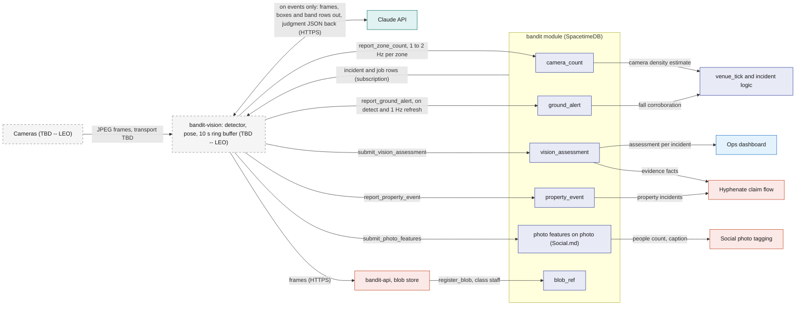
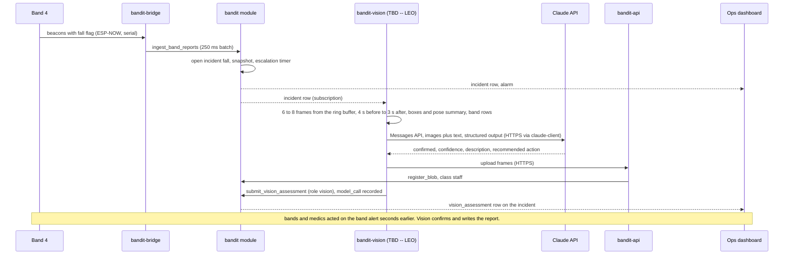

# Vision

> (TBD -- LEO) Leo owns vision and decides the cameras, the models, where they run and how Claude is used; this file fixes only what the rest of the system sends in and gets back, and records the research proposal as a starting point for Leo.

Vision is the camera side of BandIt. The rest of the system needs five things from it: head counts per zone as ground truth and as the Plan B density source, person-down alerts that corroborate falls, an event-triggered judgment with a staff report and an insurance-ready description, property events such as a fallen speaker, and features for photographer photos. Everything flows into the `bandit` module through reducers under the role `vision`, and the module, not vision, decides what happens next. Vision is never in the safety path: bands alert locally within a second, and vision confirms, counts and writes the report seconds later.

## Role in the system

Responsibilities (the interface):

- Write a fresh people count per covered zone into `camera_count` through `report_zone_count`.
- Raise and refresh a person-down alert through `report_ground_alert`.
- On an event (band SOS or fall, a local person-down flag, or the staff property button) judge what happened and write it through `submit_vision_assessment`.
- Report property events through `report_property_event`, which attach to the `property` incident staff opened, or open one when none exists; [Hyphenate](Hyphenate.md) reads them as evidence.
- Supply photo features through `submit_photo_features` for [Social](Social.md)'s photo tagging.
- Store frames as blobs through `bandit-api` and pass `blob_ref` ids as evidence.
- Send a `heartbeat` every 5 s like every other Rust service.

Not responsible for:

- Writing `zone_state`, opening or closing `sos` and `fall` incidents, or commanding bands. `venue_tick`, `ingest_band_reports` and the directives do that ([Safety](Safety.md)).
- Identifying people. Identity comes from bands (zone, time, ring colour). Claude never identifies faces, and no face recognition runs anywhere.
- Being a source of truth. Everything vision knows is a row in SpacetimeDB.
- Gating anything live. If vision is slow or absent, nothing waits.

## Interfaces

| Interface | Direction | Between | What flows | Transport |
|---|---|---|---|---|
| Frames | in | cameras to vision service | JPEG frames; how they reach the laptop is TBD -- LEO (a phone serving snapshots over Wi-Fi, or a USB webcam) | TBD -- LEO |
| `upsert_camera` | out | vision or ops to module | a `camera` row: name, zones covered and how image regions map to zones, mount, live flag | SDK reducer, role `vision` or `ops` |
| `report_zone_count` | out | vision to module | per camera: a list of (zone id, count, optional per-cell counts, light circle visible yes or no, confidence); overwrites `camera_count` in place | SDK reducer, role `vision`, throttled to about 1 to 2 Hz per zone |
| `report_ground_alert` | out | vision to module | camera id, zone id, cell or region hint, confidence, frame `blob_ref`; refreshed while the person stays down; sets `incident.camera_corroborated` when it lands in the zone of an open `sos` or `fall` incident within 3 s of the flag (starting value) | SDK reducer, role `vision` |
| `submit_vision_assessment` | out | vision to module | incident id, confirmed yes or no, confidence, description, recommended action, camera id, frame `blob_ref` ids with capture times, `model_call` id; sets `incident.vision_status` | SDK reducer, role `vision` |
| `report_property_event` | out | vision to module | camera id, zone id, kind, description, confidence, frame `blob_ref` ids, optional incident id; with an incident id it attaches to that open `property` incident, without one the module opens a `property` incident with `opened_by` `vision` | SDK reducer, role `vision` |
| `submit_photo_features` | out | vision to module | photo id, people count, where they stand, ring colours seen, caption, `model_call` id; checks the job lease | SDK reducer, role `vision` |
| `heartbeat` | out | vision to module | service `vision`, version, `backlog` (frames waiting for the detector) and a `note` with the camera name, detector frame rate and the time of the last Claude call | SDK reducer, every 5 s |
| Subscriptions | in | module to vision | new `incident` rows (`sos`, `fall`, `property`), `band_report` and `band` for the bundle, `zone`, `camera`, `venue_mode`, `job` rows of kind `photo_features` | SDK subscription |
| Frame upload | out | vision to `bandit-api` | JPEG frames; `bandit-api` stores them and calls `register_blob` with access class `staff`; returns the `blob_ref` id | HTTPS ([Rust-Backend](Rust-Backend.md)) |
| Claude API | out | vision to Claude | images plus text, structured JSON output; every call recorded in `model_call` | HTTPS through `claude-client` ([Anthropic-Agent](Anthropic-Agent.md)) |
| Consumers | in | module to the rest | `venue_tick` (camera density), incident logic (corroboration), [Ops dashboard](Ops-Dashboard.md) (camera tiles, counts beside band counts, assessment per incident), [Hyphenate](Hyphenate.md) (evidence), [Social](Social.md) (photo features) | SDK subscriptions |

## Design

### Starting proposal (TBD -- LEO): `bandit-vision`

A separate research thread on using Claude for vision exists as input for Leo; its first version proposed a periodic Claude check of the pit every 3 s, and its correction replaced that with a local detector and kept Claude for events only. The corrected proposal, all of it Leo's to change:

- One Rust process `bandit-vision` on the demo laptop owns the cameras and keeps a 10 s ring buffer of frames per camera, so an event can be looked at from 4 s before to 3 s after the moment.
- A person detector plus pose estimation (YOLO-class models) runs locally on every frame. Whether it runs inside `bandit-vision` through an ONNX runtime or as a sidecar process beside it is TBD -- LEO. It yields boxes and pose keypoints per frame.
- From the boxes: a people count per zone, using the `camera` row's mapping from image regions to zones, plus counts per cell of a 3 by 3 grid over the taped square, and whether a ring of blue lights (the light circle) is visible. These go out through `report_zone_count`, throttled to about 1 to 2 Hz per zone because the tick runs at 500 ms and a faster rate only adds rows.
- From the pose: a person-down flag when a torso stays near horizontal and low for 1.5 s (starting value, matching the band's stillness window). It goes out through `report_ground_alert`, refreshed every second while the person is still down.
- Claude is called only on events: a new `incident` of kind `sos` or `fall` in a covered zone, a local person-down flag, or the staff property button (ops opens a `property` incident with `open_incident`, [Ops dashboard](Ops-Dashboard.md)). The bundle is 6 to 8 frames from the ring buffer labelled with their time offset, resized to 1280 by 720, the detector boxes and a pose summary as text, and the band rows as text (band ids in the zone, states, flags, light-circle members). Model `claude-opus-5-5` at medium effort with structured JSON output and the server-side fallback on refusal; prompt caching for the system prompt and an empty-pit reference frame. The judgment (confirmed yes or no, confidence, a description for staff, a recommended action) and the insurance-ready incident description go out through `submit_vision_assessment`, which also sets `incident.vision_status`. For a `property` incident the result goes out twice: a `property_event` through `report_property_event` carrying the incident id, so [Hyphenate](Hyphenate.md) has the event row and frames, and the `vision_assessment`. There is no periodic Claude loop.
- Photo features after the event: for each `photo_features` job, Claude (Opus 5.5, Message Batches) reads a photographer photo with the candidate bands for that zone and time, and returns how many people, where they stand, which ring colours show, and a caption. Combined with band zone and time this gives who is in the photo. Identity always comes from bands, never faces. [Hardware](Hardware.md) lists the proposed firmware extension that makes this sharper: IDENT showing a per-band colour on request, so ring colours in a photo map to band ids.
- Every Claude call goes through `claude-client` and is recorded in `model_call` so the demo can replay it offline ([Anthropic-Agent](Anthropic-Agent.md)). Claude reads and writes words; code decides safety, money, coverage and access.

The flowchart below shows the interface: what vision sends in, what the module stores, and who reads it. Vision nodes are dashed because their internals are Leo's.

### Tables

All five are owned by this file. The module defines them only while Vision exists.

`camera`: one row per camera.

| Field | Meaning |
|---|---|
| id | assigned by SpacetimeDB |
| name | "overhead pit", "stage left" |
| zone ids | the zones this camera covers |
| region map | how image regions map to zones and to the 3 by 3 grid of the taped square (format TBD -- LEO) |
| mount | overhead or side |
| live | whether frames are arriving |
| last frame at | server time of the last report from this camera |

`camera_count`: the latest count per (camera, zone), overwritten in place so the table stays small.

| Field | Meaning |
|---|---|
| camera id, zone id | the pair; one row each |
| count | people the detector sees in the zone |
| cell counts | optional counts per grid cell, for the taped square |
| light circle visible | yes or no |
| confidence | 0 to 1 |
| observed at | server time at ingest; the tick treats a row older than 3 s (starting value) as stale |
| frame blob ref | optional, at most one frame per 10 s per camera as evidence |

`ground_alert`: a person who looks down.

| Field | Meaning |
|---|---|
| id | assigned by SpacetimeDB |
| camera id, zone id | where |
| region hint | grid cell or image region |
| confidence | 0 to 1 |
| first seen at, last seen at | the alert expires 10 s after the last refresh (starting value) |
| status | `open`, `matched`, `expired`, `dismissed` |
| incident id | the incident it corroborated or opened, when any |
| frame blob ref | the frame at first detection |

`property_event`: something other than a person that needs a record.

| Field | Meaning |
|---|---|
| id | assigned by SpacetimeDB |
| camera id, zone id | where |
| kind | `fallen_object`, `spill`, `damage`, `other` |
| description | one paragraph, from the assessment |
| confidence | 0 to 1 |
| observed at | server time |
| frame blob refs | evidence frames |
| incident id | the `property` incident this event opened or attached to |

`vision_assessment`: one per incident check.

| Field | Meaning |
|---|---|
| id | assigned by SpacetimeDB |
| incident id | the incident judged |
| trigger | `band_sos`, `band_fall`, `ground_alert`, `staff_button` |
| confirmed | yes or no |
| confidence | 0 to 1 |
| description | what the frames show, for staff |
| recommended action | one line |
| incident description | the insurance-ready paragraph Hyphenate copies into the evidence pack |
| camera id | which camera, so Hyphenate can check the camera's zone against the band's zone |
| frame blob refs | the frames sent to Claude, each with its capture time |
| model call id | the `model_call` row, for audit and replay |
| created at | server time |

### Role `vision`

`bandit-vision` connects as its own identity; it prints the identity on first start and the owner grants `vision` with `grant_role` ([SpacetimeDB](SpacetimeDB.md)). The five vision reducers accept this role, `upsert_camera` accepts `vision` or `ops`, and `heartbeat` accepts any service role. One addition this file asks of SpacetimeDB.md: `claim_job`, `extend_job_lease`, `complete_job` and `fail_job` accept role `vision` for jobs of kind `photo_features` only, so the vision service can take those jobs without holding the broader `worker` role. Nothing else in the module accepts `vision`, so a compromised camera process cannot command bands or touch incidents beyond its two columns and its own rows.

### Rates and freshness

| Signal | Rate | Fresh for | Then |
|---|---|---|---|
| `report_zone_count` | about 1 to 2 Hz per zone, one call per camera covering all its zones | 3 s (starting value) | `venue_tick` drops the camera estimate for that zone and uses the band estimate alone |
| `report_ground_alert` | on detection, refreshed every 1 s while down; matched to a band flag in the same zone within 3 s (starting value) | 10 s after the last refresh | status `expired`; an incident it corroborated stays open on its own |
| `submit_vision_assessment` | once per trigger, seconds after it | not time-bound | stays on the incident |
| `report_property_event` | once per event, with a 60 s dedupe window per camera and kind | not time-bound | stays |
| `submit_photo_features` | per `photo_features` job, in batches after the event | not time-bound | the job's lease is 60 s; batch waits use `extend_job_lease` |
| frames as blobs | one per 10 s per camera for counts, one bundle per assessment | event lifetime | kept for the evidence pack |
| `heartbeat` | every 5 s | 15 s | the service-health card goes red |

### What each consumer does, with and without vision

| Consumer | With vision | Without vision (file deleted or service down) |
|---|---|---|
| `venue_tick` density ([Safety](Safety.md)) | zone density is the higher of the fresh band estimate and the camera estimate (count divided by zone area); both stored in `zone_state` | band estimate only; the camera field stays empty |
| Plan B ([Safety](Safety.md)) | ops sets `fleet_config.density_override` through `set_fleet_config`: bands stop their own density colours, the detector count is the only fresh estimate, and ops drives band colours from the zone's risk; SOS, light circle and pay keep working on the bands | no camera half of Plan B; `set_zone_risk` and forced states are the remaining fallback |
| Incident corroboration ([Safety](Safety.md)) | a `ground_alert` in the same zone within 3 s (starting value) of a band fall or SOS sets `incident.camera_corroborated`, is linked in `incident_snapshot` and marked `matched`; a second source, never a gate. Proposal (TBD -- LEO): an alert with no matching band flag that persists for 5 s (starting value) opens a `fall` incident with `opened_by` `vision` and no band id, because people without bands fall too | falls rely on the band's IMU alone; the snapshot has no camera coverage |
| Incident assessment | `incident.vision_status` goes `pending` when the bundle is sent and `confirmed` or `not_confirmed` when the `vision_assessment` lands, seconds later, with confidence, description, recommended action and frames | `vision_status` stays `none`; ops reads band facts and witnesses only |
| [Hyphenate](Hyphenate.md) | `property` incidents from the staff button and from `report_property_event`; `vision_assessment`, `property_event` rows and frames become evidence facts in the pack, and the camera's zone is checked against the band's zone | no property incidents from cameras; claims proceed on band facts and staff notes |
| [Social](Social.md) photo tagging | `submit_photo_features` fills `people_count`, positions, ring colours and caption on the `photo`; suggestions are capped by the people count and re-ranked by ring colour | `register_photo` stands alone; tagging by zone and time co-presence with the default cap |
| [Ops dashboard](Ops-Dashboard.md) | camera tiles, the detector count beside the bands' own count per zone, person-down alerts, assessments, the property-damage button | the Vision rows are removed |
| [Merch](Merch.md) | captions and people counts help pick photos | picks by tags and time only |

The sequence below shows an event-triggered assessment, from the band's alert to the assessment on the incident.

## Failure modes and fallbacks

| Failure | Effect | Design answer |
|---|---|---|
| Frames stop (phone sleeps, cable out) | `camera_count` goes stale, `camera.live` false | the tick uses the band estimate after 3 s; the service-health card and camera tile show stale; nothing waits |
| Detector too slow for the frame rate | counts lag | drop frames, never queue them; the ring buffer keeps the newest 10 s; counts are throttled anyway |
| Claude slow, rate-limited or refuses | no assessment or a refusal stop reason | the incident is already open and handled; the assessment arrives late or is recorded as "no judgment" with the `model_call` id; the server-side fallback is enabled |
| Detector counts bystanders without bands | camera count exceeds the band count | expected and wanted: that is why the camera is ground truth and the density takes the higher estimate |
| False person-down from someone sitting or kneeling | a `ground_alert` with no band fall | the 5 s persistence before an unmatched alert opens anything, the Claude assessment marking it `not_confirmed`, and ops dismissal (`dismissed`); the alert alone never changes band lights |
| Two cameras cover one zone | two `camera_count` rows per zone | the tick takes the fresher row, or the higher count when both are fresh (Safety.md decides) |
| Vision service compromised | bad counts or alerts | the role `vision` reaches only its own tables; it cannot command bands or close incidents |
| Vision absent entirely | see the consumer table | every consumer degrades to band-only behaviour |

## Dependencies

**Depends on**

- [SpacetimeDB](SpacetimeDB.md): `incident` (its two Vision columns `camera_corroborated` and `vision_status`, and the `opened_by` value `vision`), `incident_snapshot`, `band_report`, `band`, `zone`, `job`, `blob_ref`, `model_call` (Anthropic-Agent.md), `service_heartbeat`; reducers `claim_job`, `complete_job`, `fail_job`, `extend_job_lease`, `heartbeat`, `grant_role`.
- [Rust-Backend](Rust-Backend.md): the blob upload endpoint and `register_blob`; the service identity pattern.
- [Anthropic-Agent](Anthropic-Agent.md): `claude-client`, structured outputs, prompt caching, Message Batches, refusal handling, `model_call` recording.
- [Ops dashboard](Ops-Dashboard.md): `open_incident` as the property-damage button.
- [Hardware](Hardware.md): the proposed IDENT per-band colour extension for photo tagging.

**Used by**

- [Safety](Safety.md): camera density estimate, Plan B density source, fall corroboration.
- [Ops dashboard](Ops-Dashboard.md): camera tiles and the assessment on incidents.
- [Hyphenate](Hyphenate.md): `property` incidents, `vision_assessment`, frames as evidence.
- [Social](Social.md): photo features for tagging.
- [Merch](Merch.md): captions and counts for photo picks.

**If you delete this file**

- Drop the five tables, the five vision reducers, `upsert_camera`, the job kind `photo_features` and the role `vision`.
- SpacetimeDB.md and Safety.md: remove the two Vision columns on `incident`, the camera estimate from the density rule and the camera half of Plan B.
- Ops-Dashboard.md: remove the "Vision.md" rows (camera tiles, corroboration and assessment on incidents, the property-damage button) and the `vision` service card.
- Hyphenate.md: remove the camera-sourced property incidents and the vision evidence facts.
- Social.md: remove the photo-features fields and the cap by people count; `register_photo` runs without features.
- Architecture.md and README.md: remove the Vision rows; Hardware.md keeps the IDENT colour extension as a proposal with no consumer.
- Rust-Backend.md: remove the `bandit-vision` row from the process table, the `Vision` node from the workspace diagram, the Vision row from the crate table, the `image` crate note and the `photo_features` row in the handler registry.
- Anthropic-Agent.md: remove the two Vision rows from the use-case table and the Vision bullet from its deletion list.
- Elastic.md: the `vision` value of `caption_source` goes; Merch.md: the line about captions from Vision goes.

## Open questions

- (TBD -- LEO) Which cameras: only the overhead phone on the light stand, or a second angle for falls?
- (TBD -- LEO) How frames reach the laptop (phone app serving snapshots over Wi-Fi, or a USB webcam), at what resolution and frame rate.
- (TBD -- LEO) Detector inside `bandit-vision` through an ONNX runtime, or a sidecar process; and which person and pose models.
- (TBD -- LEO) Whether Claude is used at all for the event assessment in v0.1, and on which Anthropic account and tier.
- Does the overhead camera map to one zone (the pit) or to several, which decides how simple the `camera` region map can be?
