# Band1t

The only band you need for a public venue

## Inspiration

Ten people died at [Astroworld in 2021](https://www.aafs.org/sites/default/files/media/documents/2023Proceedings_FINAL-june-1-23.pdf) because the crowd was packed too tightly for them to breathe. We built Band1t to warn about crowding, help medics reach someone in trouble and keep the evidence needed to settle the costs afterward.

The [National Safety Council](https://injuryfacts.nsc.org/home-and-community/deaths-in-public-places/introduction/) estimates 44,500 preventable deaths and 15.6 million injuries requiring medical care in U.S. public places in 2024. Falls caused about 15,000 of those deaths.

Band1t brings event organizers and attendees crowd safety, social connections, personal shopping and financial management, including insurance.

### Band1t at Cal Hacks (1)

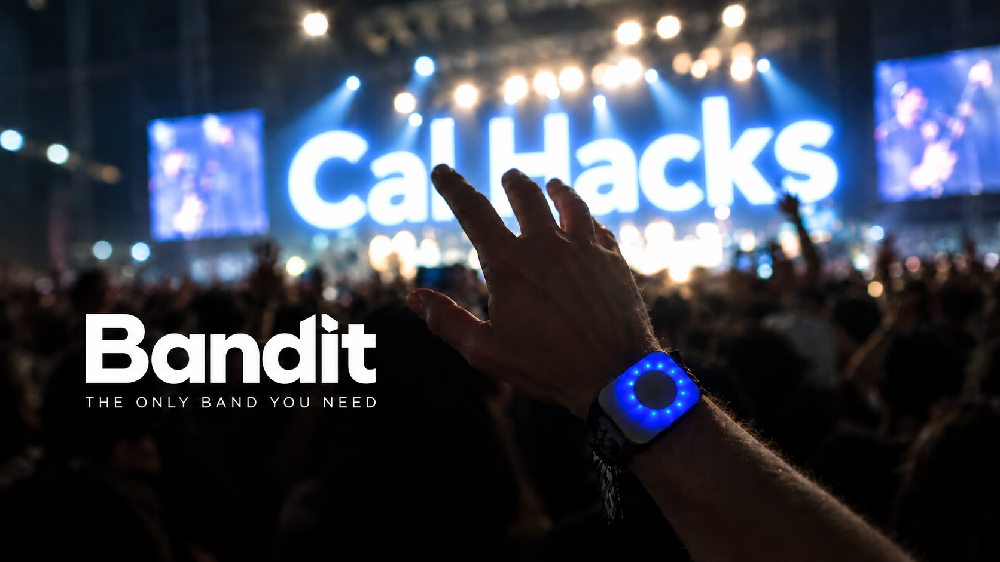

Attendees use the same band for safety alerts, medical help and their event recap.

## Background

We are concertgoers, and our first community is the attendees and organizers at Cal Hacks 13.0. Someone in a packed crowd can be hard to spot and reach. After an incident, staff accounts, medical documents and policy terms need to come together before its costs can be settled.

*Leo will add the firsthand concert account here.*

We built Band1t for event organizers and venue operators. They need to coordinate help while keeping the event running, then understand the costs that follow. A shared incident record connects their work with the attendees who need help and the medics and staff responding.

Attendees can also leave a busy event without the names or group photos that help them reconnect. We want their recap and merch to reflect the people and places they remember.

## What it does

### Getting started

An attendee taps the band's tag with their phone, signs in by email and connects the band to their account. They add their name and Instagram, Facebook or Threads handles. Social matching is enabled for every attendee.

For medical and insurance documents, attendees upload PDFs and confirm the extracted medical card. A medic can read that card after tapping the attendee's band.

Anyone can sign in by email and choose "Continue as organizer" to open the event tools.

The organizer imports the event's booths and schedule, selects its venue map and follows the crowd on the Live tab. The portal shows incidents, photos, orders and costs as the event runs.

### Safety

#### Crowd-crush prevention

Each band counts nearby bands and warns its wearer as the crowd grows. In a packed area, moving lights show an exit color to help people disperse. The band exchanges these signals directly with nearby bands, so the warning is available without opening a phone.

##### Crowd levels (2)

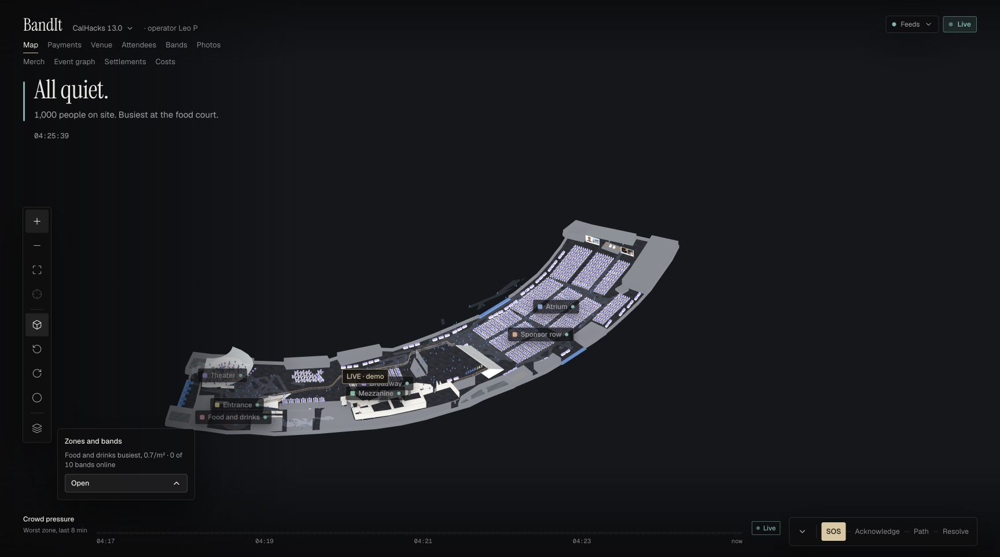

The venue overview shows crowd levels and named zones, so the organizer can locate the busiest area.

##### Crowded zones up close (3)

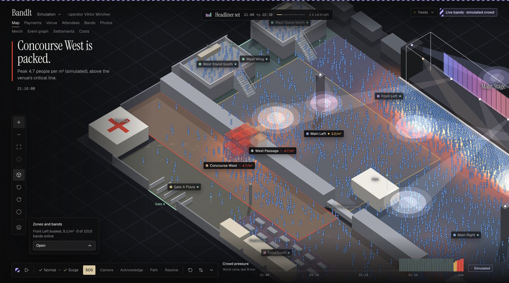

The map highlights crowded zones in the scripted concert scenario. The organizer can zoom into a crowded zone to see the people, nearby passages and crowd warning together. The venue view lets staff follow which areas are crowded while attendees receive warnings on their bands.

#### Medical help

Holding the band's button calls for help. A band with a motion sensor can also raise a fall alarm when its wearer cannot press the button.

##### Make space for help (4)

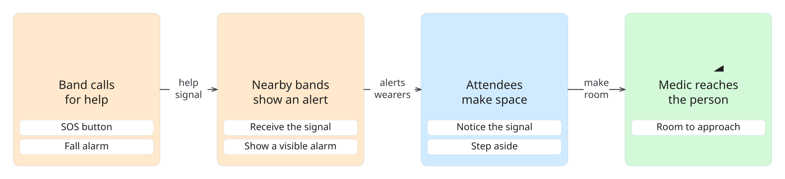

The band broadcasts a help signal, and nearby bands make the alarm visible around the person who needs assistance. Attendees notice the signal and move aside to give the person and medic room. The medic approaches the marked location and takes over care.

##### Space for a medic (5)

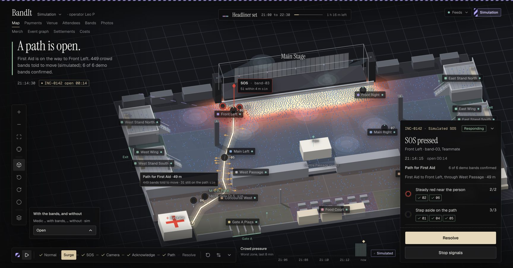

The local preview shows a medic following the route as attendees make space.

A medic takes an open incident, and the organizer sees that help is on the way. The venue view shows the approach from an entrance. The medic follows the flashing bands and taps the attendee's band to open their medical card.

The card contains the attendee's name, allergies, medications, medical conditions and emergency contact. The medic records treatment and resolves the incident when their work is done. The incident history retains the response and notes for any later claim.

Camera sightings help locate the flashing band on the venue map and preserve a short video of the incident. Its connection to the shared event is still being completed.

#### Fire evacuation

##### Exit guidance during a fire (6)

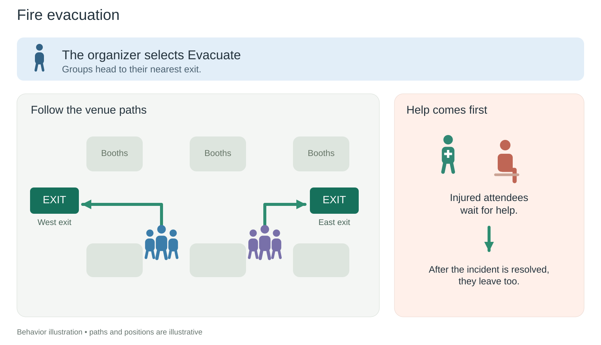

The organizer starts evacuation from the portal, and groups head toward nearby exits. People who need medical help stay with their incident until the medic resolves it. Staff can follow both the departure of the crowd and the incidents that still need attention.

Exit markers and bands use matching colors to help attendees follow guidance in a crowded hall or poor visibility. This gives the wearer a visible destination while staff coordinate the response on the venue map.

### Your recap

When an attendee leaves or the event ends, their band's tap page offers a recap of people, places, photos and personal merch suggestions. The timeline shows their stays across the event and marks recorded meetings. Attendees can trace where they were when a conversation happened.

#### People and photos

##### Attendee recap (7)

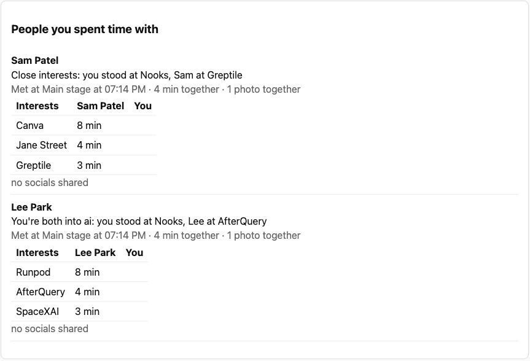

Each connection card brings together where the meeting happened, time together, shared booth interests, photos and any social handles the person shared. Attendees can use those details to recognize someone and open their social profile.

A separate “Also there with you” list covers people who shared an area without a recorded close encounter. It explains shared interests and overlapping visits. Attendees can also search a remembered name or place. Results show recorded connections with a reason and the relevant place and time.

##### How your photos find you (8)

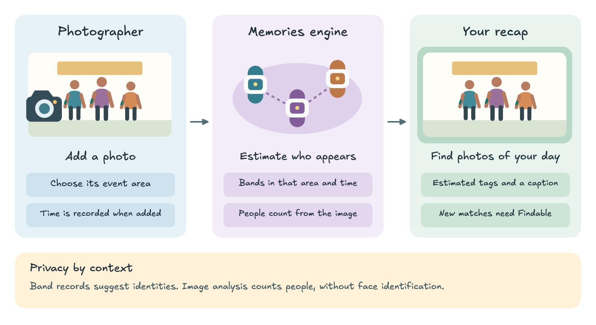

The photographer adds a photo and chooses its event area. Band1t combines nearby band records with a people count from the image to suggest who appears. Matching photos reach attendees' recaps.

Each photo lists the people linked to it and the social handles they chose to share. Share prepares the image and a caption with available Instagram handles, then opens the phone's share menu. The attendee chooses the destination and finishes the post. The original photo stays unchanged.

##### Great night. Questionable dance moves. (9)

*AI illustration of fictional concertgoers.*

At a concert or rave, photo matching uses wristband records without recognizing faces. Your band is linked to your account, so those records remain associated with you.

##### Event graph (10)

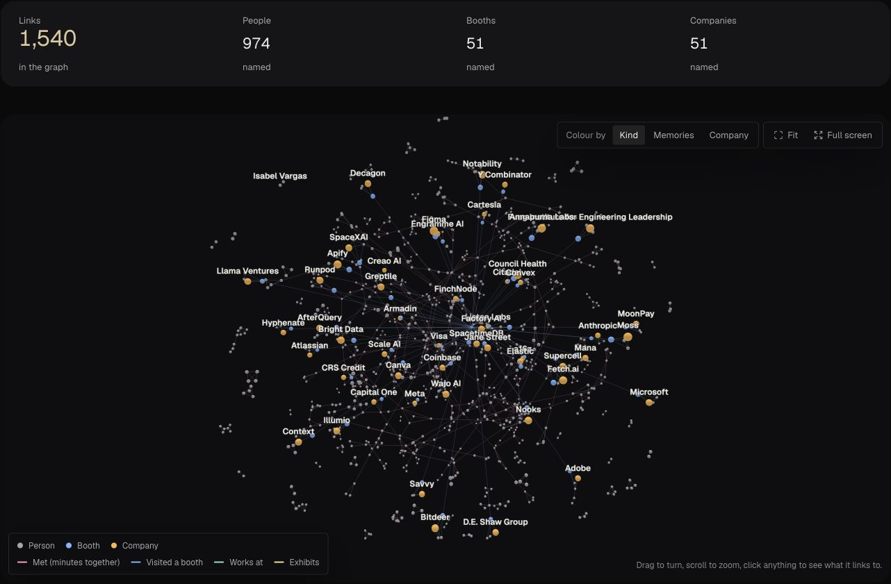

The organizer can select a person, booth, company or photo to highlight its connections. The Memories view groups people through recorded meetings, booth visits and shared photos, then gives each group a booth-based name. This makes the event's smaller communities visible and lets the organizer explore the links behind them.

Typed friend search is live on the public site. The full recap, sharing and merch journey is still being connected to the main attendee frontend.

#### Shopping

Attendees can buy during and after the event once a photo is tagged to them. When they leave, or when the event ends, Band1t adds personal suggestions based on booth visits, people met and photo captions. Each suggestion shows a price and a reason for the choice.

##### Your photo on your merch (11)

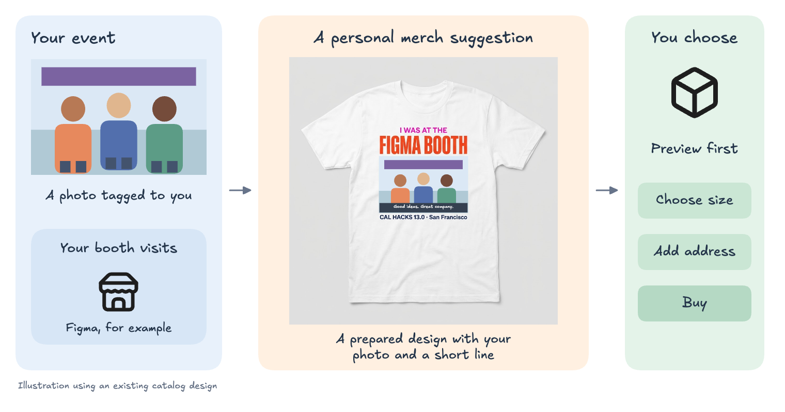

Band1t pairs a photo tagged to you with a prepared booth design and a short printed line. You preview it before choosing a size, adding delivery details and buying.

##### Personal merch picks (12)

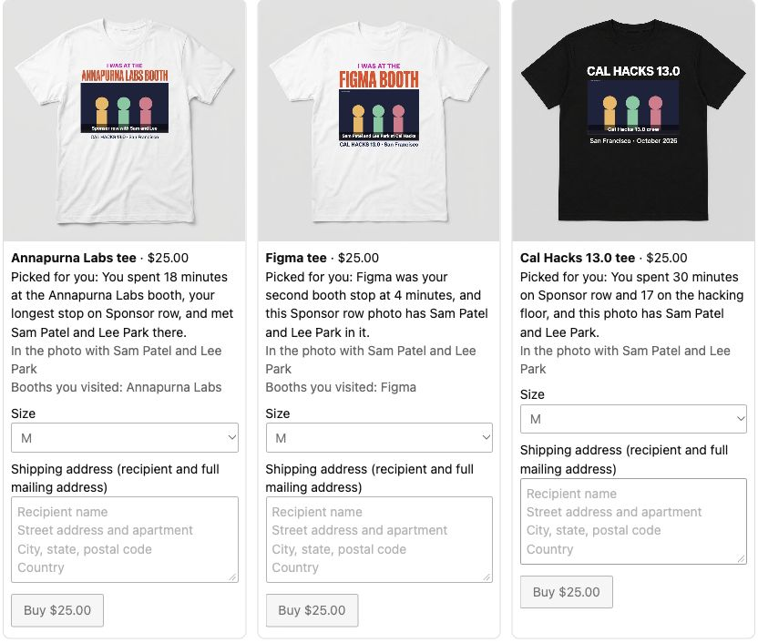

Shirts and mugs preserve a photo from the event. A booth-crawl poster also marks the booths the attendee visited. The attendee compares the finished previews, chooses an item and supplies a shirt size and delivery address before buying.

The order list keeps the product, printed line, size, address, payment status and receipt together. The organizer can review orders and booth balances, so each sale stays connected to the booth's earnings.

### Financial management for large events

An event organizer needs to know which costs are covered, what has been approved and who still owes money. Band1t keeps injury settlements, costs for damaged or stolen venue property, attendee charges, insurer receipts and booth proceeds in one Costs tab. The venue policy and each attendee's health plan determine which costs are covered. The organizer confirms policy terms and records repair costs and who was responsible.

#### Event costs (13)

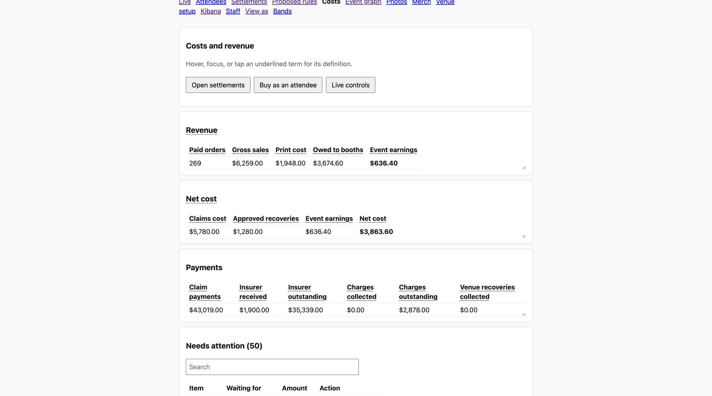

The organizer tracks event earnings and claim costs, with money received and still owed shown separately. The net-cost figure includes approved recoveries, money expected back. Payments separately shows what has arrived.

Injury claims, broken equipment and venue theft affect the same view. The organizer can inspect each claim, its settled amount and the cost the venue still carries.

The Needs attention list leads to the next action: review a claim or disputed charge, record an insurer receipt, or inspect an order awaiting payment. Completed payments and amounts still owed remain visible separately.

#### Event operating costs (14)

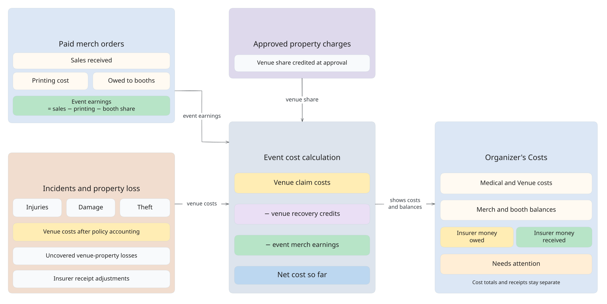

A paid merch order first covers its printing cost and the amount owed to its sponsor booths. The event keeps its fee on sponsor products and the remaining earnings from plain products. Those earnings offset the event's incident costs.

On the incident side, Band1t tracks injury settlements and damage or theft affecting venue property. The amount expected back from the insurer reduces the recorded cost. For property losses, an organizer-approved charge can also return part of the cost to the venue.

Net cost combines these recorded costs, recoveries and event earnings. The Payments view separately shows actual receipts and outstanding amounts. When an insurer receipt differs from the amount expected, the cost updates to reflect the difference.

#### Booth balances (15)

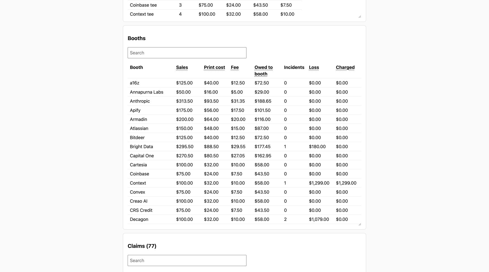

The organizer sees each booth's sales, printing costs and amount owed, alongside recorded incident losses and charges.

#### Claim review

After an incident, the attendee can file a claim and add their account of what happened. Band1t checks the evidence and policy, then recommends a settlement with reasons. The organizer reviews exceptions and approves the conditions under which later claims can be paid automatically.

The incident keeps the band evidence, staff response and later financial decisions linked, so the organizer can follow how the event became a cost.

##### Policy calculations (16)

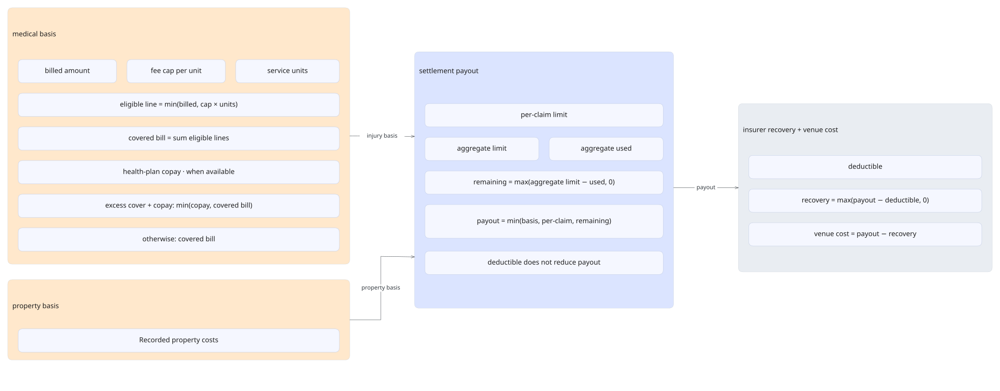

Covered service rates limit the eligible medical bill. Excess cover applies to eligible costs left after the attendee's health plan, so that plan's share is assigned first. Property claims use recorded costs, and both payouts stay within the policy limits.

Expected recovery from the venue's insurer is the payout minus the deductible, never below zero. The venue carries the difference.

##### Policy allocation example (17)

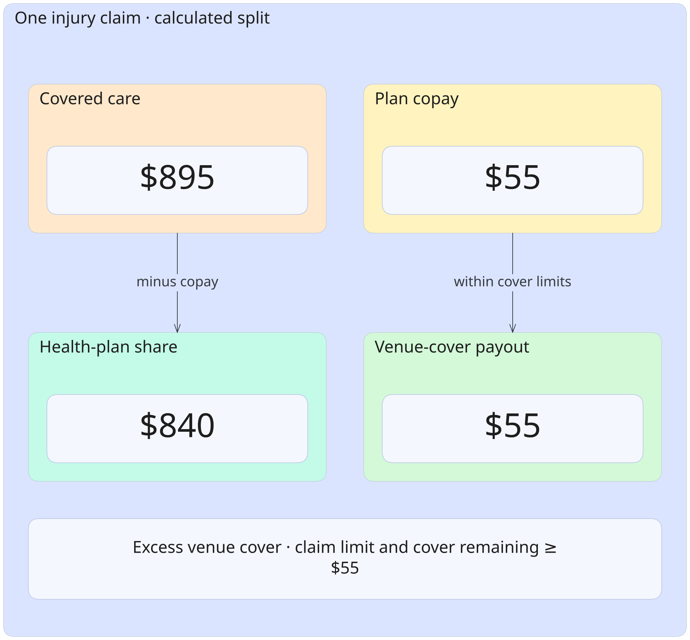

The example separates the eligible bill, the health-plan share and the venue-cover payout.

##### Reasons behind a recommendation (18)

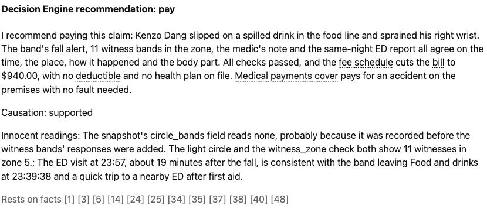

The recommendation brings together the attendee's account, band reports, witness evidence, medical notes and any hospital report. It explains how those facts match the policy and identifies conflicts that need judgment. The organizer can follow its citations before approving or refusing the claim, and the decision stays in the history.

##### Earlier organizer decisions (19)

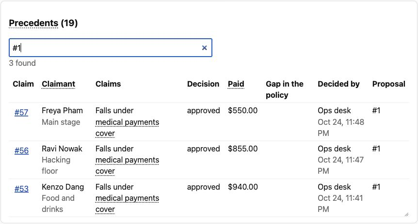

The history keeps earlier decisions with their claim, amount, organizer and time. When a policy gap needs judgment, the organizer can inspect how a similar gap was handled before and read any recorded reason. These precedents help the next review, while repeated eligible approvals can support a proposed payment rule.

##### Suggested rule for organizer review (20)

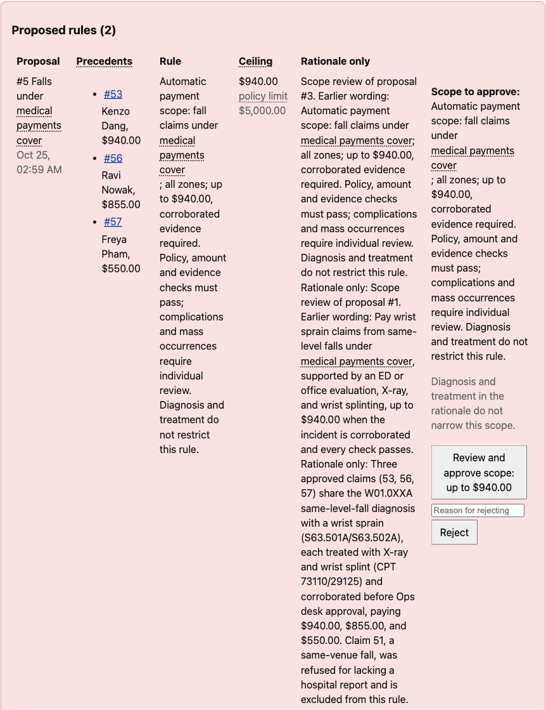

A proposed rule names the earlier approvals that support it and the largest payment it can authorize. The organizer reviews its incident type, coverage, required evidence checks and payment limit before deciding. Rejection keeps the organizer's reason with the proposal.

A separate rule approval gives matching waiting and later claims permission to proceed automatically. The rule's version and approver stay recorded, and claims outside its conditions return for individual review.

#### Settlements and charges

An approved injury payout reaches the attendee's wallet with a transaction record. A property settlement is booked to the venue or repair vendor. The organizer can follow both the settled cost and the amount expected from the venue's insurer.

##### A venue-property theft claim (21)

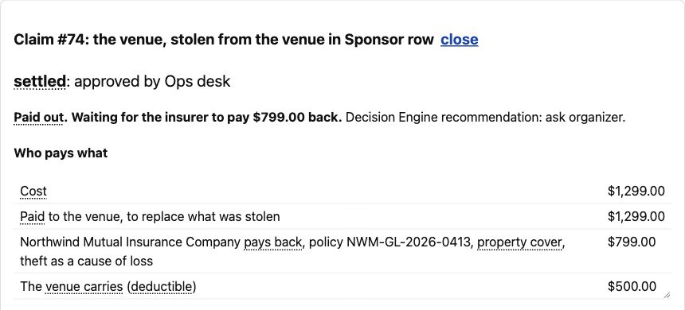

Property settlements record repair or replacement costs for the venue. The insurer's share and the venue's deductible stay visible until the insurer's payment is recorded.

##### Review and pay a charge (22)

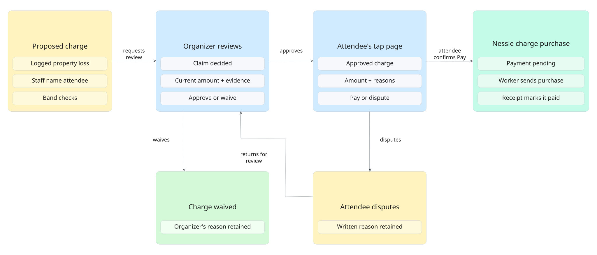

The organizer reviews the recorded loss, named attendee and supporting evidence before approving a charge. The approved amount then appears on that attendee's page.

The attendee can pay from their wallet or write a dispute, which returns the charge to the organizer. A waiver keeps the organizer's reason with the record. A payment stays pending until its receipt is saved.

#### Insurer receipts

When an insurer pays the venue, the organizer records the amount received and its reference. Band1t updates the event's outstanding recovery and actual cost. For settled property claims, the organizer can also request a letter asking the company that handled the equipment what happened.

## How it works

The Safety engine connects local band warnings, shared incidents and medic response. The Memories engine connects meetings, photo matching and sharing. The Evidence engine combines checked incident facts and policy evidence for claims.

SpacetimeDB holds live state and enforces decisions. Elastic Cloud Serverless provides search and model tasks, with copied records feeding Kibana dashboards. Bright Data supplies public web records, and Capital One Nessie handles wallet transactions with sandbox money.

Vultr Cloud Compute hosts the web API, both frontends and the background workers. A separate indexer copies changed event records into Elastic, while shared disk storage keeps uploaded documents and generated files available to these programs. systemd restarts stopped services, and Caddy provides HTTPS for the band's tap address and the organizer portal.

### Architecture (23)

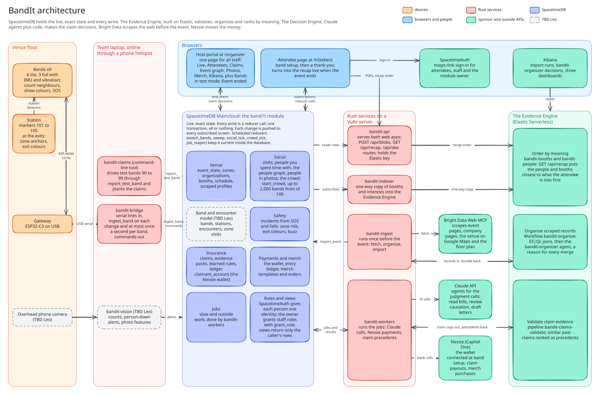

Band reports and app actions update the shared event. Workers handle external APIs, then return checked results to the same state.

https://app.excalidraw.com/s/8CxNdcrvsHz/65Xc8JRcGo5

### SpacetimeDB keeps each device on the same event

#### SpacetimeDB live updates (24)

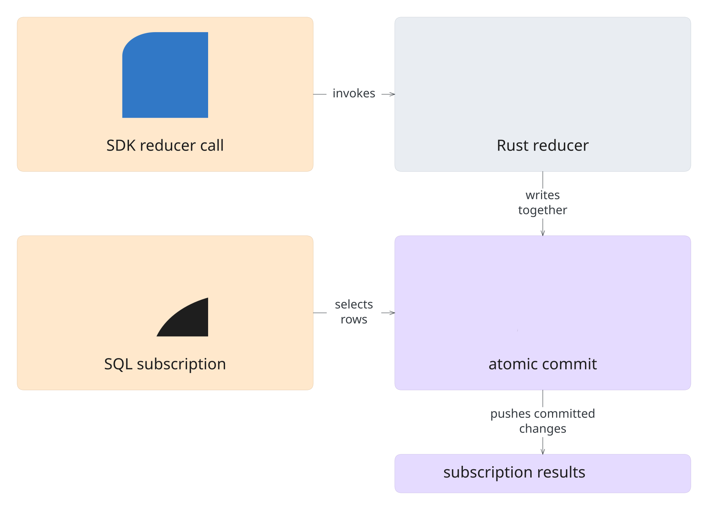

Our Rust server code runs inside SpacetimeDB Maincloud as reducers, functions that update records together. When a band raises an incident, one transaction saves its location, nearby-band snapshot and map marker. Staff screens receive the committed state through subscriptions.

The Live tab runs a scripted crowd of about 1,000 through the venue floor. Stored routes, start times and a random seed let screens draw the same movement between database updates. A physical band placed in the event contributes reports, visits and incidents to the same records, alongside the crowd.

#### Band state in Maincloud (25)

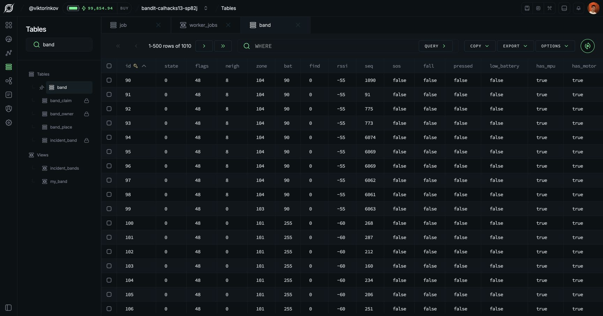

The band table keeps each device's latest report: its zone, nearby-band count, signal, battery and emergency flags. The organizer's map and safety rules use this shared event state. Each accepted update can also change the records followed by subscribed clients.

#### SpacetimeDB subscriptions (26)

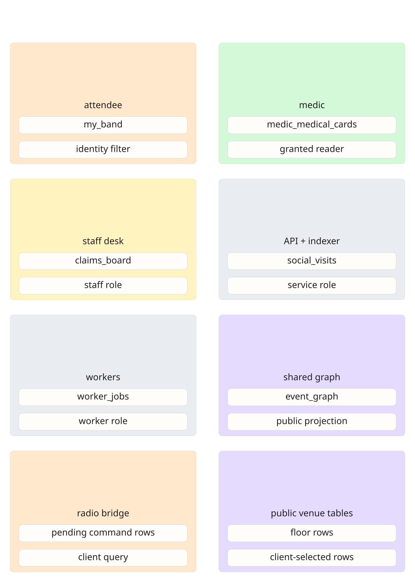

A subscription sends matching rows and their later changes. Personal views return attendee records, medical cards require a recorded grant, and workers follow open jobs. The radio bridge requests pending commands.

Server views enforce private-data access. Only the attendee and authorized organizers can read an order's shipping address. The current React client also requests shared floor and broad staff data across pages. The [view inventory](diagrams/views.md) describes these exceptions and the owner's View as behavior.

### Elastic turns documents into usable evidence

#### Elastic evidence (27)

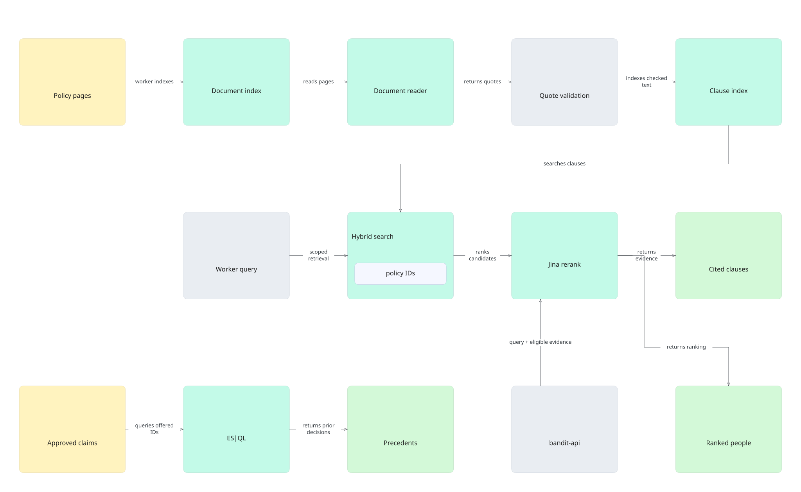

A policy PDF enters Elastic as numbered pages. Elastic Workflows calls an Elastic Agent Builder reader, whose page tool retrieves the document's text. The reader returns policy terms and clauses with the page and exact words that support them. Code compares those quotes with the source before accepting them. Hospital reports use the same reading process, with their facts attached to the claim.

Coverage searches use checked clauses from the claim's policies. Keyword search catches exact language such as “employee,” while Jina embeddings represent text by meaning and find related wording. Elastic combines both ranked lists, then Jina's reranker compares each candidate with the question. Policy and section filters narrow the initial search before ranking, so an injury and a property loss draw from the relevant cover.

Each result keeps its policy, page and clause identifier. The investigator can open the whole clause and cite it in the recommendation. A file fingerprint identifies repeated PDFs, and the reader's version identifies how they were processed. These let later lookups reuse the same pages and reading while keeping the source attached to the answer.

#### Elastic claim investigation (28)

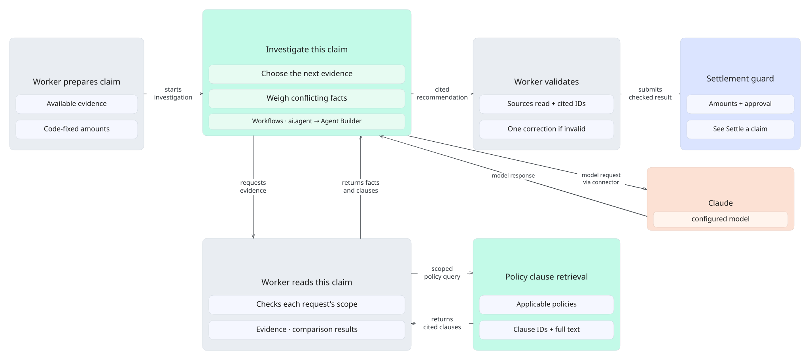

The investigation starts with the claim, its calculated amounts and an index of available evidence. Elastic Agent Builder chooses what to inspect next. It can ask for band reports, nearby witnesses, camera findings, staff notes, hospital records or policy clauses. The worker supplies each requested result, and the agent uses it to choose the next step or recommend payment, refusal or organizer review.

The worker controls this loop. It allows only the current claim's evidence and policies, checks each tool request, and limits the number of investigation turns. Code then checks the recommendation's cited facts and clauses, required evidence and allowed decision. The worker returns validation errors to the agent for one retry. If the second response still fails, code applies its guarded fallback. SpacetimeDB applies the financial rules and approval conditions before changing the claim. A wrong recommendation can delay a valid claim or pay an unjustified one.

Fixed tasks use Elastic Workflows with a defined answer format, including document extraction, photo counts, merch suggestions and letter drafting. Claude supplies the model interpretation through Elastic's configured connector. Private medical history and insurance card tasks use text with page numbers, with an image workflow to read scans. Code checks the required fields and page references before updating the attendee's card. The document text stays outside the shared policy index.

#### A recorded Elastic investigation (29)

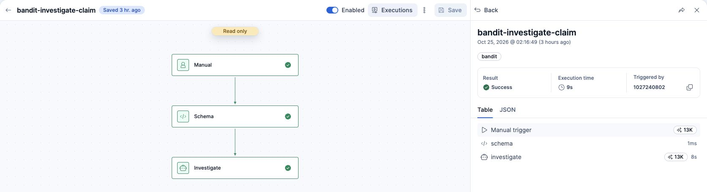

The workflow view shows the completed steps of one investigation turn. The organizer's decision history records the evidence reads and findings as they happen. Elastic's execution records retain task status and reported model usage, which helps trace a failed step back to the work that produced it.

### Bright Data supplies the event and policy sources

#### Prepare the event (30)

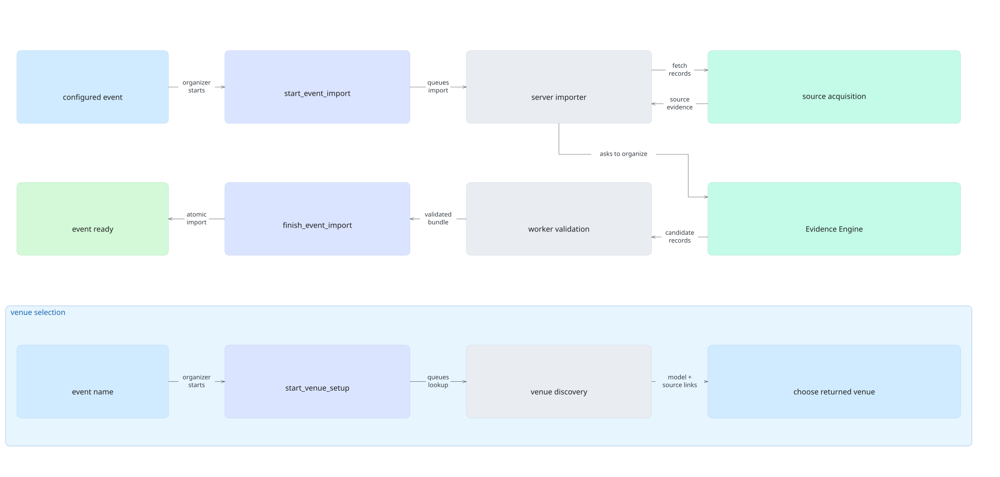

The organizer starts an import and follows its progress in the portal. A server worker uses Bright Data Web MCP to read the configured Cal Hacks source pages as Markdown. Structured scrapers fetch company profiles and venue details from LinkedIn, Crunchbase and Google Maps. These records supply the event's schedule, sponsor descriptions and company links, which later give booth visits meaning in the recap.

Event acquisition uses public pages, with speaker details from the event's own site. Personal fields are removed from company and place records before saving.

Elastic uses ES|QL, its query language, to join records with matching websites and connect schedule locations to the configured venue plan. Elastic Agent Builder resolves remaining name differences and records its reasons. Code checks the combined result, then SpacetimeDB applies it in one transaction. Existing booth positions stay in place when their source details change.

#### Completed company-data collections (31)

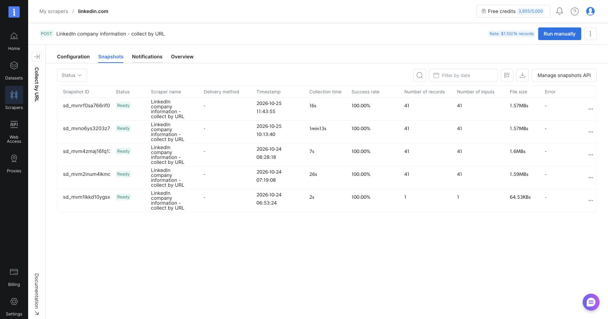

Bright Data's structured scrapers return public company information in consistent fields. Band1t uses these records to enrich booths with descriptions, industries and logos, while saved source snapshots keep the import traceable.

#### Event import in Kibana (32)

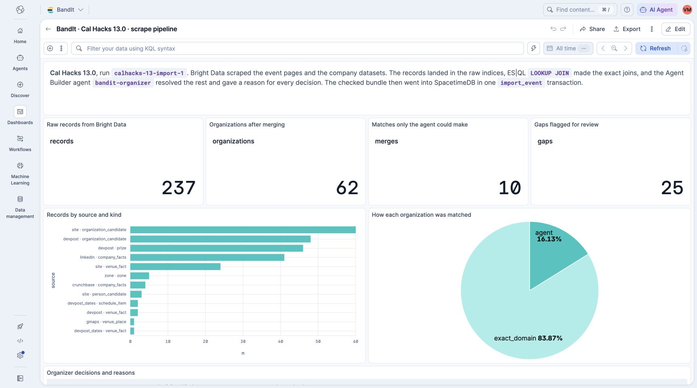

Kibana separates exact matches from decisions made by the agent and shows gaps that need review. Each imported record retains its source link, fetch time and content fingerprint, so a result can be traced back to its source.

#### Find public sources (33)

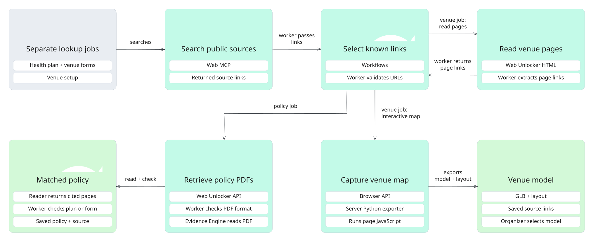

Venue setup and policy lookup use separate jobs with a shared pattern: find public links, choose a source and retrieve what the feature needs.

##### Venue maps

Venue setup needs the map's running page. Bright Data Web MCP finds candidate pages, Bright Data Web Unlocker reads their links, and Elastic selects a public 3D map. Bright Data Browser API runs that interactive page so our exporter can save its geometry and named places for the venue view. A direct model-file link uses Bright Data Web Unlocker. The organizer can then select the saved map for the event.

##### Venue pages opened through Browser API (34)

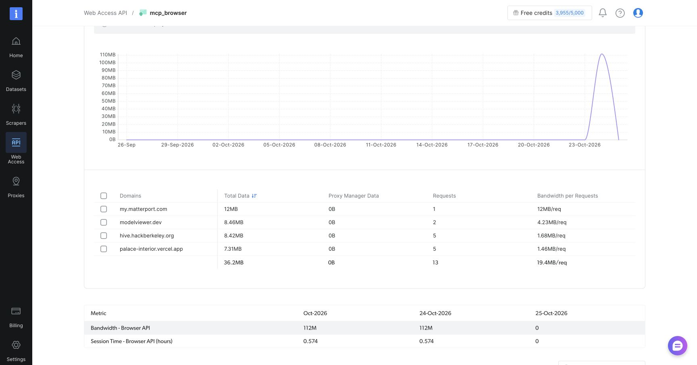

Bright Data Browser API runs the interactive page needed by the venue exporter. Its activity view records the map and model sites contacted during venue discovery.

##### Policy documents

Policy lookup starts with an attendee's insurer and health-plan name, or the organizer's venue insurer and coverage-form numbers. Bright Data Web MCP finds public links, and Elastic chooses candidates from those results. Bright Data Web Unlocker fetches the original PDFs and handles website blocks. Elastic reads their contents. Code checks the printed insurer and plan names for health plans, or the requested form number and supplied edition for venue forms. The saved document keeps its public source link.

A coverage form can sit inside a larger policy package. The reader identifies its page range, and code extracts those pages. Venue-form searches retry empty results and failed downloads. A previously checked health plan can be reused when its insurer, plan, state and lookup year match. The same PDF also reuses its saved reading when the file and reader version match.

##### Public document requests (35)

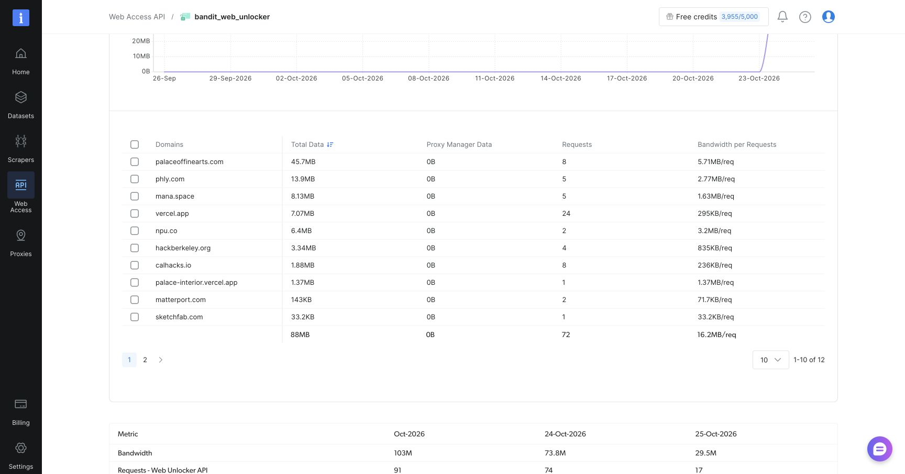

Bright Data Web Unlocker retrieves public pages and document files selected during a lookup. Its request history shows which public sites were contacted. Band1t checks the PDF and its printed plan or form details before using it as evidence.

### Safety signals and camera evidence

#### Band enclosure design (36)

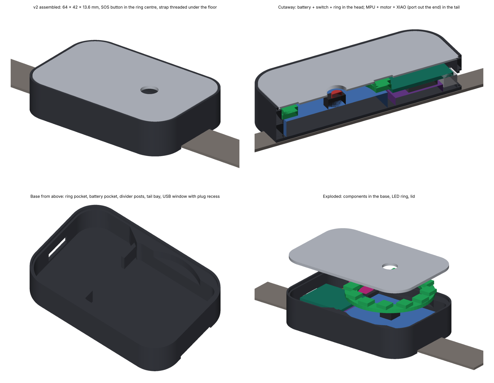

The enclosure puts the light ring and help button where the wearer can see and reach them. The same controller supports both band variants. Full bands add a motion sensor and vibration motor.

#### Band data flow (37)

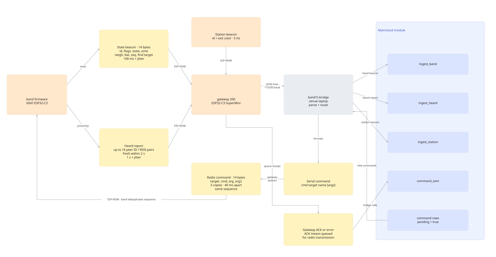

ESP-NOW carries direct radio messages between bands, exit markers and the gateway. State messages carry the band's alarm flags, zone and crowd count. Separate reports list nearby bands and signal strength.

The gateway passes received packets over USB to `band1t-bridge`, which writes them into SpacetimeDB Maincloud. Commands travel back through the same gateway. The gateway repeats a command for radio delivery, and the band recognizes repeated copies by their sequence number.

#### Band incident alarms (38)

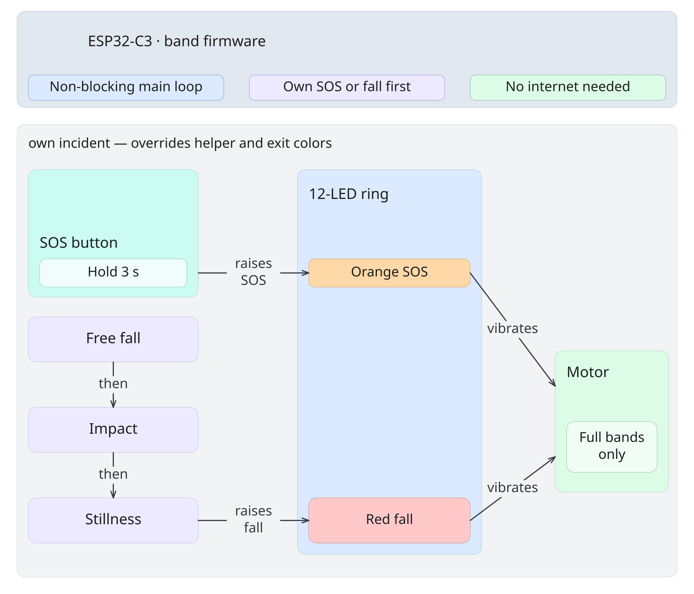

The button path raises orange SOS after a three-second hold. The motion path waits for free fall, impact and stillness before raising a red fall alarm. The ring distinguishes those states, and full bands also vibrate.

The band's own alarm takes priority over helper and exit signals. Its main loop runs without an internet connection.

#### Band helper signals (39)

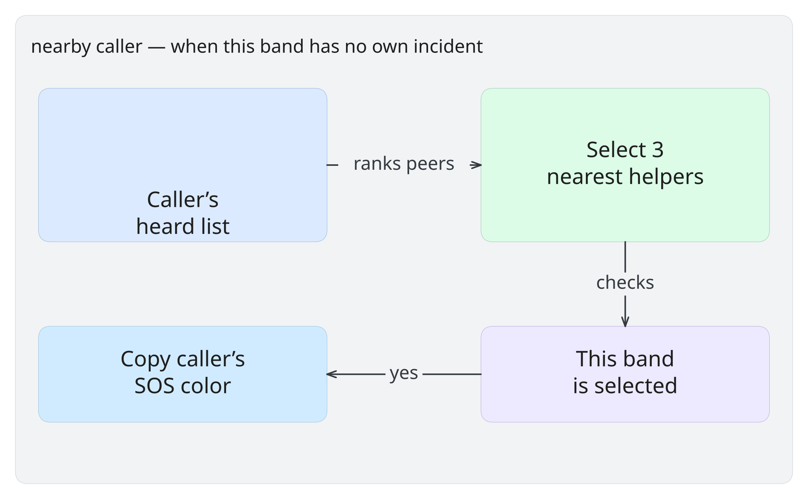

Bands use the caller's heard list to select its three nearest helpers. A selected helper copies the caller's SOS color, provided it has no incident of its own. A separate near-SOS state forms the blue light circle.

#### Band exit colors (40)

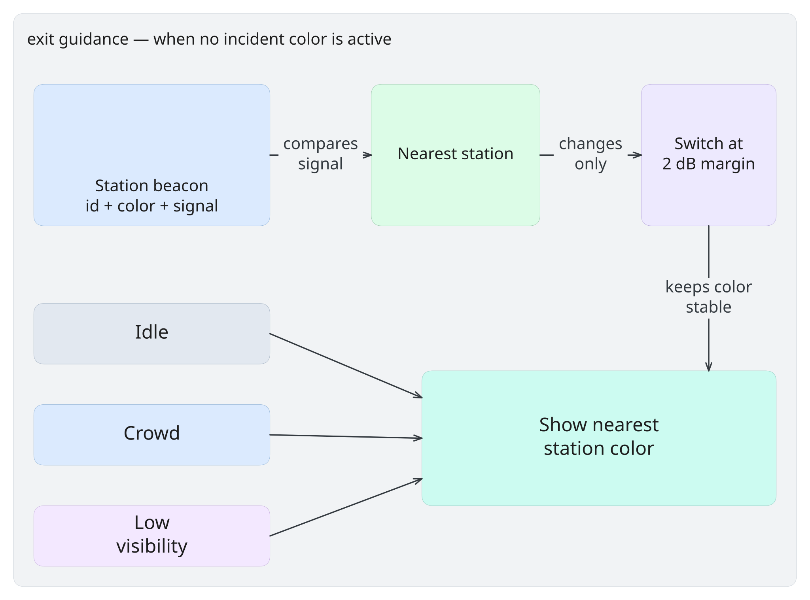

The band checks crowding locally. With no incident color active, it compares station signals and shows the nearest station's exit color. It changes stations only when another signal is stronger by a two-decibel margin, which keeps the color stable as readings fluctuate.

Idle, crowd and low-visibility modes use that selected exit color. These behaviors follow Leo's hardware design, which he is still implementing.

#### Exit markers and gateway (41)

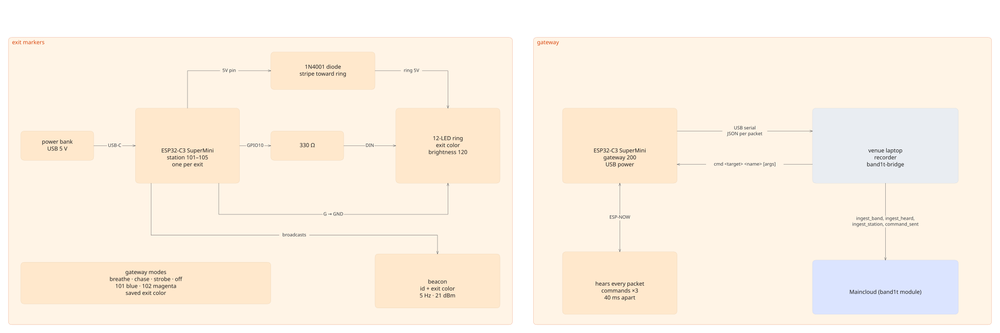

Each exit marker broadcasts its identity and color, while its ring shows the same color at the doorway. A band selects a station from its corrected radio strength and uses that color for guidance. The lights chase faster as the attendee approaches the exit. The USB-powered gateway connects this local radio network to the venue computer.

#### Respond to an incident (42)

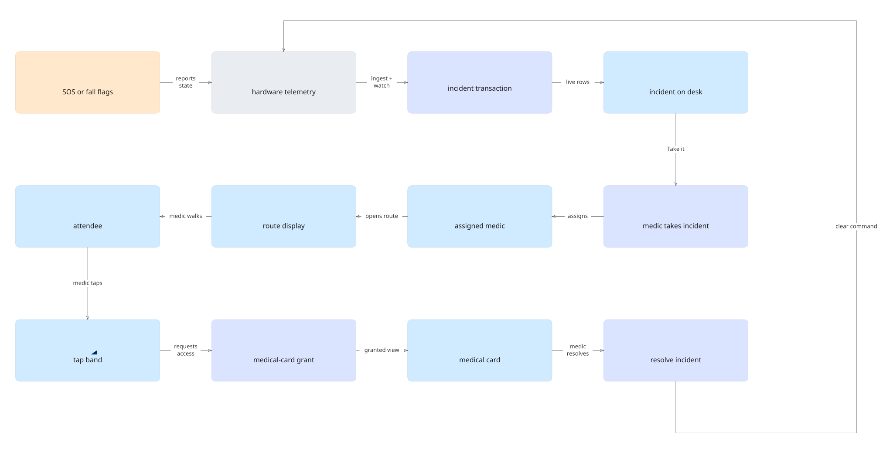

SpacetimeDB Maincloud turns a band's SOS or fall flags into an incident. The same transaction saves the zone snapshot, subject band and initial surrounding bands. Later observations update the incident's witness records without replacing that opening snapshot.

Taking the incident records the medic and response time. Tapping the attendee's band records a medical-card access grant, and the medic's data view returns that card. Resolving the incident saves the treatment outcome and queues the command that clears the band's alarm.

#### Medic route display (43)

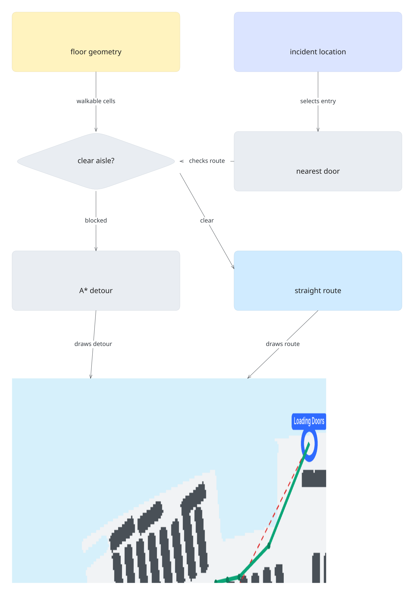

The display selects the entrance nearest the incident and places both ends of the route on the walkable floor grid. It uses a clear straight path when available, then A* pathfinding around blocked cells when needed. The recorded response time drives the displayed walk.

#### Live camera evidence (44)

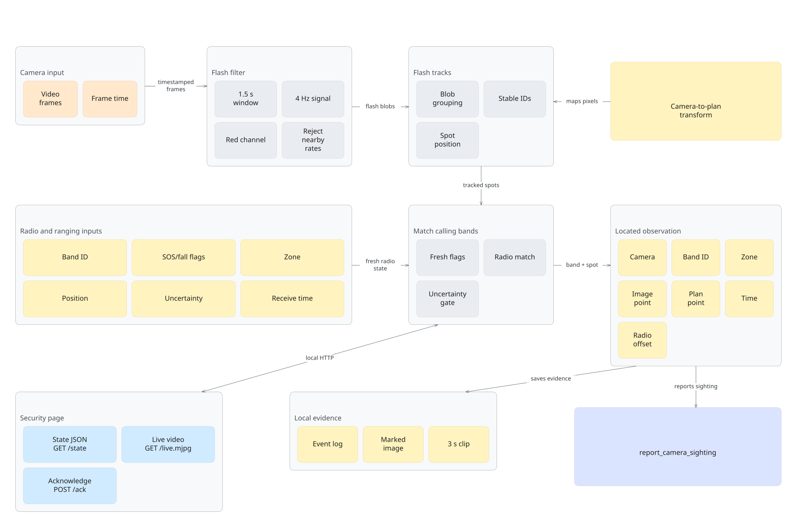

OpenCV follows a red flash at the expected rate while fresh radio reports identify bands calling for help. The camera observation supplies an image location, and the radio position narrows the matching area. Steady lights and unrelated flash rates are filtered before a match is considered.

The security view places the observation on the floor plan and 3D hall, with the radio estimate visible beside it. It saves the time, band, location, marked image and short video for later inspection. When the flash is hidden, staff can still see the radio estimate and the last camera position.

The local alarm and marked camera view work offline. Compatibility with the intended orange SOS flash and the path into the shared event remain with Leo's integration work.

#### Venue reconstruction (45)

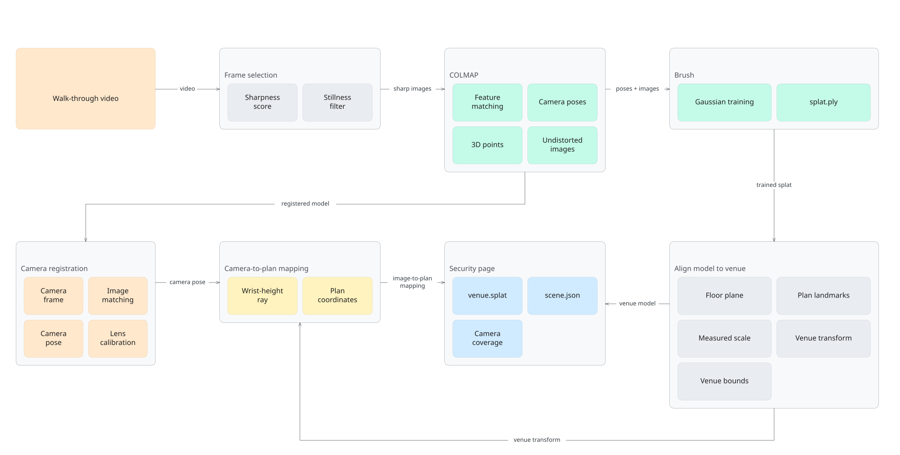

A phone walk supplies sharp images of the venue. COLMAP finds the camera positions, and Brush turns those views into a 3D model. Matching the model to measured floor landmarks puts the venue, security cameras and band observations in the same coordinate system.

### Social search uses the attendee's actual encounters

#### Find people again (46)

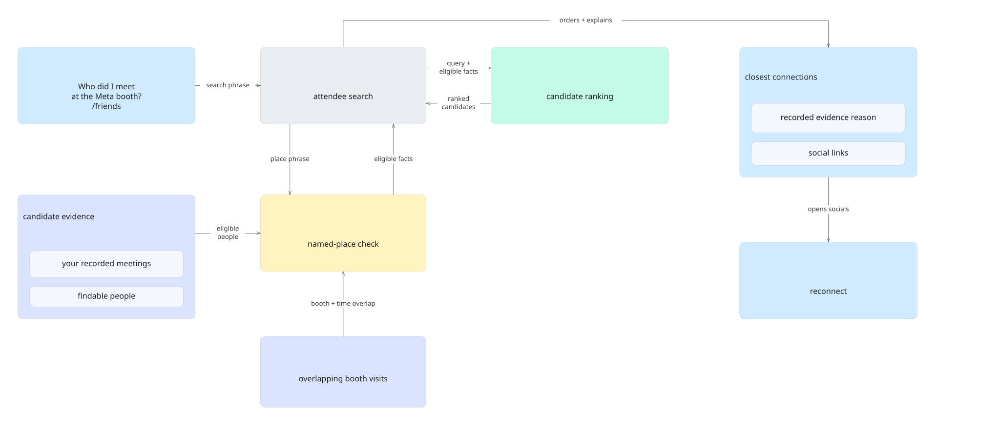

Registration sets the backend `findable` field for each attendee. Two eligible attendees count as met after three minutes close together. A separate list uses shared-zone stays of at least five minutes, and a two-minute zone stay becomes a visit. The recap retains minutes together and per booth.

Typed search starts with the attendee's recorded meetings. Overlapping booth and zone visits add place and time evidence for those people. It sends the eligible candidates and their encounter evidence directly to Elastic's ranking request. That request matches the remembered description to the evidence.

Automatic suggestions use interests from the five places where the attendee spent the most time. Elastic ranks eligible people and booths with keyword and meaning search, then Jina orders the strongest matches. If ranking fails, the lists keep their order by minutes.

#### Memories engine (47)

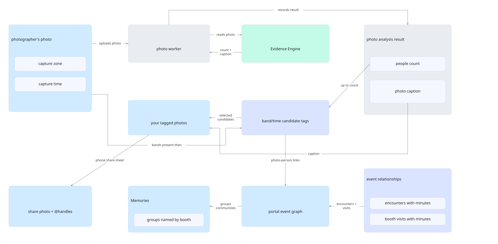

A photo's zone and time connect it to band reports. An Elastic Workflows image task returns a people count and caption. Code prioritizes claimed bands and proximity, then tags candidates up to that count.

SpacetimeDB stores photo details and band-based tags for the recap. Tags estimate who appears from time and band evidence, and a photographer's supplied caption takes priority when sharing.

### Shopping checks the choice before moving money

The Elastic Workflows shopping task receives one attendee's visits, encounters, photo captions and tags alongside the prepared catalog. It selects up to three different products, a photo, a short printed line and a reason. Code accepts known products and eligible photos, checks text lengths and rejects repeated products.

Before these picks arrive, code ranks templates by time in their booth areas. It favors photos from those areas, then photos with more recorded connections, then newer photos. The browser crops the selected photo into the design, adds the printed line and marks visited booths on the poster. The catalog keeps the product price.

#### Capital One Nessie (48)

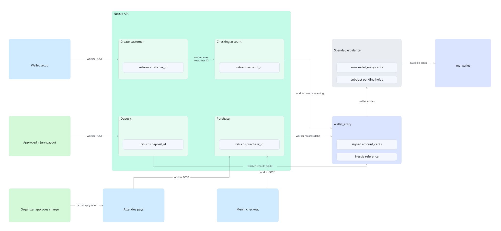

Capital One Nessie supplies customer accounts and transaction receipts for purchases, injury deposits and attendee charge payments. Connecting a wallet creates a customer and account with a configured $200 opening balance.

SpacetimeDB reserves the funds and queues a purchase together. The worker calls Capital One Nessie's purchase operation and saves its receipt, while failure releases the reserved amount. Before retrying, workers look for an existing bank record with the same reference.

Band1t calculates spendable funds from wallet entries and pending purchases because the sandbox's transaction endpoints do not update its account balance.

Only paid orders count as sales. Printing uses a configured cost for each product kind, and sponsor products allocate a 10% event fee before the remaining proceeds are assigned to their booths. The event keeps sales less printing for plain products.

### Financial decisions stay within approved limits

#### Settle a claim (49)

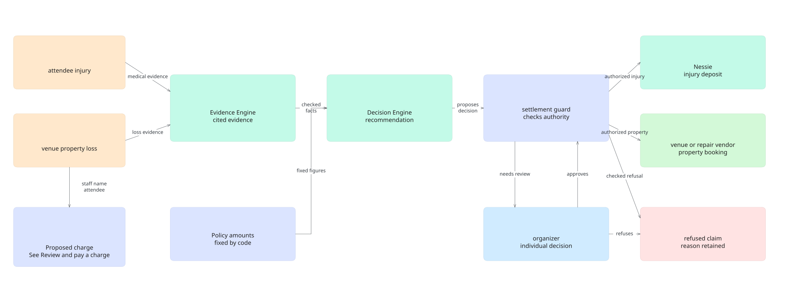

The claim evidence pack combines numbered facts from the band, nearby bands, medic, camera and hospital report. Its fingerprint, a value derived from those facts, changes whenever they change. Code checks report quotes, patient, date, diagnosis and procedure-code formats, totals and duplicate bills.

Elastic retrieves policy clauses, and the Agent Builder investigator weighs disagreements and cites the facts and clauses behind its recommendation. It must read band and witness evidence plus any filed hospital report before recommending payment. Property claims require camera evidence, and recommendations about a named person require that person's evidence.

The investigator compares conflicting accounts and explains its recommendation. A refusal based on model judgment alone always needs a person.

#### Approval checks

Payment without another review requires passed evidence and policy checks plus an organizer-approved rule's conditions and payment limit. A minimum-payment threshold, policy gaps and clusters of at least three injuries in one zone within five minutes require review. 

An approval names both the amount displayed and the version of the evidence reviewed. SpacetimeDB checks those values again when the organizer acts. New evidence or changed policy amounts require a fresh decision before money moves.

#### Approve a reusable rule (50)

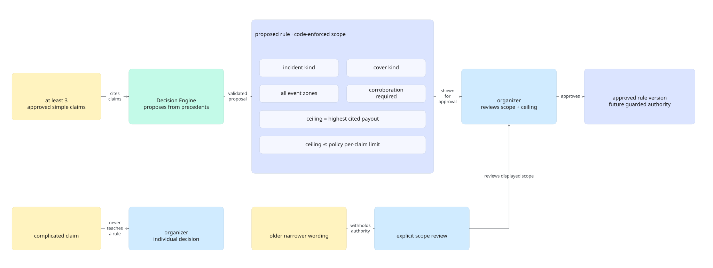

Organizer decisions become precedents. Eligible cases can support a reusable payment rule. Complicated cases keep their own decision, organizer and reason for later review.

#### Checking precedents with Elastic ES|QL (51)

SpacetimeDB selects approved claims with the same incident type and cover, leaving out cases with recorded complications. The worker supplies those claim copies and any matching uncomplicated refusals to Elastic Agent Builder for an ES|QL query. It counts distinct claims, returns their IDs and payout range, and groups the results by outcome, diagnosis and item type. This gives the agent a checked summary to compare with the organizer’s decisions.

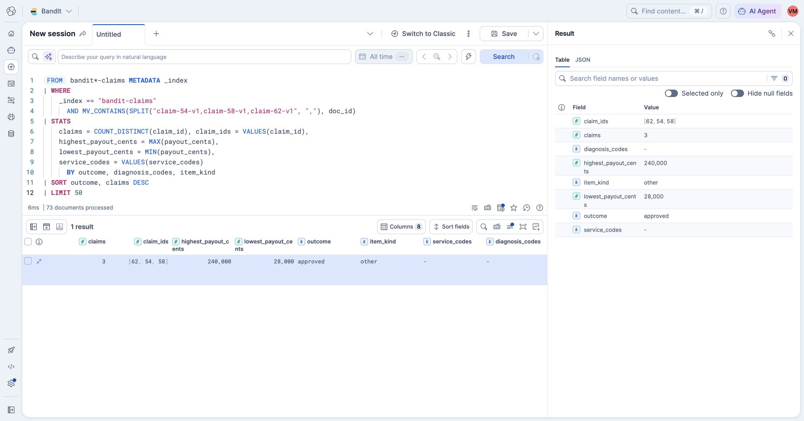

*Elastic returns the supporting claim IDs, approval outcome and payout range. Amounts in this view are stored in cents.*

The agent can propose a shared rule or decline to propose one. Code requires at least three distinct approved precedents. It checks that the proposed limit equals the highest payout among the cited claims and stays within the policy limit. Code also writes the rule’s enforceable conditions, so diagnosis details in the explanation cannot silently narrow its scope.

The proposal then waits for an organizer who did not propose it. SpacetimeDB rechecks the cited decisions, current policy limit and amount shown before saving a new rule version. The rule keeps its supporting claim IDs and named approver.

#### Financial records

The resolver recommends a settlement, the accountant records its financial effects, and the collector prepares claim documents and tracks recovery. A claim's journal records the payout obligation, expected insurer recovery and completed payment as separate steps. Code fixes journal amounts, and SpacetimeDB rejects any journal whose debits and credits do not balance. Charge recoveries are allocated between insurer and venue.

The Costs tab derives claim totals from the posted journals and merch totals from completed orders. Each amount can be traced to its claim or order.

Net cost is claim expense plus uncovered venue-property loss, less approved venue recoveries and event merch earnings. The separate payment totals distinguish a booked recovery from collected money. Disputing or waiving an approved charge reverses its recovery entry.

#### Record insurer payment (52)

After the venue receives an insurer payment, the organizer enters its amount and reference on the settled claim. The stored reference keeps the receipt connected to that claim.

SpacetimeDB records the cash received and closes the full expected receivable, the amount owed by the insurer. It records any shortfall as extra claims expense and any excess as a reduction. The claim becomes reconciled, and the Costs tab reflects those journal entries.

#### Claim documents

Elastic Workflows drafts the claim notice, evidence summary and decision letter from the checked claim data. An organizer can request a separate property-recovery letter. Code checks the drafted facts before the documents are attached to the claim.

### Jobs keep external work attached to the right change

#### Server job lifecycle (53)

A user action or an incident calls a SpacetimeDB reducer. The reducer saves the feature change and its follow-up job in one transaction. Server workers subscribe to open jobs, choose a supported job type, and request a lease: temporary ownership with an expiry.

That worker calls the services its job needs. Elastic handles document reading and investigation, Bright Data fetches public sources, and Capital One Nessie handles wallet transactions. The worker checks the response before submitting it. The result reducer accepts it only from the current holder of a live lease and applies the feature's checks. It saves the updated state and completed job together, then subscribers receive the changed rows.

A long-running worker renews its lease. Failed or expired attempts retry with backoff until the attempt limit. The job then stays failed, and any defined feature fallback runs. Jobs retain their errors and outcomes. Organizer approval uses a separate claim-review state and approval record.

#### Worker progress in Maincloud (54)

Background work stays visible in the same database as the event. Jobs move from queued to leased to done as workers claim them and return checked results. Stored attempts, errors and lease ownership show how the server handles retries and accepts a checked result.

#### Band command queue (55)

A staff action or incident creates a pending command with a target band and arguments. The bridge subscribes to those rows and sends each current command over USB. The gateway queues the radio command and returns a reply.

The bridge records the reply or error and clears the pending flag. An acknowledgement means that the gateway queued the radio transmission. The record includes the outcome time and any error.

## Tracks

### Cal Hacks

#### Best People-First Social Impact Hack

Crowd safety starts with the person inside the crowd. A band puts the help control on their wrist and gives nearby people a visible signal when someone needs space. The medical card carries information an attendee can confirm before the event and a medic can use during treatment.

Organizers also need to see whether someone has taken an incident and what happened afterward. Keeping the response, treatment notes and supporting evidence together connects immediate care with the later cost review. Our first community is Cal Hacks, with the same needs in mind for concerts and festivals.

#### Best Hardware Hack

The band's local radio handles the immediate warning, alarm and helper signals. Exit markers give those signals a visible destination, and the gateway carries the recorded state into the event system. This divides urgent physical behavior from the web services that coordinate staff and retain evidence.

The same board and firmware support lightweight bands and bands with motion sensing and vibration. The printed case brings the ring, button, antenna and battery into one wearable object. The hardware diagrams show both the electrical connections and the behavior those parts support.

#### Most Technically Complex Hack

The engineering work is in connecting different kinds of evidence without losing their context. Radio gives band identity and nearby peers, camera processing locates a flash, and the venue geometry gives the observation a place. SpacetimeDB keeps the incident, staff response and later claim tied to that event.

The interfaces carry more than a final result: timestamps, source references, command acknowledgments and approval state explain how it was reached. A recorded incident can therefore support a medic's response, an organizer's review and a checked settlement. The diagrams separate these responsibilities so each system's role remains visible.

### SpacetimeDB: Best Use of Spacetime

SpacetimeDB Maincloud is the shared event that the bands, phones, organizer and background agents act on. An incident keeps its identity as staff respond, evidence arrives and the organizer reviews its costs. Keeping those steps in one persistent state gives the physical event and its later decisions a common record.

Its most useful feature here is the combination of transactional server logic and live subscriptions. We use it to coordinate worker ownership and enforce approved payment limits beside the records those decisions depend on. Views then give attendees, medics and services different access to that event, while each client chooses the updates it follows.

### Elastic: Best use of the Elastic Agent Builder on a Serverless Instance

Our search problems need different kinds of precision. A policy question needs the right clause from the right plan. Event preparation needs to connect names that refer to the same organization. Social search needs to rank people who are already eligible through recorded encounters. Elastic lets each question use its own filters, search method and ranking while keeping the evidence available for inspection.

The difficult judgment comes after retrieval: which source answers the question, and what still needs review? Elastic Agent Builder can follow that question through several evidence reads. Elastic Workflows gives bounded tasks a defined sequence and a recorded result. Cloud Serverless keeps these search and agent services together, while Band1t's transactional rules govern the resulting action. The Kibana views make that division visible through query results, import decisions and execution steps.

### Bright Data: Best Agent/App Using Public Web Data

Public event data gives a booth visit context: which company was there, what it works on and which sessions it runs. Public policy documents supply the wording used in financial review. Bright Data connects both to their published sources, while the venue map gives the organizer a place to see the event unfold. Each result feeds an attendee or organizer feature.

The useful output depends on the source. A company profile supplies fields that can be joined with event records. A policy PDF supplies pages that can be cited. An interactive map supplies geometry that a text scrape cannot preserve. Using the appropriate Bright Data product keeps those differences intact before Elastic organizes the results and Band1t applies them.

### Meta/Facebook: Bringing People Closer Together with AI

A good conversation can outlast the memory of someone's name. Band1t keeps the place, time and shared interests available, so an attendee can find the person again and open the social profile they shared. Recorded meetings establish whose profiles qualify for search. AI helps match remembered words to that context, while each result shows the evidence behind the connection.

Photos give that connection a shared memory. Band time and location provide candidates, and an image task counts people to narrow the tags. The recap brings photos and available handles together for the attendee to share. The attendee completes the post. The Memories view also reveals groups formed around meetings, photos and booth interests, extending the story from individual contacts to event communities.

### Visa: Best use of Reimagining Shopping

Band1t starts product discovery from the event an attendee experienced. AI combines booth visits, people met and photo captions to suggest a small set of personal items. It chooses a prepared product and a short printed line, then explains why the item fits. The preview lets the attendee judge the result before choosing a size, adding an address and buying.

The same shop works during the event and in the recap, so an early departure still leads to personal suggestions. Orders retain their selected design, photo, size and payment status. Organizers can follow orders and booth earnings, giving sellers a record of the commerce connected to their event presence. Catalog prices, eligible photos and an explicit purchase action keep the recommendation within the attendee's control.

### Capital One: Best Use of Nessie

Capital One Nessie connects the attendee's event activity to a wallet with recorded money movements. The same account receives injury payouts, buys personalized merch and pays organizer-approved charges. Each movement has an external transaction reference that Band1t can tie to its own event record.

The difficult part is keeping a purchase or payout consistent when an external call must be retried. Band1t holds pending spending and looks for an existing transaction before repeating it. The bank receipt identifies what happened, while Band1t's ledger determines what remains available to spend.

### Microsoft

#### Grand Prize: Built for the Real World

The customer is an event organizer responsible for injured attendees, venue losses and the people who approve those costs. They need a recommendation they can examine, a clear point to intervene and records that remain useful after the event. Band1t keeps the evidence, policy terms, approval and resulting payment together.

Versioned approvals tie a decision to the amount and evidence it reviewed. Recorded receipts and recoverable background jobs preserve the transaction history as staff work through exceptions.

#### Microsoft Customer Impact Award

The organizer can inspect evidence and decide exceptions while eligible claims follow approved rules. The Costs tab keeps payouts, receivables and actual receipts together. Each stage retains who acted and which evidence supported the decision.

### Anthropic: Claude for Public Benefit

We start with Cal Hacks attendees and organizers who need to recover from an incident while the event continues around them. Through Elastic's configured connector, Anthropic Claude reads unstructured documents and weighs conflicting accounts for the organizer. Its explanation lets a person inspect why the evidence supports a recommendation.

Code fixes the amounts and checks citations, while judgment-based refusals go to an organizer.

### Hyphenate: The Hyphenated Enterprise: Autonomous Systems for Finance

Our company is the event organizer, and the financial work begins with an incident in the crowd. The resolver examines the evidence, the accountant keeps the claim's amounts consistent, and the collector prepares recovery documents and tracks what the venue is owed. Each handoff keeps the source facts and the responsible decision with it.

Earlier organizer decisions influence later work in two ways. Complicated claims remain precedents for human review; repeated eligible approvals can support a separate, versioned payment rule. The organizer grants that authority through conditions and a limit that code enforces, and the proposer cannot approve it.

### MLH: Best Use of Vultr

Vultr Cloud Compute provides the persistent host for Band1t's web API, event import, document processing and financial workers. An organizer starts work in the portal and follows its progress as the server completes it. The same host serves the public site and keeps source documents available to those jobs.

We chose a Linux VM because the project needs Rust services, Python tools and browser-based document processing on shared storage. Each service has its own supervised process, and deployed revisions are recorded for verification. Radio and camera programs stay at the venue where they connect to physical equipment.

## Challenges we ran into

- Our first calculation counted time together too quickly in busy zones. We corrected it so passing someone did not become a long encounter.
- Different sites spell the same sponsor differently. Exact Elastic ES|QL joins handle known matches, and Agent Builder explains the remaining merges.
- Code checks the investigator's cited evidence, computes payout amounts and enforces the organizer's approved conditions.
- Duplicate hospital reports triggered duplicate-bill checks. Each generated report now names its claimant and has its own invoice number.
- The first Rust build exhausted the Vultr server's memory. The setup adds swap and builds without debug information.
- The crowd must walk around walls and tables. A shared floor grid gives the crowd and medic routes through the aisles.

## What we learned

Putting live rules beside the data keeps screens and workers on the same state. Search needs a different representation, so Elastic keeps the indexed text while SpacetimeDB remains authoritative.

A useful investigator needs room to compare evidence and strict limits on what it can authorize. We keep that judgment visible, but make payment amounts and approval scope executable code.

## What's next

Leo's hardware and camera integration continues, and the complete attendee recap is being connected to the main public site.

## Built with

Rust, TypeScript, React, Python, C++, SQL, SpacetimeDB Maincloud, Elasticsearch, Elastic Agent Builder, Elastic Workflows, Kibana, Bright Data, Capital One Nessie, Anthropic Claude, Vultr Cloud Compute, OpenCV and Three.js.

## Try it out

https://band1t.vip
