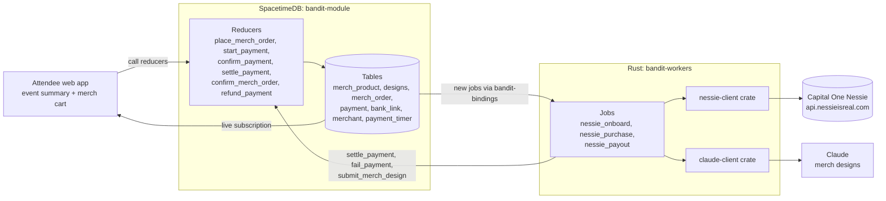
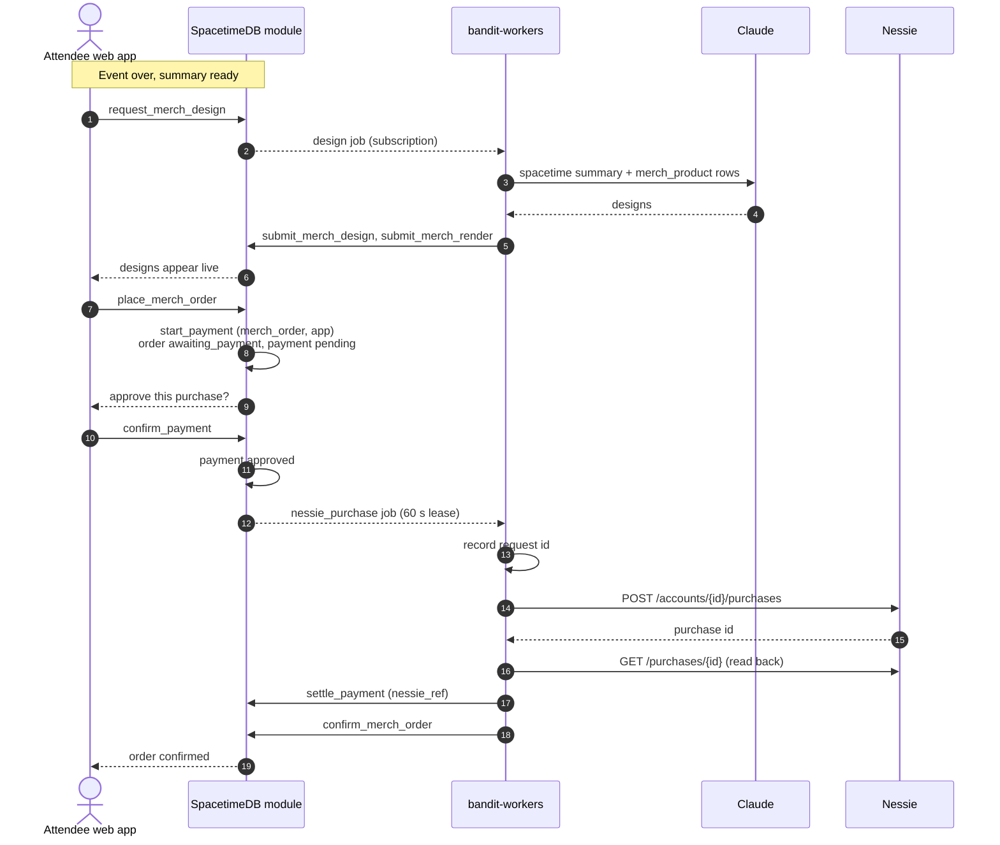
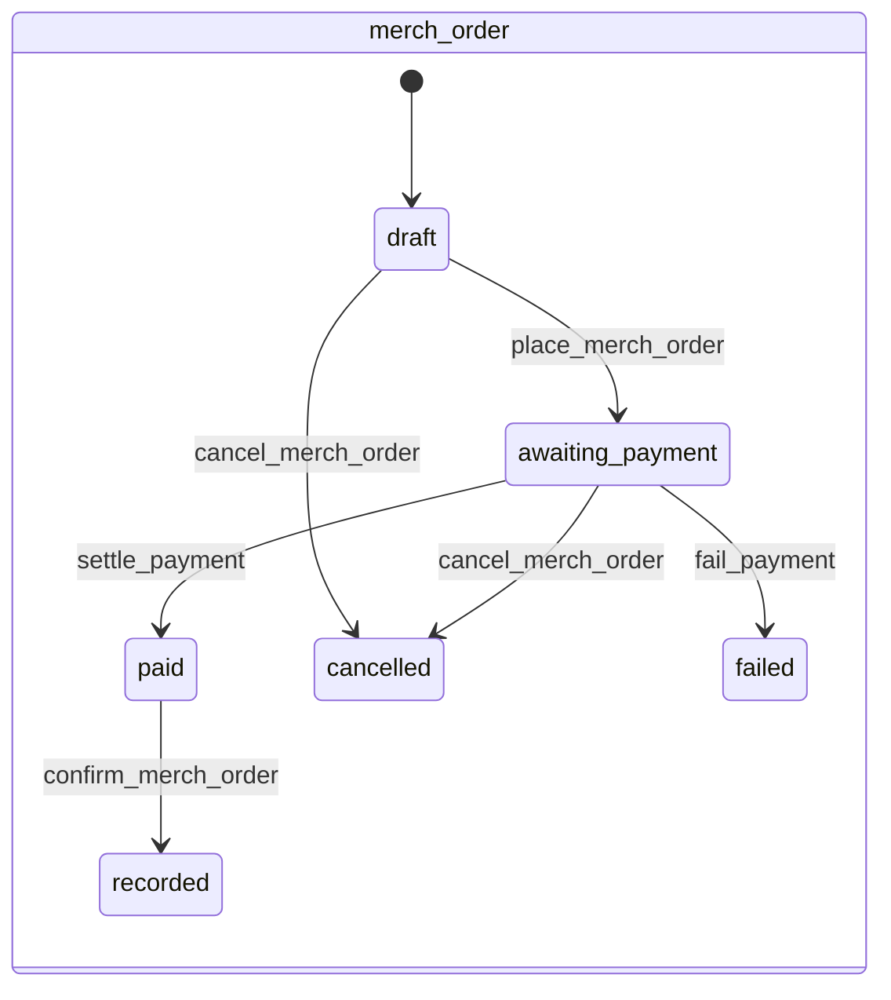
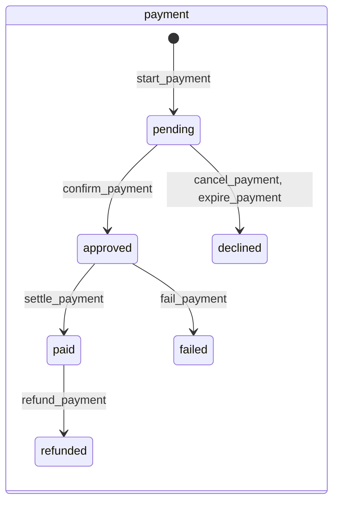

# BandIt post-event purchasing with Nessie

Saved from https://claude.ai/artifact/6LDUWRmJwJQghgiUqaM6Ke, last updated 2026-10-24.

Nessie is BandIt's bank for post-event merch. Each attendee gets a Nessie customer and checking account at sign-up, each vendor gets a Nessie merchant, and each merch order becomes one Nessie purchase.

SpacetimeDB holds every order and payment row and runs every state change as a reducer. The Rust `bandit-workers` process is the only code that calls Nessie, and it reports results back through reducers. Names match the Payments-Nessie and Merch system design docs. Track context: [Capital One Best Use of Nessie winners](https://claude.ai/artifact/5cjM7zJAoeVgRSSKg1CnTT).

## Architecture

The app talks only to SpacetimeDB. Workers subscribe to new jobs, call Nessie or Claude, and write results back through reducers, so every change reaches the app live.

No SpacetimeDB procedure calls Nessie. Procedures are still beta and cannot hold a transaction while an HTTP request is open, so they stay off the live path.

## Who owns what

SpacetimeDB decides, the worker executes, and Nessie keeps the money record.

| Part | Owns | Never does |
| --- | --- | --- |
| SpacetimeDB (`bandit-module`) | All live state: orders, payments, bank links, merchants, timers. Every state change is a reducer. Pushes updates to the app. | Calls Nessie |
| `bandit-workers` (Rust) | Every Nessie call through `nessie-client`, as `nessie_onboard`, `nessie_purchase` and `nessie_payout` jobs. 60 s leases, 3 attempts, request id recorded before any retry. | Writes state except through reducers |
| Claude (`claude-client`) | Merch designs from the attendee's spacetime summary and the event's `merch_product` rows | Moves money |
| Nessie | Customers, checking accounts, merchants, purchases, deposits, and the balance shown on stage | Holds BandIt state |
| Attendee web app | Cart, designs, and the approve button (`confirm_payment`, `confirm_mode` app, since bands are returned) | Talks to Nessie |

## Data mapping

Every BandIt money object has one Nessie twin, and `payment.nessie_ref` stores the twin's id. Version 0.1 uses no Nessie transfers.

| BandIt | SpacetimeDB row | Nessie object | Created by | Nessie call |
| --- | --- | --- | --- | --- |
| Attendee | `bank_link` (customer + account ids) | Customer + Checking account with a seeded balance | `nessie_onboard` at sign-up, then `complete_bank_link` | `POST /customers`, `POST /customers/{id}/accounts` |
| Vendor | `merchant` | Merchant, a directory record only | `register_merchant` | `POST /merchants` |
| Merch order | `merch_order` + `payment` (direction purchase, ref_kind merch_order) | Purchase on the attendee's account | `nessie_purchase` | `POST /accounts/{id}/purchases`, then `GET /purchases/{id}` |
| Merch refund | `payment` (ref_kind merch_refund) | Deposit to the attendee | `nessie_payout` | `POST /accounts/{id}/deposits` |
| Product and design | `merch_product`, `designs` | None | Bright Data `import_event` bundle, Claude | None |

A purchase carries `merchant_id`, `medium` balance, `purchase_date`, `amount` and a `description`. Put the BandIt order id in the description so a retry can find an earlier post. Price merch in whole dollars, because Nessie truncates cents.

## Purchase flow

One tap to approve. Everything after it runs in the worker and lands in the app live.

If the post fails three times, the worker calls `fail_payment` and the order shows as failed, ready to retry.

## Order and payment states

The order and its payment move together. Each arrow is one reducer, so every transition is a single SpacetimeDB transaction.

`payment_timer` drives `expire_payment` for a payment nobody approves. A refund posts a Nessie deposit through `nessie_payout`.

## Setup, failures and the pitch

Nessie was live on Oct 24, 2026, but 2026 teams hit key outages and slow responses, so plan for both.

**At sign-up and event setup**

- `nessie_onboard` creates the attendee's customer and checking account, then `complete_bank_link` stores the ids.
- `register_merchant` creates one Nessie merchant per vendor.
- There is no seeding service. Retries and the reaper reconcile anything that failed.

**When a call fails**

- **No double charges.** Nessie has no idempotency keys, so a retry first looks for an earlier purchase with the same order id in its description before posting again.
- **Leases.** A job holds a 60 s lease and gets 3 attempts. The reaper picks up expired leases and reconciles them against Nessie.
- **Read back.** A purchase counts as settled only after `GET /purchases/{id}` returns it.

**For judging**

- **Get the API key now** and onboard the test attendees before judging.
- **Keep a test `nessie-client`** that replays recorded responses, behind one flag, as Bitcamp's TerpWallet did.
- **Show the money move.** After settling, read the account back so the app can show the balance dropping on stage. This is the one addition to the current design.
- **Bring proof.** Run `bandit-sim` with a crowd placing orders at once, and show zero double charges.

## Sources

- [Nessie docs and API](http://api.nessieisreal.com/)
- [SpacetimeDB procedures](https://spacetimedb.com/docs/procedures)
- [Capital One Best Use of Nessie winners](https://claude.ai/artifact/5cjM7zJAoeVgRSSKg1CnTT): Runway, Atlantis and Weenie Beanie for the Nessie quirks
- BandIt system design docs: Payments-Nessie, Merch, Rust-Backend (System Design folder)
