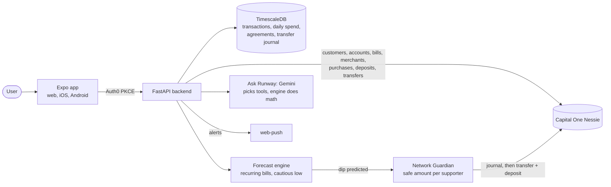
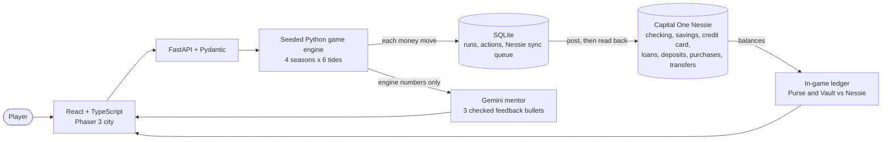
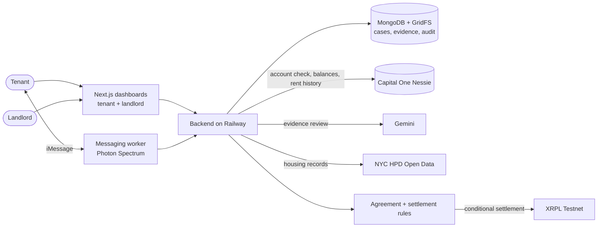

# Capital One "Best Use of Nessie" winners

Saved from https://claude.ai/artifact/5cjM7zJAoeVgRSSKg1CnTT, last updated 2026-10-24.

## TL;DR

Cal Hacks 13.0's Capital One prize is "[Capital One] Best Use of Nessie": 1 winner, $300 Giftogram per person, and no written brief. Capital One ran the same-titled track at four fall 2026 hackathons. Winners are posted for three: [Runway](https://devpost.com/software/runway-57dpic) (SwampHacks XII), [Atlantis - The Long Night](https://devpost.com/software/atlantis-the-long-night) (Technica 2026) and [RentEscrow](https://devpost.com/software/rentescrow-nthfwb) (DivHacks 2026).

All three make Nessie the money layer for one real situation: a shortfall before payday, a survival game, and disputed rent. Every money move is a Nessie record. AI explains or reviews, but deterministic code moves the money.

## Same track at recent hackathons

HackHarvard 2026 matches Cal Hacks most closely: same title, 1 winner, $300 Giftogram each. Its winner is not posted yet. Technica 2026 and SwampHacks XII share one written brief. DivHacks 2026 used the title over the broad finance brief, so RentEscrow is the weakest match.

| Event | Dates | Prize title | Brief | Winners | Prize | Winner |
| --- | --- | --- | --- | --- | --- | --- |
| [Cal Hacks 13.0](https://cal-hacks-13-0.devpost.com/) | This weekend | [Capital One] Best Use of Nessie | Title only | 1 | $300 Giftogram each | You |
| [HackHarvard 2026](https://hackharvard2026.devpost.com/) | Oct 16–18, 2026 | Best Use of Nessie | "How will you reimagine banking?" Use Nessie this weekend | 1 | $300 Giftogram each | Not posted yet |
| [Technica 2026](https://technica-2026.devpost.com/) | Oct 17–18, 2026 | [Capital One] The Best Use of Nessie | Reimagine banking with an app that creatively integrates Nessie's endpoints | 2 | $250 Giftogram each | Atlantis - The Long Night |
| [SwampHacks XII](https://swamphacks-xii.devpost.com/) | Oct 16–18, 2026 | Capital One - The Best Use of Nessie! | Same as Technica | 1 | $1,000 cash | Runway |
| [DivHacks 2026](https://divhacks-2026.devpost.com/) | Sep 26–27, 2026 | Capital One [The Best Use of Nessie] | Any finance tool, Nessie optional | 2 | $250 Giftogram each | RentEscrow |

Cal Hacks judges on application, intentionality, functionality, creativity and technical complexity. Technica's gallery also marks [Treasure Dive](https://devpost.com/software/treasure-dive) a winner, built on Nessie purchases, but its page does not name the prize.

## Is Nessie still live?

Yes. On Oct 24, 2026 the [Nessie docs page](http://api.nessieisreal.com/) loaded and `GET /atms` returned live ATM records.

- Base URL is `http://api.nessieisreal.com`. The API key goes on every request as `?key=`.
- Keys come from signing in with GitHub on the docs site.
- Customer endpoints act on data you created. `/enterprise/*` endpoints are read-only views of everything.
- Capital One still runs a dedicated "Best Use of Nessie" track, at five events this fall including Cal Hacks.

Two 2026 teams hit reliability problems. [O'Girl Bank](https://devpost.com/software/o-girl-bank) (WEHack 2026) "could not retrieve API key due to service issues" and pivoted to synthetic statements. [TerpWallet AI](https://devpost.com/software/terpwallet-ai) (Bitcamp 2026) presented from a cached snapshot of its seeded Nessie account, behind a test-mode flag. Get the key on day one, seed early, and keep a snapshot fallback.

Sandbox quirks the fall 2026 winners designed around:

- **Cents get truncated.** Runway stores amounts as integer cents.
- **Transfers have no recipient.** Runway pairs a transfer on the sender with a deposit on the receiver.
- **No idempotency keys, and balances lag new posts.** Runway journals each transfer before sending and reconciles unclear results instead of retrying. [Weenie Beanie](https://devpost.com/software/weenie-beanie) (SwampHacks XII) keeps a step log with automatic refunds.
- **Slow responses.** Atlantis queues every write, reads it back to confirm, and caches responses so play continues.

## 1. Runway: forecast the dip, get covered by friends

[Runway](https://devpost.com/software/runway-57dpic) won "Capital One - The Best Use of Nessie!" ($1,000) at [SwampHacks XII](https://swamphacks-xii.devpost.com/) (Oct 16–18, 2026). It forecasts a checking balance 30 days out, warns before a shortfall, and pulls cover from pre-approved family or friends. Team of 3.

Every cover, repayment and send is a real Nessie transfer plus a matching deposit. Repayment runs automatically after a verified paycheck.

**What made it win**

- **Uses most of Nessie.** Seven resource types, and every money move is a verified sandbox transaction.
- **One specific moment.** Running short before payday, caught before it happens.
- **Money movement done right.** A write-ahead journal, reconciliation instead of blind retries, and locks against double pays.
- **Trustworthy AI.** A grounding guard drops any dollar figure the engine did not produce.
- **Proof, not claims.** 570+ tests, 0 unsafe transfers across 2,000 generated test networks, and a backtested forecast.
- **Privacy by design.** Supporters see only what they covered and when it is repaid.

## 2. Atlantis - The Long Night: a finance survival game on Nessie

[Atlantis - The Long Night](https://devpost.com/software/atlantis-the-long-night) won "[Capital One] The Best Use of Nessie" at [Technica 2026](https://technica-2026.devpost.com/) (Oct 17–18, 2026). An underwater city sinks at year end, and your money decides whether you board the last ship. Team of 4.

Each class gets checking, savings and a credit card in Nessie. Wages and sales are deposits, market spending is purchases, moving money or paying the card is a transfer, and guild loans are loans.

**What made it win**

- **Every Nessie resource has a game meaning.** Accounts, loans, deposits, purchases and transfers all map to player moves.
- **Real barriers as classes.** No credit history, inherited debt, unpaid care work, and irregular income without savings.
- **Lessons through consequence.** Passage cost rises each season, so idle coin loses ground. "Modern Mirror" names the real concept behind each mechanic.
- **Nessie is verified, not assumed.** Writes are queued, read back, and reconciled against the in-game ledger.
- **AI on a leash.** Gemini writes only three feedback bullets, checked for filler, length and numbers the engine did not produce.
- **Tuned and shipped.** A bot test harness balances thousands of seeded games, and the game is live.

## 3. RentEscrow: hold disputed rent until repairs are verified

[RentEscrow](https://devpost.com/software/rentescrow-nthfwb) won "Capital One [The Best Use of Nessie]" at [DivHacks 2026](https://divhacks-2026.devpost.com/) (Sep 26–27, 2026). Tenants and landlords log repairs, share evidence and message, while disputed rent waits in escrow until the repair is confirmed. Team of 4.

Nessie verifies the account and supplies balances and rent history. Escrow balances in the app are test values, and settlement runs only after signed agreements and rule checks pass.

**What made it win**

- **A concrete, painful story.** Inspired by a Brooklyn dispute that ended with about $24,000 returned by court order.
- **Money tied to proof.** Rent releases only after the repair, the evidence and the tenant's confirmation line up.
- **Strict payment authority.** Gemini reviews evidence, but rules and signed agreements decide settlement.
- **One connected workflow.** Report, review, confirmation and settlement in one prototype, plus iMessage.
- **Public data for credibility.** NYC housing records back each case.

## Patterns and what BandIt should borrow

The three winners share four habits. Each maps Nessie resources onto one real situation, verifies every Nessie write, keeps AI away from moving money, and shows proof through tests or scripted runs.

**What BandIt should borrow**

- **Give each Nessie resource a BandIt meaning.** Attendee is a customer with a checking account, vendor is a merchant, merch order is a purchase, refund is a deposit.
- **Verify every post.** Record the request before sending, read the purchase back, and reconcile instead of retrying blindly.
- **Agent proposes, code pays.** Claude designs the merch from the spacetime map. Money moves only after the attendee approves.
- **Lead with one concrete moment.** Your hands were full at the show, so you buy the shirt with your friends on it afterwards.
- **Show the money move on stage.** The attendee taps approve and the Nessie balance drops live.
- **Bring proof.** A scripted crowd placing orders, with zero double charges.

## Sources

- [Nessie docs and API](http://api.nessieisreal.com/)
- Track pages: [Cal Hacks 13.0](https://cal-hacks-13-0.devpost.com/), [HackHarvard 2026](https://hackharvard2026.devpost.com/), [Technica 2026](https://technica-2026.devpost.com/), [SwampHacks XII](https://swamphacks-xii.devpost.com/), [DivHacks 2026](https://divhacks-2026.devpost.com/)
- Winner write-ups: [Runway](https://devpost.com/software/runway-57dpic), [Atlantis - The Long Night](https://devpost.com/software/atlantis-the-long-night), [RentEscrow](https://devpost.com/software/rentescrow-nthfwb) and its [repo](https://github.com/mujtaba-atif/divhacks1)
- Nessie quirks and reliability: [Weenie Beanie](https://devpost.com/software/weenie-beanie), [O'Girl Bank](https://devpost.com/software/o-girl-bank), [TerpWallet AI](https://devpost.com/software/terpwallet-ai)
